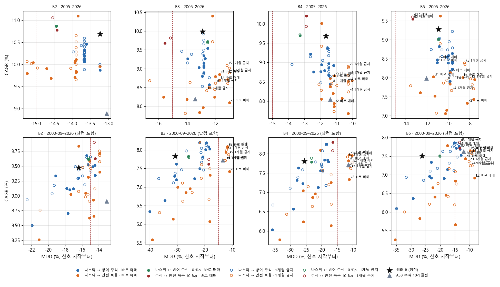
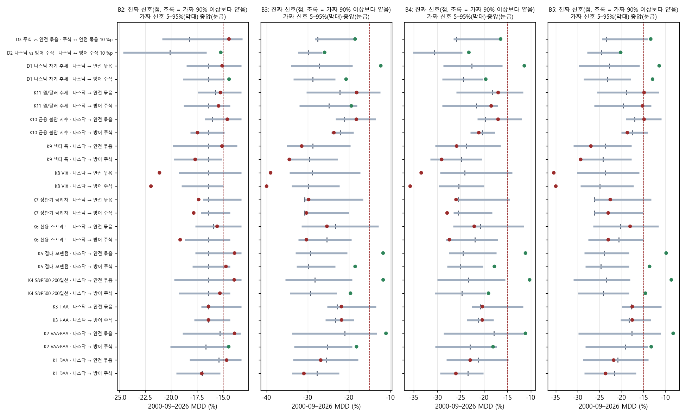
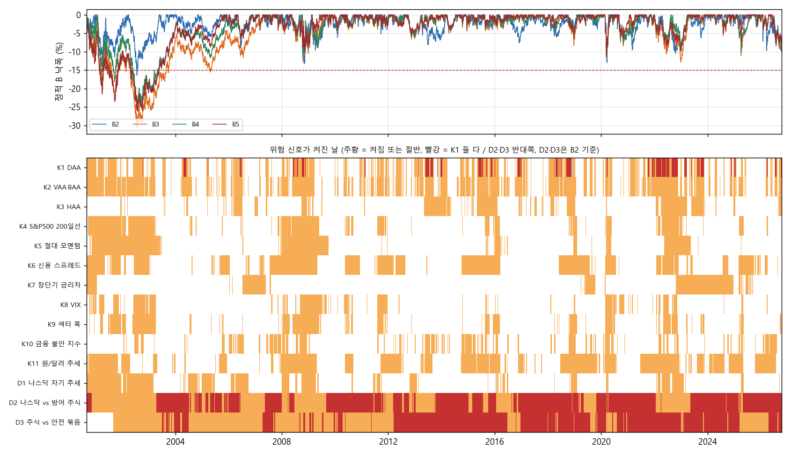
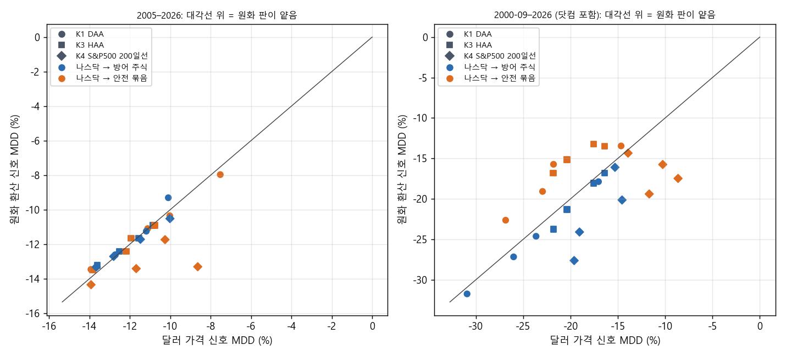

# B2–B5에 카나리아 신호로 동적 배분 얹기 (2026-10-27, DECISIONS A40)

## 왜 했는지

사용자는 2026-10-27 10:04 KST에 두 번째 검증으로 이렇게 요청했다. "해당 종목 구성과 비율에 대해 카나리아 자산군 도입으로 동적 자산배분을 해보는 거야. … 이미 다양한 신호가 퀀트 트레이딩에서 알려져 있을 거거든? 최소 8가지 이상에 대해 테스트할 수 있도록 구성해봐." 매매 방식도 정했다. "매매는 정기 리밸런싱에 더하지 말고, 신호가 바뀐 순간 기준으로 해줘. … 그 경우를 일단 해주고, 추후에 다시 1개월 재매매 금지 규칙 같은 걸 넣어서 다시 해줘."

배경은 A37·A38이다. B2–B5는 2005–2026에는 MDD −15% 안이지만, 2000-09부터 돌리면 닷컴 하락장에서 B2 −16.4%, B3 −30.8%, B4 −25.6%, B5 −26.2%로 선을 넘는다. A38의 10개월 필터는 이것을 고쳤지만 연 1.6–1.8 %p를 냈고, 사용자는 그 필터 판을 등록하지 않았다. 이번 질문은 B2–B5의 비중은 그대로 두고, 퀀트에서 알려진 위험 신호 14개 중 무엇이 그 비용을 줄이면서 닷컴형 하락을 막는지다. 신호마다 진짜 정보인지, 아니면 "나스닥을 평균적으로 덜 든 효과"인지도 가렸다. 그래서 같은 수익을 내는 정적 배분, 그리고 신호 날짜를 1년 이상 밀어 낸 가짜 신호 200개와 비교했다.

설계와 판정은 실행 전에 설계 문서(https://claude.ai/artifact/7AyPtvA6372TwXaSJFYxPq)에 고정했고, 사용자가 11:09 KST에 "둘 다 이대로 진행"으로 승인했다. 계산은 연구실 컴퓨터에서 돌렸다. 경로 44,162개를 1.6분에 처리했다.

## 핵심 결과

**한 줄 답.** 미국 주식의 추세가 꺾이면 나스닥100을 안전 묶음으로 옮기는 신호는 B3·B4·B5에서 다섯 판정을 모두 통과했다. 이 신호들은 S&P500 200일선(K4), S&P500 12개월 절대 모멘텀(K5), VAA·BAA의 네 카나리아(K2), 나스닥100 자기 200일선(D1)이다. 두 기간 모두 MDD가 −8 – −14%이고, 같은 수익의 정적 배분과 가짜 신호보다 분명히 얕다. 대가는 2005–2026 CAGR 연 0.8–2.0 %p(중앙 1.2 %p, 늦게 시작한 D3 두 행 제외)로, A38 필터(1.6–1.8 %p)보다 조금 작다. B2에는 통과한 신호가 없다. 매크로 신호(신용 스프레드·장단기 금리차·VIX), 섹터 폭, 금융 불안 지수, 원/달러, DAA, HAA도 하나도 통과하지 못했다.

**판정 통과 수.** 208개 조합 = 배분 4 × (카나리아 11 × 행동 2 + D1 × 2 + D2 + D3) × 판 2(바로 매매 / 1개월 금지)다.

| 판정 | 내용 | 통과 |
|---|---|---:|
| 1 | 2005–2026 MDD −15% 안 | 200 |
| 2 | 2000-09–2026 MDD −15% 안(신호가 늦게 시작하면 그날부터) | 53 |
| 3 | 이웃 설정 2개도 1·2 통과, 결정일 이동(0/1/5/10/15거래일) 최악 MDD −20% 안 | 39 |
| 4 | 같은 비용 정적 배분보다 2000-09 MDD가 1 %p 이상 얕음 | 60 |
| 5 | 가짜 신호 200개의 90% 이상보다 얕음 | 66 |
| 1–5 모두 | 후보 | 27 |

**후보 27개는 한 가지 생각에 몰려 있다.** 23개가 "미국 주식 추세가 꺾이면 나스닥을 안전 묶음으로"다(K2·K4·K5·D1 × B3·B4·B5 × 두 판 = 24개 중 B3 · D1 바로 매매만 빠짐). 나머지는 B5에서 D1·K5로 나스닥을 방어 주식으로 옮기는 바로 매매 2개와, B5의 D3 2개다. D3은 신호가 2001-08-30에야 시작돼 닷컴 첫해를 재지 않았으므로 판정 2를 약하게 통과한 것으로 본다. 대표 행은 아래와 같다(정적 = 신호 없는 원래 배분).

| 배분 · 신호 · 판 | 2005–2026 | 2000-09–2026 | 연 신호 매매 | 가짜보다 얕음 |
|---|---|---|---:|---:|
| B3 정적 | 9.99% / −12.9% | 7.84% / −30.8% | 0 | |
| B3 · K5 → 안전 · 1개월 금지 | 9.09% / −11.2% | 8.00% / −12.1% | 1.4 | 99.5% |
| B3 · K4 → 안전 · 바로 매매 | 8.70% / −11.7% | 8.07% / −11.7% | 6.2 | 100% |
| B4 정적 | 9.69% / −11.7% | 7.80% / −25.6% | 0 | |
| B4 · K5 → 안전 · 1개월 금지 | 8.90% / −10.3% | 7.91% / −11.7% | 1.4 | 98.5% |
| B4 · K4 → 안전 · 바로 매매 | 8.51% / −10.3% | 7.95% / −10.3% | 6.2 | 100% |
| B5 정적 | 9.28% / −10.9% | 7.51% / −26.2% | 0 | |
| B5 · K5 → 안전 · 1개월 금지 | 8.39% / −8.5% | 7.57% / −9.2% | 1.4 | 99.5% |
| B5 · K4 → 안전 · 바로 매매 | 8.01% / −8.6% | 7.65% / −8.6% | 6.2 | 100% |
| 비교: 안정형 40 정적 | 8.67% / −11.8% | 8.02% / −13.7% | 0 | |
| 비교: A38 B4 + 주식 10개월선 | 8.05% / −11.4% | 7.72% / −11.4% | 매월 판단 | |

닷컴을 넣은 긴 기간(2000-09–2026)에서 후보의 CAGR은 정적 원래 배분과 거의 같다(−0.6 – +0.4 %p, 중앙 0.0). 그러면서 MDD를 −26 – −31%에서 −8 – −14%로 줄였다. 2005–2026만 보면 연 0.8–2.0 %p를 낸다. 비용을 치른 수익은 신호 없는 안정형 40과 비슷하거나 조금 낮다(2005– 중앙 −0.2 %p, 2000-09– 중앙 −0.3 %p). 대신 MDD는 2000-09부터 0.1–5.5 %p(중앙 2.5) 얕다. A38(주식 10개월선 → CD)의 같은 배분과 비교하면 2005–2026 CAGR이 중앙 0.4 %p 높고(−0.7 – +1.6), MDD는 두 기간 모두 중앙 1.1 %p 얕다.

**같은 비용 정적 배분과 가짜 신호를 이긴다는 것이 핵심이다.** 같은 비용 정적 배분은 나스닥 비중의 일부 x를 영구히 같은 곳으로 옮긴 고정 비중이다. x는 2005–2026 CAGR이 신호 행과 같아지도록 정했다. 후보의 이 정적 배분은 2000-09 MDD가 −10.2 – −23.2%로, 신호보다 1.4–11.1 %p(중앙 5.7) 깊다. 가짜 신호는 진짜 신호의 상태 열을 1년 이상 원형으로 밀어 낸 것이다. 그래서 켜져 있는 날의 비율과 길이는 같고 날짜만 다르다. 후보의 진짜 신호는 가짜 200개의 97–100%보다 얕았다. 두 비교 모두 "나스닥을 덜 든 효과"가 아니라 시점이 맞았다는 뜻이다. 다만 그 시점은 닷컴처럼 1–2년 이어진 하락장에서 맞았고, 2005년 이후의 짧은 위기에서는 효과가 작다.

**2005년 이후의 효과는 작고 비용은 꾸준하다.** 후보 27개를 정적 원래 배분과 비교한 중앙값으로 보면 다음과 같다. 2005–2026 CAGR −1.2 %p, 2016–2026 CAGR −1.3 %p다. 2016–2026 MDD는 1.3 %p 얕다. 위기 낙폭은 2008 1.4 %p, 2020 3.3 %p, 2022 1.7 %p 얕다. 2020처럼 한 달 만에 끝난 하락은 200일선·12개월 신호가 늦게 켜지고 늦게 꺼진다. 그래서 낙폭을 크게 줄이지 못하고 반등 일부를 놓친다(추론, 날짜별로 확인하지 않았다).

**B2에는 후보가 없다.** B2는 정적으로도 2000-09 MDD가 −16.4%로 선에 가깝다. 신호 52개 중 17개가 판정 2를 넘겼지만, 같은 비용 정적 배분이 신호와 같거나 더 얕다(예: K4 → 안전 묶음 −13.9% 대 같은 비용 정적 −13.3%). B2에서 판정 4를 넘은 행은 52개 중 4개뿐이고, 판정 2를 넘은 행의 가짜 신호보다 얕은 비율은 대부분 86–94%로 90% 기준 근처다. B2의 낙폭을 정하는 것은 골드선물 35%이고(A39 ①), 나스닥 19%의 타이밍은 작은 몫이다.

**통과하지 못한 신호들.** 아래 신호들은 후보가 0개다.

- K6 신용 스프레드, K7 장단기 금리차: 2000-09 MDD 중앙 −22 – −25%. 나스닥 하락과 시점이 맞지 않았다.
- K8 VIX ≥ 25: 2000-09 MDD 중앙 −32 – −35%로 가짜 신호 대부분보다도 나빴다. 공포가 커진 바닥 근처에서 나스닥을 팔고, 잠잠해진 뒤 다시 사는 쪽으로 작동한 것으로 보인다(추론).
- K9 섹터 폭, K10 금융 불안 지수, K11 원/달러 추세: 판정 2·4·5를 거의 넘지 못했다.
- K1 DAA(VWO·BND 모멘텀): 바로 매매에서 연 31번 매매하고, 21일 안에 되돌린 매매가 21년간 612번이다. 1개월 금지에서도 2000-09 MDD가 −18%대다.
- K3 HAA(TIP 모멘텀): 신호가 2001-06에 시작해 닷컴 앞부분이 빠졌는데도 2000-09 MDD가 −18 – −19%다.
- D2(나스닥 ↔ 방어 주식 10 %p 기울이기): B3–B5에서 가짜 신호는 이겼지만, 10 %p로는 닷컴을 막지 못해 2000-09 MDD가 −20 – −26%다.

**1개월 금지(신호 매매 뒤 21거래일 동안 신호를 따르지 않음)는 매매를 1/3로 줄이고, 후보는 거의 그대로다.** 연 신호 매매는 K1 31.5 → 8.3, K2 24.0 → 7.7, K4 6.2 → 2.6, K5 4.5 → 1.4, D1 7.4 → 2.9로 줄었다. 후보 수는 바로 매매 14, 1개월 금지 13이다. 매매가 잦은 K2는 1개월 금지 판의 CAGR이 오히려 0.6–0.8 %p 높다(B3 8.10 → 8.89%). K4와 D1은 반대로 0.1–0.35 %p 낮다. 편도 비용을 20bp로 올리면 후보의 CAGR이 0.05–0.86 %p 줄지만(가장 큰 것은 K2 바로 매매), MDD는 모두 −13.7% 안에 남는다.

**신호를 미국 ETF 달러 가격으로 읽은 이유를 자료로 확인했다.** K1·K3·K4를 원/달러로 환산한 가격으로 다시 돌렸다. 후보 신호인 K4(S&P500 200일선)는 원화로 읽으면 2000-09 MDD가 평균 5 %p(배분에 따라 0.4–8.9 %p) 깊어지고 CAGR도 평균 0.2–1.3 %p 낮아졌다(예: B4 → 안전 묶음 −10.3 → −15.7%). 원화로 읽으면 환율 움직임이 주가 추세에 섞여, 원화 약세가 주가 하락을 가리는 위기 때 신호가 늦게 켜지기 때문으로 보인다(추론). K1·K3의 안전 묶음 판은 원화로 읽으면 2000-09 MDD가 평균 4 %p 얕았지만 CAGR이 최대 1.8 %p 낮았고, 방어 주식 판은 1 %p 깊었다. 원화 판은 점검용이라 판정 1–5로 매기지 않았다.

**규칙에 따른 다음 단계.** 판정 1–5를 모두 넘은 27개 행을 설계대로 프리셋 후보로 제안한다. 등록은 사용자가 정한다. 지금의 프리셋은 상품 코드 → 비중만 담는 정적 배분이다. 그래서 신호 판을 등록하려면 연구실 엔진과 화면에 카나리아 신호를 넣는 작업이 먼저 필요하다. 등록 전에는 A32식 2단계 흔들기(밴드·비용·시작 연도·이웃)를 고른 한 행에 다시 하는 것이 정직한 순서다. 사용자는 2026-10-27에 **아무것도 등록하지 않고 기록만 남기기로** 정했다(B4 신호 판 2단계 시험과 B 평균 추가도 하지 않음). 정적 프리셋(탐색 B2·B4)과 그 설명은 그대로 둔다.

## 그림

같은 그림을 연구실 앱 '실험 기록' 페이지(`aalab://experiments`)의 A40 항목에서도 볼 수 있다. 그곳의 그래프는 마우스를 올리면 값이 나온다. PNG 원본은 `2026-10-27_canary/figures/`에 있다.

1. 
   위 줄은 2005–2026, 아래 줄은 2000-09–2026이고 칸마다 배분 하나다. 검은 별이 정적 원래 배분, 회색 삼각형이 A38 필터 판이다. 채운 원은 바로 매매, 빈 원은 1개월 금지다. 파랑은 나스닥 → 방어 주식, 주황은 나스닥 → 안전 묶음이다. 빨간 점선이 −15%다. 아래 줄 B3·B4·B5에서 주황 원 몇 개가 선 오른쪽 위로 떨어져 나온 것이 후보다(이름표 = 신호와 판).
2. 
   2000-09–2026 MDD다. 회색 막대는 가짜 신호 200개의 5–95% 범위, 눈금은 그 중앙값이다. 점은 진짜 신호이고, 초록은 가짜 90% 이상보다 얕았다는 뜻이다. B3–B5의 K2·K4·K5·D1 → 안전 묶음이 막대 오른쪽 끝 밖에 있다.
3. 
   위는 정적 B2–B5의 고점 대비 낙폭이고, 아래는 신호마다 위험 상태가 켜진 날(중심 설정)이다. 2000–2003의 긴 낙폭 동안 K4·K5·D1은 거의 내내 켜져 있다. K7 장단기 금리차는 2006–2007, 2019, 2022–2024처럼 나스닥 하락과 다른 때 켜진다.
4. 
   K1·K3·K4를 달러 가격(가로)과 원화 환산 가격(세로)으로 읽었을 때의 MDD다. 대각선 아래는 원화 판이 깊다는 뜻이다. 2000-09 칸에서 K4(마름모)가 대각선 아래에 몰려 있다.

## 시험한 배분, 신호, 매매 규칙

**배분.** B2–B5는 A39와 같고 비중을 바꾸지 않았다. 신호가 없을 때는 분기 말 종가로 판단해 다음 거래일 종가에 원래 비중으로 되돌린다. 밴드는 없고 편도 10bp다. 가격은 실제 가격 우선이다(상장 후 실제 국내 가격, 상장 전 미국 대용 × 원/달러 모형, 2005년 이전은 A37 ④의 이어 붙인 대용 자료).

- B2: 나스닥100 19 · 필수소비재 19 · 헬스케어 6 · 미국10년(H) 10 · 미국30년(H) 6 · 투자등급회사채 5 · 골드선물(H) 35
- B3: 나스닥100 33 · MSCI선진국 12 · 미국10년(H) 10 · 물가채 7 · KRX금현물 12 · CD금리 20 · 달러선물 6
- B4: 나스닥100 30 · 필수소비재 11 · 투자등급회사채 8 · KRX금현물 15 · CD금리 36
- B5: 나스닥100 32 · KODEX 200 4 · 골드선물(H) 17 · CD금리 35 · 달러선물 12

**세 묶음과 행동.** 사용자가 본 대로 각 배분을 묶음으로 나눴다. 공격 = 나스닥100, 방어 주식 = 필수소비재·헬스케어, 안전 묶음 = 채권·금·CD금리·달러선물이다. MSCI선진국과 KODEX 200은 움직이지 않는다.

- **나스닥 → 방어 주식**: 위험 상태에서 나스닥100 비중을 배분이 가진 방어 주식의 비율대로 옮긴다. B3·B5처럼 방어 주식이 없으면 필수소비재·헬스케어 반반으로 산다.
- **나스닥 → 안전 묶음**: 나스닥100 비중을 그 배분의 안전 묶음에 비례해 옮긴다. 그래서 안전 묶음에는 금도 들어 있다. 예를 들어 B4는 회사채 8 : KRX금 15 : CD금리 36의 비율로 옮긴다.
- K1은 두 카나리아 중 하나가 음수면 나스닥의 절반, 둘 다면 전부를 옮긴다. D2·D3는 두 묶음 중 약한 쪽에서 강한 쪽으로 10 %p를 기울인다.

**신호 14개.** 각 신호는 중심 설정과 이웃 2개(괄호)로 돌렸다.

| 신호 | 출처 | 위험 조건 | 읽는 값 |
|---|---|---|---|
| K1 DAA | Keller & Keuning 2018 | VWO·BND의 13612W 모멘텀이 음수 (12m, 6m) | 미국 ETF 달러 |
| K2 VAA·BAA | Keller & Keuning 2017, Keller 2022 | SPY·EFA·EEM·AGG 13612W 중 하나라도 음수 (12m, 6m) | 미국 ETF 달러 |
| K3 HAA | Keller & Keuning 2023 | TIP 13612U 음수 (12m, 6m) | 미국 ETF 달러 |
| K4 S&P500 200일선 | Faber 2007의 일간판 | SPY 종가 < 200일 평균 (150, 250) | 미국 ETF 달러 |
| K5 절대 모멘텀 | Antonacci 2014 | SPY 12개월 총수익 < 단기국채 12개월 수익 (9, 15) | 미국 ETF 달러 |
| K6 신용 스프레드 | 추세 연구실 블록 | BAA10Y > 200관측일 평균 (150, 250) | FRED, 하루 늦게 |
| K7 장단기 금리차 | Estrella & Mishkin 1998 | T10Y3M < 0 %p (−0.25, +0.25) | FRED, 하루 늦게 |
| K8 VIX | 추세 연구실 블록 | VIXCLS ≥ 25 (20, 30) | FRED, 하루 늦게 |
| K9 섹터 폭 | Keller & Keuning 2016(PAA)의 폭 개념 | 미국 9개 섹터 ETF 중 200일선 아래 ≥ 5개 (4, 6) | 미국 ETF 달러 |
| K10 금융 불안 지수 | Kritzman & Li 2010 | SPY·EFA·EEM·AGG 마할라노비스 거리 10일 평균 > 직전 3년 80분위 (75, 85) | 미국 ETF 달러 |
| K11 원/달러 추세 | 한국 신호 | 원/달러 > 200일 평균 (150, 250) | FRED DEXKOUS |
| D1 나스닥 자기 추세 | 보유 상품 | 나스닥100 원화 종가 < 200일 평균 (150, 250) | 원화 |
| D2 나스닥 vs 방어 주식 | 보유 상품 | 12개월 원화 수익률이 약한 쪽 → 강한 쪽 10 %p (9, 15) | 원화 |
| D3 주식 vs 안전 묶음 | 보유 상품 | 위와 같음 (9, 15) | 원화 |

늦게 상장한 ETF는 같은 지수의 오래된 펀드로 이어 붙였다(`chains.csv`). VWO·EEM ← VEIEX(1994-05), BND·AGG ← VBMFX(1986-12), EFA ← FSPSX ← VGTSX(1996-04), TIP ← VIPSX(2000-06)다. FSIIX는 받지 못해 VGTSX가 그 자리를 채웠다. 신호 시작일이 2000-09보다 늦은 것은 K3(2001-06-29), K10(2002-01-29), D3(2001-08-30)이다. 이 세 신호는 2000-09 기간의 MDD를 신호 시작일부터 쟀다.

**매매.** 매일 종가로 상태를 읽고, 상태가 바뀌면 다음 거래일 종가에 매매한다(바로 매매). FRED 값은 하루 늦게 쓴다. 1개월 금지 판은 신호 매매 뒤 21거래일 동안 새 신호를 따르지 않는다. 금지가 끝났을 때 신호가 들고 있는 상태와 다르면 그날 매매한다. 분기 말 리밸런싱은 그대로 두되, 그때 들고 있는 상태의 목표 비중으로 맞춘다. 사용자는 "정기 리밸런싱에 더하지 말고"라고 했다. 이 문장은 신호 매매를 분기 말까지 기다리지 말라는 뜻으로 읽었고, 분기 말에 비중을 되돌리는 일은 남겼다(설계 문서에 적고 알렸다).

**비교와 점검.**

- 같은 비용 정적 배분: 위 '핵심 결과'에서 설명했다.
- 가짜 신호: 상태 열을 252행 이상 원형으로 민 것 200개다. 바로 매매 규칙으로 돌렸고, 1개월 금지 행도 같은 가짜 묶음과 비교했다.
- 결정일 이동: 판정 1·2를 넘은 행만 돌렸다. 분기 리밸런싱 날짜를 0/1/5/10/15거래일 옮기고, 두 기간 전체에서 가장 깊은 MDD를 봤다.
- D1–D3: 두 기간 모두 2000-09 원화 패널을 읽는다(가장 긴 이력).
- 신호 시작일이 늦으면 MDD를 그날부터 잰다.
- 엔진 점검: 빠른 시뮬레이터와 `run_allocation`·`simulate`의 상대 차이가 3.7e-14 이하다. 미래 정보가 없는지는 자료를 중간에서 자른 판과 같은 상태가 나오는지로 확인했다(테스트).

## 한계

- 여러 번 시험했다. 208개 조합에서 27개가 통과했다. 다만 통과한 행이 한 생각(미국 주식 추세)에 몰려 있고, 그 이웃 설정(150·250일, 9·15개월, 12m·6m)도 통과했다. 그래서 운 좋은 한 점을 고른 것일 가능성은 줄어든다.
- 추세 규칙들(Faber 2007, Antonacci 2014, Keller 2017)은 닷컴과 2008이 들어 있는 자료로 알려졌다. 그래서 닷컴 통과는 이 규칙들에 대한 독립 시험이 아니다.
- 2005–2026의 상당 부분이 모형 가격이다. A39 ⑤에서 13종 중 11종이 '모형 경고'였다. 2005년 이전은 전부 모형이고 2000년 3–8월은 빠져 있다.
- 2005년 이후의 짧은 위기에서는 신호가 낙폭을 1–3 %p만 줄였다. 다른 모양의 하락(급락 후 급반등, 금과 주식이 함께 떨어지는 해)에 대한 보장은 없다.
- 세금·괴리율·추적오차는 모형에 없다. ISA 안에서는 매매 차익 과세가 없지만, 매매가 잦은 판(K2 바로 매매 연 24번)은 실제 체결 비용이 더 클 수 있다.
- 모든 숫자는 표본 내 결과이며 '승인'이나 '실거래 가능'을 뜻하지 않는다.

## 결과 파일

`2026-10-27_canary/`: `verdicts.csv`(208행, 판정 1–5와 근거 값), `runs.csv.gz`(모든 신호 경로의 지표), `comparators.csv`(정적 B2–B5, 안정형 40, A38 필터 판), `equal_cost.csv`, `placebo.csv.gz`·`placebo_summary.csv`, `bands.csv.gz`(신호가 켜진 날), `rules.csv`(신호 정의와 시작일), `chains.csv`(이어 붙인 펀드), `summary.json`. 실행기 `scripts/aa_canary_study.py`, 도구 `lab/aa_canary.py`, 테스트 `tests/test_aa_canary.py`.
