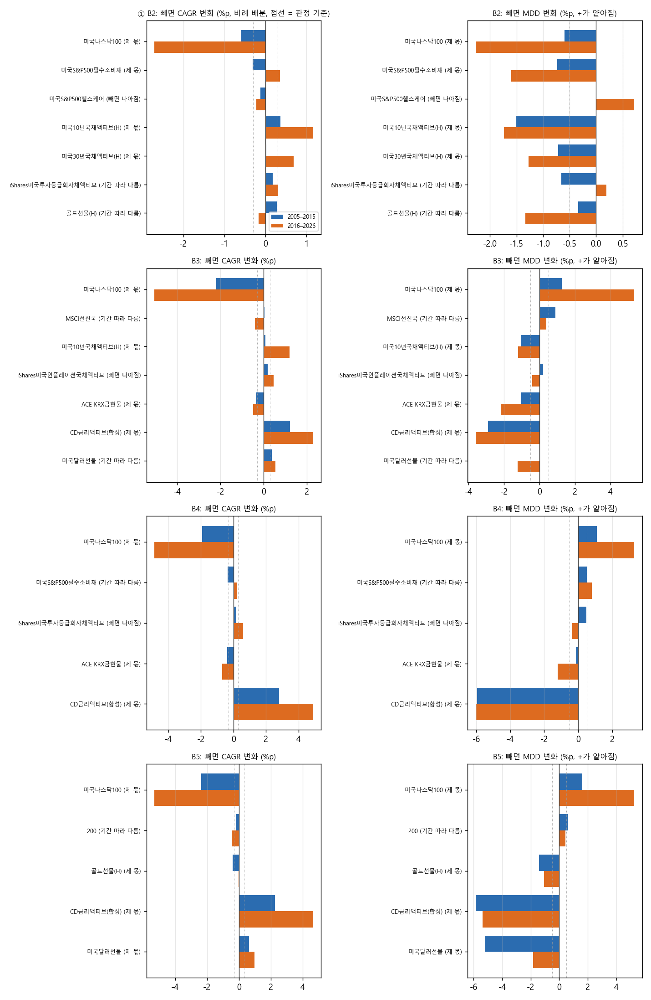
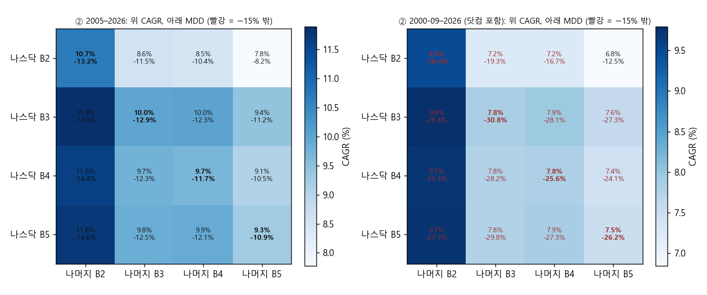
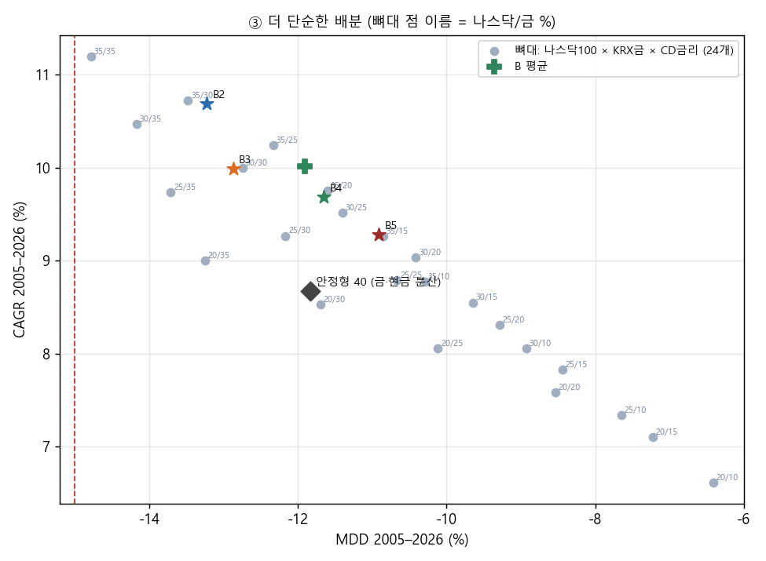
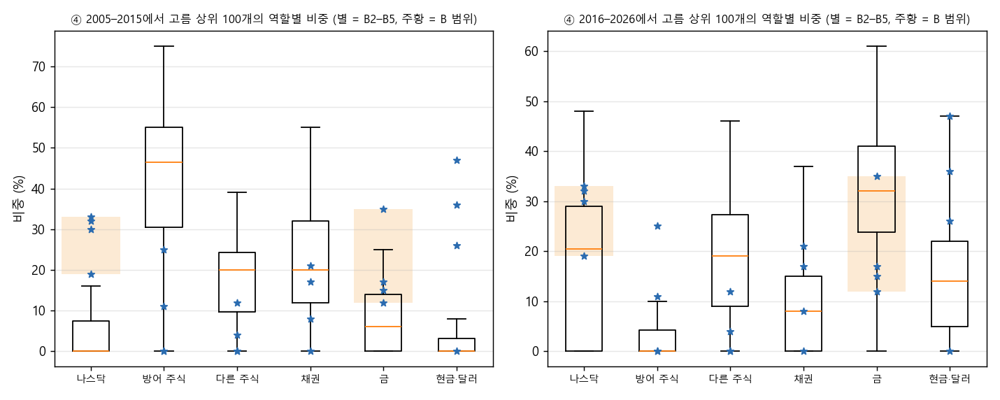
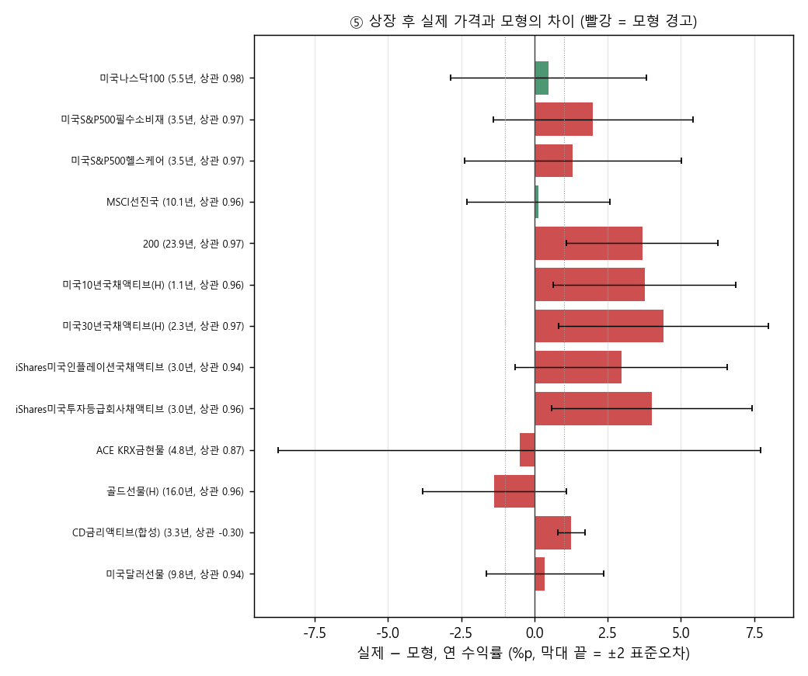

# B2–B5의 종목 구성은 정말 괜찮은가 (2026-10-27, DECISIONS A39)

## 왜 했는지

사용자는 2026-10-27 10:04 KST에 다음 시험의 우선순위를 이렇게 정했다. "가장 보고 싶은 건, 현재 B2~B5 의 종목 구성이 정말로 괜찮은 것인가야. 나스닥은 다 들어있는데 나머지는 꽤 달라서 그래." 네 배분은 A31 전역 탐색이 비슷한 기록을 가진 수만 개 가운데서 고른 것이다. 그래서 나스닥100을 뺀 나머지가 실제로 의미 있는 선택인지, 아니면 서로 바꿔 써도 되는 우연인지가 질문이다.

A37은 B2–B4 주변 비중을 흔들어도 MDD가 거의 변하지 않는다는 것을 보였다. 그러나 그 시험은 "상품 구성이 맞는가"를 묻지 않았다. 이번에는 다섯 가지로 구성을 직접 시험했다. ① 상품 하나씩 빼기, ② 나스닥 비중은 두고 나머지를 다른 배분 것으로 바꾸기(4×4), ③ 더 단순한 배분(네 배분의 평균, 나스닥100 · KRX금현물 · CD금리 세 상품 뼈대 24개), ④ 2005–2026의 한 반기에서 고른 상위 배분이 B2–B5를 다시 뽑는지, ⑤ 각 상품의 모형 가격이 실제 가격과 얼마나 맞는지다. 판정 규칙은 실행 전에 설계 문서(https://claude.ai/artifact/7AyPtvA6372TwXaSJFYxPq)에 고정했고, 사용자가 11:09 KST에 "둘 다 이대로 진행"으로 승인했다. 계산은 연구실 컴퓨터에서 돌렸다(82초).

## 핵심 결과

**한 줄 답.** B2–B5가 공통으로 기대는 재료는 나스닥100, 금, 현금성 자산(CD금리·달러선물·중기 국채)이다. 그 밖의 상품 차이는 2005–2026 기록을 거의 바꾸지 않는다. 세 상품 뼈대(나스닥100 30–35 · KRX금현물 25–30 · CD금리 35–45)가 B2–B5와 같은 성적을 낸다. 나머지 구성의 차이는 수익과 낙폭 사이에서 어디에 앉는지를 정하는 다이얼에 가깝다. 다만 2005–2015와 2016–2026 두 반기 모두에서 상위에 든 것은 B2뿐이다. B3–B5는 나스닥이 강했던 2016년 이후에 맞춘 구성이다.

**① 상품 하나씩 빼기: 나스닥100은 넷 모두에서 '제 몫'이다.** 나스닥100을 빼고 그 비중을 나머지에 비례 배분하면 CAGR이 B2 −1.6, B3 −3.6, B4 −3.4, B5 −3.8 %p 줄어든다. KRX금현물, CD금리, B5의 골드선물(H)·달러선물, B2의 미국10년·30년(H)과 필수소비재도 '제 몫'이다. 두 반기 모두에서 빼면 MDD가 0.5 %p 넘게 깊어지거나 CAGR이 0.3 %p 넘게 준다는 뜻이다. 규칙상 '빼면 나아짐'이 나온 상품은 셋이다. 셋 모두 작은 조각이고 나아지는 폭도 작다.

| 배분 | 빼면 나아짐 (비례 배분) | 전체 기간 변화 | 기간 따라 다름 |
|---|---|---|---|
| B2 | 헬스케어 6 | CAGR −0.17 %p, MDD 그대로(2016–2026만 0.7 %p 얕음) | 회사채 5, 골드선물(H) 35 |
| B3 | 물가채 7 | CAGR +0.32 %p, MDD 0.42 %p 깊음 | MSCI선진국 12, 달러선물 6 |
| B4 | 회사채 8 | CAGR +0.37 %p, MDD 0.35 %p 깊음 | 필수소비재 11 |
| B5 | 없음 | | KODEX 200 4 |

물가채와 회사채는 빼도 그 비중이 금·현금·나스닥으로 나뉘어 수익이 조금 오르고 낙폭이 조금 깊어진다. 두 변화 모두 기준(0.3·0.5 %p) 안이라 '있으나 마나'에 가깝다. B2의 골드선물(H) 35%는 2005–2026에서는 빼도 비슷하지만, 2000-09부터 돌리면 빼는 순간 MDD가 −16.4%에서 −32.0%로 깊어진다. 닷컴 하락장에서 B2를 지킨 것은 금이었다.

**② 나머지 바꾸기: '나머지에 의미 있음'.** 행 배분의 나스닥 비중에 열 배분의 나머지 상품을 같은 비율로 채운 12개 조합을 돌렸다. 2005–2026에서 12개 모두 MDD −15% 안이지만, 5개는 원래 배분보다 CAGR이 0.5 %p 넘게 낮다. 그래서 고정한 규칙으로는 '바꿔 써도 됨'이 아니다. 표를 열(나머지)로 읽으면 다이얼이 보인다. B2의 나머지(방어 섹터·골드선물·채권)는 어떤 나스닥 비중과 짝지어도 CAGR이 가장 높고(11.6–11.9%) MDD가 −15% 선에 가장 가깝다(−14.4 – −14.9%). B5의 나머지(CD금리·골드선물·달러선물)는 MDD가 가장 얕고(−8.2 – −11.2%) CAGR이 가장 낮다. 2000-09부터는 12개 중 11개가 −15% 밖이고, 선 안에 남은 하나는 나스닥이 가장 적은 B2 비중(19%)에 B5의 나머지를 붙인 배분이다(6.8% / −12.5%).

**③ 더 단순한 배분: 'B 평균'과 세 상품 뼈대가 같은 일을 한다.** 판정 기준은 2005–2026 MDD −15% 안이면서 CAGR이 B2–B5 중 가장 낮은 값(B5 9.28%) 이상인지다.

| 배분 | 2005–2026 | 2000-09–2026 | 판정 |
|---|---|---|---|
| B 평균 (13종, 아래 비중) | 10.01% / −11.91% | 8.23% / −24.2% | 같은 일을 한다 |
| 나스닥100 30 · KRX금 30 · CD 40 | 10.00% / −12.75% | 8.20% / −23.2% | 같은 일을 한다 |
| 나스닥100 35 · KRX금 25 · CD 40 | 10.24% / −12.33% | 8.15% / −28.7% | 같은 일을 한다 |
| 나스닥100 35 · KRX금 30 · CD 35 | 10.72% / −13.48% | 8.59% / −28.4% | 같은 일을 한다 |
| 나스닥100 20 · KRX금 35 · CD 45 | 9.00% / −13.25% | 7.81% / −13.25% | 못 미침 (참고) |
| 비교: B2 / B3 / B4 / B5 | 10.69 / 9.99 / 9.69 / 9.28%, −13.2 / −12.9 / −11.7 / −10.9% | −16.4 / −30.8 / −25.6 / −26.2% | |
| 비교: 안정형 40 | 8.67% / −11.83% | 8.02% / −13.7% | |

24개 뼈대 중 8개가 '같은 일을 한다'이다. 나스닥 25–35 · 금 20–35 범위이고, 나스닥이 적을수록 금이 많아야 한다(나스닥 25는 금 35에서만, 30은 금 25 이상, 35는 금 20 이상). 나스닥100 35 · KRX금 30 · CD 35는 B2(10.69% / −13.23%)와 거의 같은 점에 있고, 30 · 30 · 40은 B3와 같은 점에 있다. 2000-09부터는 나스닥이 25% 이상인 뼈대가 모두 −15%를 넘는다(−17.5 – −29.8%). 나스닥 20% 뼈대만 선 안에 남지만(−12.8 – −14.0%), 2005–2026 CAGR이 6.6–9.0%로 기준에 못 미친다.

B 평균의 비중(정수 %, 최대 잔여법)은 나스닥100 29 · 필수소비재 8 · 헬스케어 1 · MSCI선진국 3 · KODEX 200 1 · 미국10년(H) 5 · 미국30년(H) 1 · 물가채 2 · 투자등급회사채 3 · KRX금현물 7 · 골드선물(H) 13 · CD금리 23 · 달러선물 4다. 기준을 넘었으므로 설계대로 프리셋 후보로 제안한다. 등록은 사용자가 정한다. 다만 13종을 담고도 세 상품 뼈대와 같은 일을 하므로, 단순함을 원하면 뼈대가 같은 정보를 준다.

**④ 한 반기에서 고르기: 2016–2026에서 고르면 B 구성이 다시 뽑히고, 2005–2015에서 고르면 다른 구성이 뽑힌다.** A31 실제 가격 표본 중 레버리지·가상 상품이 없는 71,031개를 반기마다 다시 매겼다. 한 반기에서 MDD −15% 안 배분 중 CAGR 상위 100개를 고르고, 그 100개를 다른 반기에서 봤다.

- 2005–2015에서 고른 100개는 나스닥 중앙 0%, 방어 섹터 46.5%, 금 6%다. 2016–2026에서 이들의 MDD 중앙은 −18.8%이고 −15% 안은 5%뿐이다.
- 2016–2026에서 고른 100개는 나스닥 중앙 20.5%, 금 32%로 B2–B5 범위(나스닥 19–33, 금 12–35)에 든다. 2005–2015에서는 MDD 중앙 −16.7%, −15% 안 24%다.
- B2는 2005–2015에서 선 안 25,151개 중 CAGR 146위, 2016–2026에서 16,873개 중 279위다. 두 반기 모두 상위 2% 안이다. B3·B4·B5는 2016–2026에서 114·262·282위로 상위 2% 안이지만, 2005–2015에서는 6,535·5,916·11,828위(상위 24–47%)다. 안정형 40은 7,447위와 1,642위다.

어느 반기에서 고르든 다른 반기에서 −15%를 지킨 비율은 5–24%다. "선 안에서 수익 최고"를 고르는 방식이 기간에 민감하다는 A31(PBO 0.87)의 경고가 그대로 나온다.

**⑤ 모형 대 실제: 13종 중 11종이 '모형 경고'다.** A33 표에서 상장 후 실제 가격과 모형(미국 대용 × 원/달러)을 비교했다. 기준은 연 수익 차이 1 %p 이상 또는 월 상관 0.95 미만이다.

- 괜찮음: 나스닥100(실제 − 모형 +0.48 %p/년, 상관 0.98), MSCI선진국(+0.14, 0.96).
- 채권 4종: 실제가 모형보다 연 3.0–4.4 %p 높다. 겹친 기간은 1.1–3.0년이고 차이의 표준오차는 1.6–1.8 %p다.
- 섹터 2종 +1.3–2.0 %p, KODEX 200 +3.7 %p(24년, 원인 미확인).
- 골드선물(H) −1.4 %p(16년). KRX금현물은 차이 −0.5 %p지만 월 상관 0.87이다(국내 금 프리미엄).
- CD금리 +1.3 %p와 달러선물 상관 0.94도 경고에 걸렸다. CD금리는 거의 평평한 시계열이라 월 상관이 뜻이 없다.

2005년부터 상장일까지의 B2–B5 기록은 대부분 이 모형 값이다. 채권과 섹터는 모형이 실제보다 낮아 그 부분은 오히려 불리하게 잡혔을 수 있다. 골드선물(H)은 모형이 높다. 그래서 골드선물 35%인 B2의 모형 구간 수익은 연 0.5 %p 안팎 부풀려졌을 수 있다(35% × 1.4 %p, 추론이며 계산하지 않았다).

**규칙에 따른 다음 단계.** B 평균이 ③을 통과했으므로 프리셋 후보로 제안하고, A40에 다섯 번째 배분으로 넣을지 사용자에게 묻는다(설계에 적은 대로). 뼈대는 정보로만 보이고 제안하지 않는다(규칙에 없다). 사용자는 2026-10-27에 **B 평균을 등록하지 않고, A40에도 넣지 않기로** 정했다(‘등록 없이 기록만’). 기존 프리셋(탐색 B2·B4)과 그 설명은 그대로 둔다.

## 그림

같은 그림을 연구실 앱 '실험 기록' 페이지(`aalab://experiments`)의 A39 항목에서도 볼 수 있다. 그곳의 그래프는 마우스를 올리면 값이 나온다. PNG 원본은 `2026-10-27_composition/figures/`에 있다.

1. 
   배분마다 상품을 하나 빼고 나머지에 비례 배분했을 때의 CAGR(왼쪽)과 MDD(오른쪽, +가 얕아짐) 변화다. 파랑은 2005–2015, 주황은 2016–2026이고 점선이 판정 기준(0.3·0.5 %p)이다. 나스닥 줄의 긴 주황 막대가 2016년 이후 나스닥의 몫이다.
2. 
   행 = 나스닥 비중을 가져온 배분, 열 = 나머지 상품을 가져온 배분이다. 칸에 CAGR과 MDD를 적었고, 빨간 글씨는 −15% 밖이다. 왼쪽 열(B2의 나머지)이 진하고 오른쪽 열(B5의 나머지)이 옅다. 나머지가 수익–낙폭 다이얼처럼 작동한다는 뜻이다.
3. 
   회색 점이 나스닥100 × KRX금현물 × CD금리 뼈대 24개(이름 = 나스닥/금 %)이고, 별이 B2–B5, 초록 십자가 B 평균, 검은 마름모가 안정형 40이다. B2–B5가 뼈대가 이루는 선 위에 그대로 놓여 있다.
4. 
   한 반기에서 고른 상위 100개의 역할별 비중이다. 상자는 100개의 분포, 별은 B2–B5, 주황 띠는 B2–B5의 나스닥·금 범위다. 2005–2015에서 고르면 방어 주식이 주인공이고 나스닥이 없다.
5. 
   상품별 실제 − 모형 연 수익 차이다. 빨강이 모형 경고이고, 가로선은 ±2 표준오차다. 오른쪽에 있을수록 모형이 실제를 낮게 잡았다. KODEX 200, 미국10년·30년(H), 회사채, CD금리는 ±2 표준오차 범위도 0을 넘는다.

## 시험한 배분과 방법

네 배분은 모두 신호 없는 고정 비중이다. 분기 말 종가로 판단해 다음 거래일 종가에 원래 비중으로 되돌리고, 밴드는 없고, 편도 10bp를 뺀다. 가격은 실제 가격 우선이다. 상장 후는 실제 국내 가격(네이버 종가 + 분배금), 상장 전은 미국 대용 ETF × 원/달러 모형이다. 기간은 2005-01-03 – 2026-10-16이고, 2000-09-01부터는 A37 ④의 이어 붙인 대용 자료(2005년 이전은 전부 모형)로 함께 돌렸다.

- **B2** (탐색 B2 프리셋 `gs_b2`): 나스닥100 19 · S&P500 필수소비재 19 · S&P500 헬스케어 6 · 미국10년(H) 10 · 미국30년(H) 6 · 투자등급회사채 5 · 골드선물(H) 35
- **B3**: 나스닥100 33 · MSCI선진국 12 · 미국10년(H) 10 · 미국 물가채 7 · KRX금현물 12 · CD금리 20 · 미국달러선물 6
- **B4** (탐색 B4 프리셋 `gs_b4`): 나스닥100 30 · 필수소비재 11 · 투자등급회사채 8 · KRX금현물 15 · CD금리 36
- **B5** (2단계 표의 `B 레버·가상 없음 (-11,-10]`): 나스닥100 32 · KODEX 200 4 · 골드선물(H) 17 · CD금리 35 · 미국달러선물 12

실행 전에 고정한 판정은 다음과 같다(코드 `lab/aa_composition.py`).

- ① 반기별 변화(뺀 배분 − 원래)로 판정한다. 제 몫 = 두 반기 모두 MDD 0.5 %p 이상 깊어지거나 CAGR 0.3 %p 이상 줄어듦. 있으나 마나 = 두 반기 모두 그보다 작게 움직임. 빼면 나아짐 = 어느 반기도 기준만큼 나빠지지 않고 한 반기 이상 기준만큼 나아짐. 나머지는 기간 따라 다름. 뺀 비중을 나머지에 비례 배분하는 판과 CD금리로 옮기는 판을 둘 다 돌렸고, 요약 판정은 비례 배분 판이다.
- ② 바꿔 써도 됨 = 대각선 밖 12칸이 모두 −15% 안이고, 어느 칸도 그 행의 원래 배분보다 CAGR이 0.5 %p 넘게 낮지 않음. 2005–2026으로 판정하고 2000-09는 참고다.
- ③ 같은 일을 한다 = 2005–2026 MDD −15% 안이고 CAGR ≥ B2–B5 중 최저(9.28%). 뼈대는 나스닥100 {20, 25, 30, 35} × KRX금현물 {10, …, 35}이고 나머지는 CD금리다.
- ④ 다시 뽑힘 = 고른 100개의 나스닥·금 비중 중앙값이 B2–B5 범위(나스닥 19–33, 금 12–35) 안.
- ⑤ 모형 경고 = 연 차이 1 %p 이상 또는 월 상관 0.95 미만. 겹친 기간 1년 미만은 비교 불가.

엔진 점검으로 빠른 시뮬레이터와 `run_allocation`의 상대 차이가 3.4e-14 이하임을 확인했다(2005와 2000-09 두 패널).

## 한계

- 2005–2026의 상당 부분이 모형 가격이다(⑤). 특히 채권·섹터·골드선물(H)은 실제와 연 1–4 %p 어긋난다.
- 2000-09 시험은 2005년 이전이 전부 미국 대용 × 원/달러 모형이고, 2000년 3–8월은 빠져 있다.
- ③의 뼈대와 B 평균은 결과를 본 뒤가 아니라 설계에서 정한 격자다. 하지만 "B2–B5 중 최저 CAGR"이라는 기준 자체가 이미 탐색에서 고른 점들로 정해져 있다.
- 세금·괴리율·추적오차는 모형에 없다. 모든 숫자는 표본 내 결과이며 '승인'이나 '실거래 가능'을 뜻하지 않는다.

## 결과 파일

`2026-10-27_composition/`: `loo.csv`(①), `swap.csv`(②), `simple.csv`(③), `reselect_top.csv.gz`·`reselect_ranks.csv`(④), `model_flags.csv`(⑤), `named.csv`(①–③의 모든 배분과 2000-09 값), `dotcom_proxies.csv`(2005년 이전 대용 시리즈), `summary.json`. 실행기 `scripts/aa_composition_study.py`, 테스트 `tests/test_aa_composition.py`.
