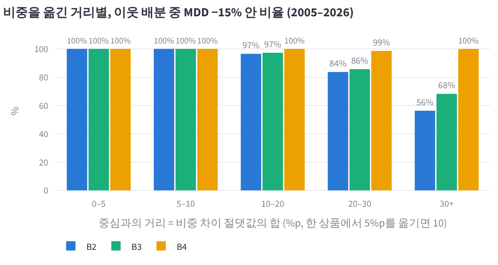
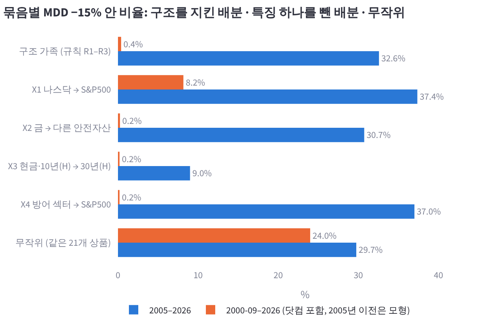
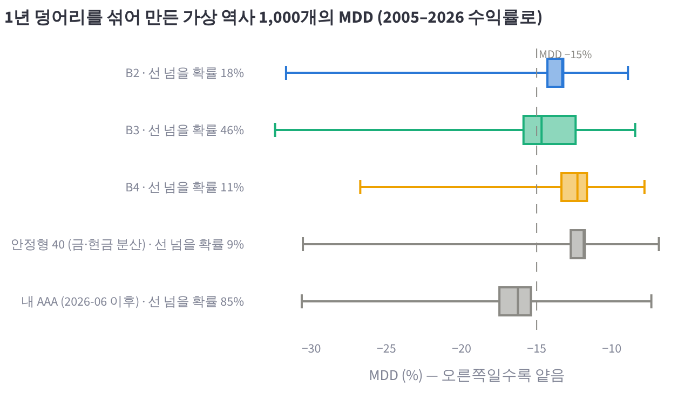
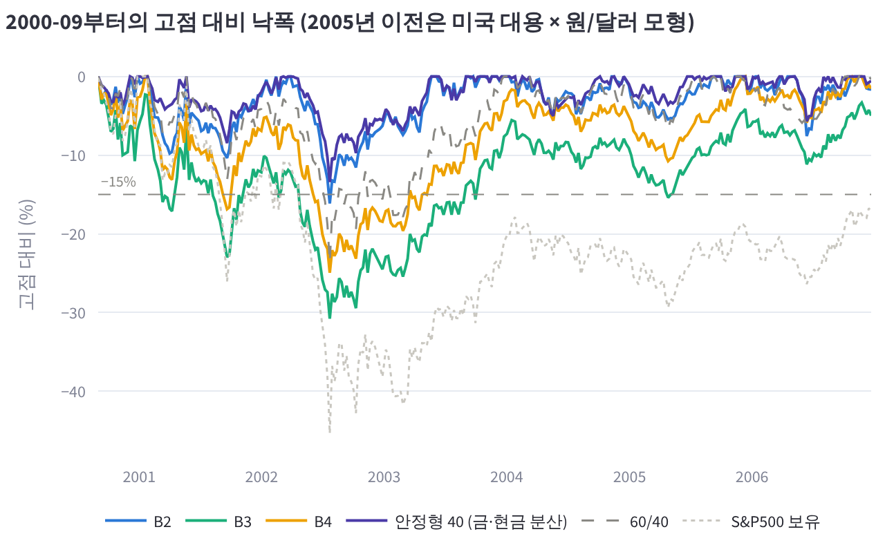
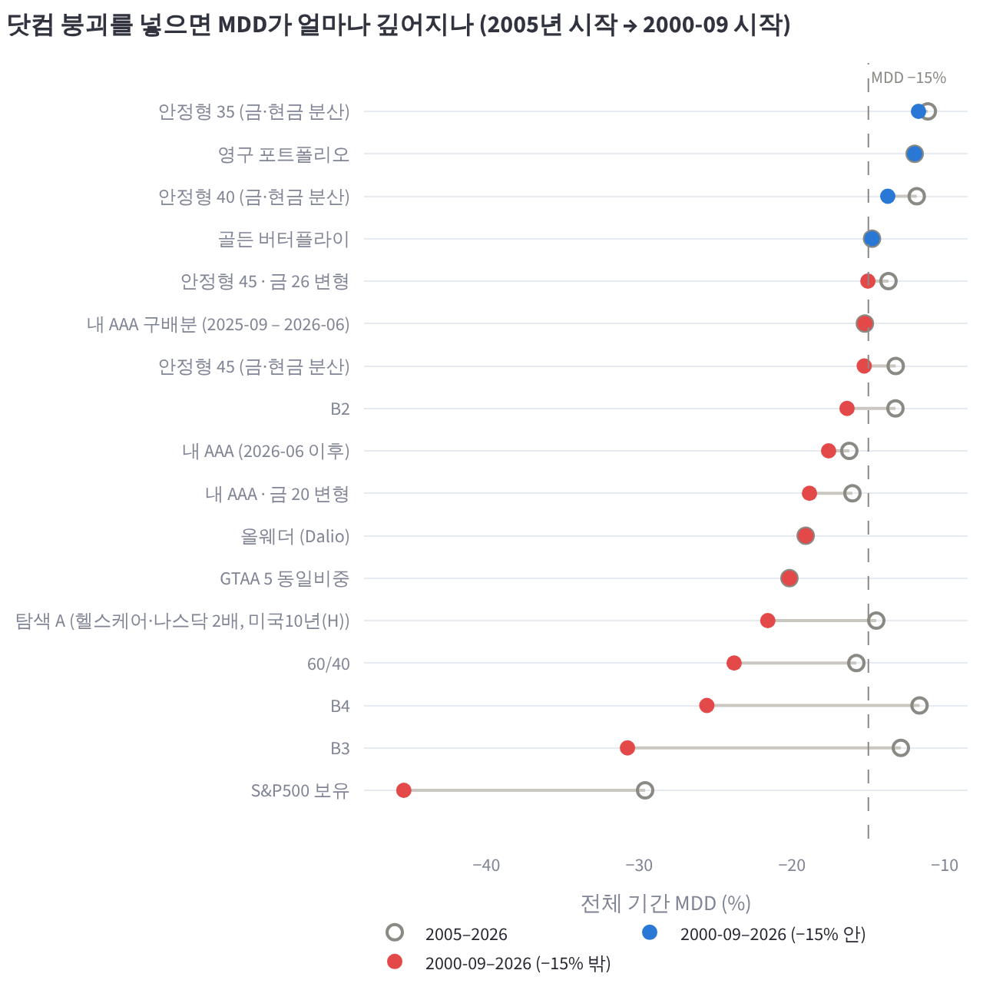

# B2·B3·B4의 공통 구조 검증, 닷컴 붕괴 포함 (2026-10-27, DECISIONS A37)

## 왜 했는지

2026-10-26 밤에 사용자는 B2·B3·B4를 지금까지 가장 믿을 만한 배분으로 정리했다. 세 배분에는 공통 구조가 있다. 주식은 41–45%이고 그 중심이 나스닥100이며, 금을 12–35% 담고, 장기 미국채 대신 CD금리·중기채를 쓴다. 사용자는 "이 구조의 신뢰성을 높이는 작업"을 원했고, 그 방법으로 세 배분 부근의 더 정밀한 탐색을 물었다(23:22 KST).

주변에서 더 좋은 점을 한 번 더 고르는 방식은 쓰지 않았다. A31에서 확인했듯이 "선 위 최고 한 점"을 고르는 규칙은 PBO가 0.87이고, 근처를 더 촘촘히 뒤지면 같은 일을 더 세게 하게 된다. 그래서 점이 아니라 구조를 시험했다. 시험은 네 가지다.

- ① 세 배분 주변이 평평한 고원인지 본다.
- ② 구조를 지킨 배분이 무작위 배분보다 실제로 안전한지 보고, 특징을 하나씩 빼서 무엇이 그 일을 하는지 본다.
- ③ 기간과 순위가 안정한지 본다.
- ④ 2005년 이전으로 넓혀, 이 표본에 없던 닷컴 붕괴를 견디는지 본다.

설계와 판정 규칙은 실행 전에 설계 문서(https://claude.ai/artifact/GdyMEWFZou8mDFJBXdAt4n)에 고정했다. 사용자는 결정 카드에서 "①–④ 모두 (닷컴 포함)"을 골랐다.

## 핵심 결과

**① 고원: 통과.** 세 배분에서 비중을 합계 10 %p 안에서 옮긴 이웃 3,636개는 모두 MDD −15% 안이다. 한 상품에서 5 %p를 떼어 다른 상품에 주면 거리가 10이다. 20–30 %p를 옮겨도 B2 84%, B3 86%, B4 99%가 선 안이다. 다만 같은 역할의 상품 하나를 통째로 바꾸면 선을 넘는 경우가 네 개 있다.

**② 구조가 안전을 만드는가: 실패.** 구조 규칙을 지킨 배분 2만 개 중 −15% 안은 32.6%다. 같은 21개 상품으로 만든 무작위 배분은 29.7%로, 1.1배에 그친다. 고정한 기준은 2배였다. 대신 구조는 수익을 준다. CAGR 중앙값이 10.9%로, 무작위의 7.4%보다 높다. 특징을 하나씩 빼 보면 역할이 갈린다.

- 낙폭을 막는 것은 '장기채 대신 현금·중기채'와 방어 섹터다.
- 나스닥과 금이 하는 일은 수익이다. 나스닥은 선 안 비율을 오히려 4.8 %p 낮춘다.

**③ 기간·순위 안정성: 통과, 단서 있음.** 구조 안에서 고르는 규칙의 PBO는 0.40이다. 무작위는 0.61, 전역 탐색은 0.87이다. 앞뒤 반기의 CAGR 순위 상관은 0.58로 판정 기준을 넘는다. 그러나 MDD 순위 상관은 0.28이다. 1년 덩어리를 섞은 가상 역사에서 −15%를 넘을 확률은 다음과 같다.

| 배분 | −15%를 넘을 확률 |
|---|---:|
| B2 | 18% |
| B3 | 47% |
| B4 | 11% |
| 안정형 40 | 9% |

**④ 닷컴 붕괴: 실패. 가장 무거운 시험이다.** 미국 대용 자료를 이어 2000-09부터 돌리면 세 배분의 MDD가 모두 −15%를 넘는다. 최저점은 셋 다 2002-07-23이다.

| 배분 | 2000-09부터 MDD |
|---|---:|
| B2 | −16.4% |
| B3 | −30.8% |
| B4 | −25.6% |

같은 구조 2만 개 중 선 안에 남는 것은 0.4%뿐이고, 무작위 배분은 24%가 남는다. 등록 프리셋 중 2000-09부터 선 안인 것은 네 개뿐이다.

| 프리셋 | 2000-09부터 MDD |
|---|---:|
| 안정형 35 | −11.7% |
| 영구 포트폴리오 | −12.0% |
| 안정형 40 | −13.7% |
| 골든 버터플라이 | −14.8% |

고정 규칙에 따라 탐색 B2·B4·A 프리셋 설명에 "2005년 이후에만 확인됨"과 닷컴 MDD를 붙였다. 비중은 바꾸지 않았다.

**한 줄 해석.** B2–B4는 2005–2026 안에서 주변까지 평평한 좋은 자리다. 그 구조가 낙폭을 막는 힘은 무작위보다 크지 않고, 나스닥 중심 주식이 길게 무너진 2000–2002에는 견디지 못했다. 이 구조의 강점은 "이 표본의 위기(2008·2020·2022)에 맞는 안전자산 선택"이지, 위기 일반에 대한 보장이 아니다.

## 그림

그래프는 연구실 앱 '실험 기록' 페이지(`aalab://experiments`)의 A37 항목에서 마우스를 올려 값을 볼 수 있다. 같은 그래프를 PNG로 `2026-10-27_local_study/figures/`에도 넣었다.

1. 
   비중을 옮긴 거리별로, 이웃 배분 중 MDD −15% 안 비율을 보인다(①). 10 %p까지는 셋 다 100%다. B4는 30 %p 넘게 옮겨도 무너지지 않는다.
2. 
   묶음마다 −15% 안 비율을 2005–2026(파랑)과 2000-09–2026(주황)으로 나란히 보인다(②·④). 구조 가족은 파랑에서 무작위와 비슷하고, 주황에서는 거의 0이다.
3. 
   1년 덩어리를 섞은 가상 역사 1,000개의 MDD 분포다(③).
4. 
   2000-09부터 2006년까지 고점 대비 낙폭이다(④). B3·B4는 2002년에 −25%를 넘고, 안정형 40만 −15% 위에 머문다.
5. 
   등록 프리셋 전부에 대해, 2005년 시작 MDD가 2000-09 시작으로 바꾸면 얼마나 깊어지는지 보인다(④).

## 시험한 배분

세 배분 모두 신호나 overlay가 없는 고정 비중이다. 분기 리밸런싱(밴드 없음), 편도 비용 10bp이고, 국내 상장 ETF의 원화 수익률로 계산한다. 가격은 '실제 가격 우선'이다. 각 상품이 상장한 뒤에는 실제 국내 가격(네이버 종가 + 분배금)을 쓰고, 그 전은 미국 대용 ETF × 원/달러 모형이다. 보유 상품이 모두 실제 가격이 되는 시점은 B2·B3가 2025-08(미국10년(H) 상장), B4가 2023-10(투자등급회사채 상장)이다. 그러니 2008·2020 위기를 포함한 대부분의 기간은 모형 숫자다.

**B2** (탐색 B2 프리셋 `gs_b2`, 실제 가격 우선 10.69% / −13.23%)

| 상품 | 비중 |
|---|---:|
| 나스닥100 | 19 |
| S&P500 필수소비재 | 19 |
| S&P500 헬스케어 | 6 |
| 미국10년국채(H) | 10 |
| 미국30년국채(H) | 6 |
| 투자등급회사채 | 5 |
| 골드선물(H) | 35 |

주식 44%의 절반 이상이 방어 섹터다. 금이 가장 많고, 그 금은 환헤지 선물이다.

**B3** (프리셋 아님, 9.99% / −12.87%)

| 상품 | 비중 |
|---|---:|
| 나스닥100 | 33 |
| MSCI선진국 | 12 |
| 미국10년국채(H) | 10 |
| 미국 물가채 | 7 |
| KRX금현물 | 12 |
| CD금리 | 20 |
| 미국달러선물 | 6 |

주식 45% 중 나스닥이 73%이고, 안전자산 중 현금성(CD·달러)이 26%다.

**B4** (탐색 B4 프리셋 `gs_b4`, 9.69% / −11.65%)

| 상품 | 비중 |
|---|---:|
| 나스닥100 | 30 |
| S&P500 필수소비재 | 11 |
| 투자등급회사채 | 8 |
| KRX금현물 | 15 |
| CD금리 | 36 |

주식 41%, 현금 36%다.

비교 배분은 다음과 같다.

- 안정형 40: 주식 39(S&P500 25 · 선진국 8 · EM 6) · 미국30년(H) 12 · 미국10년(H) 13 · 금현물 20 · CD금리 16
- 내 AAA: 현재 보유
- ④에서는 등록 프리셋 전부

## 방법

유니버스는 A31 탐색 유니버스에서 레버리지·가상 상품과 KODEX 200을 뺀 21개다. KODEX 200은 실제−모형 차이(연 +3.7 %p) 원인을 확인하기 전이라 뺐다. 비중은 정수 %, 상품당 3% 이상, 최대 10개다. 계산은 A31의 빠른 시뮬레이터(`lab/aa_search.StaticSim`)로 했다. 엔진(`run_allocation`)과의 최대 상대 오차는 3.6e-14다(2000-09 시작은 3.9e-14). 기간은 2005-01-03 – 2026-10-16이다.

**① 이웃 지도.** 중심마다 무작위 이웃 5,000개를 만들었다. 비중을 줄일 상품과 늘릴 상품을 겹치지 않게 고르고, 절반은 새 상품 하나를 들인다. 거리는 L1(비중 차이 절댓값 합, %p)이고 30까지다. 같은 역할 상품 바꾸기도 했다(금선물↔금현물, CD↔달러선물·10년(H), 섹터끼리, 회사채↔물가채↔10년(H), 나스닥→S&P500 등). 판정: 거리 10 이하 이웃의 80% 이상이 선 안.

**② 구조 규칙과 특징 빼기.** 구조 규칙은 세 개다.

- R1: 주식 35–50%, 그중 나스닥 40% 이상
- R2: 금(현물+선물) 10–35%
- R3: 미국30년(H) 6% 이하, 리츠 없음

이 규칙 안에서 '구조 가족' 2만 개를 뽑고, 같은 21개 상품에서 규칙 없이 두 단계 무작위(자산군 → 상품) 2만 개를 뽑았다. 특징 빼기는 가족의 각 배분에서 하나만 바꾼 짝을 만든다.

- X1: 나스닥 → S&P500
- X2: 금 → 다른 안전자산(비례 배분)
- X3: CD금리·10년(H) → 30년(H)
- X4: 방어 섹터 → S&P500

판정: 가족의 선 안 비율이 무작위의 2배 이상이어야 구조가 안전을 만든다고 본다. 특징을 뺐을 때 선 안 비율이 5 %p 미만으로 변하면 그 특징은 '우연'이다.

**③ 시간.** 세 가지를 봤다.

- 2005–2015 대 2016–2026 반기 순위 상관(Spearman)
- 월간 수익률 CSCV PBO. 규칙은 "훈련 반쪽에서 MDD −15% 안 중 CAGR 최대"이고, 가족 안과 무작위 안에서 따로 쟀다.
- 252일 덩어리 순환 블록 부트스트랩 1,000회. 모든 배분에 같은 덩어리를 쓴다.

판정: 가족 PBO < 0.5이고 CAGR 순위 상관 ≥ 0.5. 부트스트랩은 나란히 보여 준다.

**④ 닷컴.** 2005년 이전에 시작하지 않는 대용 ETF는 미국 뮤추얼펀드·금 선물 시리즈로 이어 붙였다. 대체 후보는 실행 전에 고정했고, 대용 ETF의 첫 36개월 월수익률 상관이 가장 높은 것을 쓴다(아래 표). 이렇게 패널을 2000-09-01까지 늘렸다. 판정: B2·B3·B4의 2000-09 시작 MDD ≥ −15%, 그리고 가족의 선 안 비율. ④가 가장 무겁다. 실패하면 프리셋 설명에 "2005년 이후에만 확인됨"을 붙이고, 다음 방향은 사용자가 정한다.

| 대용 | 이어 붙인 시리즈 | 이음 날짜 | 겹친 36개월 월 상관 | 연 평균 차이 (대용 − 시리즈) | 연 추적 차이 |
|---|---|---|---:|---:|---:|
| IEF (미국10년) | VFITX | 2002-07-30 | 0.991 | +1.6%p | 2.2%p |
| TLT (미국30년) | VUSTX | 2002-07-30 | 0.996 | +1.2%p | 1.9%p |
| LQD (회사채) | VFICX (VWESX 0.951) | 2002-07-30 | 0.960 | +2.6%p | 2.7%p |
| TIP (물가채) | VIPSX | 2003-12-05 | 0.995 | −0.1%p | 0.6%p |
| GLD (금) | GC=F 근월물 | 2004-11-18 | 0.998 | −0.4%p | 1.1%p |
| EFA (선진국 외) | VGTSX (FSIIX·VDMIX는 자료 없음) | 2001-08-27 | 0.986 | −1.3%p | 2.8%p |
| EEM (신흥국) | VEIEX | 2003-04-14 | 0.967 | −0.6%p | 4.8%p |

이음은 종가만 바꾼다. 연 평균 차이는 겹친 36개월에서 '대용 ETF − 이어 붙인 시리즈'다. 채권 시리즈는 대용 ETF보다 연 1.2–2.6 %p 낮게 나왔다. yfinance 뮤추얼펀드 조정가의 분배금 처리와 듀레이션 차이를 의심하지만 확인하지 않았다(추론). 이 차이는 2005년 이전 채권 수익을 낮게 잡는 쪽이라, 채권을 담은 배분의 닷컴 낙폭을 조금 깊게 만든다. B2(10년·30년·회사채 21%)라면 연 약 0.36 %p이고, 2000-09부터 최저점까지 약 2년이니 0.7 %p 안팎이다. B2의 −16.4%를 선 안으로 옮기기엔 부족하고, B3·B4는 채권이 적어 영향이 더 작다(추론). 안정형 40처럼 채권이 많은 배분은 실제보다 불리하게 계산된 쪽이다.

## 결과 상세

### ① 이웃 지도 (`neighbour_bins.csv`, `substitutions.csv`)

| 중심 | 거리 0–5 | 5–10 | 10–20 | 20–30 | 30+ | 거리 10 이하에서 가장 나쁜 MDD |
|---|---:|---:|---:|---:|---:|---:|
| B2 | 100% (300) | 100% (982) | 96.5% | 83.6% | 56% (112) | −14.55% |
| B3 | 100% (311) | 100% (980) | 97.3% | 85.6% | 68% (107) | −14.36% |
| B4 | 100% (127) | 100% (936) | 100% | 98.6% | 100% (50) | −13.20% |

CAGR 중앙값은 거리와 상관없이 중심과 거의 같다(B2 10.7%, B3 10.0%, B4 9.6–9.7%). 고원이 평평하다는 뜻이다. 같은 역할 상품 바꾸기 30개 중 선을 넘은 것은 네 개다.

| 중심 | 바꾸기 | CAGR | MDD |
|---|---|---:|---:|
| B2 | 골드선물(H) 35 → KRX금현물 | 11.37% | −17.10% |
| B2 | 필수소비재 19 → 유틸리티 | 10.70% | −15.13% |
| B3 | CD금리 20 → 미국10년(H) | 10.25% | −15.83% |
| B4 | CD금리 36 → 미국달러선물 | 9.74% | −15.52% |

B2의 금은 환헤지 여부가 중요하다. 골드선물(H)는 원/달러 움직임을 지우지만, 금현물은 원화 금값이라 달러 노출을 그대로 받는다. 2008–09에 원/달러가 급등했다가 되돌아올 때 금 35%가 함께 흔들린 것으로 보인다(dd_2008 −17.1%, 추론). B3·B4의 CD금리는 '듀레이션 없는 현금'이라는 역할이 중요하다. 10년(H)나 달러로 바꾸면 2022 금리 상승이나 2008 환율 충격을 받는다.

### ② 구조 규칙과 특징 빼기 (`groups.csv`, `ablations.csv`)

| 묶음 | 수 | −15% 안 | CAGR 중앙 | MDD 중앙 | 2008 창 선 안 | 2020 | 2022 |
|---|---:|---:|---:|---:|---:|---:|---:|
| 구조 가족 (R1–R3) | 20,000 | 32.6% | 10.9% | −16.0% | 58% | 76% | 92% |
| X1 나스닥 → S&P500 | 20,000 | 37.4% | 9.4% | −15.7% | 53% | 57% | 99.8% |
| X2 금 → 다른 안전자산 | 20,000 | 30.7% | 9.2% | −16.6% | 69% | 82% | 70% |
| X3 현금·10년(H) → 30년(H) | 12,208 | 9.0% | 11.1% | −19.4% | 72% | 89% | 47% |
| X4 방어 섹터 → S&P500 | 4,135 | 37.0% | 10.7% | −15.6% | 58% | 72% | 96% |
| 무작위 (같은 21개) | 20,000 | 29.7% | 7.4% | −18.1% | 51% | 50% | 74% |

무작위 2만 개 중 우연히 규칙을 만족한 것은 40개였고, 그중 40%가 선 안이었다.

짝 비교는 같은 배분에서 특징 하나만 바꾼 결과다. X3·X4는 그 특징을 가진 가족만 센다.

| 바꾸기 | 짝 수 | 원래 선 안 | 바꾼 뒤 | 선 안이던 것 중 밖으로 | CAGR 변화 중앙 | MDD 변화 중앙 |
|---|---:|---:|---:|---:|---:|---:|
| X1 나스닥 → S&P500 | 20,000 | 32.6% | 37.4% | 25.5% | −1.60%p | −0.45%p |
| X2 금 → 다른 안전자산 | 20,000 | 32.6% | 30.7% | 31.8% | −1.66%p | −0.88%p |
| X3 현금·10년(H) → 30년(H) | 12,208 | 40.3% | 9.0% | 78.8% | +0.29%p | −3.47%p |
| X4 방어 섹터 → S&P500 | 4,135 | 50.3% | 37.0% | 29.1% | +0.14%p | −0.34%p |

판정 규칙대로 읽으면 이렇다.

- 가족/무작위 비는 1.10배로 2배에 못 미친다. "이 구조가 안전을 만든다"는 주장은 기각한다.
- 특징별로 보면 낙폭을 막는 것은 X3(−31 %p)과 X4(−13 %p)다.
- 나스닥(X1)은 빼면 선 안이 4.8 %p 늘어 '안전에는 해로움'이고, 금(X2)은 −1.8 %p로 '우연' 범위다.
- 나스닥과 금은 둘 다 CAGR을 1.6–1.7 %p 올린다. 이 구조에서 둘은 수익 재료다.

위기 창을 보면 세 특징이 위기마다 반대로 움직인다. 금과 장기채 회피는 2022(금리 상승)에 도움이 되고 2008·2020에는 손해다. 나스닥은 2008·2020에 도움이 되고 2022에 손해다. 이 구조는 2005–2026 표본의 세 위기 사이에서 균형을 맞춘 조합이다.

### ③ 시간 (`halves.csv`, `summary.json`, `bootstrap.csv`)

| 묶음 | CAGR 순위 상관 (앞↔뒤) | MDD 순위 상관 | 앞(2005–15) 선 안 | 뒤(2016–26) 선 안 | 앞 CAGR 중앙 | 뒤 CAGR 중앙 |
|---|---:|---:|---:|---:|---:|---:|
| 구조 가족 | 0.58 | 0.28 | 58% | 48% | 9.1% | 12.7% |
| 무작위 | 0.46 | 0.74 | 47% | 36% | 7.7% | 7.1% |

CSCV PBO(252개 분할)는 다음과 같다.

- 구조 가족: 0.40. 고른 배분의 표본 외 선 안은 69%, 고른 배분은 38종이다.
- 무작위: 0.61. 표본 외 선 안은 40%다.

구조 안에서 고르는 일은 전역에서 고르는 것(0.87)보다 훨씬 덜 과적합된다. 그러나 MDD의 순위는 앞뒤 반기에서 거의 이어지지 않는다(0.28). 수익 순서는 유지되지만 어느 배분이 낙폭이 작은지는 반기마다 바뀐다는 뜻이다.

부트스트랩은 2005–2026 일간 수익률을 252일 덩어리로 다시 섞어 22년짜리 가상 역사 1,000개를 만든 것이다. 실제로 없던 '나쁜 해 두 개 연달아'가 생길 수 있다.

| 배분 | −15%를 넘을 확률 | MDD 중앙 | 하위 10% | 하위 5% |
|---|---:|---:|---:|---:|
| B2 | 17.8% | −13.2% | −16.3% | −17.5% |
| B3 | 46.5% | −14.7% | −18.5% | −20.2% |
| B4 | 10.7% | −12.3% | −15.1% | −16.9% |
| 안정형 40 | 9.1% | −11.8% | −14.7% | −15.9% |
| 내 AAA | 85.4% | −16.2% | −20.6% | −22.5% |

### ④ 닷컴 (`dotcom.csv`, `dotcom_groups.csv`, `dotcom_proxies.csv`)

2000-09-01 – 2026-10-16, 같은 설정이다(분기 리밸런싱, 10bp, 2005년 이후는 위와 같은 실제 가격 우선). 표의 2005~ 칸은 같은 패널에서 2005년부터 다시 잰 값이다.

| 배분 | 2000-09~ CAGR / MDD | 2005~ CAGR / MDD | 최저점 |
|---|---|---|---|
| 안정형 35 | 7.8 / −11.7 | 8.2 / −11.1 | 2002-07-23 |
| 영구 포트폴리오 | 7.7 / −12.0 | 8.2 / −12.0 | 2008-11-03 |
| 안정형 40 | 8.0 / −13.7 | 8.7 / −11.8 | 2002-07-23 |
| 골든 버터플라이 | 8.1 / −14.8 | 8.5 / −14.8 | 2020-03-18 |
| 안정형 45 · 금 26 | 8.5 / −15.0 | 9.3 / −13.7 | 2002-07-23 |
| 내 AAA 구배분 | 8.2 / −15.2 | 8.7 / −15.2 | 2022-12-28 |
| 안정형 45 | 8.1 / −15.3 | 8.9 / −13.2 | 2002-07-23 |
| **B2** | 9.5 / −16.4 | 10.7 / −13.2 | 2002-07-23 |
| 내 AAA | 8.3 / −17.6 | 9.1 / −16.2 | 2002-07-23 |
| 내 AAA · 금 20 | 9.0 / −18.9 | 10.0 / −16.0 | 2002-07-23 |
| 올웨더 | 7.9 / −19.1 | 8.2 / −19.1 | 2022-11-07 |
| GTAA 5 | 9.2 / −20.2 | 9.8 / −20.2 | 2020-03-20 |
| 탐색 A | 10.4 / −21.6 | 12.1 / −14.5 | 2002-07-23 |
| 60/40 | 7.9 / −23.8 | 9.2 / −15.8 | 2002-07-23 |
| **B4** | 7.8 / −25.6 | 9.7 / −11.7 | 2002-07-23 |
| **B3** | 7.8 / −30.8 | 10.0 / −12.9 | 2002-07-23 |
| S&P500 보유 | 9.1 / −45.4 | 12.2 / −29.6 | 2002-07-23 |

| 묶음 | 2000-09~ 선 안 | 닷컴 창(2000-09 – 2003) 선 안 | 2005~ 선 안 | 닷컴 창 낙폭 중앙 |
|---|---:|---:|---:|---:|
| 구조 가족 | 0.4% | 0.7% | 32.6% | −29.5% |
| X1 나스닥 → S&P500 | 8.2% | 10.9% | 37.4% | −19.2% |
| X2 금 → 다른 안전자산 | 0.3% | 0.8% | 30.7% | −30.3% |
| X3 현금·10년(H) → 30년(H) | 0.2% | 1.5% | 9.0% | −28.3% |
| X4 방어 섹터 → S&P500 | 0.2% | 0.3% | 37.0% | −26.8% |
| 무작위 | 24.0% | 56.9% | 29.7% | −13.8% |

닷컴 실패의 주된 원인은 나스닥 비중으로 보인다. 근거는 다음과 같다.

- B2가 셋 중 가장 덜 빠졌다. B2는 나스닥이 19%로 가장 적고, 필수소비재 19%와 금 35%를 담는다. 2000–2002에 금 값은 올랐고 필수소비재는 시장보다 훨씬 덜 빠진 것으로 알고 있다(이 메모에서 섹터별로 따로 재지는 않음).
- 나스닥을 S&P500으로 바꾸면(X1) 닷컴 낙폭 중앙이 −29.5%에서 −19.2%로 얕아진다.
- 나스닥100은 2000-09부터 2002년 저점까지 약 75–80% 빠졌다. 분기마다 30%로 다시 채우면 손실이 계속 쌓인다.

다만 나스닥을 빼도 선 안은 8%뿐이다. 주식 35–50% 자체가 이 하락장에서 −15%를 지키기 어렵다. 반대로 안정형 40은 장기·중기 국채(H)가 25%, 안정형 35는 30%다. 이 국채가 2000–2002 금리 인하 때 올라 낙폭을 막은 것으로 보인다(추론). 이 구조가 피한 장기채는 2022에는 독이었지만 2000–2002에는 해독제였다. 어느 쪽이 맞는지는 위기의 종류(인플레이션·금리 상승 대 성장 붕괴·금리 인하)에 달려 있다. 2005–2026 표본은 앞의 종류(2022)에 더 무게를 줬다.

## 해석과 경쟁 가설

관측된 사실은 넷이다.

- B2–B4 주변은 넓게 평평하다.
- 구조 가족의 MDD 통과율은 무작위와 비슷하다.
- 구조 안 선택은 덜 과적합된다.
- 2000-09부터는 세 배분이 모두 −15%를 넘는다.

이것을 "B2–B4는 2005–2026의 위기 조합에 잘 맞춘 수익형 배분"으로 읽는 것이 가장 단순하다. 경쟁 가설과 그 무게는 다음과 같다.

1. **2005년 이전 모형이 틀렸다.** 원/달러 일별 값(FRED DEXKOUS)은 실제다. 2000–2004 한국은행 기준금리는 출처 대조를 하지 않은 'memory' 값이고, 헤지 상품의 수익에 들어간다. 이어 붙인 시리즈는 월 상관 0.96–0.998이고, 채권 시리즈는 오히려 수익을 낮게 잡는다(위 표). 이런 오차가 B3의 −30.8%를 −15% 안으로 바꿀 크기는 아니다. B2의 −16.4%는 경계에서 1.4 %p 차이라, 모형 오차로 뒤집힐 수 있는 범위다(추론).
2. **시작일이 불리하다.** 2000-09는 나스닥이 3월 고점에서 한 번 빠졌다가 되오른 자리다. 3월에 시작하면 낙폭은 더 깊었을 것이다. 반대로 2002년 이후에 시작하면 닷컴이 빠진다. 2000-09는 금 선물(GC=F) 자료가 허락하는 가장 이른 날이라 고른 것이고, 결과를 본 뒤 바꾸지 않았다.
3. **분기 리밸런싱이 하락장에 계속 사들인다.** 이것은 구조의 일부다. 신호(추세 필터) 없이 고정 비중을 쓰는 한 피할 수 없다.

## 한계

- 2005년 이전은 전부 모형이다: 미국 ETF·뮤추얼펀드·금 근월물 × 원/달러, 두 나라 단기금리, 총보수, 헤지 추가 비용 20bp.
- 2005년 이후도 상장 전 구간은 모형이다(B4 보유 상품은 2023-10부터, B2·B3는 2025-08부터 모두 실제).
- 괴리율, 추적오차, 국내 금 프리미엄, 세금은 모형에 없다.
- EFA 대체는 VGTSX 하나뿐이다(FSIIX·VDMIX는 yfinance에 없음).
- 2026-10-27 ④ 재실행 때 yfinance가 다시 내려준 뮤추얼펀드 이력이 첫 실행과 1e-7 수준으로 달랐다. 선 안 비율과 수는 같았다.
- ④의 비교 대상에 등록 프리셋 전부를 넣은 것은 첫 실행 뒤다. 첫 실행 때 고정한 비교는 안정형 40·내 AAA·60/40·S&P500이었다. 추가된 행은 정보이고 판정에는 쓰지 않았다.
- 모든 결과는 표본 내 연구이며 '승인'이나 '실거래 가능'을 뜻하지 않는다.

## 남은 판단

판정 규칙이 정한 대로, 다음 방향은 사용자가 정한다. 생각할 수 있는 길은 셋이다.

**(가) 신호 overlay.** 주식 부분에 미리 정한 추세 필터(Faber 10개월 이동평균, 연구실의 overlay '추세 필터 10')를 얹는다. 2005–2026과 2000-09–2026 모두에서 같은 판정으로 본다. 파라미터는 문헌값으로 고정해 닷컴에 맞추지 않는다.

**(나) 나스닥 상한.** 구조 가족에 나스닥 상한을 두고 다시 고른다. 닷컴을 통과하는 상한을 고르는 순간 2000–2002도 표본 안이 되어, 남는 표본 외 시대가 없다.

**(다) 지금대로 받아들이기.** "2005년 이후에만 확인됨" 표시를 단 채로 B2–B4를 쓰고, 닷컴형 위기에 대한 보험이 필요하면 안정형 40(2000-09부터 −13.7%)과 섞는 방안을 비교한다.

KODEX 200 실제−모형 차이의 원인 확인도 아직 열려 있다.

## 재현

```
# 연구실 컴퓨터(YYJ), 저장소 루트, 브랜치 claude/aa-local-study
python -m pytest -q tests/test_aa_local.py
python scripts/aa_local_study.py --out docs/research/allocation/2026-10-27_local_study            # ①–③, 약 3.5분
python scripts/aa_local_study.py --dotcom --out docs/research/allocation/2026-10-27_local_study   # ④, 약 1.5분 (뮤추얼펀드·금 선물을 yfinance로 받음)
python scripts/aa_local_study.py --quick --out <임시 폴더>                                         # 1–2분 점검
```

seed 2027이다. 표본 수는 이웃 5,000/중심, 가족 2만, 무작위 2만(자산군 Sobol 2,000 × 상품 10), 부트스트랩 1,000회다. 코드는 `lab/aa_local.py`(표본 추출·특징 빼기·이웃·부트스트랩·대용 이어 붙이기), `scripts/aa_local_study.py`, 테스트 `tests/test_aa_local.py`. 가장 큰 결과 파일은 `structure.csv.gz`(11 MB, 가족·특징 빼기·무작위 전부의 지표와 비중)다.
