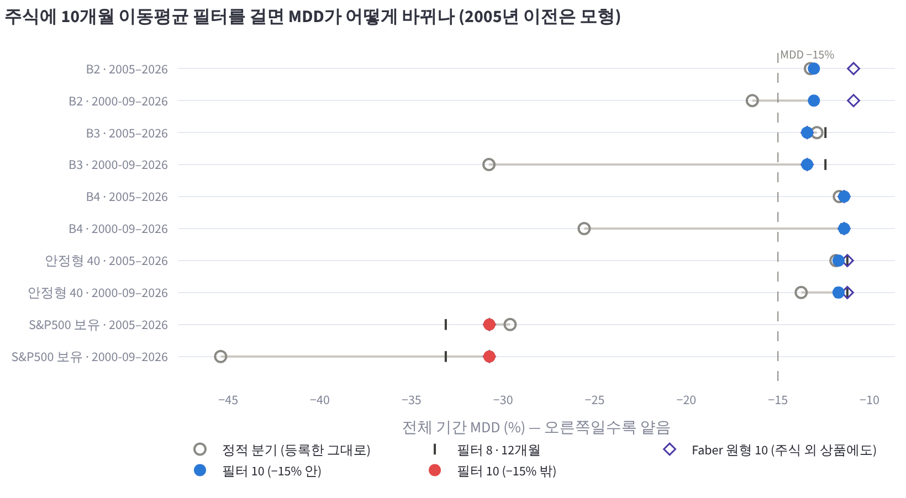
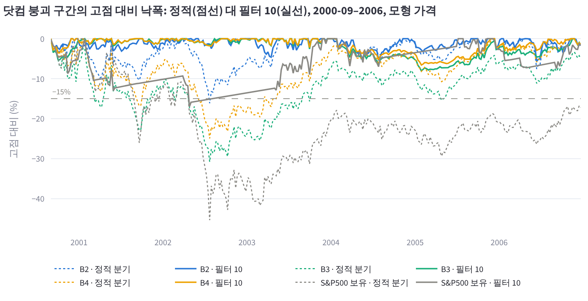
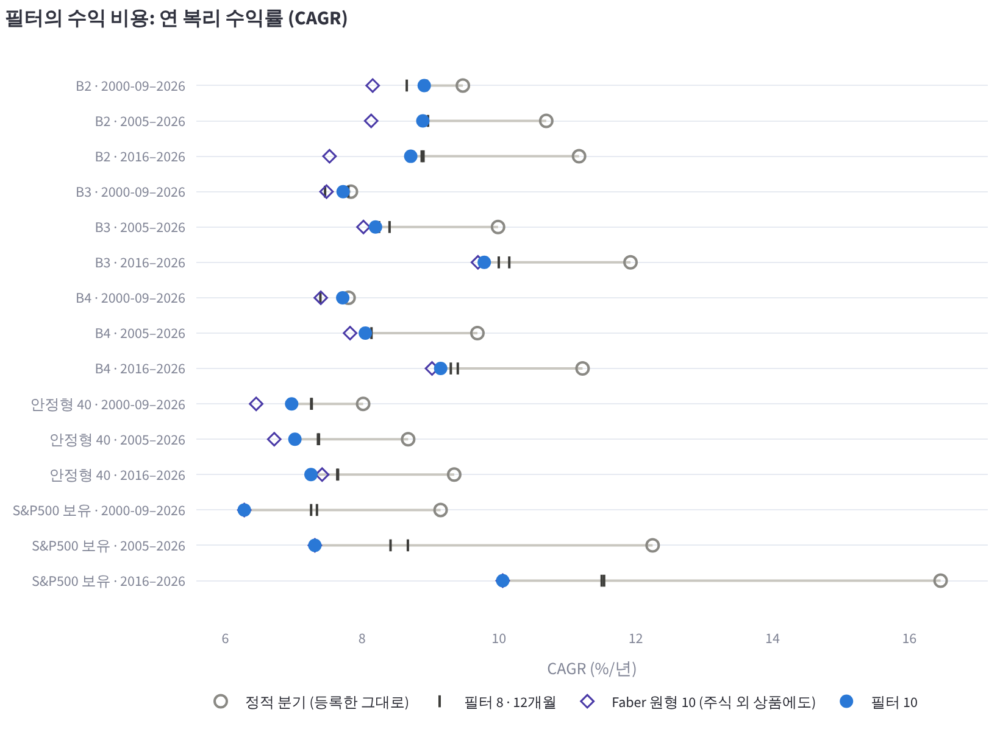
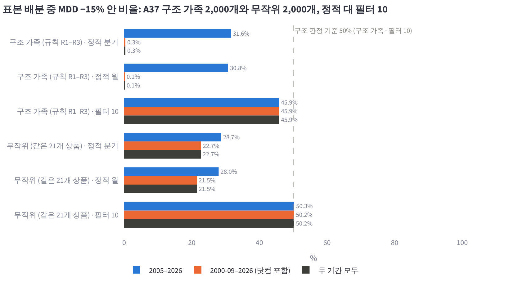

# B2·B3·B4의 주식에 10개월 추세 필터 얹기 (2026-10-27, DECISIONS A38)

## 왜 했는지

A37에서 B2·B3·B4는 2005–2026 안에서는 주변까지 평평한 좋은 자리였다. 그런데 미국 대용 자료를 2000-09까지 이어 붙여 닷컴 하락장을 넣자, 세 배분의 MDD가 −16.4%, −30.8%, −25.6%로 모두 −15%를 넘었다. 최저점은 셋 다 2002-07-23이었다. 나스닥 중심의 주식을 하락장 내내 분기마다 다시 채운 것이 주된 원인으로 보였다.

사용자는 다음 방향 카드에서 "추세 필터를 얹어 시험"을 골랐고, 설계 문서(https://claude.ai/artifact/3PkTmzQJdQESFNhWJvmPne)를 "이대로 실행"으로 승인했다. 질문은 하나다. 비중은 그대로 두고 주식에만 Faber(2007)의 10개월 이동평균 필터를 얹으면, 2005년 시작과 2000-09 시작 두 기간 모두에서 MDD −15% 안에 남는가. 판정 규칙과 필터 길이는 실행 전에 설계 문서에 고정했다.

## 핵심 결과

**점 판정과 필터 견고: 통과.** 필터 10을 얹으면 2000-09부터의 MDD가 세 배분 모두 −15% 안으로 들어온다. 필터 8·12개월에서도 두 기간 모두 선 안이고, 결정일을 1–15거래일 옮긴 최악 MDD도 선 안이다.

| 배분 | 정적 분기 2005– | 필터 10 2005– | 정적 분기 2000-09– | 필터 10 2000-09– | 필터 10 날짜 최악 |
|---|---:|---:|---:|---:|---:|
| B2 | −13.2% | −13.0% | −16.4% | −13.0% | −13.1% |
| B3 | −12.9% | −13.4% | −30.8% | −13.4% | −14.1% |
| B4 | −11.7% | −11.4% | −25.6% | −11.4% | −11.5% |

닷컴 구간(2000-09 – 2003-12)의 낙폭은 B2 −16.4 → −4.7%, B3 −30.8 → −5.3%, B4 −25.6 → −3.7%로 줄었다. 필터를 얹은 뒤에는 세 배분 모두 2000-09 시작 MDD가 2005 시작 MDD와 같다. 가장 깊은 낙폭이 닷컴이 아니라 2008에서 나온다는 뜻이다.

**2005년 이후에는 낙폭을 거의 줄이지 못했다.** 2005–2026 MDD는 B2·B4에서 0.2–0.3 %p 얕아지고 B3에서 0.5 %p 깊어졌다. 위기별로 보면 2008에는 필터가 돕지 못했고(B3 −12.4 → −13.4%), 2020에는 1.5–2.1 %p 얕아졌으며, 2022에는 B3·B4가 얕아지고 B2는 0.5 %p 깊어졌다. 2008에 돕지 못한 이유로 원/달러를 의심한다. 2008에는 원화가 크게 약해져 환노출 미국 주식의 원화 손실이 달러 손실보다 작았는데, 필터는 그 주식을 원화 CD금리로 옮겼다. 이 설명은 확인한 것이 아니라 추론이다.

**수익 비용은 2005–2026에서 연 1.6–1.8 %p다.** 닷컴을 포함한 기간에서는 거의 같다.

| 배분 | 2000-09–2026 정적 → 필터 | 2005–2026 정적 → 필터 | 2016–2026 정적 → 필터 |
|---|---|---|---|
| B2 | 9.5 → 8.9% | 10.7 → 8.9% | 11.2 → 8.7% |
| B3 | 7.8 → 7.7% | 10.0 → 8.2% | 11.9 → 9.8% |
| B4 | 7.8 → 7.7% | 9.7 → 8.0% | 11.2 → 9.1% |

정적 값은 등록 설정인 분기 리밸런싱이다. 필터와 같은 매월 리밸런싱(정적 월)과 비교해도 비용은 2005–2026에서 0.1 %p, 2016–2026에서 0.2 %p 안쪽으로 같다. 2005년 이후 주식 비중의 평균 약 20%가 CD금리에 가 있었다. 주식이 하나라도 꺼진 달은 B2 41%, B3 26%, B4 36%이고, 21년 동안 꺼진 조합이 바뀐 달은 95, 58, 68번이다. 연간 편도 회전율(자산 대비)은 0.08–0.09에서 0.73–0.87로 늘었다. 위 수익은 편도 10bp를 이미 뺀 값이다.

**구조 판정: 실패.** A37의 구조 가족 2,000개 중 필터 10에서 두 기간 모두 −15% 안인 비율은 45.9%로, 고정한 기준 50%에 못 미친다. 같은 21개 상품의 무작위 배분 2,000개에 필터를 얹으면 50.2%다. 필터가 없을 때는 가족 0.3%, 무작위 22.7%였다. 필터를 얹고 나면 구조가 낙폭을 더 막지 않고, 수익만 더 준다. 2005–2026 CAGR 중앙값이 가족 9.2%, 무작위 6.3%다.

**필터 비용을 치른 B는 신호 없는 안정형 40과 비슷하다.** 안정형 40은 필터 없이도 닷컴을 버틴 등록 프리셋이다. 비교하면 다음과 같다.

| 배분 | 2005–2026 | 2000-09–2026 | 2016–2026 CAGR |
|---|---|---|---:|
| 안정형 40 (정적 분기) | 8.7% / −11.8% | 8.0% / −13.7% | 9.3% |
| B2 + 필터 10 | 8.9% / −13.0% | 8.9% / −13.0% | 8.7% |
| B3 + 필터 10 | 8.2% / −13.4% | 7.7% / −13.4% | 9.8% |
| B4 + 필터 10 | 8.0% / −11.4% | 7.7% / −11.4% | 9.1% |

B2 + 필터는 긴 기간에서 안정형 40보다 0.2–0.9 %p 높지만 2016년 이후는 0.6 %p 낮다. 낙폭은 서로 1–2 %p 안이다. 필터 판이 안정형 40을 분명히 앞선다고 말할 근거는 없다.

**점검: S&P500 하나에 필터를 걸면 결정일 운이 크다.** S&P500 보유에 같은 필터를 걸면, 2000-09부터의 MDD는 −45.4 → −30.7%로 줄지만 2005부터는 −29.6 → −30.7%로 오히려 깊어진다. CAGR은 12.2 → 7.3%로 떨어지고, 결정일을 옮기면 MDD가 −39.4%까지 간다. 세 배분에서는 날짜를 옮겨도 MDD가 0.1–0.7 %p만 변한다. 주식이 40% 남짓이고 나머지가 금·채권·현금이라 필터의 타이밍 운이 희석되기 때문으로 보인다.

**규칙에 따른 다음 단계.** 점 판정과 필터 견고를 모두 통과한 B2·B3·B4의 '필터 판'을 프리셋 후보로 제안한다. 등록 여부는 사용자가 정한다. 정적 프리셋(탐색 B2·B4)과 그 설명은 그대로 둔다.

**한 줄 해석.** 필터는 닷컴처럼 길게 이어지는 주식 하락장을 끊었다. 그 대가로 2005년 이후의 상승장에서 연 1.6–1.8 %p를 냈고, 이 표본의 위기(2008·2020·2022) 낙폭은 거의 줄이지 못했다. 비용을 치른 수익은 신호 없는 안정형 40과 비슷하다.

## 그림

그래프는 연구실 앱 '실험 기록' 페이지(`aalab://experiments`)의 A38 항목에 있고, 마우스를 올리면 모든 설정의 값이 나온다. 같은 그래프를 PNG로 `2026-10-27_trend_filter/figures/`에도 넣었다.

1. 
   배분과 기간마다 정적 분기(빈 원)에서 필터 10(채운 원)으로 MDD가 어떻게 바뀌는지 보인다. 막대는 필터 8·12개월, 마름모는 모든 위험자산에 거는 Faber 원형이다. 2000-09 시작의 긴 선이 필터가 한 일이고, 2005 시작 줄에서는 점이 거의 움직이지 않는다.
2. 
   2000-09부터 2006년까지 고점 대비 낙폭이다. 점선이 정적, 실선이 필터 10이다. 5거래일마다 찍은 값이라 일별 MDD보다 조금 얕다. 이 곡선에서 필터를 얹은 세 배분의 최저는 −5.7 / −8.1 / −6.6%이고, 정적은 −16.1 / −30.8 / −24.9%다.
3. 
   세 구간의 CAGR을 정적 분기와 필터 10으로 비교한다. 2005–2026과 2016–2026에서는 선이 길고(비용), 2000-09–2026에서는 짧다.
4. 
   A37 구조 가족과 무작위 배분에서 −15% 안 비율이다. 필터는 두 묶음 모두를 비슷한 수준(46–50%)으로 끌어올린다.

## 시험한 배분과 필터 규칙

세 배분의 비중은 A37과 같고 바꾸지 않았다. 등록 설정은 신호 없는 분기 리밸런싱이다.

- **B2** (탐색 B2 프리셋 `gs_b2`): 나스닥100 19 · S&P500 필수소비재 19 · S&P500 헬스케어 6 · 미국10년(H) 10 · 미국30년(H) 6 · 투자등급회사채 5 · 골드선물(H) 35. 필터 대상은 앞의 세 주식(44%)이다.
- **B3** (프리셋 아님): 나스닥100 33 · MSCI선진국 12 · 미국10년(H) 10 · 미국 물가채 7 · KRX금현물 12 · CD금리 20 · 미국달러선물 6. 필터 대상은 나스닥100과 MSCI선진국(45%)이다.
- **B4** (탐색 B4 프리셋 `gs_b4`): 나스닥100 30 · S&P500 필수소비재 11 · 투자등급회사채 8 · KRX금현물 15 · CD금리 36. 필터 대상은 나스닥100과 필수소비재(41%)다.
- 비교: 안정형 40(S&P500 25 · 선진국 8 · EM 6 · 미국30년(H) 12 · 미국10년(H) 13 · 금현물 20 · CD금리 16), 점검용 S&P500 100.

필터 규칙은 다음과 같다.

- 매월 마지막 거래일에, 주식 상품마다 원화 월말 종가를 최근 10개 월말 종가의 평균과 비교한다. 아래면 그 상품의 기본 비중을 KODEX CD금리액티브(459580)로 옮기고, 위면 기본 비중을 그대로 둔다. 주식이 아닌 상품(금·채권·CD금리·달러선물)은 그대로 둔다.
- 신호 가격은 투자자가 보는 그 상품의 원화 총수익 가격이다. 상장 후에는 실제 국내 가격, 상장 전에는 미국 대용 ETF × 원/달러 모형이다. 환노출 상품은 환율 움직임도 신호에 들어간다.
- 정한 목표 비중으로 다음 거래일 종가에 체결하고, 편도 10bp를 뺀다. 필터를 쓰면 엔진이 매월 목표 비중으로 맞추므로, 같은 주기의 '정적 월'을 같이 돌렸다.
- 월말 종가가 10개가 안 되면 보유로 본다. 신호는 시작일 이전 이력도 쓴다.

설정은 여섯 가지다. 정적 분기(등록 설정), 정적 월, 필터 8·10·12개월(주식만), 그리고 모든 위험자산에 거는 Faber 원형 10(참고용)이다. 표본 묶음은 정적 분기·정적 월·필터 10만 돌렸다.

## 방법

기간은 두 개다. 2005-01-03 – 2026-10-16은 A37 ①–③과 같은 실제 가격 우선 패널이고, 2000-09-01 – 2026-10-16은 A37 ④의 늘린 패널이다. 늘린 패널은 2005년 이전을 미국 ETF·뮤추얼펀드·금 선물을 원/달러로 바꾼 모형으로 채운다. 이어 붙인 시리즈는 A37과 같다.

2000-09 시작 때 주식 상품의 원화 이력은 다음과 같다. 필터가 시작 시점부터 작동하는지 보려고 실행 전에 기록했다.

| 상품 | 대용 | 첫 가격 | 2000-09 전 월말 수 | 시작부터 작동 |
|---|---|---|---:|---|
| 미국S&P500, S&P500(H) | SPY | 1993-01-29 | 93 | 예 |
| 미국나스닥100 | QQQ | 1999-03-10 | 19 | 예 |
| 미국다우존스30 | DIA | 1998-01-20 | 33 | 예 |
| S&P500 유틸리티·필수소비재·헬스케어·에너지 | XLU·XLP·XLV·XLE | 1998-12-22 | 22 | 예 |
| MSCI선진국 | SPY 0.7 + EFA 0.3 | 1996-04-29 | 54 | 예 |
| MSCI EM선물(H) | EEM | 1994-05-04 | 77 | 예 |
| 미국러셀2000(H) | IWM | 2000-05-26 | 5 | 아니오(2001-02 말까지 신호 없이 보유) |

러셀2000(H)은 B2·B3·B4·안정형 40에 없고, 표본 묶음의 일부에만 들어 있다.

표본 묶음은 A37 ②에서 뽑은 구조 가족 2만 개와 무작위 2만 개의 각 앞 2,000개다(seed 2037, 2038). 정적 분기에서 가족의 선 안 비율이 A37의 2만 개(32.6%, 0.4%)와 비슷한 31.6%, 0.3%라 앞 2,000개가 전체를 대표한다고 본다.

모든 실행은 엔진(`lab.aa_engine.run_allocation`)으로 했다. 정적 분기 MDD가 A37과 같은지 실행 전에 점검했고, 같았다(B2 −13.23 / −16.40, B3 −12.87 / −30.77, B4 −11.65 / −25.57%). 실행기는 `scripts/aa_trend_filter_study.py`이고, 연구실 컴퓨터에서 작업자 12개로 3분 48초 걸렸다. 결과 파일은 `2026-10-27_trend_filter/`에 있다.

- `named.csv`: 이름 붙은 배분 × 설정 × 기간. CAGR·MDD·위기 창 낙폭·2016년 이후·날짜 최악 MDD·필터 활동
- `curves.csv.gz`: 2000-09 – 2006 자산 곡선(5거래일마다)
- `samples.csv.gz`, `groups.csv`: 표본 묶음
- `warmup.csv`, `summary.json`(판정)

엔진에는 필터를 걸 상품을 고르는 `Overlay.only`를 더했다. 비워 두면 예전처럼 모든 위험자산에 걸리고, 예전 결과와 저장 기록은 그대로다(테스트 있음).

## 한계

- **이 통과는 필터 길이에 대한 독립 시험이 아니다.** 10개월은 Faber(2007)의 문헌값이고, 그 표본(1973–2005)에는 2000–2002가 들어 있다. 이동평균 필터가 알려진 이유가 바로 닷컴과 2008을 피한 데 있다. 우리는 값을 고르지 않았지만, 닷컴에서 통한다는 것은 예상된 결과에 가깝다. 8·12개월에서도 같이 통과한 것이 칼날 위가 아니라는 근거다.
- **2005년 이전은 전부 모형이다.** 미국 대용·뮤추얼펀드·금 선물 × 원/달러이고, 2000년 3–8월(닷컴 고점 직후)은 빠져 있다. 원화 가격으로 신호를 보므로, 당시 원/달러 움직임이 환노출 나스닥의 신호를 바꿨을 수 있다.
- **긴 하락장은 표본에 한 번뿐이다.** 필터가 비용을 내는 상승장과 도움이 되는 긴 하락장이 앞으로 얼마나 자주 올지는 이 데이터로 알 수 없다. 2008·2020처럼 빠른 위기에서는 이 표본에서도 도움이 적었다.
- **부트스트랩은 하지 않았다.** 필터는 가격 경로를 따라 움직이므로, 필터를 거친 수익률을 섞으면 신호의 논리가 깨진다.
- 매월 확인과 매매가 필요하다(B2는 21년 동안 95번 조합이 바뀜). 세금·괴리율·추적오차·ISA 거래 제약은 모형에 없다. 모든 결과는 표본 내 연구이고 승인이나 실거래 가능을 뜻하지 않는다.

## 남은 판단

- 사용자: B2·B3·B4 '필터 판'을 프리셋으로 등록할지. 등록하면 프리셋이 필터 설정을 함께 갖도록 하고, 리밸런싱 계산기가 이번 달 CD금리로 옮길 주식을 보여 주게 한다. 정적 프리셋은 그대로 둔다.
- 필터 판은 아직 A32식 2단계 흔들기(밴드·비용·시작 연도·이웃 비중)를 거치지 않았다. 이번에 본 것은 필터 길이 8·12와 결정일 이동뿐이다.
