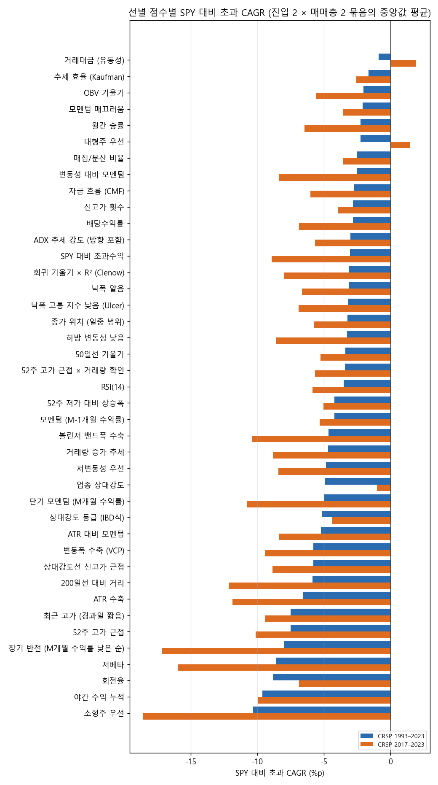
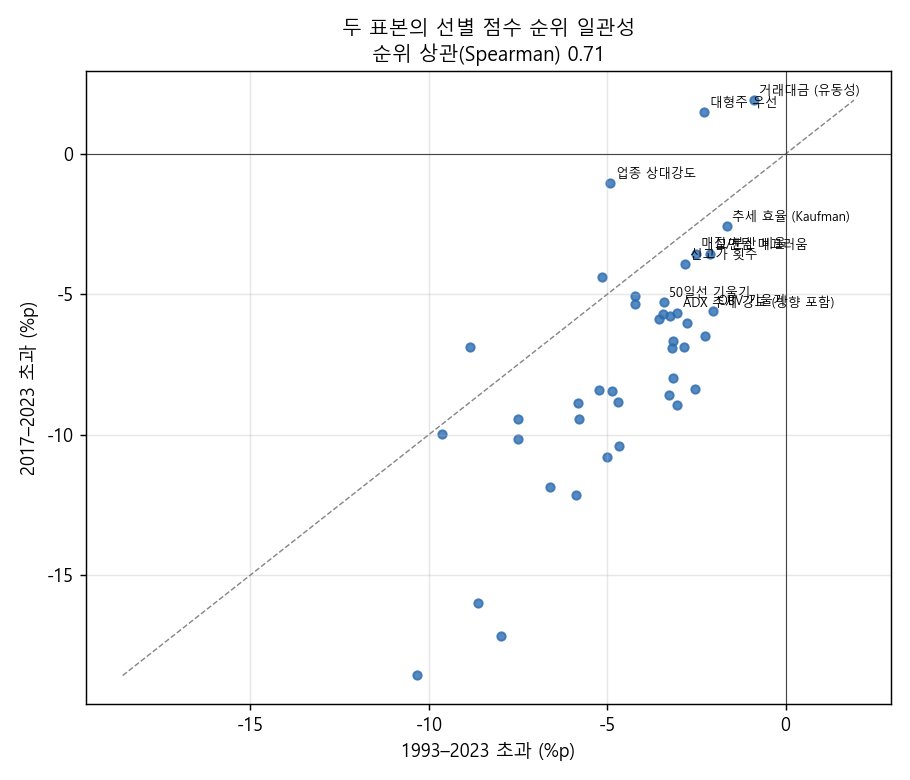
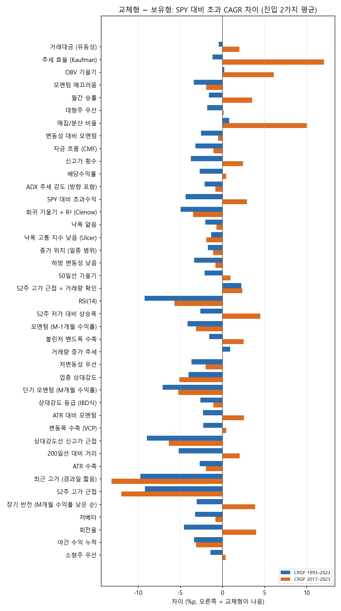
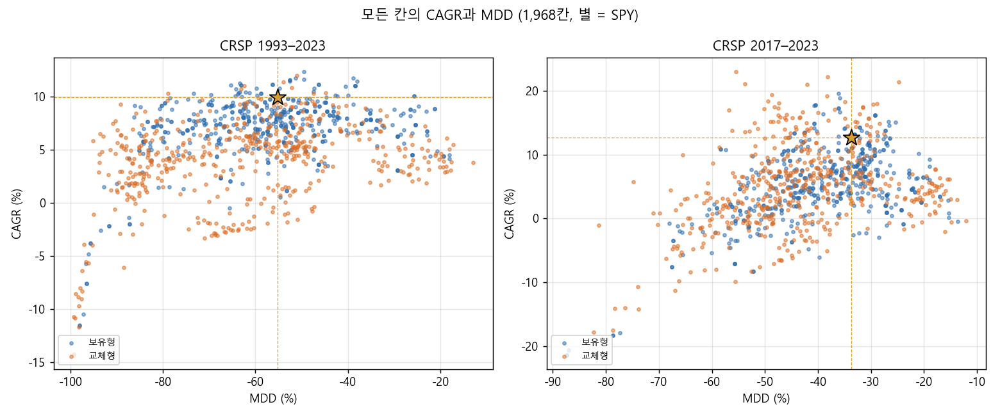

# 선별 점수 대표 필터 비교 결과 (결정 79, 상위 3000)

## 왜 했는지

종목 스크린 v2의 선별 점수 41개 가운데 어떤 것이 추세추종 매매와 잘 맞는지 고르려고, 점수를 기본값으로 하나씩 같은 조건에서 비교했습니다. 여러 점수를 섞고 매매층을 흔들어 보는 다음 단계(Stage B)의 후보를 정하는 것이 목적이었습니다.

## 핵심 결과

통과 칸은 1993–2023 28칸, 2017–2023 34칸(각 984칸 중)이었고, 두 표본 모두 통과한 조합은 격자 한 칸짜리 세 개뿐이었습니다. 점수 순위는 두 기간 사이에서 꽤 일관됐습니다(Spearman 0.71). 거래대금·추세 효율·대형주·매끄러움이 위, 소형주·장기 반전·저베타가 아래였습니다. 다만 위쪽 점수는 크고 유동성 높은 종목을 고르는 것이라, 선별 효과라기보다 지수에 가까워진 결과일 가능성이 큽니다. 교체형은 보유형보다 나빴고, 상위 점수도 MDD가 깊어 선별만으로는 낙폭을 줄이지 못했습니다.

## 그림

그림은 `scripts/make_study_figures.py --study scores`로 드라이브의 집계 결과에서 만들었습니다. 교체형 − 보유형 그림은 점수별로 진입 두 가지를 평균한 차이라서, 본문의 "같은 점수·진입끼리 비교한 차이의 중앙값 −3.0%p"와 계산 방식이 조금 다릅니다(그림 기준 중앙 −2.7%p).

2026-10-26 · 연구실 컴퓨터 실행 (2026-10-25 22:38 – 2026-10-26 01:11 KST) · 분석은 드라이브 `CRSP/lab_crsp/scores_top3000/summary.csv`(328행)만으로 했습니다. 칸 단위 파일(`families/…`)은 이번 분석에 쓰지 않았습니다.

## 설정

결정 79의 메뉴를 그대로 돌렸습니다. 선별 점수 41개(코드 `lab/screens.SELECT_SCORES` 기준이며, 설계 메모의 42개와 하나 차이가 납니다)를 기본 lookback으로 하나씩 쓰고, 점수마다 제외 {위생 필터만, + 추세 템플릿} × 상위 K {20, 50, 100}의 6칸을 진입 2가지(조건 없음 / 100일선 위), 매매층 2가지(보유형: 트레일링 30% + ATR 3 / 교체형: 월말 목록 이탈 시 매도 + ATR 3), 표본 2개에서 시험했습니다. 그래서 표본마다 984칸, 모두 1,968칸입니다. 계좌 단위 최대 20종목, 거래당 위험 1%, 종목 상한 10%, 편도 20bp, 레버리지 없음입니다. 통과 기준은 CAGR ≥ SPY 그리고 |MDD| ≤ |SPY MDD|, 거래 30회 이상입니다. SPY는 1993–2023 9.9% / −55%, 2017–2023 12.7% / −34%입니다.

## 결과

통과한 칸은 1993–2023에서 984칸 중 28칸, 2017–2023에서 984칸 중 34칸입니다. 같은 진입·매매층에서 두 표본 모두 통과 칸이 있는 조합은 세 개뿐입니다: 추세 효율(Kaufman) × 교체형(진입 두 가지 모두), 대형주 우선 × 교체형 × 조건 없음. 세 조합 모두 1993–2023에서는 6칸 중 1칸만 통과했고, 중앙값으로는 SPY보다 연 1.8–3.1%p 뒤집니다. 통과가 격자 한 칸에 몰려 있어서 견고한 영역이라고 볼 수 없습니다.

이번 결과에서 가장 쓸 만한 정보는 순위입니다. 점수별 중앙 초과수익(진입·매매층 4묶음 평균) 순위가 두 표본 사이에서 Spearman 0.71로 꽤 일관됩니다. v1 스크린 비교에서는 이기는 스타일이 기간마다 뒤집혔는데(1993–2023 배당·소형·반전, 2017–2023 대형), 이번 v2 점수에서는 상위와 하위가 두 기간에서 거의 같습니다.

| 선별 점수 | 계층 | 1993–2023 초과 (%p, 중앙) | 2017–2023 초과 (%p, 중앙) | MDD 중앙 (%) 1993 / 2017 | 통과 칸 (24칸 중) 1993 / 2017 |
|---|---|---|---|---|---|
| 거래대금 (유동성) | 1 | −0.9 | +1.9 | −73 / −36 | 0 / 3 |
| 추세 효율 (Kaufman) | 2 | −1.7 | −2.6 | −54 / −37 | 2 / 9 |
| 대형주 우선 | 3 | −2.3 | +1.5 | −56 / −29 | 1 / 15 |
| 모멘텀 매끄러움 | 1 | −2.1 | −3.6 | −67 / −37 | 0 / 3 |
| 매집/분산 비율 | 1 | −2.5 | −3.6 | −48 / −44 | 2 / 0 |
| OBV 기울기 | 1 | −2.0 | −5.6 | −48 / −45 | 1 / 0 |
| 신고가 횟수 | 1 | −2.8 | −3.9 | −55 / −37 | 0 / 0 |
| 월간 승률 | 1 | −2.3 | −6.5 | −55 / −38 | 0 / 0 |
| … | | | | | |
| 200일선 대비 거리 | 2 | −5.9 | −12.2 | −80 / −59 | 0 / 0 |
| 야간 수익 누적 | 1 | −9.6 | −10.0 | −87 / −51 | 0 / 0 |
| 장기 반전 | 3 | −8.0 | −17.2 | −75 / −60 | 0 / 0 |
| 저베타 | 2 | −8.6 | −16.0 | −53 / −47 | 0 / 0 |
| 소형주 우선 | 3 | −10.3 | −18.6 | −77 / −64 | 0 / 0 |

(초과 = 해당 묶음 6칸의 CAGR − SPY CAGR 중앙값을 4묶음 평균. 통과 칸은 4묶음 × 6칸 = 24칸 중 개수.) 단기 RSI는 1993–2023에서 가장 많은 9칸이 통과했지만 2017–2023에서는 0칸이라 일관성 기준에서 탈락합니다.

매매층과 진입에 대해서는 두 가지가 분명합니다. 첫째, 교체형은 1993–2023에서 보유형보다 나빴습니다. 같은 점수·진입끼리 비교한 초과수익 차이의 중앙값이 −3.0%p였고, 2017–2023에서는 차이가 거의 없습니다(+0.1%p). MDD는 두 표본 모두 교체형이 중앙값으로 4–5%p 더 깊었습니다. 특히 모멘텀은 교체형에서 −2.4 ~ −4.2%p 더 나빠져서, "매달 승자로 갈아타면 모멘텀이 살아난다"는 결정 79의 가설은 이 매매층(ATR 3 손절과 위험 1% 크기를 그대로 둔 채)에서는 지지되지 않았습니다. 둘째, 100일선 위 진입 조건은 효과가 거의 없습니다(중앙 −0.3%p).

낙폭 예산 기준(낙폭 15%에 맞춰 현금과 섞은 뒤 SPY를 같은 방식으로 섞은 것과 비교)으로 봐도 결론은 같습니다. 칸 묶음별 중앙 `dd_excess`가 1993–2023 최고 +0.9%p, 2017–2023 최고 +3.2%p이고 전체 중앙은 각각 −1.0%p, −2.8%p입니다. 저변동성 계열(저변동성, 볼린저 수축, 가격 범위 수축, 하방 변동성)은 MDD 중앙이 −27%로 SPY보다 훨씬 얕지만 CAGR 중앙이 5.1%라서, 낙폭을 맞춰 놓고 보면 SPY 혼합과 비슷한 수준(−0.5%p)에 그칩니다.

## 해석

아래는 결과에서 제가 추론한 것이고, 칸 단위 기록이나 보유 종목으로 확인하지는 않았습니다.

1. 두 기간에서 일관되게 위에 있는 점수는 거래대금, 추세 효율, 대형주, 매끄러움입니다. 거래대금과 대형주는 크고 유동성 높은 종목을 고르는 점수라 지수와 비슷하게 움직이는 것이 자연스럽고, 2017–2023의 통과는 초대형주 집중 구간의 효과일 가능성이 큽니다. 대형주 우선 × 상위 20은 사실상 시가총액 상위 20종목이기 때문입니다. 선별 "알파"라기보다 지수 근사에 가깝다고 보는 편이 안전합니다.
2. 반대로 소형주·장기 반전·저베타·야간 수익은 두 기간 모두 최하위입니다. v1에서 1993–2023에 소형·반전이 이긴 것과 정반대인데, 이번 매매층(트레일링·ATR 손절, 위험 기준 크기)과 v2 점수 정의가 달라서인지, v1 결과가 우연이었는지는 이 자료만으로 가릴 수 없습니다. 소형주를 유니버스에서 빼지 않는다는 원칙은 그대로 지켰습니다. 소형주를 고르지 않았을 뿐, 후보에서 제외하지는 않았습니다.
3. 계층 순서(가격·거래량 원자료 → 1차 파생 → 기타)는 결과로 뒷받침되지도, 반박되지도 않았습니다. 상위 8개 가운데 6개가 1계층이지만, 통과 칸 수는 2계층(1993–2023)과 3계층(2017–2023, 대형주)이 더 많습니다.
4. 묶는 조건은 여전히 MDD입니다. 상위 점수들도 1993–2023 MDD 중앙이 −50 ~ −70%라서, 선별만으로 SPY보다 얕은 낙폭을 만들지 못합니다.

## 한계

이번 분석은 묶음별 중앙값 요약만 썼습니다. 통과한 칸이 몇 종목에 기대는지, 거래 수, 3년 창 승률 분포는 아직 보지 않았습니다. 시험 횟수가 1,968칸이 늘었으므로 최종 후보를 고를 때 DSR에 반영해야 합니다. 41개 점수는 모두 기본 lookback 하나만 시험했으므로, 순위는 "이 기본값에서의 순위"입니다.

## 다음 단계 제안 (실행 전 검토 요청)

두 기간에서 일관된 상위 점수(거래대금, 추세 효율, 매끄러움, 매집/분산, OBV 기울기)를 2–3개씩 평균 순위로 섞고, 매매층(보유형 트레일링 폭, 교체형에서 ATR 손절 유무, 위험 %, 최대 종목 수)을 함께 Sobol로 탐색하는 Stage B를 제안합니다. 교체형에서 ATR 손절을 빼 보는 칸은 모멘텀 가설을 제대로 시험하는 데 필요합니다. 설계는 실행 전에 검토받겠습니다.
