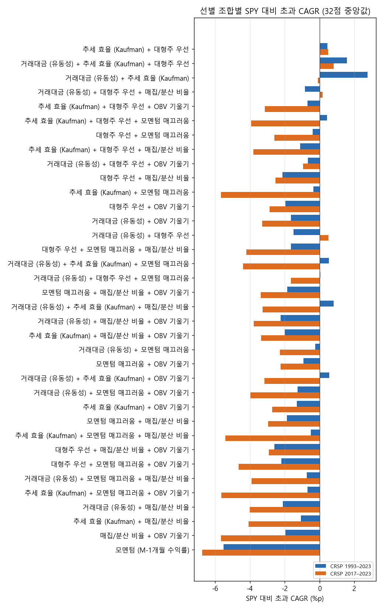
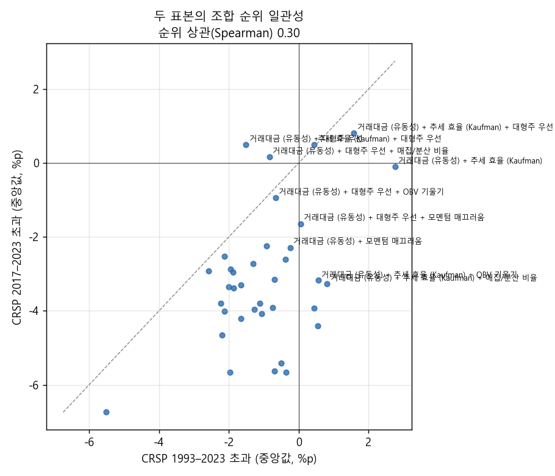
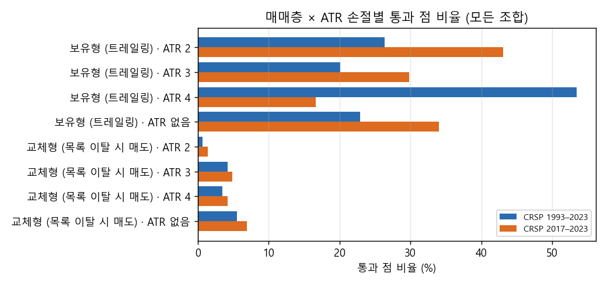
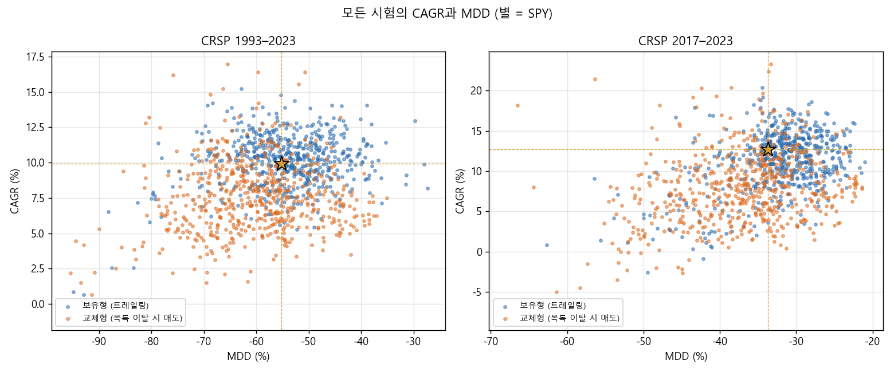

# Stage B 결과: 상위 선별 점수 조합 × 매매층 Sobol (결정 80, 상위 3000)

2026-10-26 · 연구실 컴퓨터 실행(19:51–22:18 KST, 작업 8개) · 결과는 드라이브 `CRSP/lab_crsp/combos_top3000`. 설계와 판정 규칙은 실행 전에 커밋한 `2026-10-26_stage_b_design.md`(결정 80)를 그대로 따랐습니다. 보류 구간(2024년 이후)은 쓰지 않았습니다.

## 왜 했는지

결정 79에서 두 기간 모두 위쪽이던 선별 점수 여섯 개(거래대금, 추세 효율, 대형주, 매끄러움, 매집/분산, OBV 기울기)를 섞으면 나아지는지, 그리고 매매층(보유형·교체형, ATR 손절 유무, 위험 비율, 종목 수)을 바꾸면 결론이 달라지는지를 보려고 했습니다. 또 ATR 손절을 뺀 교체형에서 "매달 승자로 갈아타면 모멘텀이 살아난다"는 가설을 다시 시험했습니다.

## 핵심 결과

여섯 점수 가운데 둘이나 셋을 섞은 조합은 단독 점수보다 확실히 나았습니다. 조합 36개 중 34개가 두 표본 모두에서 통과한 점을 가졌고, 두 표본 모두 통과한 (조합, 점)은 73개입니다. 결정 79에서는 같은 기준으로 단독 점수 세 개가 격자 한 칸씩만 통과했습니다. 1위는 추세 효율 + 대형주로, 32점 가운데 1993–2023에서 53%, 2017–2023에서 56%가 통과했고 SPY 대비 초과 CAGR 중앙값은 두 표본 모두 +0.4–0.5%p입니다. 2위는 거래대금 + 추세 효율 + 대형주(50% / 50%, +1.6 / +0.8%p)입니다.

매매층은 보유형(트레일링)이 압도적이었습니다. 두 표본 통과 73점 가운데 67점이 보유형이고, 교체형은 어떤 ATR 설정에서도 통과 비율이 7%를 넘지 않았습니다. 모멘텀 단독은 ATR 손절이 없는 교체형을 포함해 64회 중 한 번도 통과하지 못했습니다(초과 중앙값 −6.6 / −6.9%p). 그래서 모멘텀 가설은 이 매매층에서 지지되지 않았습니다.

다만 이것을 "선별 알파"로 읽기는 어렵습니다. 상위 조합은 모두 대형주나 거래대금이 들어가 크고 유동성 높은 종목을 고르므로 지수와 비슷하게 움직이고, 초과도 연 0.5–3%p 수준입니다. MDD 중앙값은 1993–2023에서 −49%로 SPY(−55%)보다 조금 얕을 뿐입니다. 조합 순위의 두 표본 간 상관은 0.30으로 약하고, PBO는 2017–2023에서 60%입니다.

## 그림

그림은 실행기(`lab/combo_study.py`)가 실행 끝에 직접 만든 것입니다.

## 설정

조합은 여섯 점수의 2개 조합 15개, 3개 조합 20개, 모멘텀 단독 1개로 36개이고, 점수는 기본 lookback의 평균 백분위 순위로 합쳤습니다. 매매층은 모든 조합과 표본에 같은 Sobol 32점을 썼습니다. 변수는 제외(위생 / + 추세 템플릿), 상위 K {20, 50, 100}, 보유형(트레일링 15–40%) / 교체형, ATR 손절 {없음, 2, 3, 4}, 위험 0.5–2.0%, 최대 종목 {10, 15, 20, 30}입니다. ATR 손절이 없는 점은 동일 금액 슬롯으로 샀습니다. 진입 조건은 없고, 종목 상한 10%, 편도 20bp, 레버리지는 없습니다. 표본은 CRSP 시총 상위 3,000(상장폐지 포함)의 1993–2023(SPY 9.9% / −55%)과 2017–2023(SPY 12.7% / −34%)입니다. 시험은 2,304회이고, 이번 연구 안의 유효 시험 수는 약 635(평균 상관 0.72)입니다. 통과 기준은 CAGR ≥ SPY, |MDD| ≤ |SPY MDD|, 거래 30회 이상입니다.

## 결과

통과한 시험은 1993–2023에서 1,152회 중 197회, 2017–2023에서 1,152회 중 203회입니다. 등록한 규칙대로 조합마다 표본별 순위(통과 점 비율 → 초과 중앙값)를 매기고 두 순위를 더했습니다. 상위 여섯 개는 다음과 같습니다.

| 조합 | 통과 점 비율 1993 / 2017 | 초과 중앙값 (%p) 1993 / 2017 | MDD 중앙값 (%) 1993 / 2017 | 낙폭 15% 맞춤 초과 (%p) 1993 / 2017 | 순위 합 |
|---|---|---|---|---|---|
| 추세 효율 + 대형주 | 53 / 56 | +0.4 / +0.5 | −49 / −29 | +0.4 / +1.4 | 2 |
| 거래대금 + 추세 효율 + 대형주 | 50 / 50 | +1.6 / +0.8 | −51 / −28 | +0.5 / +1.5 | 4 |
| 거래대금 + 추세 효율 | 31 / 38 | +2.8 / −0.1 | −60 / −29 | +0.7 / +1.2 | 9 |
| 거래대금 + 대형주 + 매집/분산 | 19 / 41 | −0.8 / +0.2 | −58 / −32 | −0.2 / +0.3 | 14 |
| 추세 효율 + 대형주 + OBV 기울기 | 25 / 28 | −0.7 / −3.1 | −54 / −31 | +0.1 / −0.4 | 14 |
| 추세 효율 + 대형주 + 매끄러움 | 50 / 22 | +0.4 / −3.9 | −50 / −31 | 0.0 / −0.8 | 14 |
| … | | | | | |
| 매집/분산 + OBV 기울기 | 13 / 0 | −2.0 / −5.7 | −50 / −43 | −0.3 / −2.4 | 57 |
| 모멘텀 단독 | 0 / 0 | −5.5 / −6.7 | −82 / −49 | −1.1 / −2.4 | 72 |

추세 효율과 대형주가 들어간 조합이 위쪽을 차지했습니다. 상위 세 조합은 모두 두 표본에서 낙폭 15% 맞춤 초과(dd_excess)가 양수이고, 3년 창 승률 중앙값은 2017–2023에서 0.75입니다.

매매층별로 보면(모든 조합 합산) 보유형의 통과 비율은 ATR 손절 설정에 따라 1993–2023에서 20–54%, 2017–2023에서 17–43%였습니다. 교체형은 두 표본 모두 1–7%였습니다. ATR 손절을 뺀 보유형도 23% / 34%로 손절이 있는 경우와 비슷해서, 손절 유무보다 보유형인지가 결과를 갈랐습니다. ATR 4의 보유형은 1993–2023에서 54%로 가장 좋았지만 2017–2023에서는 17%로 가장 나빠서, 손절 폭에는 일관된 방향이 없습니다.

두 표본 모두 통과한 73점은 매매층 공간에서 한 점에 몰려 있지 않습니다. 67점이 보유형이고, 제외(추세 템플릿 46 / 위생 27), 상위 K(20: 27, 50: 23, 100: 23), ATR(2: 20, 3: 16, 4: 21, 없음: 16), 최대 종목 수에 고루 퍼져 있습니다. 트레일링 폭은 17–38%(중앙 28%)에 걸쳐 있습니다. 32점이 Sobol 표본이라 격자처럼 '이웃'을 정의할 수 없으므로, 영역은 "보유형이면 나머지 설정과 거의 무관하게 통과가 나온다"는 넓은 의미로만 말할 수 있습니다.

PBO(전체 시험 중 "가장 좋은 것 고르기"의 과최적화 확률, 참고용)는 1993–2023에서 30%, 2017–2023에서 60%입니다. 짧은 표본에서는 표본 안 1등이 표본 밖에서 하위 절반으로 떨어지는 경우가 더 많다는 뜻입니다.

등록 규칙대로 넓은 영역이 있으므로 상위 세 조합의 대표 점(두 표본 초과 중 작은 값이 가장 큰 점)에 DSR을 붙였습니다. 시험 수는 이번 연구의 유효 수 635와, 지금까지 누적된 유효 수에 가까운 17,000 두 가지로 계산했습니다.

| 조합 (점) | 매매층 | CAGR / MDD 1993 | CAGR / MDD 2017 | DSR 1993 (N 635 / 17,000) | DSR 2017 (N 635 / 17,000) |
|---|---|---|---|---|---|
| 추세 효율 + 대형주 (24) | 교체형, ATR 4, 위험 1.5%, 30종목, 상위 20 | 13.2% / −44% | 17.5% / −33% | 0.95 / 0.85 | 0.74 / 0.59 |
| 거래대금 + 추세 효율 + 대형주 (5) | 보유형, 트레일링 24%, ATR 4, 위험 1.4%, 30종목, 템플릿, 상위 100 | 13.2% / −48% | 15.2% / −23% | 0.97 / 0.90 | 0.73 / 0.58 |
| 거래대금 + 추세 효율 (14) | 보유형, 트레일링 35%, ATR 없음, 15종목, 템플릿, 상위 50 | 13.1% / −40% | 17.1% / −29% | 0.97 / 0.89 | 0.71 / 0.57 |

1993–2023에서는 DSR이 0.85–0.97이지만, 2017–2023에서는 0.57–0.74로 '우연이 아닐 확률'이 충분히 높다고 말하기 어렵습니다. 첫 번째 대표 점은 드문 교체형 통과입니다. 이 점들은 등록 규칙이 고른 예시이고 후보로 확정한 것이 아닙니다.

## 해석

아래는 결과에서 추론한 것이고, 보유 종목이나 거래 내역으로 확인하지는 않았습니다.

1. 점수를 섞자 통과가 넓어진 가장 큰 이유는 대형주와 거래대금 점수가 선택 집합을 초대형·고유동성 종목 쪽으로 끌어당겼기 때문으로 보입니다. 추세 효율을 더하면 그 안에서 꾸준히 오르는 종목이 앞에 서서 낙폭이 조금 얕아졌습니다. 결과가 SPY에 가까운 수익에 낙폭을 몇 %p 줄인 모양이라는 점이 이 해석과 맞습니다.
2. 보유형 우위는 결정 79의 결과를 넓은 매매층에서 다시 확인한 것입니다. 매달 목록에서 빠질 때 파는 교체형은 회전이 잦아 비용과 잡음 매매가 늘어나는 것으로 보입니다.
3. 모멘텀은 ATR 손절을 빼도 살아나지 않았습니다. 결정 76 직후의 사전 점검(손절 없는 월간 교체)에서 보였던 우위는 위험 기준 크기·종목 상한·거래대금 위생 필터가 없는 조건이었으므로, 그 차이가 남은 설명 후보입니다.
4. 조합 순위의 두 표본 상관이 0.30으로 약하고 2017–2023 PBO가 60%이므로, 상위권 안의 순서는 믿기 어렵습니다. 믿을 만한 것은 "대형주·추세 효율 계열 + 보유형"이라는 큰 묶음까지입니다.

## 한계

모든 점수는 기본 lookback 하나만 썼습니다. 32점은 7개 변수에 비해 성긴 표본이라 개별 설정의 좋고 나쁨을 가리지 못합니다. 편도 20bp, 세금 없음이고, 결과는 표본 내 연구입니다. 시험 수는 이번에 2,304회가 늘었으며, 연구실 컴퓨터의 시험 기록(드라이브 `combos_top3000/lab_results`)은 아직 노트북 연구 기록에 합치지 않았습니다. 결과를 "실거래 가능"으로 읽지 않습니다.

## 남은 판단

- 상위 묶음(추세 효율 + 대형주 계열, 보유형)을 다음 단계 후보로 좁힐지, 아니면 낙폭을 더 줄이는 층(시장 국면 필터, 현금 비중 조절)을 먼저 붙여 볼지.
- 이 결과가 지수 근사라는 의심을 확인하려면 SPY 대비 베타·상관과 보유 종목 구성을 보는 점검이 필요합니다. 이 점검을 할지.
- 보류 구간 평가는 사용자가 후보를 지정해 요청할 때만 합니다.
