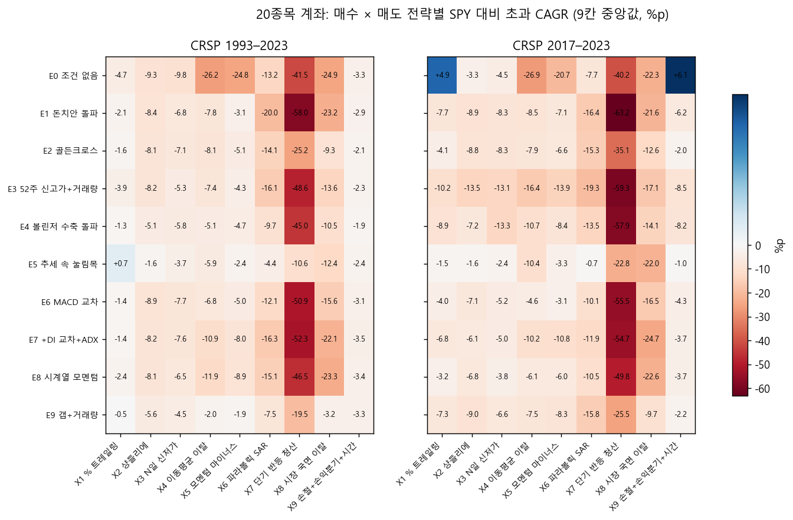
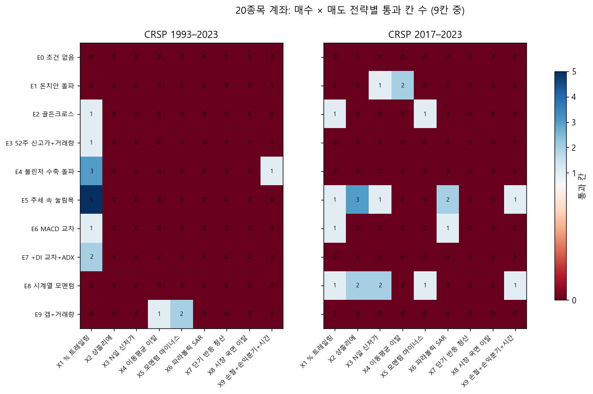
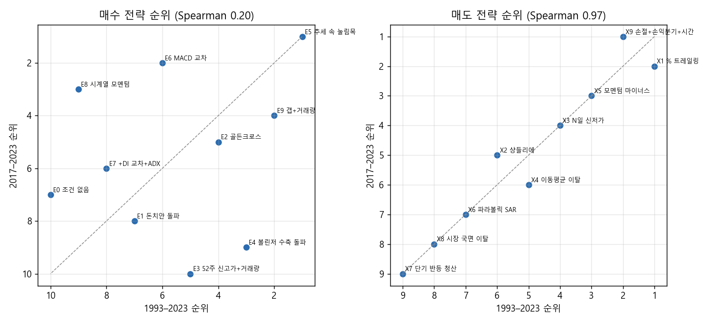
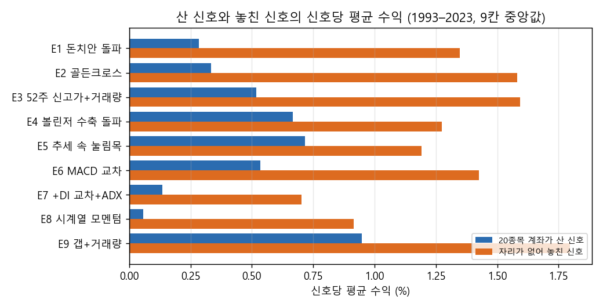
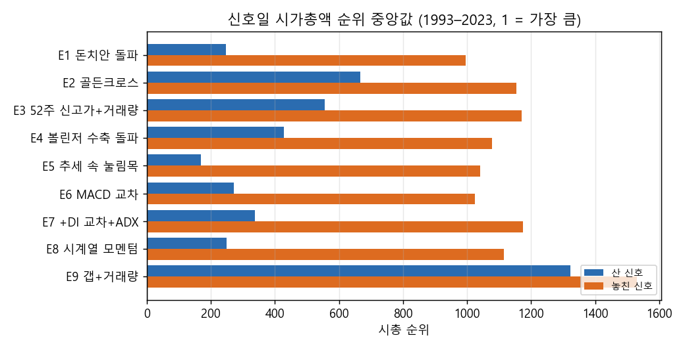
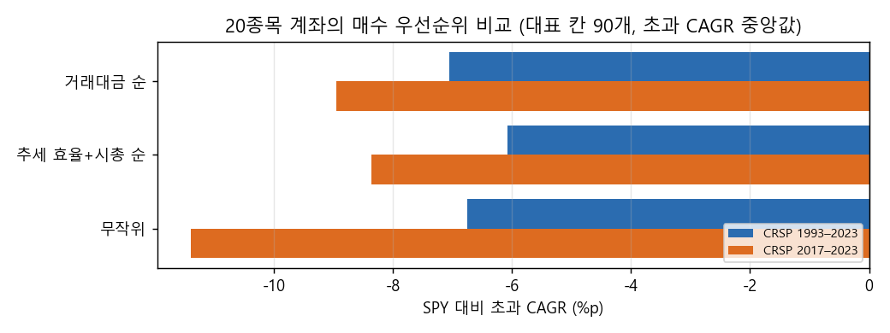

# Stage C 결과: 매수 전략 × 매도 전략, 일별 상위 3000 (결정 81)

2026-10-27 · 연구실 컴퓨터 실행(2026-10-27 00:21–05:11 KST). 메모리 부족 때문에 작업 수를 6 → 5 → 4로 줄여 이어 돌렸고, 비어 버린 결과 파일 하나는 그 쌍만 다시 계산했습니다. 결과는 드라이브 `CRSP/lab_crsp/stagec_daily3000`에 있습니다. 판정은 실행 전에 커밋한 결정 81과 `2026-10-26_stage_c_design.md`를 그대로 따랐고, 보류 구간(2024년 이후)은 쓰지 않았습니다. 집계표와 재현 스크립트는 `docs/research/lab/2026-10-27_stage_c/`와 `scripts/stage_c_report.py`에 있습니다.

## 왜 했는지

Stage B는 매수 조건 없이 '목록에 있으면 산다'로 시험해 판정이 흐려졌습니다. 그래서 사용자 요청대로 다섯 가지를 바꿨습니다. 잘 알려진 매수 전략 9개(+ 비교용 조건 없음)와 성격이 다른 매도 전략 9개를 시험했고, Minervini 추세 템플릿을 뺐습니다. 유니버스는 연말 1회 대신 매일 다시 골랐고, 매수는 신호가 처음 켜진 날에만 하도록 했습니다. 마지막으로 신호 전체 결과와 실제로 살 수 있는 20종목 계좌를 나란히 봐서, 20종목 제한 때문에 무엇을 놓치는지 확인했습니다.

## 핵심 결과

20종목 계좌는 거의 모든 조합에서 SPY에 졌습니다. 칸 756개 중 통과는 1993–2023에서 17칸, 2017–2023에서 22칸이었습니다. 계좌 CAGR 중앙값은 2.9%(MDD −79%)와 3.2%(MDD −43%)로, SPY 9.9%(−55%)와 12.7%(−34%)에 크게 못 미쳤습니다. 등록 기준인 '두 표본 모두에서 이웃이 받쳐 주는 통과 영역'을 가진 쌍은 하나도 없어서 최종 후보와 DSR은 없습니다.

매도 전략의 순서는 두 기간에서 거의 같았습니다(Spearman 0.97). 고점 대비 % 트레일링(X1)과 초기 손절 묶음(X9)이 위였고, 단기 반등 청산(X7)과 시장 국면 이탈(X8)은 맨 아래였습니다. 매수 전략의 순서는 두 기간이 달랐고(0.20), 상승 추세 속 눌림목(E5)만 두 기간 모두 1위였습니다. 가장 나은 쌍은 'E5 눌림목 × X1 % 트레일링'이었습니다. 1993–2023에서 9칸 중 5칸이 한 덩어리로 통과했지만, 2017–2023에서는 1칸뿐이었습니다. 이 쌍의 초과 수익도 대부분 1999–2003년 하락장에서 나왔습니다.

20종목 제한의 영향은 컸습니다. 거래대금 순으로 사면 신호의 대부분 1–4%만 사게 됩니다(골든크로스 약 12%, 갭+거래량 약 25%). 산 신호의 시가총액 순위는 중앙 170–670위(갭+거래량은 1,300위대)였고, 놓친 신호는 1,000–1,500위였습니다. 놓친 신호의 신호당 평균 수익이 산 신호보다 모든 매수 전략에서 높았고(1993–2023 중앙 0.7–1.8% 대 0.1–0.9%), +50% 이상 큰 수익 신호 가운데 계좌가 산 비율은 대부분 1–6%(갭+거래량 18%)였습니다. 우선순위를 '추세 효율 + 시총'이나 무작위로 바꿔도 1993–2023에서만 조금 나았을 뿐(90쌍 중 58–59쌍) 결론은 같았습니다.

## 그림

## 무엇을 시험했나

### 종목 필터링 (모든 전략 공통)

매 거래일 그날까지의 21거래일 평균 시가총액으로 CRSP 미국 보통주(NYSE·AMEX·NASDAQ) 상위 3,000개를 고르고, 그 가운데 위생 필터를 통과한 종목만 매수 후보로 둡니다. 위생 필터는 네 가지입니다. 최근 12개월 중 가격이 있는 날이 90% 이상이어야 하고, 주가 5달러 이상, 21일 평균 거래대금 100만 달러 이상이어야 합니다. 그리고 63일 Amihud 비유동성(|일간 수익률| ÷ 거래대금) 상위 20%는 뺍니다. 시총 하한, 추세 템플릿, 월말 선별 목록은 없습니다. 상장폐지 종목도 포함하고, 폐지되면 마지막 거래일에 강제로 팝니다. 이렇게 한 번이라도 후보에 든 종목은 1991–2024년 1만 3,259개입니다.

### 매수 전략 (신호일 종가로 판단 → 다음 날 시가에 매수)

E1–E9는 조건이 참이 된 첫날에만 신호가 나고, 괄호 안이 대표값입니다.

- E0 조건 없음: 후보에 있고 자리가 비면 삽니다. 비교용입니다.
- E1 돈치안 돌파: 종가가 직전 N일 고가의 최댓값을 넘은 첫날, N 20 / [55] / 100.
- E2 골든크로스: N일 이동평균이 200일 이동평균을 위로 교차한 날, N 20 / [50] / 100.
- E3 52주 신고가 + 거래량: 종가가 직전 252일 고가를 넘고 거래량이 직전 50일 평균의 m배 이상인 첫날, m 1.2 / [1.5] / 2.0.
- E4 볼린저 수축 후 돌파: 어제 볼린저(20일, 2σ) 밴드폭이 최근 126일 중 하위 p% 안이고, 오늘 종가가 상단 밴드를 넘은 첫날, p 10 / [20] / 30.
- E5 상승 추세 속 눌림목: 종가가 200일 이동평균 위인데 2일 RSI가 r 미만으로 떨어진 첫날, r 5 / [10] / 15.
- E6 MACD 교차: MACD 선이 시그널 선을 위로 교차하고 MACD가 0보다 큰 날. (빠른, 느린, 시그널) EMA = (8, 17, 9) / [(12, 26, 9)] / (19, 39, 9).
- E7 +DI 교차 + ADX: +DI(14)가 −DI(14)를 위로 교차하고 ADX(14)가 a 이상인 날, a 15 / [20] / 25.
- E8 시계열 모멘텀: 최근 L개월 수익률이 같은 기간 단기국채 수익률보다 높아진 첫날, L 3 / 6 / [12].
- E9 갭 상승 + 거래량 폭발: 시가가 어제 고가 × (1 + g%) 이상이고, 거래량이 직전 50일 평균의 3배 이상이며, 종가 > 시가인 첫날, g 2 / [4] / 6.

### 매도 전략 (조건이 맞은 날 종가 → 다음 날 시가에 전량 매도, 상장폐지 매도는 공통)

- X1 % 트레일링: 종가가 보유 중 최고 종가 × (1 − x%) 아래, x 15 / [25] / 35.
- X2 샹들리에: 종가가 보유 중 최고 종가 − k × ATR(22) 아래, k 2 / [3] / 4.
- X3 N일 신저가: 종가가 직전 N일 저가의 최솟값 아래, N 10 / [20] / 50.
- X4 이동평균 이탈: 종가가 N일 이동평균 아래, N 20 / [50] / 100.
- X5 모멘텀 마이너스: N일 수익률이 0 미만, N 21 / [63] / 126.
- X6 파라볼릭 SAR 반전: SAR(가속 a, 최대 0.2)이 가격 위로 넘어간 날, a 0.01 / [0.02] / 0.03.
- X7 단기 반등 청산: 종가 > 5일 이동평균 또는 2일 RSI > r, r 60 / [70] / 80.
- X8 시장 국면 이탈: SPY 종가가 SPY의 N일 이동평균 아래(보유 종목 전부 매도), N 100 / 150 / [200].
- X9 초기 손절 묶음: 세 조건을 함께 씁니다. 종가가 매수가 − k × ATR(14)(신호일 값) 아래면 손절하고, 한 번 +2R(R = k × ATR)에 닿은 뒤 종가가 매수가 아래로 내려오면 팝니다. 60거래일이 지났는데 종가가 매수가 이하여도 팝니다. k 1.5 / [2] / 3.

### 시험 구조

매수 10 × 매도 9 = 90쌍이고, 쌍마다 매수 값 3 × 매도 값 3 = 9칸(E0 쌍은 3칸)이라 표본마다 756칸입니다. 표본은 1993–2023과 2017–2023입니다. 비용은 매수·매도 각각 20bp이고 레버리지는 없으며, 남는 현금은 단기국채 수익률을 받습니다.

- 신호 전체(C1): 보유 수 제한 없이 신호가 난 종목을 모두 따로 매매합니다(종목별 단독 시험). 신호마다 따로 계산한 신호별 결과표도 만들었습니다(같은 종목에 겹친 신호도 각각 셈).
- 20종목 계좌(C2): 최대 20종목, 매수 시 자산의 1/20, 리밸런싱 없음입니다. 이미 든 종목은 건너뛰고, 자리가 없을 때 난 신호는 버립니다. 같은 날 후보가 남는 자리보다 많으면 20일 평균 거래대금이 큰 순으로 삽니다. 대표 칸에서는 '추세 효율(6개월)과 시총 백분위의 평균' 순과 무작위 순도 시험했습니다.
- 통과: 20종목 계좌는 CAGR > SPY, |MDD| < |SPY MDD|, 거래 30회 이상입니다. 신호 전체는 매매 기록 포트폴리오로 같은 기준을 적용했습니다.

## 결과

### 매수·매도 전략 순위 (20종목 계좌, 모든 칸의 SPY 대비 초과 CAGR 중앙값)

| 매도 전략 | 1993–2023 순위 / 초과 | 2017–2023 순위 / 초과 | 통과 칸 비율 1993 / 2017 |
|---|---|---|---|
| X1 % 트레일링 | 1 / −1.6%p | 2 / −5.5%p | 15% / 5% |
| X9 손절+손익분기+시간 | 2 / −2.9%p | 1 / −4.1%p | 1% / 2% |
| X5 모멘텀 마이너스 | 3 / −4.9%p | 3 / −7.5%p | 2% / 2% |
| X3 N일 신저가 | 4 / −6.4%p | 4 / −7.6%p | 0% / 5% |
| X4 이동평균 이탈 | 5 / −7.4%p | 6 / −10.0%p | 1% / 2% |
| X2 샹들리에 | 6 / −7.7%p | 5 / −7.7%p | 0% / 6% |
| X6 파라볼릭 SAR | 7 / −12.4%p | 7 / −13.2%p | 0% / 4% |
| X8 시장 국면 이탈 | 8 / −14.9%p | 8 / −18.1%p | 0% / 0% |
| X7 단기 반등 청산 | 9 / −45.8%p | 9 / −51.7%p | 0% / 0% |

매도 전략은 두 기간의 순위가 거의 같았습니다(Spearman 0.97). 오래 들고 가는 청산(X1, X9)이 위, 빨리 파는 청산(X7은 평균 1.5일 보유)과 시장 전체를 보고 다 파는 청산(X8)이 아래입니다.

| 매수 전략 | 1993–2023 순위 / 초과 | 2017–2023 순위 / 초과 |
|---|---|---|
| E5 추세 속 눌림목 | 1 / −3.5%p | 1 / −3.0%p |
| E9 갭+거래량 | 2 / −3.8%p | 4 / −8.7%p |
| E6 MACD 교차 | 6 / −8.2%p | 2 / −6.3%p |
| E2 골든크로스 | 4 / −7.8%p | 5 / −9.1%p |
| E8 시계열 모멘텀 | 9 / −10.9%p | 3 / −6.9%p |
| E4 볼린저 수축 돌파 | 3 / −5.7%p | 9 / −10.7%p |
| E7 +DI 교차+ADX | 8 / −10.1%p | 6 / −9.4%p |
| E1 돈치안 돌파 | 7 / −9.1%p | 8 / −10.3%p |
| E3 52주 신고가+거래량 | 5 / −8.1%p | 10 / −14.0%p |
| E0 조건 없음 | 10 / −13.7%p | 7 / −9.7%p |

매수 전략은 두 기간 순위가 엇갈렸습니다(Spearman 0.20). 1993–2023에서는 모든 매수 전략이 '조건 없음'보다 나았습니다. 하지만 2017–2023에서는 돈치안 돌파, 52주 신고가+거래량, 볼린저 수축 돌파가 '조건 없음'보다 못했습니다. 2017–2023의 '조건 없음'은 거래대금 큰 순으로 20종목을 사므로 초대형주를 사는 셈이고, 이 기간에는 그 자체가 유리했습니다(E0 × X1 +4.9%p, E0 × X9 +6.1%p).

### 통과한 칸과 이웃

20종목 계좌의 통과는 1993–2023 17칸, 2017–2023 22칸입니다. 1993–2023 통과의 13칸이 X1(% 트레일링)에 몰렸습니다. 두 표본 모두에서 통과 칸이 있는 쌍은 세 개입니다: E5 × X1, E2 × X1, E6 × X1. 이 가운데 이웃이 받쳐 주는 영역(2칸 이상 연결)이 두 표본 모두에 있는 쌍은 없습니다. E5 × X1은 1993–2023에서 9칸 중 5칸이 연결 영역을 이뤘지만 2017–2023에서는 1칸만 통과했습니다. 2017–2023에서는 E5 × X2·X6, E8 × X2·X3에 2칸 영역이 있었지만 1993–2023에서는 통과가 없었습니다. 그래서 등록 규칙대로 최종 후보와 DSR 계산은 없습니다.

### 신호 전체 (C1)

| 매수 전략 (9칸 중앙값) | 연간 신호 1993 / 2017 | 신호당 평균 수익 | 승률 | 손익비 | 평균 보유일 | +50% 이상 비율 |
|---|---|---|---|---|---|---|
| E1 돈치안 돌파 | 14,877 / 15,563 | 1.3% / 0.6% | 39% / 38% | 1.80 / 1.83 | 54 / 47 | 2.8% / 2.7% |
| E2 골든크로스 | 1,537 / 1,763 | 1.3% / 1.7% | 39% / 39% | 1.98 / 2.09 | 43 / 42 | 2.6% / 3.4% |
| E3 52주 신고가+거래량 | 3,400 / 3,087 | 1.6% / 0.1% | 40% / 38% | 1.83 / 1.75 | 53 / 50 | 3.4% / 2.9% |
| E4 볼린저 수축 돌파 | 6,536 / 7,648 | 1.3% / 0.2% | 39% / 37% | 1.94 / 1.83 | 44 / 40 | 2.5% / 2.4% |
| E5 추세 속 눌림목 | 13,916 / 15,249 | 1.2% / 0.5% | 41% / 39% | 1.96 / 1.84 | 34 / 32 | 2.0% / 1.9% |
| E6 MACD 교차 | 8,841 / 9,035 | 1.4% / 0.7% | 39% / 37% | 2.01 / 1.92 | 53 / 47 | 2.7% / 2.7% |
| E7 +DI 교차+ADX | 7,786 / 8,312 | 0.7% / 0.5% | 39% / 38% | 1.86 / 1.92 | 35 / 34 | 2.1% / 1.6% |
| E8 시계열 모멘텀 | 9,514 / 10,890 | 0.8% / 0.5% | 40% / 38% | 1.89 / 1.92 | 36 / 32 | 2.0% / 1.9% |
| E9 갭+거래량 | 536 / 660 | 1.5% / 1.5% | 42% / 40% | 1.74 / 1.82 | 53 / 50 | 4.4% / 4.5% |

신호 하나하나의 평균 수익은 비용을 빼고 1% 안팎입니다. 승률은 40% 남짓이고, 이긴 거래가 진 거래보다 평균 두 배쯤 큽니다. 전형적인 추세추종 모양이지만 남는 몫이 작습니다. 매도 쪽에서는 X1(% 트레일링)과 X9(손절 묶음)가 신호당 평균 수익이 훨씬 컸습니다(1993–2023 중앙 14%, 20%). 보유 기간이 길기(평균 290일, 207일) 때문이고, X9는 승률 13%에 손익비 27로 '작게 자주 잃고 가끔 크게 버는' 모양입니다. 매매 기록 포트폴리오는 그날 후보인 3,000개 계좌를 모두 같은 비중으로 섞으므로 대부분 현금입니다. 그래서 통과가 하나도 없었습니다(CAGR 중앙 1–7%). 이 지표는 전략끼리 비교하는 데만 의미가 있습니다.

### 산 신호와 놓친 신호

| 매수 전략 (9칸 중앙값, 1993–2023) | 산 신호 / 놓친 신호 | 신호당 수익 산 / 놓친 | +50% 중 산 비율 | 시총 순위 중앙 산 / 놓친 |
|---|---|---|---|---|
| E1 돈치안 돌파 | 4,473 / 455,431 | 0.3% / 1.3% | 0.7% | 247 / 995 |
| E2 골든크로스 | 5,569 / 41,394 | 0.3% / 1.6% | 5.8% | 667 / 1,154 |
| E3 52주 신고가+거래량 | 3,890 / 98,139 | 0.5% / 1.6% | 2.4% | 556 / 1,171 |
| E4 볼린저 수축 돌파 | 5,207 / 194,556 | 0.7% / 1.3% | 1.8% | 427 / 1,079 |
| E5 추세 속 눌림목 | 5,866 / 424,420 | 0.7% / 1.2% | 1.1% | 168 / 1,040 |
| E6 MACD 교차 | 5,190 / 265,025 | 0.5% / 1.4% | 1.1% | 271 / 1,024 |
| E7 +DI 교차+ADX | 6,679 / 234,113 | 0.1% / 0.7% | 1.5% | 338 / 1,175 |
| E8 시계열 모멘텀 | 7,675 / 286,304 | 0.1% / 0.9% | 1.4% | 250 / 1,116 |
| E9 갭+거래량 | 3,850 / 11,867 | 0.9% / 1.8% | 17.6% | 1,323 / 1,530 |

20종목 계좌는 신호의 대부분 1–4%(E2 약 12%, E9 약 25%)만 샀습니다. 거래대금 순으로 사기 때문에 산 신호는 큰 종목에 몰렸고(시총 순위 중앙 170–670위), 놓친 신호(중앙 1,000–1,500위)보다 신호당 수익이 일관되게 낮았습니다. 2017–2023도 같은 방향입니다(놓친 쪽이 0.2–1.8%, 산 쪽이 −0.4–0.5%).

### 매수 우선순위 (대표 칸 90개)

| 우선순위 | 초과 CAGR 중앙 1993 / 2017 | 통과 비율 1993 / 2017 | 거래대금 순보다 나은 쌍 1993 / 2017 |
|---|---|---|---|
| 거래대금 순 | −7.1%p / −9.0%p | 2.2% / 0% | – |
| 추세 효율 + 시총 순 | −6.1%p / −8.4%p | 5.6% / 2.2% | 58 / 40 (90쌍 중) |
| 무작위 | −6.7%p / −11.4%p | 2.2% / 0% | 59 / 32 |

우선순위를 바꾸면 1993–2023에서는 조금 나아졌지만 2017–2023에서는 섞였습니다. 무작위가 거래대금 순을 1993–2023에서 59쌍이나 이긴다는 것은 '큰 종목 먼저'가 이 매수 신호들과는 맞지 않는다는 뜻으로 읽힙니다.

### 지수 근사 점검 (상위 5쌍의 대표 칸, 20종목 계좌)

| 쌍 (칸) | 표본 | CAGR / MDD | 통과 | 베타 | 하락장 포착률 | 로그 초과 1993–98 / 1999–2003 / 2004–16 / 2017–23 |
|---|---|---|---|---|---|---|
| E5 × X1 (r 5, x 35%) | 1993–2023 | 10.3% / −48% | 예 | 0.78 | 0.76 | −18% / +30% / +6% / −8% |
| | 2017–2023 | 14.6% / −31% | 예 | 0.86 | 0.91 | – / – / – / +11% |
| E6 × X1 (MACD 12, x 35%) | 1993–2023 | 9.9% / −51% | 예 | 0.76 | 0.77 | −12% / −12% / +9% / +13% |
| | 2017–2023 | 12.8% / −33% | 예 | 0.81 | 0.95 | – / – / – / +1% |
| E2 × X1 (SMA 20, x 25%) | 1993–2023 | 10.5% / −61% | 아니오 | 0.70 | 0.68 | −4% / +41% / −37% / +14% |
| | 2017–2023 | 11.7% / −28% | 아니오 | 0.70 | 0.93 | – / – / – / −6% |

E4 × X1과 E7 × X1도 비슷했습니다(베타 0.63–0.77). 가장 나은 'E5 눌림목 × X1 트레일링 35%'도 1993–2023 초과의 대부분을 1999–2003에서 벌었고, 1993–98과 2017–23에는 SPY에 졌습니다. Stage B 지수 점검과 같은 모양입니다. 하락장 포착률은 1993–2023에서 0.7대지만 2017–2023에서는 0.9대로 높아져, 최근 하락장에서는 덜 막아 줬습니다.

### 과최적화 확률 (참고)

PBO(가장 좋은 칸을 고르는 규칙이 표본 밖에서 하위 절반으로 떨어질 확률)는 다음과 같습니다. 20종목 계좌 1993–2023 6%, 2017–2023 52%이고, 신호 전체 포트폴리오는 26%, 72%입니다. 긴 표본에서는 상대 순위가 꽤 유지되지만, 짧은 표본에서는 고르는 행위 자체가 거의 동전 던지기입니다.

## 해석

아래는 결과에서 추론한 것이고, 보유 종목 구성을 하나하나 확인하지는 않았습니다.

1. 매도 규칙이 매수 규칙보다 결과를 더 많이 갈랐습니다. 매도 순위는 두 기간에서 거의 같았고, 오래 들고 가며 크게 빠질 때만 파는 규칙이 이겼습니다. 이는 추세추종에서 수익이 소수의 큰 상승에서 나온다는 일반적인 설명과 맞습니다.
2. 신호 자체에는 작은 양의 기대값이 있지만(신호당 약 1%), 20종목 계좌는 그 가운데 대부분 몇 %만, 그것도 큰 종목 쪽만 삽니다. 놓친 신호가 더 좋았다는 점에서 20종목 계좌의 '어떤 신호를 살지' 규칙이 지금 성적을 깎는 가장 큰 요인으로 보입니다. 사용자가 다음 단계로 정한 '매수 전 스크리닝'이 바로 이 지점을 다룹니다.
3. 통과한 칸도 대부분 1999–2003 하락장 회피에 기대고 있어, 일반적인 우위라기보다 특정 사건의 덕일 가능성이 큽니다.

## 한계

모든 결과는 표본 내 연구입니다. 비용은 편도 20bp로 고정했고, 소형주에는 낙관적일 수 있습니다. 세금은 없습니다. 위생 필터의 Amihud 하위 20%는 그날 가격이 있는 모든 종목 기준이라, 후보 3,000개 안의 순위와 조금 다릅니다. 신호 전체 포트폴리오는 대부분 현금이라 통과 판정에는 맞지 않는 지표였습니다. 실행 중 작업 수를 두 번 줄였고 한 쌍을 다시 계산했지만, 결과 파일은 모두 열어 확인했고 계산 방식은 같습니다. 이번 시험 기록(3,024회, 우선순위 비교 360회 중 설정이 같은 것은 중복으로 세지 않음)은 드라이브 `stagec_daily3000/lab_results`에 있고, 노트북 연구 기록에는 아직 합치지 않았습니다.

## 남은 판단

- 다음 단계로 정한 '매수 전 종목 스크리닝'을 어떤 스크린으로 시작할지. 예: 놓친 신호 쪽에 많았던 중소형 범위(시총 순위 500–2,000)로 좁히기, 저변동성·저유동성 제외, 업종 강도. `lab/signal_replay.py`로 저장된 신호표를 걸러 20종목 계좌를 빠르게 다시 계산할 수 있습니다.
- 20종목 계좌의 매수 순서를 거래대금 대신 신호의 질(예: 신호 강도, 변동성 대비 돌파 크기)로 바꿔 볼지.
- 매도는 X1(% 트레일링)과 X9(손절 묶음)로 좁혀 다음 시험의 기본으로 둘지.
- 보류 구간 평가는 사용자가 후보를 지정해 요청할 때만 합니다. 지금은 후보가 없습니다.
