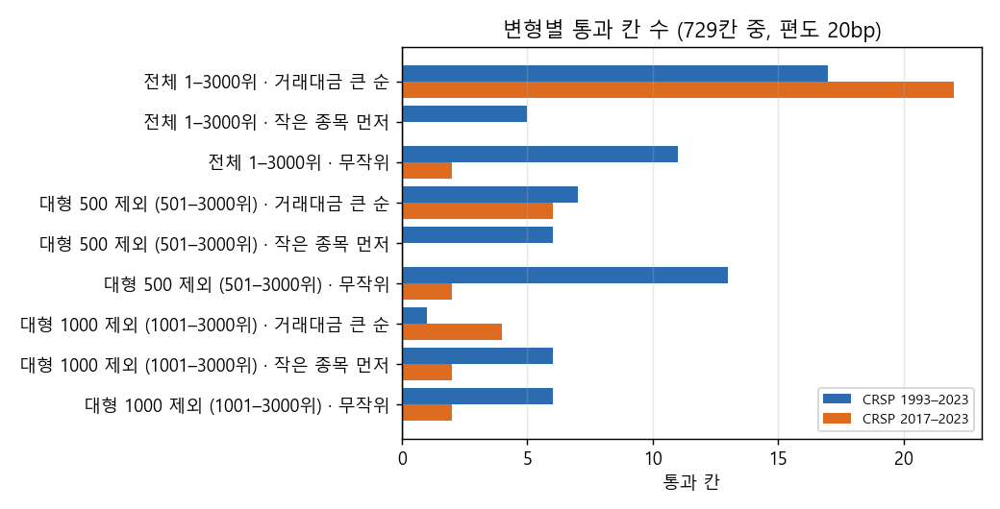
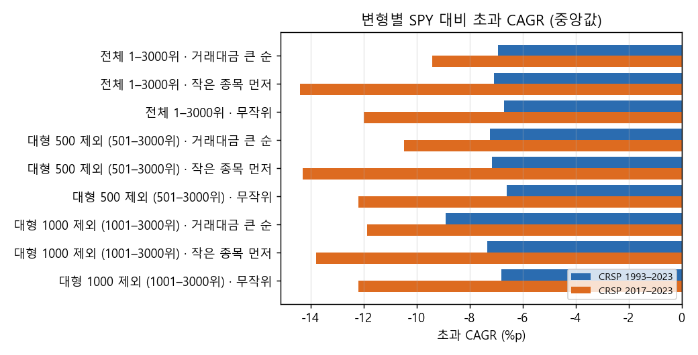
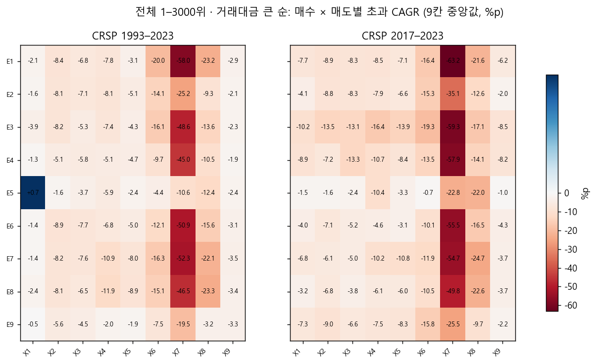
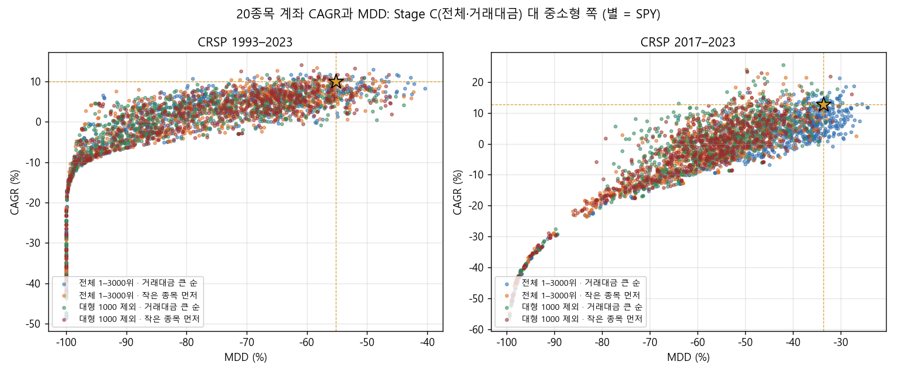

# Stage D 결과: 놓친 중소형 신호를 가져오면 나아지는가 (결정 82)

2026-10-27 · 연구실 컴퓨터 실행(11:22–15:04 KST, 신호표 replay). 결과는 드라이브 `CRSP/lab_crsp/stagec_missed_daily3000`에 있습니다. 설계와 판정은 실행 전에 기록한 결정 82와 `2026-10-27_stage_d_design.md`를 따랐고, 보류 구간(2024년 이후)은 쓰지 않았습니다. 집계표는 `docs/research/lab/2026-10-27_stage_d/`에 있습니다.

## 왜 했는지

Stage C의 20종목 계좌는 같은 날 신호가 자리보다 많으면 거래대금 큰 순으로 샀습니다. 그래서 큰 종목 신호만 샀고, 놓친 중소형 신호의 신호당 수익이 더 높았습니다. 사용자는 위험을 감수하더라도 그 신호를 가져오는 쪽으로 다시 돌려 보자고 했습니다. Stage D는 매수·매도 규칙은 그대로 두고 '어떤 신호를 사느냐'만 바꿨습니다.

## 핵심 결과

중소형 쪽으로 옮겨도 나아지지 않았습니다. 9가지 변형 모두에서, 미리 정한 후보 조건을 만족한 조합이 없었습니다. 조건은 두 기간 모두 이웃 칸이 받쳐 주는 통과 영역이 있고 40bp에서도 통과하는 것입니다. 통과 칸 수는 Stage C 그대로인 '전체 · 거래대금 큰 순'(1993–2023 17칸, 2017–2023 22칸)이 가장 많았습니다. '작은 종목 먼저'는 2017–2023에서 통과가 0–2칸이었고, CAGR 중앙값도 마이너스(−1.1–−1.7%)로 떨어졌습니다. 변동성은 더 커졌고(연 20% → 23–26%), 최악의 해도 더 나빴습니다.

가장 중요한 발견은 '놓친 신호가 더 좋았던' 이유가 종목 크기가 아니라는 점입니다. 사는 순서를 무작위나 작은 종목 먼저로 바꾸면 산 신호의 시총 순위는 1,100–2,250위로 옮겨 갔습니다. 그래도 산 신호의 신호당 평균 수익(1993–2023 중앙 0.5–0.6%)은 놓친 신호(1.0–1.2%)보다 여전히 낮았습니다. 크기와 상관없이, 20종목 계좌가 '자리가 날 때' 사는 신호 자체가 평균보다 못한 신호라는 뜻입니다. 이유에 대한 가설은 해석 절에 적었습니다.

비용을 편도 40bp로 올리면 모든 변형의 CAGR 중앙값이 0% 안팎으로 떨어졌습니다. 작은 종목 먼저 사는 경우 100만 달러 계좌에서는 1993–2023 거래의 약 20%가 그 종목 하루 평균 거래대금의 5%를 넘는 주문이었습니다. 실제로는 체결 비용이 더 클 수 있습니다.

## 그림

## 무엇을 시험했나

### 종목 필터링

Stage C와 같습니다. 매일 21거래일 평균 시가총액 상위 3,000개 미국 보통주 가운데 위생 필터를 통과한 종목이 후보입니다. 위생 필터는 최근 12개월 중 90% 이상 거래, 주가 5달러 이상, 21일 평균 거래대금 100만 달러 이상, 63일 Amihud 비유동성 상위 20% 제외입니다. 여기에 변형별로 '신호일 시총 순위 범위'를 더 겁니다. 범위는 전체(1–3,000위), 대형 500 제외(501–3,000위), 대형 1,000 제외(1,001–3,000위) 세 가지이고, 범위 밖 신호는 아예 사지 않습니다.

### 매수

신호는 Stage C의 E1–E9입니다. 모두 조건이 처음 참이 된 날 종가로 판단해 다음 날 시가에 삽니다.

- E1 직전 N일 고가 돌파(20 / 55 / 100일)
- E2 N일선이 200일선을 상향 교차(20 / 50 / 100)
- E3 52주 신고가 + 거래량 m배(1.2 / 1.5 / 2.0)
- E4 볼린저 밴드폭 하위 p% 뒤 상단 돌파(10 / 20 / 30)
- E5 200일선 위에서 2일 RSI < r(5 / 10 / 15)
- E6 MACD 상향 교차(MACD > 0)
- E7 +DI 상향 교차 + ADX ≥ a
- E8 L개월 수익률 > 단기국채(3 / 6 / 12)
- E9 갭 상승 + 거래량 3배 + 양봉(g 2 / 4 / 6%)

계좌는 최대 20종목입니다. 매수 시 자산의 1/20을 넣고 리밸런싱은 하지 않습니다. 이미 든 종목은 건너뛰고, 자리가 없을 때 난 신호는 버립니다. 같은 날 후보가 남은 자리보다 많을 때 사는 순서는 변형별로 다릅니다: 20일 평균 거래대금 큰 순(Stage C), 시총이 작은 종목 먼저, 무작위(시드 81).

### 매도

Stage C의 X1–X9이고, 조건이 맞은 날 종가로 판단해 다음 날 시가에 전량 팝니다.

- X1 보유 중 최고 종가 대비 x% 하락(15 / 25 / 35%)
- X2 최고 종가 − k × ATR(22)
- X3 직전 N일 저가 이탈
- X4 N일선 이탈
- X5 N일 수익률 < 0
- X6 파라볼릭 SAR 반전
- X7 종가 > 5일선 또는 2일 RSI > r
- X8 SPY가 N일선 아래
- X9 진입가 − k × ATR(14) 손절 + 2R 뒤 손익분기 + 60일 시간 손절

상장폐지 때는 공통으로 팝니다. 비용은 편도 20bp와 40bp 두 가지로 계산했습니다.

## 결과

### 변형별 성적 (20종목 계좌, 729칸의 중앙값)

| 범위 · 사는 순서 | 통과 칸 1993 / 2017 | CAGR 1993 / 2017 | MDD 1993 / 2017 | 변동성 1993 / 2017 | 최악의 해 1993 / 2017 | 40bp 통과 칸 1993 / 2017 |
|---|---|---|---|---|---|---|
| 전체 · 거래대금 (Stage C) | 17 / 22 | 3.0% / 3.3% | −78% / −42% | 20% / 21% | −43% / −24% | 10 / 8 |
| 전체 · 무작위 | 11 / 2 | 3.2% / 0.7% | −69% / −48% | 20% / 22% | −42% / −26% | 5 / 2 |
| 전체 · 작은 종목 먼저 | 5 / 0 | 2.8% / −1.7% | −75% / −58% | 23% / 26% | −43% / −29% | 4 / 0 |
| 501–3000위 · 거래대금 | 7 / 6 | 2.7% / 2.2% | −81% / −52% | 23% / 25% | −44% / −26% | 4 / 3 |
| 501–3000위 · 무작위 | 13 / 2 | 3.3% / 0.5% | −68% / −50% | 21% / 23% | −42% / −26% | 8 / 0 |
| 501–3000위 · 작은 종목 먼저 | 6 / 0 | 2.8% / −1.6% | −76% / −58% | 24% / 27% | −43% / −30% | 3 / 0 |
| 1001–3000위 · 거래대금 | 1 / 4 | 1.0% / 0.8% | −84% / −57% | 24% / 27% | −45% / −28% | 0 / 2 |
| 1001–3000위 · 무작위 | 6 / 2 | 3.1% / 0.5% | −70% / −52% | 22% / 24% | −41% / −27% | 3 / 1 |
| 1001–3000위 · 작은 종목 먼저 | 6 / 2 | 2.6% / −1.1% | −75% / −58% | 24% / 27% | −42% / −30% | 3 / 2 |

SPY는 1993–2023 9.9%(−55%), 2017–2023 12.7%(−34%)입니다. 낙폭 조건 없이 CAGR만으로 줄 세우면 1993–2023에서는 '501–3000위 · 무작위'(3.3%)가 1위였습니다. 2017–2023에서는 Stage C 그대로인 '전체 · 거래대금'(3.3%)이 1위였습니다. 어느 쪽도 SPY의 3분의 1에 못 미칩니다. 낙폭 15%에 맞춘 수익(같은 낙폭의 SPY+국채 혼합 대비)도 모든 변형에서 마이너스였습니다(1993–2023 중앙 −1.7–−2.0%p).

두 기간 모두에서 통과 칸이 있는 (변형, 쌍)은 20bp에서 9개였습니다. 그중 E5 × X1(눌림목 × % 트레일링)은 Stage C와 같은 결과입니다. 나머지는 대부분 한 기간에 1칸뿐이어서, 이웃이 받쳐 주는 영역이 두 기간 모두에 있는 경우는 없었습니다. 그래서 등록 규칙대로 후보, 지수 점검, DSR은 없습니다.

### 산 신호와 놓친 신호 (범위 안, 20bp, 9칸 중앙값, 1993–2023)

| 범위 · 사는 순서 | 산 신호 시총 순위 중앙 | 놓친 신호 시총 순위 중앙 | 신호당 수익 산 / 놓친 | +50% 신호 중 산 비율 |
|---|---|---|---|---|
| 전체 · 거래대금 | 393 | 1,112 | 0.5% / 1.3% | 2.0% |
| 전체 · 무작위 | 1,144 | 1,083 | 0.5% / 1.2% | 2.4% |
| 전체 · 작은 종목 먼저 | 2,215 | 1,030 | 0.5% / 1.2% | 4.1% |
| 501–3000위 · 작은 종목 먼저 | 2,224 | 1,330 | 0.5% / 1.1% | 4.8% |
| 1001–3000위 · 작은 종목 먼저 | 2,255 | 1,632 | 0.5% / 1.0% | 6.2% |

사는 종목의 크기는 순서 규칙대로 크게 바뀌었습니다. 하지만 산 신호의 신호당 수익은 어느 변형에서나 0.3–0.6%로 거의 같았고, 놓친 신호(1.0–1.3%)보다 낮았습니다. 2017–2023도 같은 방향입니다(산 쪽 −0.3–+0.1%, 놓친 쪽 0.5–0.6%). 큰 수익 신호를 사는 비율은 작은 종목 먼저일 때 2%에서 4–6%로 늘었지만 여전히 작았습니다.

### 실제로 살 수 있는가 (주문 금액 ÷ 그 종목 20일 평균 거래대금)

10만 달러 계좌에서는 어떤 변형이든 주문이 하루 거래대금의 0.3% 안쪽이었고, 5%를 넘는 거래는 없었습니다. 100만 달러 계좌에서는 이렇습니다.
- 거래대금 순: 5% 넘는 거래가 1% 안팎입니다.
- 무작위: 1993–2023 8–13%, 2017–2023 1% 안쪽입니다.
- 작은 종목 먼저: 1993–2023 거래의 약 20%가 5%를 넘었습니다.

### Stage C 재현 확인

등록한 첫 단계로 '전체 · 거래대금 · 20bp'가 Stage C의 저장된 계좌를 재현하는지 확인했습니다. 1,458칸 중 1,443칸은 상대 오차 1e-5 안이었습니다(중앙 1e-6, 저장 형식 때문의 차이). 나머지 15칸은 모두 E8(시계열 모멘텀)과 X7·X8 조합이었고, 오차는 최대 0.9%였습니다. E8은 단기국채 수익률과 비교하는 유일한 매수 신호입니다. 이번 신호표를 만들 때 받은 단기국채 수익률 자료가 Stage C 때와 조금 달라서, 경계에 걸린 신호 몇 개가 바뀐 것으로 보입니다. 계좌를 다시 계산하는 방법 자체는 다른 모든 칸에서 맞았습니다. 이 15칸은 후보 판정에 영향이 없었습니다(후보 0). 그래서 실행을 멈추지 않고 이 사실을 기록합니다.

## 해석

아래는 결과에서 추론한 것이고 따로 확인하지는 않았습니다.

> 2026-10-27 추가: 후속 진단(`2026-10-27_stage_d_timing.md`)에서 아래 1번 해석은 맞지 않았습니다. 칸 단위로 보면 놓친 신호와 산 신호의 차이가 거의 없었고(중앙 +0.03%p / −0.31%p), 신호가 몰린 시점으로도 설명되지 않았습니다. 기록으로 남겨 둡니다.

1. Stage C에서 본 '놓친 신호가 더 좋다'는 크기 효과가 아니라 시점 효과로 보입니다. 20종목 계좌는 자리가 날 때만 삽니다. 자리는 보유 종목이 손절·추세 이탈로 팔릴 때 나고, 이런 날은 시장이 약할 때가 많습니다. 반대로 신호가 한꺼번에 쏟아지는 날(큰 하락 뒤 반등)에는 계좌가 이미 차 있어 대부분을 놓칩니다. 그런 반등 신호가 평균적으로 좋았다면, 어떤 순서 규칙으로도 그 신호를 가져올 수 없습니다.
2. 그렇다면 고칠 곳은 '어떤 신호를 사느냐'가 아니라 '언제 자리가 있느냐'입니다. 예를 들어 종목 수를 늘리거나, 일부 현금을 남겨 두거나, 신호가 몰리는 날 더 사는 방식이 있습니다. 하지만 이것은 20종목 제한이라는 사용자 조건과 부딪힙니다.
3. 소형주 쪽으로 옮기면 변동성과 최악의 해가 나빠지고, 큰 계좌에서는 체결도 어려워집니다. 위험을 감수해도 얻는 것이 없었습니다.

## 한계

계산은 신호표 replay로 했고, 엔진과 같다는 것은 Stage C 칸 1,443개에서 확인했습니다. E8의 15칸은 입력 자료 차이로 Stage C와 조금 다릅니다. 비용은 편도 20bp·40bp 고정이라, 소형주의 실제 호가 차이와 시장 충격은 반영하지 못했습니다. 세금은 없습니다. 시점 효과 가설은 아직 숫자로 확인하지 않았습니다. 이번 시험 기록(26,244개 계좌)은 드라이브 `stagec_missed_daily3000/lab_results`에 있고, 노트북 연구 기록에는 합치지 않았습니다.

## 남은 판단

- 시점 효과 가설을 확인할지: 신호가 몰린 날과 아닌 날의 신호당 수익, 계좌가 꽉 찬 날의 비율을 신호표로 바로 볼 수 있습니다(엔진 재실행 없음).
- 20종목 제한을 유지하면서 '자리'를 다루는 방식을 시험할지: 예를 들어 보유 상한 20 + 현금 일부 유보, 또는 같은 날 신호가 N개 이상이면 다음 날 나눠 사기.
- 매수 전 스크리닝(원래 다음 단계)을 이 결과를 반영해 어떻게 설계할지.
- 보류 구간 후보는 없습니다.
