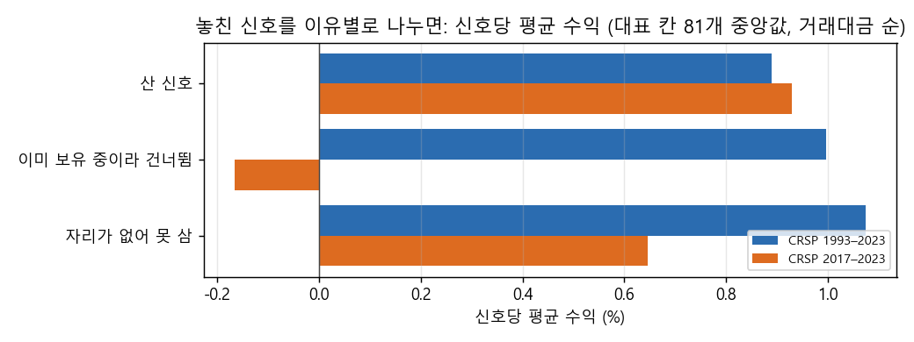
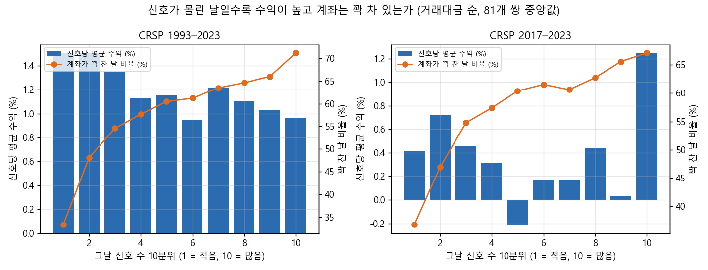

# Stage D 시점 진단: 20종목 계좌가 놓친 신호는 정말 더 좋았나

2026-10-27 · 새 전략이나 엔진 재실행 없이 했습니다. 저장된 신호표(`stagec_signals_v2`)와 20종목 계좌 replay(`lab/signal_replay.py`)만 썼습니다. 대상은 매수 9 × 매도 9 = 81쌍의 대표 칸 × 두 표본입니다. 계좌는 전체 범위, 편도 20bp이고, 사는 순서는 Stage C의 거래대금 순과 비교용 작은 종목 먼저 두 가지입니다. 재현 스크립트는 `scripts/stage_d_timing.py`이고 집계표는 `docs/research/lab/2026-10-27_stage_d_timing/`에 있습니다. 보류 구간은 쓰지 않았습니다.

## 왜 했는지

Stage C·D에서 '20종목 계좌가 놓친 신호의 신호당 수익이 산 신호보다 높다'는 결과가 나왔습니다. Stage D에서 작은 종목을 사도 이 차이가 그대로여서, 원인이 종목 크기가 아니라 '자리가 나는 시점'일 것이라는 가설을 세웠습니다. 놓친 신호를 이유별로 나누고, 신호가 몰린 날과 시장 상태로 나눠 이 가설을 확인했습니다.

## 핵심 결과

먼저 바로잡을 점이 있습니다. 칸 하나하나에서 보면 놓친 신호가 산 신호보다 일관되게 좋지는 않았습니다. 대표 칸 81개 가운데 놓친 쪽이 더 높은 쌍은 1993–2023에서 54%, 2017–2023에서 31%였습니다. 칸별 차이의 중앙값도 +0.03%p와 −0.31%p로 거의 0입니다. Stage C·D의 '놓친 쪽이 늘 높다'는 숫자는 칸마다 산 쪽과 놓친 쪽의 중앙값을 따로 구해 나란히 놓은 것이었습니다. 그 비교가 실제보다 차이를 크게 보이게 했습니다.

시점 가설도 맞지 않았습니다. 신호가 가장 많이 몰린 날(상위 10%)에 전체 신호의 약 3분의 1이 나왔고, 그런 날 계좌는 71%(평소 59%)가 꽉 차 있었습니다. 시점 때문에 많이 놓친 것은 맞습니다. 하지만 1993–2023에서는 신호가 몰린 날의 신호가 오히려 덜 좋았습니다(신호당 1.0% 대 신호가 적은 날 1.5%). 같은 날짜 묶음 안에서 비교해도 산 쪽과 놓친 쪽의 차이는 거의 그대로 남았습니다(93–107%). 이미 보유 중이라 건너뛴 신호는 놓친 신호의 1%뿐이라 영향이 작았습니다.

시장 상태로 나누면 시장이 고점에서 많이 빠져 있을 때 난 신호가 가장 좋았습니다(1993–2023 1.5%, 2017–2023 1.7%). 시장이 고점 근처일 때 난 신호는 가장 나빴습니다(0.6%, −0.4%). 계좌는 하락장에서 신호를 더 많이 샀습니다(매수 비율 7.5% 대 1.2%). 그러니 '약한 시장에서만 자리가 나서 나쁜 신호를 산다'는 설명도 맞지 않습니다.

## 그림

## 무엇을 봤나

종목 필터링, 매수, 매도는 Stage C·D와 같습니다.
- 종목 필터링: 매일 21일 평균 시총 상위 3,000 + 위생 필터
- 매수: E1–E9의 첫날 신호. 쌍마다 대표 값(예: 돈치안 55일, 눌림목 RSI2 < 10, 시계열 모멘텀 12개월)
- 매도: X1–X9. 대표 값(예: 고점 대비 25% 트레일링, 샹들리에 3 ATR, 손절 묶음 2 ATR)
- 계좌: 최대 20종목, 자산의 1/20씩 매수, 자리가 없으면 신호를 버림

신호 하나하나는 그 신호만 다음 날 시가에 사서 같은 매도 규칙으로 판다고 보고 수익을 계산했습니다(신호표).

1. 사지 않은 신호를 두 가지로 나눴습니다: 그 종목을 이미 들고 있어 건너뛴 신호, 그날 남은 자리가 없어 못 산 신호. 체결이 안 된 주문은 뺐습니다.
2. 칸마다 날짜를 그날 신호 수로 10분위로 나눴습니다. 분위별 신호당 수익과 계좌가 꽉 찬 날의 비율을 봤습니다.
3. 같은 분위 안에서 산 신호와 놓친 신호를 비교했습니다(산 신호 수로 가중). 전체 차이 가운데 얼마가 남는지 봤습니다.
4. 신호일의 SPY 상태(52주 고점 대비 낙폭, 20일 수익률)를 3분위로 나눠 신호당 수익과 매수 비율을 봤습니다.

## 결과

### 놓친 신호를 이유별로 (대표 칸 81개의 중앙값, 거래대금 순)

| 구분 | 신호 수 1993 / 2017 | 신호당 수익 | 승률 | +50% 비율 |
|---|---|---|---|---|
| 산 신호 | 5,999 / 1,406 | 0.89% / 0.93% | 40% / 41% | 1.9% / 2.3% |
| 이미 보유 중이라 건너뜀 | 2,462 / 509 | 1.00% / −0.17% | 39% / 36% | 3.0% / 1.9% |
| 자리가 없어 못 삼 | 194,911 / 46,068 | 1.07% / 0.65% | 39% / 38% | 2.5% / 2.7% |

놓친 신호의 99%가 '자리가 없어서'였습니다. 작은 종목 먼저 사도 모양은 같았습니다(산 신호 1.15% / 0.59%, 못 산 신호 1.05% / 0.58%).

### 칸별 차이 (놓친 신호 − 산 신호의 신호당 수익)

| 사는 순서 | 표본 | 놓친 쪽이 높은 쌍 | 차이 중앙값 | 사분위 범위 |
|---|---|---|---|---|
| 거래대금 순 | 1993–2023 | 54% | +0.03%p | −0.43 – +0.33%p |
| 거래대금 순 | 2017–2023 | 31% | −0.31%p | −1.12 – +0.10%p |
| 작은 종목 먼저 | 1993–2023 | 49% | −0.06%p | −0.54 – +3.46%p |
| 작은 종목 먼저 | 2017–2023 | 51% | +0.01%p | −1.13 – +0.58%p |

### 신호가 몰린 날

신호 수 상위 10% 날짜에 전체 신호의 32%(1993–2023)와 33%(2017–2023)가 나왔습니다. 그런 날 계좌가 꽉 차 있던 비율은 71%와 67%로, 전체 날짜 평균(59%, 58%)보다 높습니다. 분위별 신호당 수익은 1993–2023에서 신호가 적은 날 1.5%에서 많은 날 1.0%로 내려갔습니다. 2017–2023에서는 들쭉날쭉하다가 마지막 분위만 1.25%로 높았습니다. 같은 분위 안에서 비교해도 놓친 쪽 − 산 쪽 차이가 전체 차이의 93%(1993–2023)와 107%(2017–2023)만큼 남았습니다. 그러니 신호가 몰리는 시점으로는 차이를 설명하지 못합니다. 다만 칸별 차이 자체가 원래 작습니다.

### 시장 상태 (신호일 SPY, 3분위)

| SPY 상태 | 신호당 수익 1993 / 2017 | 계좌 매수 비율 1993 / 2017 |
|---|---|---|
| 고점 대비 가장 많이 빠졌을 때 | 1.46% / 1.66% | 7.5% / 6.4% |
| 중간 | 1.32% / 0.73% | 2.6% / 2.7% |
| 고점 근처 | 0.55% / −0.36% | 1.2% / 1.6% |
| 20일 수익률 가장 낮을 때 | 0.72% / 1.34% | 6.7% / 6.5% |
| 20일 수익률 가장 높을 때 | 1.51% / 0.83% | 3.3% / 3.5% |

## 해석

아래는 결과에서 추론한 것입니다.

1. '놓친 신호가 늘 더 좋다'는 관찰은 집계 방식 때문에 커 보였습니다. 칸 단위로 보면 차이는 거의 없고 방향도 섞여 있습니다. 그래서 '놓친 신호를 가져오면 나아진다'는 전제 자체가 약했습니다. Stage D에서 어떤 순서 규칙으로도 나아지지 않은 것과 맞습니다.
2. 20종목 계좌가 SPY에 진 이유는 '좋은 신호를 놓쳐서'라기보다 신호 자체의 기대값이 작아서(신호당 1% 안팎)로 보입니다. 비용과 꽉 찬 상태에서의 기회비용을 넘을 만큼 크지 않은 것입니다.
3. 시장이 많이 빠져 있을 때 난 신호가 가장 좋았습니다. 하락 뒤 반등 초입의 추세 신호가 가장 가치 있다는 뜻으로 읽힙니다. 시장 국면을 매수 판단에 쓰는 방향(예: 하락장에서 슬롯을 더 쓰기)은 다음 설계의 실마리가 될 수 있습니다. 다만 이것은 이번 진단의 범위 밖이고 따로 시험해야 합니다.

## 한계

대표 칸 81개 × 두 표본 × 사는 순서 2가지만 봤고, 9칸 전체를 보지는 않았습니다. 신호당 수익은 같은 종목에 겹친 신호도 각각 센 값이라 서로 독립이 아닙니다. 중앙값끼리의 비교라 일부 칸의 큰 값이 흐려질 수 있습니다. 이 진단은 시험 기록에 넣지 않았습니다(새 전략 없음).

## 남은 판단

- 다음 설계에서 '놓친 신호 가져오기'는 접고 다른 쪽을 볼지. 예: 신호의 기대값 자체를 올리는 매수 전 스크리닝, 또는 시장 낙폭 국면에 따라 슬롯을 쓰는 규칙.
- 시장 낙폭 3분위 결과를 바탕으로 '하락장 신호 우선' 같은 규칙을 새로 등록해 시험할지. 이 경우 결과를 본 뒤의 설계라 데이터 스누핑 위험이 있습니다. 보류 구간 평가를 아끼는 등 검증을 더 엄하게 해야 합니다.
