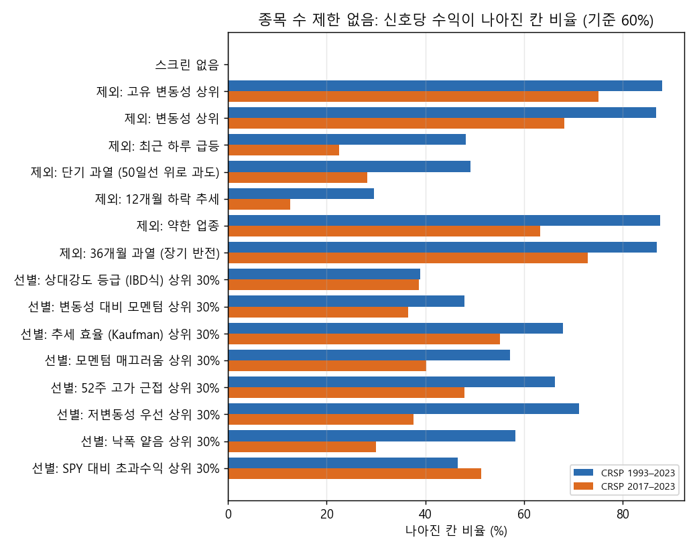
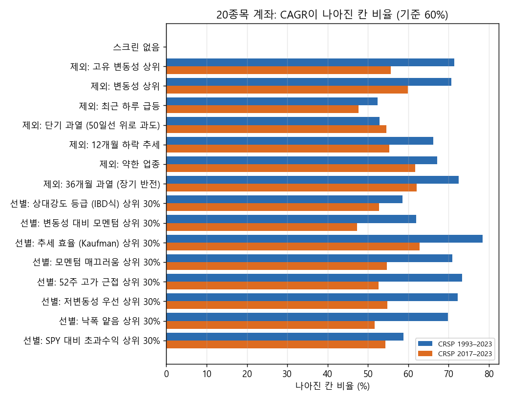
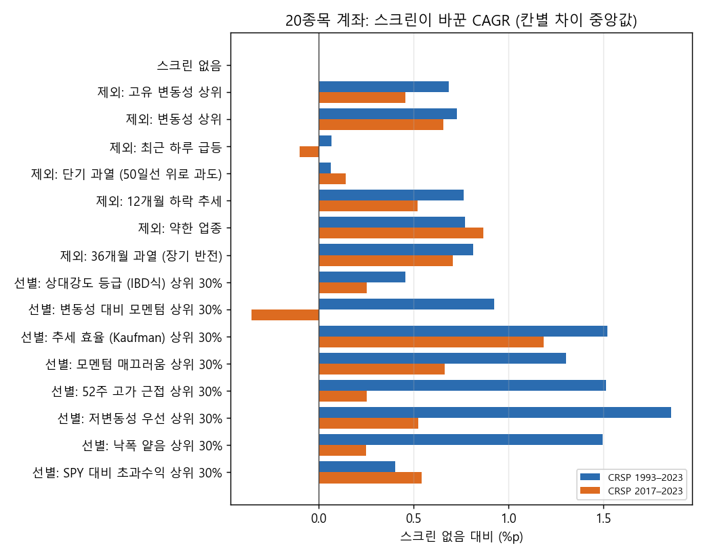
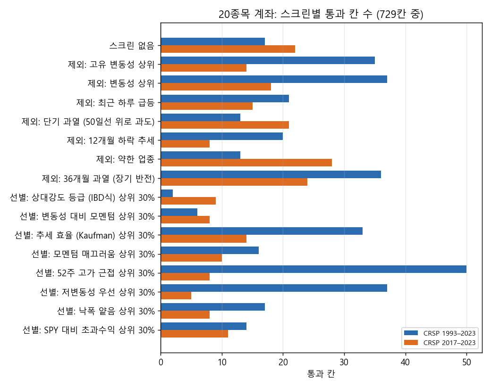
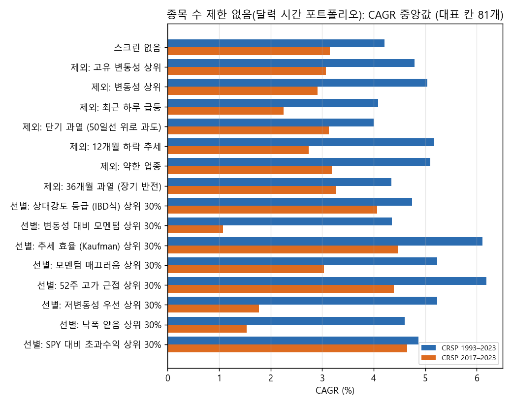

# Stage E 결과: 매수 전 스크리닝, 종목 수 제한 없음과 20종목 (결정 83)

2026-10-27 · 연구실 컴퓨터 실행(19:38–22:35 KST, 신호표 + 20종목 계좌 replay, 엔진 재실행 없음). 결과는 드라이브 `CRSP/lab_crsp/stagec_screens_daily3000`에 있습니다. 설계와 판정은 실행 전에 커밋한 결정 83과 `2026-10-27_stage_e_design.md`를 따랐고, 보류 구간(2024년 이후)은 쓰지 않았습니다. 집계표는 `docs/research/lab/2026-10-27_stage_e/`에 있습니다.

## 왜 했는지

Stage C·D와 그 시점 진단에서 20종목 계좌가 SPY에 진 이유는 신호 자체의 기대값이 작아서(신호당 1% 안팎)로 보였습니다. 사용자는 매수 신호가 난 종목을 사기 전에 한 번 더 거르자고 했습니다. 그리고 그 효과를 20종목 계좌와 종목 수 제한 없음 두 가지로 보자고 했습니다.

## 핵심 결과

미리 정한 기준을 만족한 스크린이 있었습니다. 기준은 두 기간 모두 '스크린 없음'과 같은 칸끼리 비교해 60% 이상 나아지고, 차이 중앙값이 0보다 큰 것입니다.
- 종목 수 제한 없음(신호당 수익): 고유 변동성 상위 20% 제외, 변동성 상위 20% 제외, 약한 업종 제외, 36개월 과열 제외의 4가지가 통과했습니다.
- 20종목 계좌(CAGR): 추세 효율 상위 30% 선별, 약한 업종 제외, 36개월 과열 제외의 3가지가 통과했습니다.
- 두 쪽 모두 통과한 것은 '약한 업종 제외'와 '36개월 과열 제외'입니다.

다만 나아진 크기는 작았습니다. 신호당 수익은 중앙 +0.04–0.16%p, 20종목 계좌 CAGR은 +0.7–1.5%p 늘었습니다. 20종목 계좌의 CAGR 중앙값은 여전히 3–5%로 SPY(9.9%, 12.7%)에 크게 못 미칩니다. 낙폭은 '저변동성 상위 30%'와 '낙폭 얕음 상위 30%'가 가장 많이 줄였습니다(칸의 95–99%에서 MDD가 얕아짐, 중앙 +8–24%p). 하지만 수익은 거의 늘지 않았습니다.

20종목 계좌에서 두 기간 모두 이웃 칸이 받쳐 주는 통과 영역이 생긴 후보가 4개 나왔습니다. 모두 '상승 추세 속 눌림목(E5)' 매수에 % 트레일링(X1) 또는 손절 묶음(X9) 매도였고, 스크린은 52주 고가 근접, 저변동성, SPY 대비 초과수익, 약한 업종 제외였습니다. 넷 모두 편도 40bp에서도 통과했습니다. 그러나 지금까지의 시험 수를 반영한 DSR은 0–0.17로, 우연을 배제하기 어렵습니다. 1993–98에는 대부분 SPY에 졌고, 1999–2003에 크게 앞선 경우가 많습니다. 그래서 보류 구간 후보로 올리지 않습니다.

종목 수 제한 없음의 달력 시간 포트폴리오(그날 열린 포지션 전부를 같은 비중)는 보유 종목이 중앙 250–930개로, 실제로 따라 하기 어려운 규모였습니다. CAGR도 스크린별 중앙 1–6%에 그쳤습니다.

## 그림

## 무엇을 시험했나

### 종목 필터링

기본은 Stage C와 같습니다. 매일 21거래일 평균 시가총액 상위 3,000개 미국 보통주 가운데 위생 필터를 통과한 종목이 후보입니다. 위생 필터는 최근 12개월 중 90% 이상 거래, 주가 5달러 이상, 21일 평균 거래대금 100만 달러 이상, 63일 Amihud 비유동성 상위 20% 제외입니다. 추세 템플릿은 없습니다. 여기에 매수 신호가 난 날 스크린 하나를 더 겁니다(신호일 종가까지의 자료만 사용).

제외 7가지(걸리면 사지 않음):
- 고유 변동성 상위 20%: 63일 SPY 대비 잔차 변동성
- 변동성 상위 20%: 60일
- 최근 하루 급등: 21일 중 하루 +20% 이상
- 단기 과열: 종가 > 50일선 × 1.25
- 12개월 하락: 12-1개월 수익률 < 0
- 약한 업종: 2자리 SIC 업종의 평균 6-1개월 수익률 하위 30%
- 36개월 과열: 36개월 수익률 상위 10%

선별 8가지(그날 후보 중 점수 상위 30%만 삼):
- IBD식 상대강도
- 변동성 대비 12개월 모멘텀
- 6개월 추세 효율
- 12개월 모멘텀 매끄러움(오른 날 비율)
- 52주 고가 근접
- 저변동성
- 12개월 낙폭 얕음
- 6개월 SPY 대비 초과수익

### 매수

Stage C의 E1–E9입니다. 모두 조건이 처음 참이 된 날 종가로 판단해 다음 날 시가에 삽니다.
- E1 직전 N일 고가 돌파
- E2 N일선이 200일선 상향 교차
- E3 52주 신고가 + 거래량
- E4 볼린저 수축 뒤 상단 돌파
- E5 200일선 위에서 2일 RSI < r(상승 추세 속 눌림목)
- E6 MACD 상향 교차
- E7 +DI 상향 교차 + ADX
- E8 L개월 수익률 > 단기국채
- E9 갭 상승 + 거래량 3배

20종목 계좌는 Stage C와 같습니다. 자산의 1/20씩 사고, 리밸런싱은 없으며, 자리가 없으면 신호를 버리고, 같은 날은 거래대금 큰 순으로 삽니다. 종목 수 제한 없음은 통과한 신호를 모두 각각 매매합니다.

### 매도

Stage C의 X1–X9이고, 조건이 맞은 날 종가로 판단해 다음 날 시가에 전량 팝니다.
- X1 최고 종가 대비 x% 하락
- X2 샹들리에(ATR 22)
- X3 N일 신저가
- X4 N일선 이탈
- X5 N일 수익률 < 0
- X6 파라볼릭 SAR 반전
- X7 5일선 위 또는 2일 RSI > r
- X8 SPY가 N일선 아래
- X9 ATR 손절 + 2R 뒤 손익분기 + 60일 시간 손절

상장폐지 매도는 공통이고, 비용은 편도 20bp입니다(후보는 40bp로 다시 확인).

## 결과

### 스크린별 짝 비교 (729칸, 1993–2023 / 2017–2023)

| 스크린 | 남는 신호 | 제한 없음: 신호당 수익 나아진 칸 · 차이 중앙 | 20종목: CAGR 나아진 칸 · 차이 중앙 | 20종목: MDD 나아진 칸 · 차이 중앙 | 도움 판정 (제한 없음 / 20종목) |
|---|---|---|---|---|---|
| 고유 변동성 상위 제외 | 92% / 91% | 88% / 75% · +0.16 / +0.07%p | 71% / 56% · +0.7 / +0.5%p | 81% / 79% · +2.1 / +2.9%p | 예 / 아니오 |
| 변동성 상위 제외 | 91% / 91% | 87% / 68% · +0.16 / +0.04%p | 71% / 60% · +0.7 / +0.7%p | 85% / 80% · +2.7 / +2.9%p | 예 / 아니오 |
| 최근 하루 급등 제외 | 97% / 96% | 48% / 23% · 0 / −0.05%p | 52% / 48% · +0.1 / −0.1%p | 69% / 65% · +0.6 / +1.1%p | 아니오 / 아니오 |
| 단기 과열 제외 | 94% / 94% | 49% / 28% · 0 / −0.04%p | 53% / 55% · +0.1 / +0.1%p | 74% / 74% · +1.3 / +1.6%p | 아니오 / 아니오 |
| 12개월 하락 제외 | 65% / 61% | 30% / 13% · −0.06 / −0.37%p | 66% / 55% · +0.8 / +0.5%p | 75% / 64% · +2.2 / +1.3%p | 아니오 / 아니오 |
| 약한 업종 제외 | 73% / 71% | 88% / 63% · +0.10 / +0.04%p | 67% / 62% · +0.8 / +0.9%p | 70% / 58% · +1.4 / +0.8%p | 예 / 예 |
| 36개월 과열 제외 | 86% / 86% | 87% / 73% · +0.05 / +0.04%p | 73% / 62% · +0.8 / +0.7%p | 83% / 69% · +2.7 / +1.3%p | 예 / 예 |
| 선별: IBD식 상대강도 | 43% / 44% | 39% / 39% · −0.04 / −0.05%p | 59% / 53% · +0.5 / +0.3%p | 48% / 40% · −0.2 / −1.7%p | 아니오 / 아니오 |
| 선별: 변동성 대비 모멘텀 | 30% / 32% | 48% / 36% · 0 / −0.09%p | 62% / 47% · +0.9 / −0.4%p | 78% / 56% · +5.9 / +1.4%p | 아니오 / 아니오 |
| 선별: 추세 효율 | 43% / 47% | 68% / 55% · +0.09 / +0.03%p | 78% / 63% · +1.5 / +1.2%p | 78% / 56% · +3.6 / +0.7%p | 아니오 / 예 |
| 선별: 모멘텀 매끄러움 | 32% / 34% | 57% / 40% · +0.03 / −0.05%p | 71% / 55% · +1.3 / +0.7%p | 88% / 78% · +9.3 / +5.5%p | 아니오 / 아니오 |
| 선별: 52주 고가 근접 | 47% / 45% | 66% / 48% · +0.09 / 0%p | 73% / 53% · +1.5 / +0.3%p | 82% / 68% · +7.3 / +3.7%p | 아니오 / 아니오 |
| 선별: 저변동성 | 31% / 33% | 71% / 38% · +0.19 / −0.08%p | 72% / 55% · +1.9 / +0.5%p | 99% / 95% · +23.7 / +12.1%p | 아니오 / 아니오 |
| 선별: 낙폭 얕음 | 32% / 33% | 58% / 30% · +0.08 / −0.18%p | 70% / 52% · +1.5 / +0.3%p | 97% / 90% · +15.6 / +8.4%p | 아니오 / 아니오 |
| 선별: SPY 대비 초과수익 | 33% / 33% | 47% / 51% · −0.01 / +0.01%p | 59% / 54% · +0.4 / +0.5%p | 56% / 41% · 0 / −2.3%p | 아니오 / 아니오 |

'남는 신호'는 스크린 없음 대비 비율입니다. MDD 차이가 +이면 낙폭이 얕아졌다는 뜻입니다. 20종목 계좌가 산 신호는 스크린 없음일 때 3.4%였고, 선별 스크린을 쓰면 7–10%로 늘었습니다(신호가 줄어서).

### 20종목 계좌의 통과 칸과 후보

통과 칸(729칸 중)은 스크린 없음 17 / 22칸이었습니다. 52주 고가 근접은 50 / 8, 저변동성은 37 / 5, 변동성 상위 제외는 37 / 18, 36개월 과열 제외는 36 / 24, 약한 업종 제외는 13 / 28이었습니다. 두 기간 모두 이웃이 받쳐 주는 통과 영역이 생긴 후보는 4개이고, 모두 40bp에서도 통과했습니다.

| 후보 (대표 칸) | CAGR / MDD 1993–2023 | CAGR / MDD 2017–2023 | 베타 · 하락장 포착률 1993 | 로그 초과 1993–98 / 1999–2003 / 2004–16 / 2017–23 | DSR 1993 / 2017 | DSR(사분위 흩어짐, N 1,169) 1993 / 2017 |
|---|---|---|---|---|---|---|
| 52주 고가 근접 × E5 눌림목(r 10) × X9 손절 묶음(k 3) | 11.0% / −46% | 15.2% / −32% | 0.87 · 0.85 | −20% / +11% / +19% / +19% | 0.00 / 0.00 | 0.00 / 0.15 |
| 저변동성 × E5 눌림목(r 5) × X9 손절 묶음(k 3) | 12.4% / −41% | 13.5% / −29% | 0.79 · 0.64 | −10% / +24% / +30% / +24% | 0.00 / 0.00 | 0.01 / 0.16 |
| SPY 대비 초과수익 × E5 눌림목(r 10) × X1 트레일링(25%) | 13.1% / −54% | 14.4% / −25% | 0.85 · 0.74 | +5% / +65% / −4% / +20% | 0.00 / 0.00 | 0.00 / 0.17 |
| 약한 업종 제외 × E5 눌림목(r 5) × X1 트레일링(25%) | 13.3% / −50% | 13.7% / −31% | 0.78 · 0.71 | −7% / +63% / +10% / +25% | 0.00 / 0.00 | 0.01 / 0.13 |

SPY는 9.9%(−55%)와 12.7%(−34%)입니다. DSR의 시험 수는 Stage B–E에서 기록된 약 55,000회입니다. 샤프 비율의 흩어짐을 이번 시험 전체로 잡으면 DSR은 모두 0입니다. 극단값이 섞인 이 흩어짐을 사분위 범위로 줄여 다시 잡고(사분위 범위 ÷ 1.349), 시험 수를 유효 수 1,169로 낮춰도 1993–2023 0.00–0.01, 2017–2023 0.13–0.17에 그쳤습니다(오른쪽 열, `scripts/stage_e_report.py`의 `dsr_iqr_effective`).

### 종목 수 제한 없음: 달력 시간 포트폴리오 (대표 칸 81개)

스크린 없음은 CAGR 중앙 4.2% / 3.2%, MDD −60% / −41%였고, 보유 종목 수는 중앙 926 / 861개였습니다. 스크린을 쓰면 보유 종목은 250–900개로 줄었습니다. CAGR 중앙은 추세 효율(6.1% / 4.5%)과 52주 고가 근접(6.2% / 4.4%)이 가장 높았지만 SPY에는 못 미쳤습니다. 통과(CAGR > SPY, |MDD| < |SPY MDD|)한 쌍은 1993–2023에서 최대 13개, 2017–2023에서 0–1개였습니다.

## 해석

아래는 결과에서 추론한 것입니다.

1. 변동성이 크거나, 업종이 약하거나, 오래 과열된 종목을 빼면 신호의 질이 조금 나아졌습니다. 반대로 상대강도·SPY 대비 초과수익처럼 '이미 많이 오른 종목'을 고르는 선별은 신호당 수익을 높이지 못했습니다.
2. 개선 폭(신호당 0.1%p 안팎)은 20종목 계좌가 SPY를 따라잡기에는 너무 작습니다. 스크린 하나로는 Stage C의 근본 문제(신호의 작은 기대값)를 풀지 못합니다.
3. 후보 4개는 모두 '상승 추세 속 눌림목' 매수였습니다. 이 매수는 Stage C에서도 유일하게 두 기간 모두 1위였습니다. 다만 약 55,000번 시험한 끝에 나온 결과라 DSR이 매우 낮고, 1999–2003 같은 특정 구간 의존도 남아 있습니다.

## 한계

칸 단위 짝 비교는 스크린 하나씩만 했고, 조합은 시험하지 않았습니다. 선별은 '상위 30%' 하나만 썼습니다. 달력 시간 포트폴리오는 매일 같은 비중으로 맞추는 비용을 무시해 실제보다 낙관적입니다. 같은 종목에 겹친 신호는 각각 셌습니다. 비용은 편도 20bp(후보 40bp)이고 세금은 없습니다. 이번 시험 기록(23,328개 계좌)은 드라이브 `stagec_screens_daily3000/lab_results`에 있습니다.

## 남은 판단

- '도움' 판정을 받은 스크린(약한 업종 제외, 36개월 과열 제외, 변동성 제외, 추세 효율 선별)을 조합해 볼지. 조합은 새 번호로 결과 전에 등록해야 합니다.
- 후보 4개(모두 눌림목 매수)를 더 엄하게 검증할지. 예: 구간 빼기(1999–2003 제외), 이웃 칸 안정성. 보류 구간 평가는 사용자가 후보를 지정해 요청할 때만 합니다.
- 낙폭을 크게 줄인 저변동성·낙폭 얕음 선별을 '수익 최대'보다 '낙폭 최소' 목표에 맞춰 따로 볼지.
