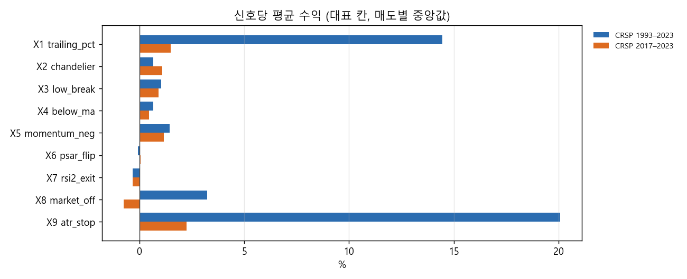
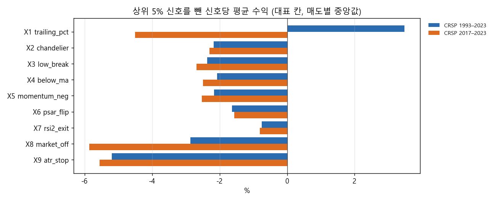
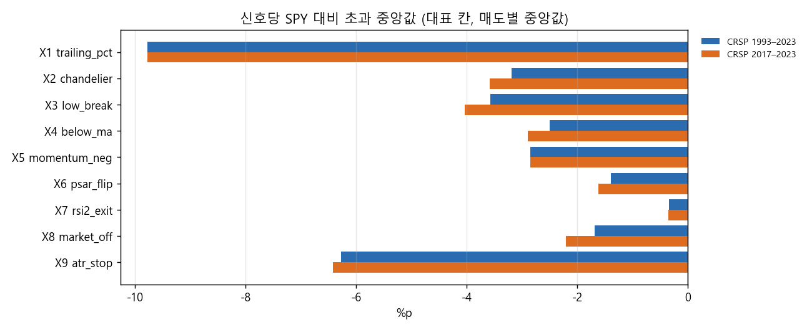
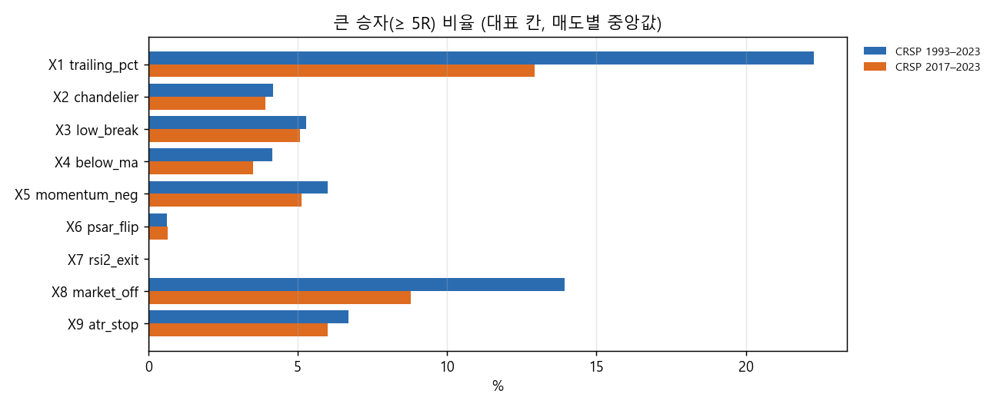
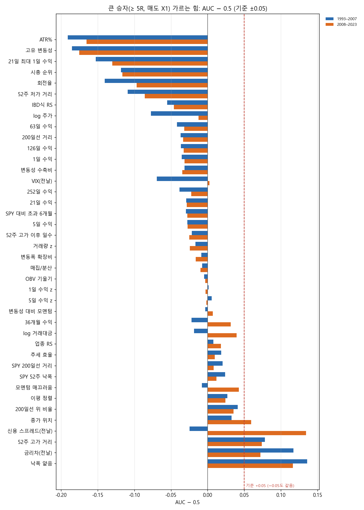
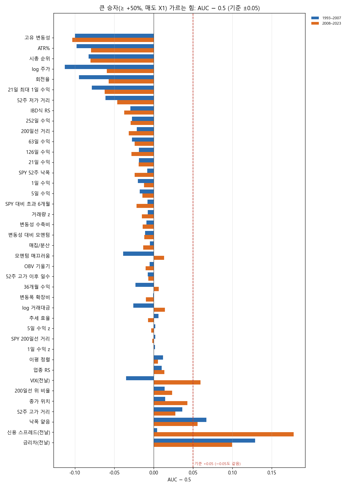

# Stage G-1 결과: 꼬리 분석과 SPY 대비 채점 (결정 85)

설계: `docs/research/lab/2026-10-28_stage_g_design.md`. 결과 전에 커밋 c168660으로 올렸고, 보완(SPY 구간 명시, 월 블록 위약)은 f0344ff입니다. 실행기는 `lab/tail_study.py`(da7ac7d)이고, 2026-10-28 15:20–15:31 KST에 돌렸습니다(점검 실행 15:12).

## 왜 했는지

Stage B–F에서 SPY를 넘는 전략을 찾지 못했습니다. 사용자는 추세추종 수익이 대부분 평균에서 크게 벗어난 소수의 거래에서 나온다고 봤습니다. 이번에는 세 가지를 물었습니다.
- 그 말이 신호 전체에서도 맞는가
- 신호 하나하나가 같은 기간 SPY보다 나았는가
- 큰 승자는 신호가 난 날 이미 무엇이 달랐는가

마지막 답에 따라 다음 단계(③)가 갈립니다. 큰 승자를 '고르는' 모형을 만들지, 아니면 이긴 종목에 더 싣는 '키우는' 쪽(피라미딩)으로 갈지입니다.

설계 전에 이미 본 숫자가 있습니다. Stage C 기본 칸에서 상위 5% 신호가 순이익의 73–145%를 냈고, 2σ 밖 신호가 60–110%를 냈습니다.

## 핵심 결과

1. **수익은 꼬리에서 나옵니다.** 순이익이 플러스인 칸 중 89%(1993–2023)와 100%(2017–2023)에서 상위 5% 신호가 순이익 전부 이상을 냈습니다. 나머지 95%를 합치면 손실이라는 뜻입니다. 신호 수익 중앙값은 −2.1% / −2.5%이고, 왜도 중앙값은 7.3 / 5.8입니다.
2. **신호는 같은 기간 SPY를 이기지 못합니다.** 신호가 같은 보유 구간 SPY보다 나았던 비율은 칸 중앙값 36% / 34%였습니다. SPY 대비 초과의 중앙값은 −2.4% / −2.8%입니다. 평균 초과가 플러스인 칸은 1993–2023에서 32%, 2017–2023에서 3%뿐입니다. 큰 승자(≥ 5R)만 보면 SPY보다 평균 +47% / +53% 높았습니다. 결국 '평균적인 신호'는 시장보다 못하고, 시장을 이기는 것은 드문 큰 승자뿐입니다. 2000–2008만 예외로, 평균 초과가 플러스인 칸이 55%였습니다.
3. **매도 규칙이 꼬리를 결정합니다.** 오래 들고 가는 매도(X1 25% 트레일링, X9 손절 + 손익분기)는 큰 승자(≥ 5R) 비율이 22% / 7%로 가장 높았습니다. 빨리 파는 X6(파라볼릭 SAR)·X7(RSI 2)은 큰 승자가 거의 없었습니다(0–0.7%).
4. **큰 승자를 가르는 특징: 미리 정한 규칙상으로는 '고르는 모형'(③ C)으로 갑니다. 다만 내용은 조심해서 읽어야 합니다.** 매도 X1, 주 정의 B5R에서 8개 특징이 기준을 넘었습니다. ATR%, 고유 변동성, 21일 최대 1일 수익, 시총 순위, 회전율, 52주 저가 거리, 52주 고가 거리, 낙폭 얕음입니다. 위약 200번에서는 신호 위약 · 월 블록 위약 모두 시장 외 특징이 한 번도 통과하지 않았습니다(95% 분위 0개). 하지만 이 8개 중 대부분은 '변동성이 낮은 종목'을 가리킵니다. 5R의 R이 ATR에 비례하므로, 변동성이 낮은 종목은 같은 % 상승으로도 5R에 닿습니다. 즉 상당 부분이 정의에서 나온 결과입니다. 절대 수익 기준(≥ +50%)으로 보면 변동성 특징은 2017–2023에서 방향이 뒤집혔고(고변동성 종목이 큰 승자가 되기 쉬움), 기준을 넘은 것은 '낮은 주가' 하나뿐이었습니다. 시장 특징 6개는 하나도 기준을 넘지 못했습니다.

## 그림

대표 칸의 신호당 평균 수익(매수 9종의 중앙값)입니다. 오래 들고 가는 X1·X9만 1993–2023에서 평균이 크게 플러스이고, 2017–2023에서는 대부분 0 근처입니다.

상위 5% 신호를 빼면 거의 모든 매도에서 평균이 마이너스가 됩니다. 수익이 꼬리에서 나온다는 뜻입니다.

같은 보유 구간 SPY 대비 신호 초과수익의 중앙값입니다. 모든 매도에서 마이너스입니다.

큰 승자(≥ 5R) 비율입니다. X1·X9·X8에서 높고, X6·X7에서는 거의 없습니다.

특징별 AUC − 0.5(1993–2007 / 2008–2023)입니다. 위쪽의 변동성 · 규모 특징이 크게 음수인 것은 큰 승자가 '변동성이 낮은 종목'이라는 뜻이고, 5R 정의의 영향이 큽니다.

같은 그림을 절대 수익 기준으로 그린 것입니다. 변동성 특징의 힘이 작아지고, 2017–2023에서는 방향이 뒤집힙니다(표 참고).

## 무엇을 봤나

### 종목 필터링

Stage C와 같습니다. 매일 21거래일 평균 시가총액 상위 3,000개 미국 보통주 가운데 위생 필터를 통과한 종목이 대상입니다. 위생 필터는 최근 12개월 중 90% 이상 거래, 주가 5달러 이상, 21일 평균 거래대금 100만 달러 이상, 63일 Amihud 비유동성 상위 20% 제외입니다. 추가 스크린은 없습니다.

### 매수

Stage C의 E1–E9 전부입니다(각 3개 값). 조건이 처음 참이 된 날 종가로 판단해 다음 날 시가에 삽니다.
- E1 직전 N일 고가 돌파
- E2 N일선이 200일선 상향 교차
- E3 52주 신고가 + 거래량
- E4 볼린저 수축 뒤 상단 돌파
- E5 200일선 위에서 2일 RSI < r
- E6 MACD 상향 교차
- E7 +DI 상향 교차 + ADX
- E8 L개월 수익률 > 단기국채
- E9 갭 상승 + 거래량

### 매도

Stage C의 X1–X9 전부입니다(각 3개 값). 조건이 맞은 날 종가로 판단해 다음 날 시가에 전량 팝니다.
- X1 최고 종가 대비 x% 하락
- X2 샹들리에(ATR 22)
- X3 N일 신저가
- X4 N일선 이탈
- X5 N일 수익률 < 0
- X6 파라볼릭 SAR 반전
- X7 5일선 위 또는 2일 RSI > r
- X8 SPY가 N일선 아래
- X9 ATR 손절 + 2R 뒤 손익분기 + 60일 시간 손절

### 계산 방식

계좌는 만들지 않았습니다. 신호마다 같은 금액을 산다고 보고(종목 수 제한 없음), 편도 20bp를 뺀 신호 수익을 그대로 봤습니다. 큰 승자 정의는 세 가지입니다.
- B50: 수익 ≥ +50%
- B5R: 수익 ≥ 5R. R = 신호일 ATR(14) × 2 ÷ 매수가
- B2S: 같은 칸에서 신호일 전 365일 동안 매도가 끝난 신호들의 평균 + 2σ 초과

SPY 대비 초과는 신호와 같은 구간(매수일 시가 → 매도일 시가)으로 잽니다. 동일비중 대비 초과는 위생 필터 통과 종목 동일비중 지수로 잽니다.

## 결과

### (가) 꼬리 집중도 (전 칸 729개의 중앙값, 1993–2023 / 2017–2023)

| 항목 | 1993–2023 | 2017–2023 |
|---|---|---|
| 순이익이 플러스인 칸 | 78% | 71% |
| 그중 상위 5%가 순이익 전부 이상을 낸 칸 | 89% | 100% |
| 그중 상위 1%가 순이익 전부 이상을 낸 칸 | 42% | 82% |
| 신호당 평균 / 중앙값 | +1.2% / −2.1% | +0.5% / −2.5% |
| 왜도 | 7.3 | 5.8 |
| 큰 승자 B50 / B5R / B2S | 2.6% / 5.1% / 4.5% | 2.7% / 4.3% / 5.1% |

네 구간으로 나누면 1993–99·2009–16·2017–23은 모양이 비슷합니다. 2000–08은 순이익이 플러스인 칸이 46%뿐이었습니다. 같은 종목이 보유 중에 다시 낸 신호(겹치는 신호)는 칸 중앙값 37%(10–90% 분위 1–80%)입니다. 매수 9종을 합친 (다)의 신호 묶음에서는 96%였습니다.

대표 칸, 매도별(매수 9종의 중앙값):

| 매도 | 평균 | 상위 5% 뺀 평균 | B50 | B5R | SPY 대비 초과 중앙값 | SPY를 이긴 비율 |
|---|---|---|---|---|---|---|
| X1 25% 트레일링 | +14.5% / +1.5% | +3.5% / −4.5% | 14.7% / 7.5% | 22.3% / 12.9% | −9.8% / −9.8% | 35% / 32% |
| X2 샹들리에 3 ATR | +0.7% / +1.1% | −2.2% / −2.3% | 1.9% / 2.2% | 4.2% / 3.9% | −3.2% / −3.6% | 36% / 34% |
| X3 20일 신저가 | +1.0% / +0.9% | −2.4% / −2.7% | 2.5% / 2.7% | 5.3% / 5.1% | −3.6% / −4.0% | 34% / 32% |
| X4 50일선 이탈 | +0.7% / +0.5% | −2.1% / −2.5% | 1.7% / 1.9% | 4.2% / 3.5% | −2.5% / −2.9% | 33% / 33% |
| X5 63일 수익 < 0 | +1.5% / +1.2% | −2.2% / −2.5% | 3.1% / 3.2% | 6.0% / 5.1% | −2.8% / −2.9% | 34% / 33% |
| X6 파라볼릭 SAR | −0.1% / +0.1% | −1.6% / −1.6% | 0.4% / 0.4% | 0.6% / 0.7% | −1.4% / −1.6% | 39% / 38% |
| X7 RSI 2 | −0.3% / −0.3% | −0.7% / −0.8% | 0% / 0% | 0% / 0% | −0.3% / −0.4% | 42% / 43% |
| X8 SPY 200일선 아래 | +3.2% / −0.7% | −2.9% / −5.9% | 7.2% / 5.1% | 13.9% / 8.8% | −1.7% / −2.2% | 41% / 40% |
| X9 손절 묶음(k 2) | +20.1% / +2.3% | −5.2% / −5.6% | 5.8% / 4.8% | 6.7% / 6.0% | −6.3% / −6.4% | 18% / 18% |

X9의 1993–2023 평균 +20%는 극소수의 수십 년 보유 신호에서 나왔습니다. 손익분기 뒤에는 따로 파는 규칙이 없어, 수십 배가 된 신호가 섞여 있습니다.

### (나) SPY · 동일비중 대비 채점

전 칸 중앙값(1993–2023 / 2017–2023)은 다음과 같습니다.
- SPY를 이긴 신호 비율 36% / 34%
- SPY 대비 초과 중앙값 −2.4% / −2.8%, 평균 −0.25% / −0.83%
- 평균 초과가 플러스인 칸 32% / 3%
- 동일비중 대비 초과 중앙값 −2.7% / −2.7%, 이긴 비율 37% / 38%(이 줄만 대표 칸 81개의 중앙값)
- 큰 승자(B5R)만의 SPY 대비 초과 평균 +47% / +53%

구간별 평균 초과가 플러스인 칸은 1993–99 35%, 2000–08 55%, 2009–16 34%, 2017–23 4%였습니다. 시장이 꺾였던 2000–08에만 신호가 시장보다 나은 경우가 많았습니다.

### (다) 큰 승자는 신호 시점에 무엇이 달랐나

분석 대상은 E1–E9 대표 칸 신호를 종목 · 날짜별로 합친 1,669,250개입니다(1993–2023). 매도 X1(25%) 기준 큰 승자(B5R) 비율은 E9가 12.6%로 가장 낮았고, 나머지 매수는 20–24%였습니다.

**미리 정한 판정 (매도 X1, B5R)**: 기준을 넘은 특징은 8개입니다. 모두 시장 외 특징입니다. 위약 95% 분위는 신호 위약 · 월 블록 위약 모두 0개였습니다. 그래서 규칙상 결론은 '③은 큰 승자 확률을 직접 맞히는 걷기식 모형'입니다.

| 특징 | 큰 승자 중앙값 | 나머지 중앙값 | AUC 1993–2007 / 2008–2023 | 네 구간 AUC | ≥ +50% 기준 AUC 2017–23 |
|---|---|---|---|---|---|
| ATR% | 2.3% | 3.1% | 0.31 / 0.34 | 0.28 · 0.32 · 0.30 · 0.44 | 0.62 (뒤집힘) |
| 고유 변동성 | 1.5% | 2.1% | 0.32 / 0.33 | 0.28 · 0.33 · 0.29 · 0.45 | 0.61 (뒤집힘) |
| 21일 최대 1일 수익 | 3.4% | 4.8% | 0.35 / 0.37 | 0.32 · 0.36 · 0.34 · 0.45 | 0.60 (뒤집힘) |
| 시총 순위(작을수록 큼) | 753 | 1,133 | 0.38 / 0.38 | 0.35 · 0.41 · 0.36 · 0.43 | 0.51 |
| 회전율 | 0.5% | 0.7% | 0.36 / 0.40 | 0.33 · 0.38 · 0.37 · 0.48 | 0.57 (뒤집힘) |
| 52주 저가 거리 | +39% | +52% | 0.39 / 0.41 | 0.36 · 0.42 · 0.37 · 0.48 | 0.58 (뒤집힘) |
| 52주 고가 거리 | −5.6% | −8.7% | 0.58 / 0.57 | 0.60 · 0.57 · 0.58 · 0.52 | 0.44 (뒤집힘) |
| 낙폭 얕음 | −27% | −36% | 0.64 / 0.62 | 0.67 · 0.61 · 0.66 · 0.52 | 0.39 (뒤집힘) |

AUC는 0.5가 무작위입니다. 0.5보다 작으면 값이 작을수록 큰 승자가 되기 쉽다는 뜻입니다. 이 8개는 모두 '변동성이 낮고 큰 종목, 고점 가까이에서 덜 빠진 종목'이라는 한 가지 성격을 가리킵니다. 5R의 R은 ATR에 비례합니다. 그래서 변동성이 낮은 종목은 같은 % 상승으로 더 쉽게 5R에 닿고, 이 관계의 상당 부분은 정의에서 나옵니다.

같은 신호를 다른 정의로 보면 결과가 다릅니다.
- 절대 기준(≥ +50%)과 2σ 기준에서는 위 특징이 모두 기준 미달이었고, 2017–2023에서는 방향이 뒤집혔습니다.
- 그 두 정의에서 기준을 넘은 것은 '낮은 주가'(≥ +50%, 2σ)와 '금리차가 클 때'(2σ)뿐이었습니다.
- 매도 X9에서는 '지난 1년 수익이 작을수록'과 '큰 종목일수록'이 B5R · B50 · B2S 모두에서 기준을 넘었습니다.

시장 특징 6개(SPY 200일선 거리, SPY 52주 낙폭, VIX, 금리차, 신용 스프레드, 200일선 위 비율)는 주 정의에서 하나도 기준을 넘지 못했습니다. 신호 위약에서는 시장 특징 1개가 늘 통과했는데(해마다 큰 승자 비율이 달라서), 월 블록 위약에서는 0개였습니다.

## 해석

- 사용자의 판단은 맞았습니다. 신호 단위 수익은 소수의 큰 승자가 전부이고, 나머지는 SPY보다 못합니다. 그래서 '좋은 칸을 고르는' Stage B–F 방식은 사실상 '큰 승자를 몇 개 잡았나'를 재고 있었습니다.
- 매도는 꼬리를 살리는 쪽(오래 들고 가는 트레일링, 손익분기 뒤 길게)이 맞습니다. 빨리 파는 매도는 꼬리를 잘라 기대값이 0 근처로 갑니다.
- 큰 승자를 신호 시점에 고를 수 있는지는 아직 반쯤 열린 문제입니다. 규칙상으로는 고르는 모형을 만들 근거가 있습니다(8개, 위약 0개). 하지만 그 신호의 대부분은 '변동성이 낮으면 5R에 닿기 쉽다'는 정의의 효과이고, 절대 기준에서는 2017–2023에 뒤집혔습니다. 그래서 ③을 설계할 때는 다음이 필요해 보입니다.
  - ATR%를 통제 변수로 넣거나, 목표를 R이 아닌 'SPY 대비 초과'나 절대 수익으로도 같이 맞혀 비교할 것
  - 같은 종목의 겹치는 신호(묶음의 96%)를 종목 단위로 묶어 검증할 것

## 한계

- 겹치는 신호가 많아(매수 9종 묶음의 96%), 신호들이 서로 독립이 아닙니다. 같은 종목의 긴 상승 하나가 여러 신호를 큰 승자로 만듭니다. AUC는 이 때문에 실제보다 확실해 보일 수 있습니다. 위약은 시간 묶음(월)은 지켰지만, 종목 묶음은 지키지 않았습니다.
- 끝까지 들고 간 신호는 2023년 말 가격으로 평가했습니다(1993–2023 X9에서 비중이 큼).
- 동일비중 대비 초과는 종가 지수라 구간이 하루 반 정도 어긋납니다.
- 2017–2023은 1993–2023의 일부이고, 네 구간은 1993–2023 신호를 나눈 것입니다.
- 서술 분석이라 새 전략 시험으로 세지 않았습니다. 보류 구간(2024년 이후)은 쓰지 않았습니다.

## 남은 판단

- ③ C(큰 승자 고르기 모형)의 설계. 위의 R 정의 문제와 종목 묶음 문제를 어떻게 다룰지가 핵심입니다.
- G-2 극단 이벤트 매수 V1–V6는 등록대로 오늘 21시 이후 전체 코어로 돌립니다.

집계표는 `docs/research/lab/2026-10-28_stage_g/`에 있습니다(칸별 · 특징별 집계만, 종목별 행 없음). 전체 결과는 드라이브 `CRSP/lab_crsp/stage_g_tail`에 있습니다.
