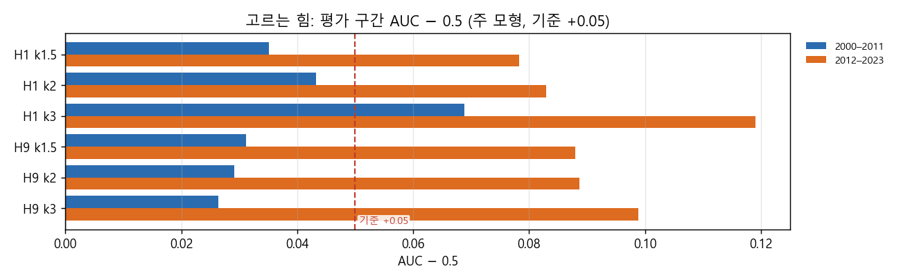
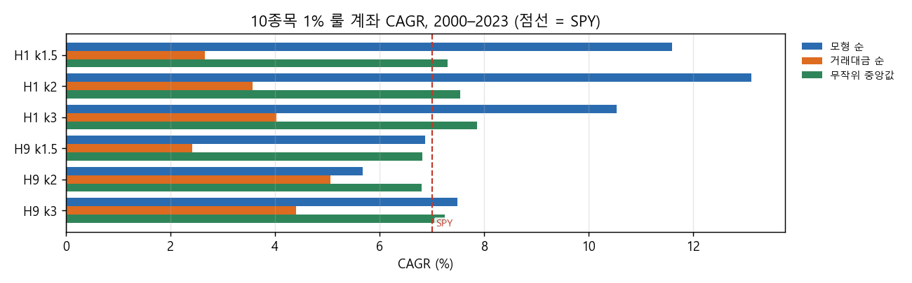
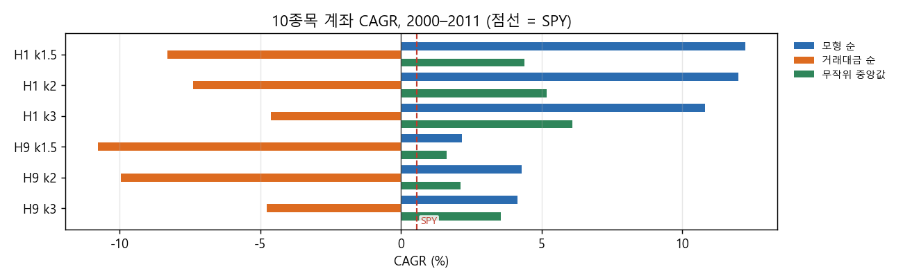
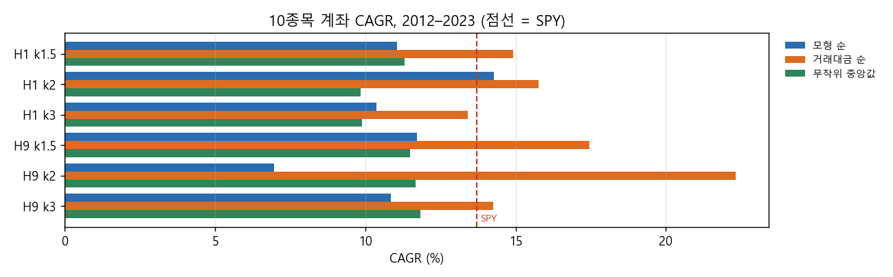
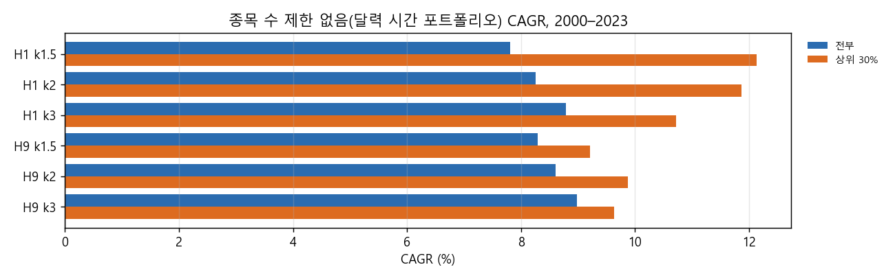

# Stage H 결과: 큰 승자 고르기, 걷기식 학습과 1% 룰 계좌 (결정 86)

설계: `docs/research/lab/2026-10-28_stage_h_design.md`. 결과 전에 커밋 28f76cc로 올렸고, 한계 문구 정정은 ed10755입니다. 실행기는 `lab/pick_study.py`(d70dc42)이고, 2026-10-28 18:32–20:34 KST에 돌렸습니다. 사용자가 오늘만 낮 시간 CPU 제한을 풀었습니다.

## 왜 했는지

G-1에서 수익은 소수의 큰 승자에게서 나왔고, 큰 승자를 가르는 특징도 보였습니다. Stage H는 두 가지를 물었습니다.
- 그해 이전 자료만으로 신호가 난 날 큰 승자를 미리 고를 수 있는가
- 그렇게 고른 거래로 사용자 계좌 규칙 A(거래당 위험 1%, 종목당 10% 상한, 최대 10종목)가 SPY보다 나아지는가

종목 수 제한이 없는 경우도 함께 봤습니다(사용자 요청).

## 핵심 결과

1. **미리 정한 판정으로는 통과한 설정이 없습니다.** 매도 2 × 손절 k 3 = 설정 6개 기준입니다.
   - 판정 1(고르는 힘): 1/6(H1 k 3)
   - 판정 2: 10종목 계좌 0/6, 제한 없음 3/6(H1 셋)
   - 판정 3(후보): 0개
   - 보류 구간 후보는 없습니다.
2. **모형으로 고르면 계좌가 좋아지긴 했지만, 2000–2011에 몰려 있었습니다.** H1(25% 트레일링 + ATR 손절)의 10종목 계좌 CAGR은 2000–2023 기준 다음과 같았습니다.

   | 매수 순서 | CAGR | MDD |
   |---|---|---|
   | 모형 순 | 10.5–13.1% | −32 – −40% |
   | 거래대금 순 | 2.7–4.0% | −68 – −82% |
   | 무작위 중앙값 | 7.3–7.9% | |
   | SPY | 7.0% | −55% |
   | 동일비중 유니버스 | 8.2% | −61% |

   그러나 차이는 거의 2000–2011에서 났습니다(모형 +11 – +12%, 거래대금 순 −5 – −8%). 2012–2023에는 거래대금 순(13–16%)이 모형 순(10–14%)보다 나았습니다. 2017–2023의 모형 순 CAGR은 5–11%로 SPY 13.2%에 못 미쳤습니다.
3. **고르는 힘은 작습니다.** 평가 구간 AUC는 0.53–0.57(2000–2011)과 0.58–0.62(2012–2023)였습니다. 2000–2011에서는 H1 k 3만 기준 0.55와 위약을 넘었습니다. H9는 위약(종목 묶음으로 표시를 섞은 모형)이 2000–2011에 오히려 더 높았습니다(0.59–0.60). 연도마다 큰 승자 비율이 달라서 생기는 효과로 보입니다. ATR%를 넣은 판과 뺀 판의 AUC는 거의 같았습니다. G-1에서 걱정한 저변동성 효과는 이 목표(거래 기여)에서는 크지 않았습니다.
4. **종목 수 제한이 없으면** 모형 상위 30%만 산 경우가 전부 산 경우보다 나았습니다. H1 달력 시간 포트폴리오 CAGR은 10.7–12.1%로, 전부 산 경우 7.8–8.8%와 SPY 7.0%보다 높았습니다. 그러나 MDD는 −46 – −52%로 SPY와 비슷했고, 2017–2023에는 SPY에 못 미쳤습니다. 줄이기 전 총노출은 자산의 수백–수천 배라, 사실상 늘 100%로 줄여 계산했습니다.
5. **10% 상한**: 계좌 A에서는 손절폭이 보통 3–9%라 신호의 58–93%가 10% 상한에 걸렸습니다. 10종목 계좌에서 상한에 걸린 거래(저변동성)가 안 걸린 거래보다 대체로 기여가 컸습니다. H1 k 2 모형 순에서는 상한 거래 266개가 평균 +2.0%, 승률 38%였고, 비상한 거래 56개는 +0.2%, 승률 23%였습니다.

## 그림

주 모형(로지스틱, ATR% 포함, 거래 기여 ≥ +5%)의 평가 구간 AUC − 0.5입니다. 기준(+0.05)을 두 반쪽 모두 넘은 것은 H1 k 3뿐입니다.

10종목 1% 룰 계좌의 2000–2023 CAGR입니다. 모형 순 · 거래대금 순 · 무작위 중앙값을 비교했고, 점선이 SPY입니다. H1에서는 모형 순이 SPY보다 높습니다.

2000–2011 CAGR(점선 = SPY 0.6%)입니다. 모형 순의 이점이 대부분 여기서 나왔습니다.

2012–2023 CAGR(점선 = SPY 13.7%)입니다. 거래대금 순이 모형 순보다 높고, SPY를 넘은 모형 순은 H1 k 2 하나입니다.

종목 수 제한 없는 달력 시간 포트폴리오의 CAGR입니다. 모형 상위 30%와 전부를 비교했습니다.

## 무엇을 했나

### 종목 필터링

Stage C와 같습니다. 매일 21거래일 평균 시가총액 상위 3,000개 미국 보통주 가운데 위생 필터를 통과한 종목이 대상입니다. 위생 필터는 12개월 중 90% 이상 거래, 주가 5달러 이상, 21일 거래대금 100만 달러 이상, Amihud 비유동성 상위 20% 제외입니다. 추세 템플릿과 추가 스크린은 없습니다.

### 매수

E1–E9(Stage C)와 V1–V6(G-2)의 가운데 값 신호를 종목 · 날짜별로 하나로 합쳤습니다. 1993–2023에 약 160만 개입니다. 어떤 매수 신호가 떴는지는 특징으로 넣었습니다. 사는 순서는 세 가지를 비교했습니다.
- 모형 점수 순
- 거래대금 순(지금까지의 방식)
- 무작위 순(100번)

### 매도

모두 ATR(14) × k 손절(k = 1.5 / 2 / 3)이 들어갑니다.
- H1: 최고 종가 대비 25% 하락 또는 손절
- H9: 손절 + 2R 뒤 손익분기 + 60일 시간 손절(진입가 아래일 때만)

### 계좌 규칙 (사용자 선택 A)

- 주식 수 = 자산 × 1% ÷ (매수가 − 손절선)이고, 종목당 자산의 10%를 넘지 않습니다.
- 최대 10종목, 레버리지 없음.
- 청산한 종목은 20거래일 동안 다시 사지 않습니다.
- 편도 20bp, 남는 현금은 단기국채입니다.

종목 수 제한 없음은 신호마다 같은 비중 규칙으로 각각 매매했다고 보고, 비중 합이 100%를 넘는 날은 비례로 줄였습니다.

### 모형

신호일의 특징은 55개입니다(G-1의 40개 + 매수 표시 15개). 목표는 '거래 기여(비중 × 수익) ≥ 자산의 +5%'입니다. 모형은 두 가지입니다.
- L2 로지스틱
- 학습 구간에서 방향을 정한 특징 순위 평균

1993–1999로 처음 맞추고, 2000–2023은 해마다 1월에 그 전까지 청산이 끝난 거래로만 다시 맞췄습니다. 위약은 학습 자료의 표시를 종목 묶음으로 섞어 100번 다시 맞춘 것입니다.

## 결과

### 판정 (설정별)

| 설정 | AUC 2000–11 / 2012–23 | 위약 95% | 판정 1 | 10종목: 거래대금 순을 이긴 해 · 무작위를 이긴 해 | 판정 2 (10종목 / 제한 없음) | 10종목 모형 순 CAGR / MDD 2000–23 | 2017–23 CAGR | 판정 3 |
|---|---|---|---|---|---|---|---|---|
| H1 k 1.5 | 0.535 / 0.578 | 0.540 / 0.510 | 미달 | 71% · 58% | 미달 / 통과 | 11.6% / −38% | 8.6% | 미달 |
| H1 k 2 | 0.543 / 0.583 | 0.543 / 0.504 | 미달 | 75% · 71% | 미달 / 통과 | 13.1% / −40% | 10.7% | 미달 |
| H1 k 3 | 0.569 / 0.619 | 0.526 / 0.489 | 통과 | 63% · 58% | 미달 / 통과 | 10.5% / −32% | 5.2% | 미달 |
| H9 k 1.5 | 0.531 / 0.588 | 0.588 / 0.531 | 미달 | 50% · 54% | 미달 / 미달 | 6.9% / −47% | 4.6% | 미달 |
| H9 k 2 | 0.529 / 0.589 | 0.595 / 0.521 | 미달 | 50% · 42% | 미달 / 미달 | 5.7% / −46% | 4.3% | 미달 |
| H9 k 3 | 0.526 / 0.599 | 0.597 / 0.526 | 미달 | 54% · 42% | 미달 / 미달 | 7.5% / −41% | 6.4% | 미달 |

기준선(2000–2023 / 2017–2023)은 다음과 같습니다.
- SPY 7.0%, MDD −55% / 13.2%, −34%
- SPY 200일선 6.4%, −21% / 10.4%, −19%
- 동일비중 유니버스 8.2%, −61% / 8.5%, −43%

10종목 계좌의 판정 2가 모두 미달인 이유는 같습니다. 2012–2023 CAGR에서 거래대금 순이 모형 순보다 높았기 때문입니다. H9는 2000–2011에도 무작위 중앙값과 큰 차이가 없었습니다.

### 10종목 계좌 (CAGR, 2000–2011 / 2012–2023)

같은 기간 SPY는 0.6% / 13.7%(저장된 SPY 자료, 배당 재투자)입니다.

| 설정 | 모형 순 | 거래대금 순 | 무작위 중앙값 (90% 분위) |
|---|---|---|---|
| H1 k 1.5 | 12.2% / 11.0% | −8.3% / 14.9% | 4.4% / 11.3% (8.4% / 13.8%) |
| H1 k 2 | 12.0% / 14.3% | −7.4% / 15.8% | 5.2% / 9.8% (8.7% / 14.1%) |
| H1 k 3 | 10.8% / 10.4% | −4.6% / 13.4% | 6.1% / 9.9% (9.7% / 13.1%) |
| H9 k 1.5 | 2.2% / 11.7% | −10.8% / 17.4% | 1.6% / 11.5% |
| H9 k 2 | 4.3% / 7.0% | −9.9% / 22.3% | 2.1% / 11.7% |
| H9 k 3 | 4.1% / 10.9% | −4.8% / 14.3% | 3.6% / 11.8% |

거래대금 순은 2000–2011에 크게 잃었습니다. 닷컴 붕괴와 금융위기 때 거래대금이 큰 종목의 신호를 먼저 샀기 때문으로 보입니다. 2012–2023에는 가장 좋았습니다.

2017–2023만 떼어 보면 다음과 같습니다.

| 설정 | 모형 순 CAGR / MDD | 거래대금 순 CAGR / MDD | 무작위 중앙값 CAGR / MDD |
|---|---|---|---|
| H1 k 1.5 | 8.6% / −33% | 13.6% / −31% | 7.5% / −39% |
| H1 k 2 | 10.7% / −33% | 15.2% / −31% | 6.5% / −36% |
| H1 k 3 | 5.2% / −31% | 11.5% / −28% | 5.9% / −33% |
| H9 k 1.5 | 4.6% / −39% | 20.3% / −33% | 10.2% / −42% |
| H9 k 2 | 4.3% / −38% | 18.2% / −60% | 8.7% / −39% |
| H9 k 3 | 6.4% / −37% | 17.1% / −33% | 9.5% / −39% |

SPY는 13.2% / −34%입니다.

### 종목 수 제한 없음 (달력 시간 포트폴리오, 2000–2023)

| 설정 | 전부: CAGR / MDD | 모형 상위 30%: CAGR / MDD | 거래 기여 평균(상위 30% / 전부) 2000–11 · 2012–23 |
|---|---|---|---|
| H1 k 1.5 | 7.8% / −52% | 12.1% / −52% | 0.95 / 0.50% · 1.04 / 0.43% |
| H1 k 2 | 8.3% / −51% | 11.9% / −50% | 1.16 / 0.63% · 1.34 / 0.52% |
| H1 k 3 | 8.8% / −48% | 10.7% / −46% | 1.51 / 0.83% · 2.02 / 0.65% |
| H9 k 1.5 | 8.3% / −55% | 9.2% / −54% | 2.23 / 2.25% · 1.56 / 0.96% |
| H9 k 2 | 8.6% / −55% | 9.9% / −53% | 2.53 / 2.64% · 1.89 / 1.16% |
| H9 k 3 | 9.0% / −54% | 9.6% / −51% | 2.77 / 2.93% · 2.85 / 1.38% |

### 10% 상한에 걸린 거래와 안 걸린 거래

신호 전체(종목 수 제한 없음)에서 상한에 걸린 비율은 k 1.5에서 93%, k 2에서 84%, k 3에서 58%입니다. 상한 거래의 기여 평균이 비상한 거래보다 높았습니다(H1 k 2 기준 0.65% 대 0.21%, 큰 승자 7.3% 대 6.2%). 모형 상위 30%에서도 같은 방향이었습니다(1.31% 대 0.45%).

10종목 계좌(모형 순)에서 상한 거래는 H1 k 2 기준 266개, 기여 평균 +2.0%, 승률 38%, 큰 승자 10.5%였습니다. 비상한 거래는 56개, +0.2%, 23%, 7.1%였습니다. 표는 `trades_capped.csv`에 있습니다.

### 그 밖의 판

- ATR%를 뺀 판의 AUC는 넣은 판과 0.001–0.007 차이였습니다.
- 순위 평균 모형은 로지스틱과 비슷하거나 조금 높았습니다(H1 k 3: 0.587 / 0.600).
- 보조 목표 'SPY 대비 초과 > 0'의 AUC는 0.51–0.58로 더 약했습니다.

## 해석

- 신호 시점 정보로 큰 승자를 고르는 힘은 있지만 작습니다(AUC 0.53–0.62). 위약과 비교하면 H1에서만 분명합니다.
- 10종목 계좌에서 모형 순이 SPY를 넘은 것(2000–2023)은 주로 2000–2011을 덜 잃은 덕분입니다. 같은 기간 SPY는 연 0.6%였습니다. 2012–2023에는 모든 설정에서 거래대금 순이 모형 순보다 높았습니다. SPY(13.7%)와 비교하면 H1 k 2만 14.3%로 조금 높았고, 나머지(H1 10.4–11.0%, H9 7.0–11.7%)는 낮았습니다. 2017–2023에는 모형 순이 모든 설정에서 SPY(13.2%)보다 낮았고(4.3–10.7%), MDD는 −31 – −39%로 SPY −34%와 비슷했습니다. 그래서 '시장을 이기는 전략'이 아니라 '약세장에서 덜 잃는 고르기'에 가깝습니다.
- 거래대금 순의 MDD −68 – −90%는, 지금까지 Stage C–F 20종목 계좌가 거래대금 순으로 산 것이 큰 손실의 한 원인이었음을 보여 줍니다.

## 한계

- 특징 40개는 G-1 결과 전에 고정했습니다. 목표(거래 기여 ≥ +5%), ATR% 통제판, 종목 단위 위약은 G-1을 본 뒤 정했습니다.
- 반쪽 AUC는 여러 해의 모형 점수를 모아 계산해, 해마다 큰 승자 비율이 다른 효과가 섞입니다. 그래서 위약과 비교했습니다.
- 위약은 계산량 때문에 한 번 맞출 때 학습 자료 20만 행만 썼습니다.
- 2017–2023은 같은 계좌 곡선의 일부를 잘라 본 것입니다(새로 시작한 계좌가 아님).
- 종목 수 제한 없음의 달력 시간 포트폴리오는 매일 비중을 맞추는 비용을 넣지 않았고, 총노출이 매우 커서 실제로 따라 할 수 없는 규모입니다.
- 보류 구간(2024년 이후)은 쓰지 않았습니다.

## 남은 판단

- 후보가 없으므로 보류 구간 평가는 하지 않습니다.
- H1의 '약세장에서 덜 잃는 고르기'를 더 볼지는 사용자가 정합니다. 예를 들어 모형 순 계좌를 SPY 200일선 같은 시장 국면과 비교하는 일입니다.
- G-1 결론 규칙의 다른 갈래인 피라미딩(이긴 종목에 더 싣기, D)은 아직 시험하지 않았습니다.
- 강세장 뒤처짐 진단은 `2026-10-29_stage_h_bull_diag.md`에 있습니다. 주된 이유는 종목 크기(중형주)였고, 현금 비중 · 승자 사이징 · 손절 잦음은 아니었습니다.

집계표는 `docs/research/lab/2026-10-29_stage_h/`(설정별 계좌 · AUC · 위약 · 연도별 · 상한 구분)에 있습니다. 전체 결과는 드라이브 `CRSP/lab_crsp/stage_h_pick`에 있습니다(신호별 특징 표는 임시 폴더에만 두고 지웠습니다).
