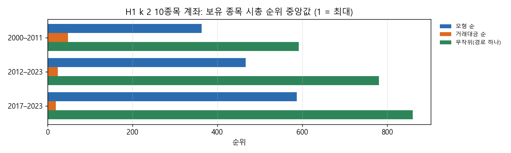
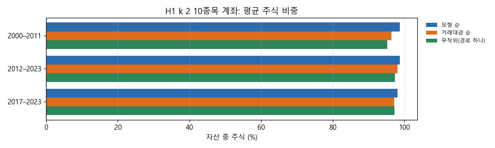
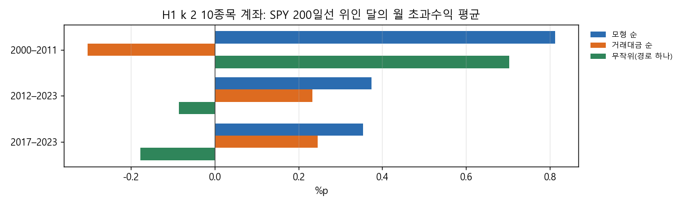
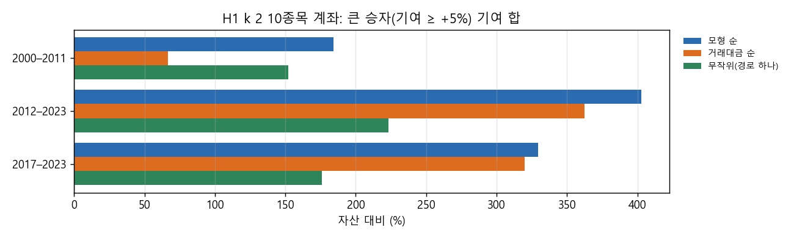

# Stage H 강세장 진단: 모형 순 10종목 계좌는 왜 2012–2023에 뒤졌나

새 전략 시험이 아니라 서술 분석이라 시험 수에 넣지 않습니다. 대상은 Stage H(결정 86)의 H1(25% 트레일링 + ATR k 손절) 10종목 1% 룰 계좌, k = 1.5 / 2 / 3입니다. 실행기는 `lab/h_diag.py`이고, 2026-10-28 20:47–21:12 KST에 돌렸습니다.

## 왜 했는지

Stage H에서 모형 순 계좌는 2000–2023 전체로는 SPY와 거래대금 순보다 나았습니다. 그러나 그 이점은 2000–2011에 몰려 있었습니다. 2012–2023에는 거래대금 순(13–16%)이 모형 순(10–14%)보다 높았고, 2017–2023에는 SPY(13.2%)에 못 미쳤습니다. 다음 설계(피라미딩 등)에 앞서, 강세장에서 뒤처진 이유가 무엇인지 숫자로 가렸습니다. 후보는 네 가지입니다.
- 현금 비중
- 종목 크기
- 승자 사이징
- 잦은 손절

## 핵심 결과

**주된 이유는 '종목 크기'입니다.** 나머지 셋은 차이가 작거나 오히려 모형 순이 나았습니다. 숫자는 H1 k 2, 2012–2023 기준입니다(괄호는 k 1.5 · 3의 범위).

- **현금 비중: 이유가 아님.** 주식 비중 평균은 모형 순 98.7%, 거래대금 순 98.1%로 같습니다. 자리가 다 찼는데 신호가 남은 날이 두 계좌 모두 99.8%이고, 자리가 남았는데 살 신호가 없던 날은 0–0.2%입니다. 늘 10종목을 꽉 채워 들고 있었습니다.
- **종목 크기: 주된 이유.**
  - 보유 종목의 시총 순위 중앙값은 모형 순 467위(399–539)였고, 거래대금 순은 24위(18–32)였습니다.
  - 시총 상위 500 안 비율은 모형 순 53%(50–55%), 거래대금 순 100%(96–100%)입니다.
  - 그 결과 SPY 베타는 0.72(0.59–0.72) 대 0.88(0.82–0.88), 상관은 0.74 대 0.86입니다.
  - 2017–2023에는 모형 순 보유 종목이 더 작아졌습니다(순위 중앙값 587위). 대형주가 이끈 장에서 중형주를 들고 있었던 것입니다.
- **승자 사이징: 이유가 아님.**
  - 큰 승자(거래 기여 ≥ 자산의 +5%)는 모형 순이 오히려 많았습니다. 21개, 기여 합 +403%였고, 거래대금 순은 17개, +362%였습니다.
  - 평균 비중(8.5% 대 7.7%)과 10% 상한에 걸린 비율(79% 대 72%)도 비슷합니다.
  - 차이는 '기간 끝까지 들고 간 승자'에서 났습니다. 거래대금 순은 2023년 말까지 들고 간 포지션(거래의 9%)이 평균 +5.0% 기여했습니다. 모형 순은 7%, +1.4%였습니다. 오래 오른 초대형주를 끝까지 들고 간 효과로 보입니다.
- **손절 잦음: 이유가 아님.**
  - ATR 손절로 끝난 거래 비율은 모형 순 55%(42–62%), 거래대금 순 61%(43–63%)로 비슷합니다. 손절 거래의 평균 기여도 −0.6 – −0.7%로 같습니다.
  - 다만 모형 순은 거래 수가 더 많았습니다(149 대 107). 중소형주의 상장폐지(대부분 인수 · 합병) 청산도 13%로 거래대금 순(3%)보다 많았습니다.
- **SPY가 200일선 위인 달의 월 초과수익**: 모형 순 +0.4%p, 거래대금 순 +0.2%p로 둘 다 작습니다. 강세장 안에서 월마다 지는 것이 아닙니다. 대형주가 크게 오른 몇 해에 크게 뒤졌습니다. 2017년 모형 순 +14%, 거래대금 순 +31%, SPY +22%였고, 2023년은 +6%, +17%, +26%였습니다.
- **재현**: 다시 맞춘 모형 순 · 거래대금 순 계좌의 CAGR이 Stage H와 소수점 15자리까지 같았습니다(`diag/reproduction.json`). 무작위 경로 하나(시드 2029)는 CAGR 6.0 / 8.1 / 9.9%로, Stage H 무작위 중앙값 7.3 / 7.5 / 7.9% 근처입니다.

## 그림

H1 k 2 계좌가 들고 있던 종목의 시총 순위 중앙값(1 = 가장 큼)입니다. 거래대금 순은 늘 초대형주(20–50위)를, 모형 순은 중형주(360–590위)를 들었습니다.

평균 주식 비중입니다. 세 계좌 모두 95% 이상이라 현금은 차이를 만들지 않았습니다.

SPY가 200일선 위인 달의 월 초과수익 평균입니다. 모두 0 근처입니다.

큰 승자(기여 ≥ +5%) 거래의 기여 합입니다. 모형 순이 거래대금 순보다 작지 않습니다.

## 표 (H1, 2012–2023 / 2017–2023)

| k | 계좌 | CAGR | 주식 비중 | 시총 순위 중앙 · 상위 500 비율 | 베타 · 상관 | 큰 승자 수 · 기여 합 | ATR 손절 비율 · 평균 기여 |
|---|---|---|---|---|---|---|---|
| 1.5 | 모형 순 | 11.0% / 8.6% | 98.7% | 539 · 50% | 0.72 · 0.71 | 23 · +307% | 62% · −0.6% |
| 1.5 | 거래대금 순 | 14.9% / 13.6% | 99.6% | 32 · 96% | 0.87 · 0.85 | 18 · +338% | 63% · −0.6% |
| 2 | 모형 순 | 14.3% / 10.7% | 98.7% | 467 · 53% | 0.72 · 0.74 | 21 · +403% | 55% · −0.7% |
| 2 | 거래대금 순 | 15.8% / 15.2% | 98.1% | 24 · 100% | 0.88 · 0.86 | 17 · +362% | 61% · −0.7% |
| 3 | 모형 순 | 10.4% / 5.2% | 96.6% | 399 · 55% | 0.59 · 0.75 | 14 · +278% | 42% · −0.6% |
| 3 | 거래대금 순 | 13.4% / 11.5% | 93.2% | 18 · 100% | 0.82 · 0.85 | 13 · +293% | 43% · −0.8% |

비교 기간의 SPY는 13.7% / 13.2%입니다. 전체 표(세 기간 × 세 계좌 × k 셋)와 연도별 표는 `docs/research/lab/2026-10-29_stage_h/diag/`에 있습니다.

## 해석과 다음 설계에 주는 뜻

- 모형은 '크기'를 직접 고르지 않았습니다. 하지만 큰 승자(기여 ≥ +5%)가 되기 쉬운 신호가 중형주 쪽에 많아 중형주를 골랐습니다. 이것이 2000–2011에는 도움이 됐고(대형 기술주 붕괴를 피함), 2012–2023 초대형주 장세에서는 발목을 잡았습니다.
- 그래서 피라미딩(이긴 종목에 더 싣기)만으로는 강세장 뒤처짐이 크게 바뀌지 않을 수 있습니다. 승자 사이징은 이미 거래대금 순과 비슷하거나 나았습니다. 강세장 뒤처짐을 직접 겨냥하려면 종목 크기를 다루는 쪽을 먼저 생각할 수 있습니다. 예를 들면 모형 점수와 시총 순위를 함께 쓰거나, 계좌 안에 대형주 몫을 두는 것입니다. 다만 그것은 2000–2011의 이점을 줄일 수 있습니다.
- 피라미딩의 효과는 '기간 끝까지 들고 간 승자' 쪽에서 나올 수 있습니다. 거래대금 순의 이점 일부가 오래 오른 종목을 끝까지 들고 간 데서 나왔기 때문입니다.

## 한계

- 서술 분석이고, 같은 1993–2023 자료의 결과를 다시 쪼갠 것입니다.
- '큰 승자 기여 합'과 '상위 5개 거래 몫'은 거래를 청산한 해에 묶었습니다. 그해 계좌 수익과 정확히 맞물리지 않습니다.
- 무작위는 경로 하나만 봤습니다(Stage H의 100개 분포는 `2026-10-29_stage_h/<설정>/accounts.csv`).
