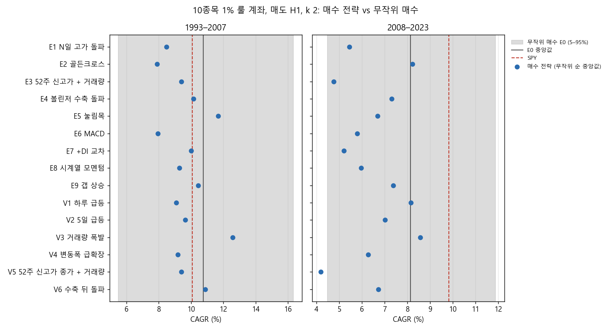
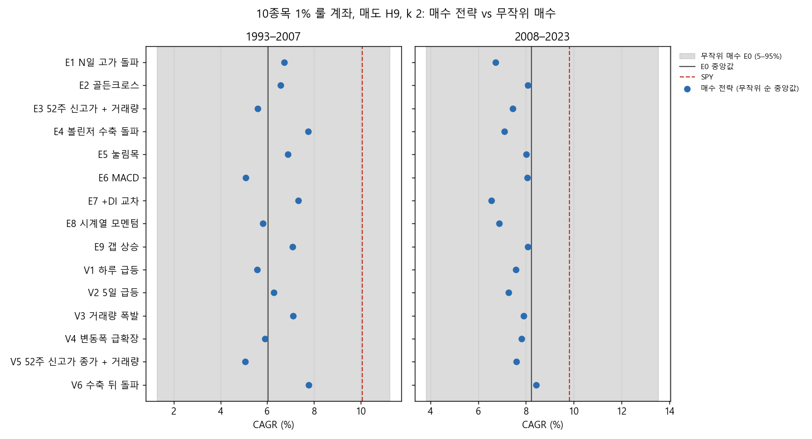
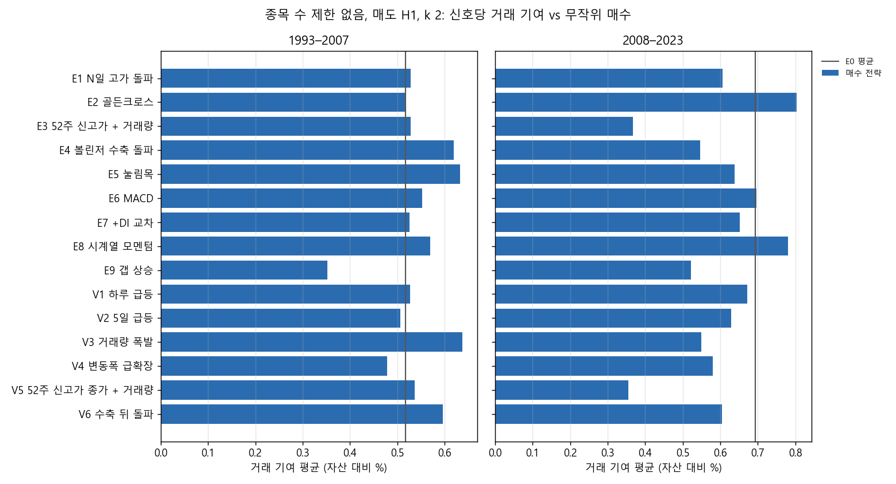
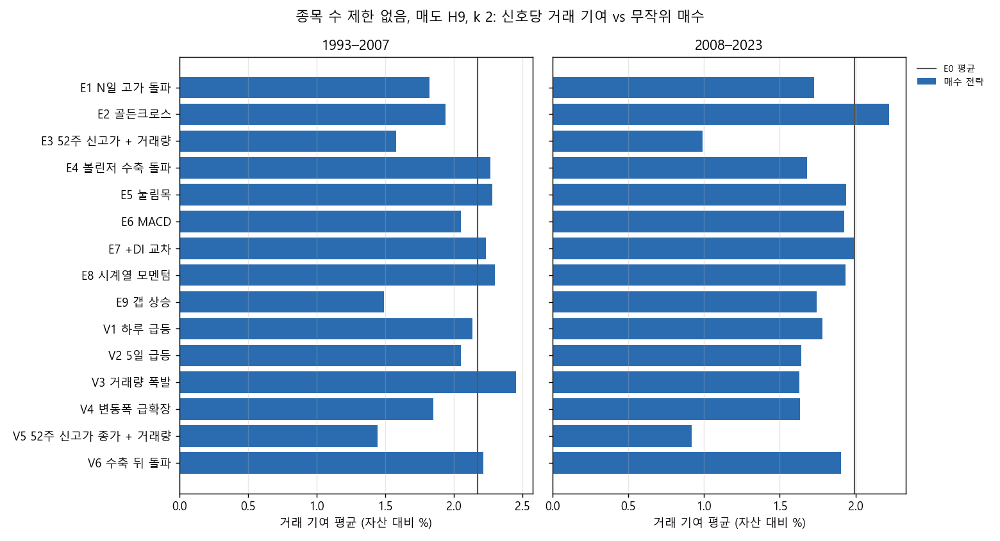

# Stage I 결과: 매수 전략별 1% 룰 계좌 시험 (결정 87)

설계: `docs/research/lab/2026-10-29_stage_i_design.md`. 결과 전에 커밋 ef84d5f로 올렸고, 한계 한 줄과 실행기는 1d19f92에 넣었습니다. 실행기는 `lab/entry_study.py`이고, 2026-10-28 23:06–23:24 KST에 돌렸습니다.

## 왜 했는지

사용자가 원한 것은 '매수 전략마다 따로 시험해 어떤 전략이 의미 있는지'였습니다. 그래서 매수 전략 15개를 하나씩, 같은 매도와 같은 계좌 규칙(1% 룰, 10종목)으로 돌렸습니다. 비교 기준은 아무 종목이나 무작위로 산 경우(E0)와 SPY입니다. 무작위 매수보다 나아야 그 매수 규칙이 '뭔가를 안다'고 말할 수 있습니다.

## 핵심 결과

1. **무작위로 산 것보다 확실히 나은 매수 전략은 없었습니다.** 미리 정한 기준(두 반쪽 1993–2007 · 2008–2023 모두, k 세 값 중 2개 이상)으로 보면 다음과 같습니다.
   - 종목 수 제한 없음(신호당 거래 기여): 30개(매수 15 × 매도 2) 중 3개만 통과했습니다. E6 MACD · E8 시계열 모멘텀(매도 H1), E7 +DI 교차(매도 H9)입니다. 차이는 거래당 자산의 +0.01 – +0.1%p로 아주 작습니다. 이 셋의 10종목 계좌는 2008–2023에 오히려 무작위 중앙값보다 낮았습니다(k 2 기준 E0 분포 안 분위 16–27%).
   - 10종목 계좌: 30개 중 1개만 통과했습니다. V3 거래량 폭발(매도 H1)이고, 무작위 매수 500개 계좌 분포에서 73% / 58% 분위입니다(k 2, 두 반쪽).
2. **SPY를 넘은 후보는 없습니다.** 1993–2023 전체로 가장 나은 것은 V3 거래량 폭발 × H1(k 2)이었습니다. 10종목 계좌 CAGR 10.6%, MDD −45%로 SPY 9.9%, −55%보다 나았지만, 2017–2023은 6.2%로 SPY 13.2%에 크게 못 미쳤습니다.
3. **무작위로 사도 비슷한 성적이 나옵니다.** 같은 매도 · 계좌 규칙으로 무작위로 산 E0의 10종목 계좌 중앙값은 다음과 같습니다.
   - 매도 H1: 1993–2023 9.2%
   - 매도 H9: 7.3%
   - 비교: SPY 9.9%, 동일비중 유니버스 10.2%

   대부분의 매수 전략은 무작위 매수 분포의 5–95% 띠 안에 있었습니다. 2008–2023에는 E3 52주 신고가 + 거래량(6%), V5 52주 신고가 종가 + 거래량(3%), E1 N일 고가 돌파(12%)처럼 무작위보다 확연히 못한 전략도 있었습니다(괄호는 E0 분포 안 분위, H1 k 2).
4. **결론**: 지금까지 시험한 매수 규칙 15개는 '언제 살지'에 대해 무작위보다 나은 정보를 거의 주지 못합니다. 계좌 성적의 대부분은 매수 규칙이 아니라 매도 · 비중 규칙(1% 룰, 트레일링)과 시장 전체의 움직임에서 나왔습니다.

## 그림

매도 H1(25% 트레일링 + ATR 손절), k 2입니다. 회색 띠는 무작위 매수 E0 500개 계좌의 5–95%, 검은 선은 E0 중앙값, 빨간 점선은 SPY, 파란 점은 각 매수 전략(무작위 순 100번의 중앙값)입니다. 거의 모든 점이 띠 안에 있고, 2008–2023에는 대부분 E0 중앙값보다 왼쪽(낮음)입니다.

매도 H9(ATR 손절 + 손익분기 + 60일 시간 손절), k 2입니다. 역시 대부분 띠 안에 있습니다.

종목 수 제한 없음에서 신호당 거래 기여(자산 대비 %)입니다. 검은 선이 무작위 매수의 평균입니다.

같은 그림, 매도 H9입니다.

## 무엇을 했나

### 종목 필터링

매일 21거래일 평균 시가총액 상위 3,000개 미국 보통주 가운데 위생 필터를 통과한 종목입니다. 위생 필터는 12개월 중 90% 이상 거래, 주가 5달러 이상, 21일 거래대금 100만 달러 이상, Amihud 비유동성 상위 20% 제외입니다.

### 매수 (각각 따로, 가운데 값)

모두 조건이 처음 참이 된 날 종가로 판단해 다음 날 시가에 삽니다.
- E1 N일 고가 돌파: 종가가 직전 55일 고가를 넘은 첫날
- E2 골든크로스: 50일선이 200일선을 위로 넘은 날
- E3 52주 신고가 + 거래량: 종가가 52주 고가를 넘고 거래량이 50일 평균의 1.5배 이상
- E4 볼린저 수축 돌파: 밴드폭이 126일 중 하위 20%였다가 상단 밴드를 넘은 날
- E5 눌림목: 200일선 위 종목이 2일 RSI 10 미만으로 떨어진 첫날
- E6 MACD: MACD(12, 26, 9)가 시그널선을 위로 넘고 0보다 클 때
- E7 +DI 교차: +DI가 −DI를 위로 넘고 ADX ≥ 20
- E8 시계열 모멘텀: 12개월 수익률이 단기국채를 처음 넘은 날
- E9 갭 상승: 시가가 전일 고가보다 4% 이상 높고, 거래량이 50일 평균의 3배 이상, 양봉
- V1 하루 급등: 하루 수익이 평소 하루 변동의 2.5배를 넘고 고가 근처 마감
- V2 5일 급등: 5일 수익이 평소 5일 변동의 2.5배를 넘음
- V3 거래량 폭발: log 거래량이 평소보다 표준편차 4배 이상 크고 양봉
- V4 변동폭 급확장: 그날 진폭이 평소 진폭(ATR 20)의 2.5배를 넘고 양봉
- V5 52주 신고가 종가 + 거래량: 종가가 252일 최고 종가를 새로 쓰고 거래량 2배 이상
- V6 수축 뒤 돌파: 20일 범위가 1년 중 하위 20%로 좁아졌다가 직전 20일 고가를 넘음
- **E0 무작위 매수(비교 기준)**: 위생 필터를 통과한 종목 · 일마다 1% 확률로 뽑은 날에 삽니다. 씨앗 5개입니다.

### 매도 (k = 1.5 / 2 / 3)

- H1: 최고 종가 대비 25% 하락 또는 ATR(14) × k 손절
- H9: ATR(14) × k 손절 + 2R 뒤 손익분기 + 60일 시간 손절(진입가 아래일 때만)

### 계좌 A와 종목 수 제한 없음

- **계좌 A**: 주식 수 = 자산 × 1% ÷ (매수가 − 손절선), 종목당 10% 상한, 최대 10종목입니다. 청산 뒤 20거래일 재진입 금지, 편도 20bp, 남는 현금은 단기국채입니다. 신호가 자리보다 많은 날은 무작위 순으로 채웠고, 순서 100번의 중앙값과 분포를 봤습니다. E0는 씨앗 5개 × 순서 100번 = 500개 계좌입니다.
- **종목 수 제한 없음**: 신호마다 같은 비중 규칙으로 각각 매매한다고 보고, 거래 기여(비중 × 수익)의 평균을 봤습니다. 달력 시간 포트폴리오는 `verdicts.csv`의 `cal_*` 열에 있습니다.

## 결과 (k 2, 두 매도. k 1.5 · 3은 `2026-10-29_stage_i/verdicts.csv`)

### 매도 H1 (25% 트레일링 + ATR 손절), k 2

| 매수 | 10종목 CAGR 1993–2007 / 2008–2023 (E0 안 분위) | 10종목 CAGR · MDD 1993–2023 | 2017–2023 CAGR | 제한 없음 거래 기여 평균 1993–2007 / 2008–2023 | 판정 (a) · (b) |
|---|---|---|---|---|---|
| E1 N일 고가 돌파 | 8.5% / 5.4% (24 / 12%) | 7.3% · −54.5% | 4.2% | 0.53 / 0.61% | 아니오 · 아니오 |
| E2 골든크로스 | 7.9% / 8.2% (18 / 52%) | 8.1% · −52.5% | 7.7% | 0.52 / 0.80% | 아니오 · 아니오 |
| E3 52주 신고가 + 거래량 | 9.4% / 4.8% (34 / 6%) | 6.9% · −53.8% | 0.7% | 0.53 / 0.37% | 아니오 · 아니오 |
| E4 볼린저 수축 돌파 | 10.2% / 7.3% (43 / 38%) | 8.9% · −52.2% | 5.8% | 0.62 / 0.55% | 아니오 · 아니오 |
| E5 눌림목 | 11.7% / 6.7% (63 / 29%) | 9.1% · −52.6% | 6.4% | 0.63 / 0.64% | 아니오 · 아니오 |
| E6 MACD | 7.9% / 5.8% (18 / 16%) | 6.9% · −51.5% | 4.8% | 0.55 / 0.70% | 예 · 아니오 |
| E7 +DI 교차 | 10.0% / 5.2% (40 / 10%) | 7.3% · −52.6% | 4.0% | 0.53 / 0.65% | 아니오 · 아니오 |
| E8 시계열 모멘텀 | 9.3% / 6.0% (32 / 19%) | 7.8% · −52.7% | 6.1% | 0.57 / 0.78% | 예 · 아니오 |
| E9 갭 상승 | 10.5% / 7.4% (46 / 39%) | 9.1% · −51.9% | 9.1% | 0.35 / 0.52% | 아니오 · 아니오 |
| V1 하루 급등 | 9.1% / 8.2% (29 / 51%) | 8.7% · −47.1% | 8.2% | 0.53 / 0.67% | 아니오 · 아니오 |
| V2 5일 급등 | 9.6% / 7.0% (37 / 33%) | 8.4% · −52.3% | 5.9% | 0.51 / 0.63% | 아니오 · 아니오 |
| V3 거래량 폭발 | 12.6% / 8.6% (73 / 58%) | 10.6% · −44.5% | 6.2% | 0.64 / 0.55% | 아니오 · 예 |
| V4 변동폭 급확장 | 9.2% / 6.3% (31 / 24%) | 7.8% · −48.1% | 5.8% | 0.48 / 0.58% | 아니오 · 아니오 |
| V5 52주 신고가 종가 + 거래량 | 9.4% / 4.2% (34 / 3%) | 7.0% · −53.6% | 1.6% | 0.54 / 0.36% | 아니오 · 아니오 |
| V6 수축 뒤 돌파 | 10.9% / 6.7% (51 / 29%) | 8.7% · −47.9% | 3.0% | 0.60 / 0.60% | 아니오 · 아니오 |

E0 무작위 매수: 10종목 중앙값 10.8% / 8.1%, 1993–2023 9.2%, 2017–2023 6.8%. 거래 기여 평균 0.52 / 0.69%입니다.

### 매도 H9 (ATR 손절 + 손익분기 + 시간 손절), k 2

| 매수 | 10종목 CAGR 1993–2007 / 2008–2023 (E0 안 분위) | 10종목 CAGR · MDD 1993–2023 | 2017–2023 CAGR | 제한 없음 거래 기여 평균 1993–2007 / 2008–2023 | 판정 (a) · (b) |
|---|---|---|---|---|---|
| E1 N일 고가 돌파 | 6.7% / 6.7% (58 / 29%) | 7.0% · −56.6% | 7.1% | 1.82 / 1.73% | 아니오 · 아니오 |
| E2 골든크로스 | 6.6% / 8.1% (57 / 47%) | 7.3% · −67.5% | 10.9% | 1.94 / 2.22% | 아니오 · 아니오 |
| E3 52주 신고가 + 거래량 | 5.6% / 7.4% (45 / 37%) | 6.5% · −56.8% | 8.4% | 1.58 / 0.99% | 아니오 · 아니오 |
| E4 볼린저 수축 돌파 | 7.7% / 7.1% (73 / 34%) | 7.3% · −59.3% | 7.8% | 2.26 / 1.68% | 아니오 · 아니오 |
| E5 눌림목 | 6.9% / 8.0% (62 / 46%) | 7.1% · −57.8% | 8.3% | 2.28 / 1.94% | 아니오 · 아니오 |
| E6 MACD | 5.1% / 8.0% (38 / 47%) | 6.8% · −61.9% | 8.8% | 2.05 / 1.93% | 아니오 · 아니오 |
| E7 +DI 교차 | 7.3% / 6.6% (68 / 27%) | 6.7% · −64.7% | 9.4% | 2.23 / 2.00% | 예 · 아니오 |
| E8 시계열 모멘텀 | 5.8% / 6.9% (48 / 31%) | 6.1% · −67.4% | 9.2% | 2.30 / 1.94% | 아니오 · 아니오 |
| E9 갭 상승 | 7.1% / 8.1% (65 / 48%) | 7.5% · −70.4% | 7.5% | 1.49 / 1.75% | 아니오 · 아니오 |
| V1 하루 급등 | 5.6% / 7.6% (45 / 40%) | 6.4% · −61.5% | 9.5% | 2.13 / 1.78% | 아니오 · 아니오 |
| V2 5일 급등 | 6.3% / 7.3% (53 / 35%) | 6.9% · −61.6% | 6.7% | 2.05 / 1.64% | 아니오 · 아니오 |
| V3 거래량 폭발 | 7.1% / 7.9% (65 / 44%) | 7.5% · −49.5% | 5.8% | 2.45 / 1.63% | 아니오 · 아니오 |
| V4 변동폭 급확장 | 5.9% / 7.8% (49 / 43%) | 7.3% · −60.7% | 8.6% | 1.85 / 1.64% | 아니오 · 아니오 |
| V5 52주 신고가 종가 + 거래량 | 5.1% / 7.6% (38 / 41%) | 6.4% · −62.9% | 8.9% | 1.44 / 0.92% | 아니오 · 아니오 |
| V6 수축 뒤 돌파 | 7.8% / 8.4% (73 / 52%) | 7.8% · −58.9% | 7.9% | 2.21 / 1.90% | 아니오 · 아니오 |

E0 무작위 매수: 10종목 중앙값 6.0% / 8.2%, 1993–2023 7.3%, 2017–2023 10.1%. 거래 기여 평균 2.17 / 1.99%입니다.

기준선(1993–2023 / 1993–2007 / 2008–2023 / 2017–2023)은 다음과 같습니다.
- SPY: 9.9%, −55% / 10.1% / 9.8% / 13.2%, −34%
- SPY 200일선: 8.6%, −21% / 8.2% / 8.9% / 10.4%
- 동일비중 유니버스: 10.2%, −61% / 12.1% / 8.5% / 8.5%

판정 (a) · (b)는 k 세 값을 모두 본 결과입니다(같은 매수 · 매도에서 k 2개 이상). 후보(SPY를 1993–2023과 2017–2023 모두 넘음)는 90개 설정 중 0개라, 40bp 재확인과 DSR은 하지 않았습니다.

## 해석

- 이 시험에서는 매수 규칙 자체에 '정보'가 거의 없었습니다. 같은 매도 · 비중 규칙이면 아무 종목이나 산 것과 성적이 비슷하거나, 오히려 못한 경우가 많았습니다.
- 그나마 일관되게 무작위보다 위에 있던 것은 V3 거래량 폭발(매도 H1)입니다. 1993–2023 낙폭도 가장 얕았습니다(−45%). 하지만 2017–2023에는 SPY에 크게 못 미쳤고, 한 번 통과한 결과라 우연일 가능성이 남습니다(시험 90개 중 1개).
- 52주 신고가 계열(E3, V5)은 2008–2023에 무작위보다 확연히 나빴습니다(분위 3–6%).
- 지금까지 Stage B–H에서 '어느 칸이 낫다'로 보인 차이의 상당 부분은 매수 신호의 질보다 매도 · 비중 규칙과 운에서 나왔을 가능성이 큽니다.

## 한계

- 매수 값은 가운데 하나만 봤습니다. 이웃 값은 다음 단계입니다.
- 계좌 A에서는 손절폭이 보통 3–9%라 거래 대부분(H1 k 2에서 64–92%)이 10% 상한에 걸립니다.
- 기간별 값은 1993-02부터 이어진 한 계좌 곡선을 잘라 계산했습니다. 2017–2023과 두 반쪽은 새로 시작한 계좌가 아니라 이전 보유가 이어진 상태입니다(Stage C–F의 2017–2023 표본은 새로 시작했음).
- 신호가 적은 전략(E9 갭 상승 1.7만 개, V3 3.3만 개)은 자리를 늘 채우지 못해 현금이 남을 수 있습니다. 이것도 그 전략의 성질로 봤습니다.
- 보류 구간(2024년 이후)은 쓰지 않았습니다.

## 남은 판단

- 매수 규칙이 무작위와 비슷하다는 결과를 받아들이고 '매도 · 비중 · 시장 국면' 쪽으로 연구를 옮길지는 사용자가 정합니다. 그렇지 않으면 V3 거래량 폭발의 이웃 값 · 다른 계좌 규칙 확인으로 갈 수 있습니다.
- 집계표는 `docs/research/lab/2026-10-29_stage_i/`에 있습니다. 판정 전체(`verdicts.csv`), 무작위 순 계좌의 5 · 50 · 95% 분위(`accounts_quantiles.csv`), 거래대금 순 계좌(`accounts_dollar_volume.csv`), 신호 단위 표(`unlimited.csv`)입니다. 전체 결과는 드라이브 `CRSP/lab_crsp/stage_i_entries`에 있습니다.
