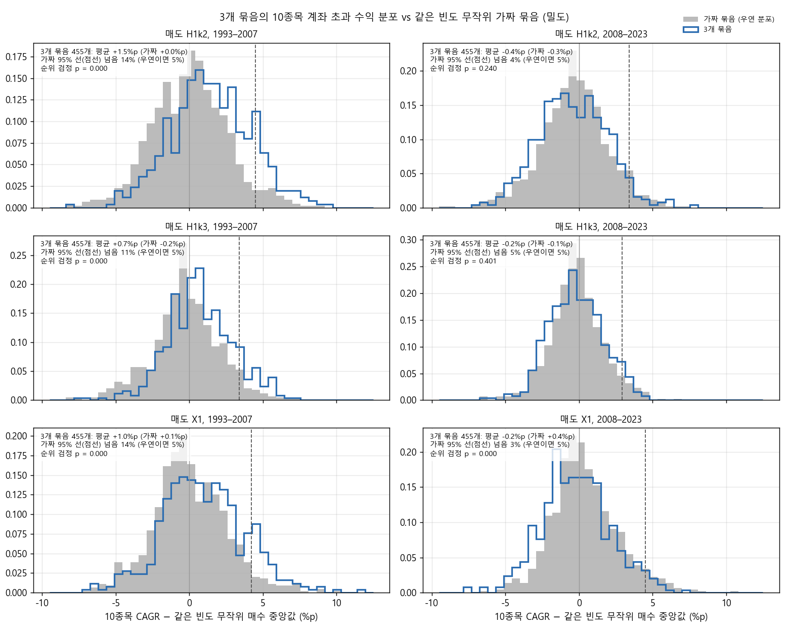
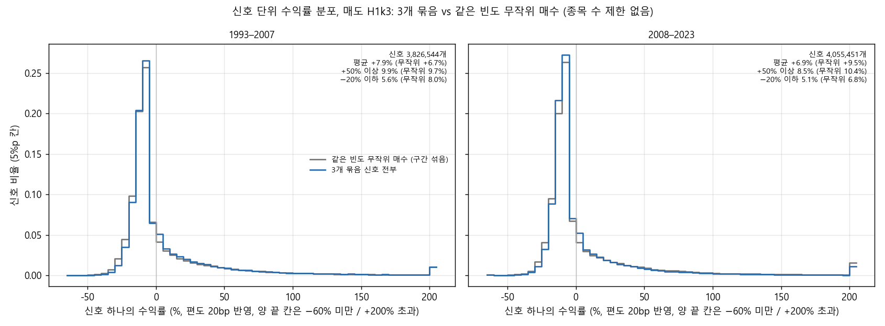
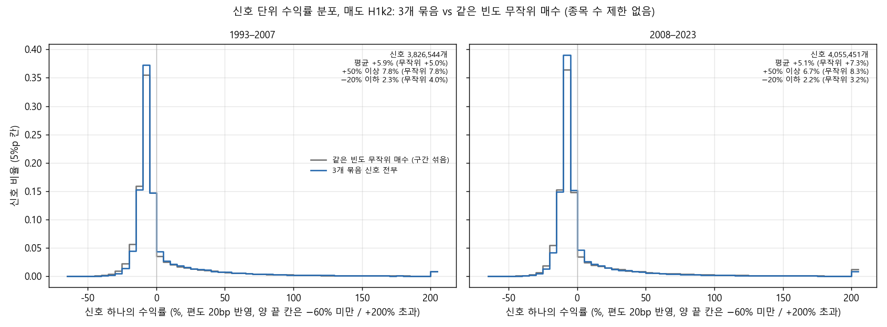
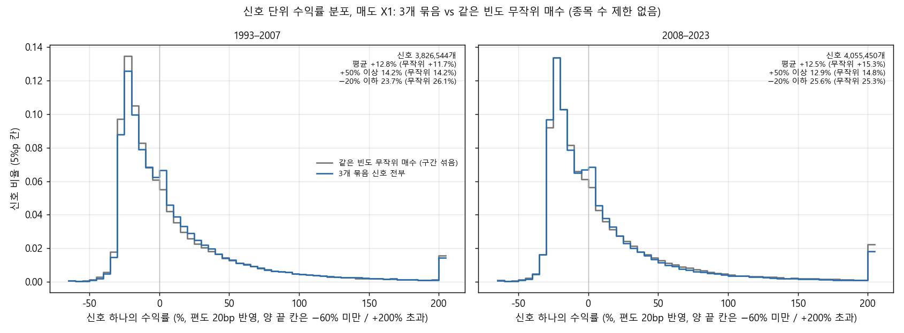
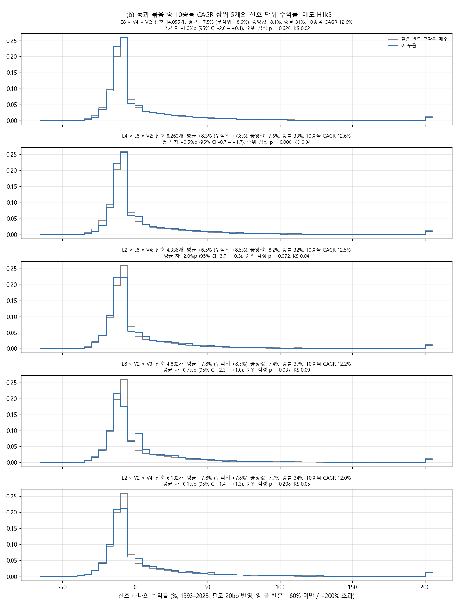
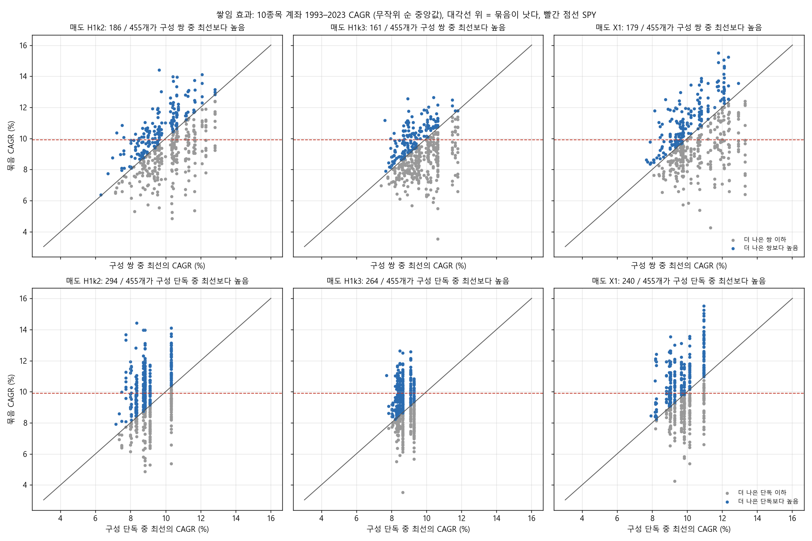

# Stage J3 결과: 매수 규칙 3개 묶기 (결정 89)

설계는 `docs/research/lab/2026-10-29_stage_j3_design.md`입니다. 결과 전에 커밋 ac6b5ea로 등록했고, 실행 전에 91318f6에서 보완했습니다(8구간, 가짜 묶음 800개, 단독 · 쌍 재계산, 히스토그램). 실행기는 `lab/pair_study.py --size 3`이고, 2026-10-29 10:31–11:14 KST에 돌렸습니다(낮 시간 CPU 제한: 코어 8개, 낮은 우선순위).

## 왜 했는지

Stage J에서 매수 규칙 2개를 묶은 105쌍은 같은 빈도로 무작위로 산 것보다 낫지 않았습니다. 사용자는 그래도 하루 신호가 아직 너무 많다고 보고, 더 엄격한 규칙을 원했습니다. 그래서 같은 15개 규칙을 3개씩 묶어(455개 조합 전부) '세 규칙이 10거래일 안에 모두 가리킨 종목'만 샀습니다. 비교 기준은 같은 빈도로 무작위로 산 경우(E0)입니다. 사용자 요청에 따라 그림은 하루 신호 수가 아니라 수익률(%)을 가로축으로 한 히스토그램과 통계 검정으로 바꿨습니다.

## 핵심 결과

1. **10종목 계좌에서는 우연보다 많은 묶음이 무작위를 이겼습니다. 다만 그 차이는 1993–2007에서 나왔습니다.**
   - 등록한 판정(b)은 두 반쪽 모두 같은 빈도 E0의 중앙값보다 높고, 매도 3종 중 2개 이상에서 그래야 합니다. 455개 중 118개가 통과했습니다.
   - 가짜 묶음 800개의 통과율은 18.75%였습니다. 그러면 우연히 85개가 통과하리라 기대되고, 95% 분위는 99개입니다. 118 > 99이므로 등록 기준으로 '정보가 있다'입니다.
   - 하지만 초과 수익 히스토그램(그림 1)을 보면 차이는 1993–2007에만 있습니다. 이 시기 묶음은 같은 빈도 무작위보다 평균 +0.7–+1.5%p 높았고, 가짜 95% 선을 넘은 묶음이 11–14%였습니다(우연이면 5%, 순위 검정 p < 0.001). 2008–2023에는 평균 −0.2 – −0.4%p로 가짜 묶음(−0.3 – +0.4%p)과 같거나 못했습니다.
2. **신호당 수익(종목 수 제한 없음)은 무작위보다 나아지지 않았습니다.**
   - (a) 판정(신호당 거래 기여, 두 반쪽)은 455개 중 24개만 통과했습니다. 우연 기대 108개보다 훨씬 적습니다.
   - 신호 단위 수익률의 분포는 무작위와 '다르긴' 했습니다. 묶음 × 매도 1,365칸 중 65%가 p < 0.05였고, 같은 검정에서 가짜 묶음은 4.2%였습니다. 그래서 검정 자체는 제대로 맞춰져 있습니다.
   - 그러나 방향은 좋지 않았습니다. 평균 수익 차이의 95% 신뢰구간이 0보다 위인 칸은 3.8%, 아래인 칸은 48%였습니다. 평균 차이의 중앙값은 신호당 −1.1%p입니다.
   - 모든 신호를 모아 보면(그림 2) 두 반쪽에서 모두 −20% 이하 손실이 무작위보다 적었습니다. 하지만 2008–2023에는 +50% 이상 큰 수익도 적어 평균이 낮았습니다. 예를 들어 H1 k 3에서 묶음은 평균 +6.9%, 무작위는 +9.5%였습니다.
3. **등록 규칙의 SPY 후보는 5개였고, 40bp에서도 매도 2종이 남은 것은 2개입니다.** 둘은 E2 골든크로스 × E5 눌림목 × V2 5일 급등, 그리고 E4 볼린저 수축 돌파 × V3 거래량 폭발 × V5 52주 신고가 종가 + 거래량입니다.
   - 그러나 2017–2023 CAGR이 SPY(13.2%)를 겨우 넘었습니다(40bp에서 13.2–15.8%).
   - 샤프로 보면 SPY나 같은 빈도 무작위와 구별되지 않습니다(PSR 0.60–0.93, 여러 번 시험한 것을 보정하기 전).
   - 가짜 묶음도 0.38%(800개 중 3개)가 같은 후보 규칙을 통과했습니다. 묶음은 1.1%(455개 중 5개)였습니다.
4. **3개 묶음은 그 안의 쌍보다 대체로 못했습니다.** 1993–2023 10종목 CAGR에서 세 쌍 중 최선보다 높았던 묶음은 455개 중 186 / 161 / 179개(매도별)이고, 차이 중앙값은 −0.4%p 안팎입니다. 세 단독 중 최선보다 높았던 묶음은 240–294개로 절반을 조금 넘었습니다.
5. **'더 엄격하게(더 드물게)'의 효과는 중간까지만 있었습니다.**
   - 10종목 계좌가 두 반쪽 모두 같은 빈도 무작위를 이긴 비율은 하루 0.5–2개인 묶음에서 가장 높았습니다(39–44%, 같은 빈도 가짜 31–37%).
   - 하루 0.1개 이하로 아주 드문 묶음은 오히려 낮았습니다(4%, 가짜 22%). 0.1–0.5개는 25–29%(가짜 16–23%)였습니다.
6. **결론**: 3개를 묶으면 10종목 계좌가 1993–2007에 무작위보다 나았고, 그 덕에 등록 기준을 넘었습니다. 하지만 2008–2023에는 이점이 없었습니다. 신호 하나하나의 수익도 무작위보다 낫지 않았습니다(큰 손실은 줄었지만 큰 수익도 줄었음). 지금의 매수 규칙 조합이 '언제 살지'에 대해 꾸준히 쓸 만한 정보를 준다고 보기는 어렵습니다.

## 그림

**그림 1.** 가로축은 10종목 계좌 CAGR에서 같은 빈도 무작위 매수(E0) 500개 계좌의 중앙값을 뺀 값(%p)입니다. 회색은 가짜 묶음 800개로, 정보가 없는 묶음이 우연히 보일 수 있는 범위입니다. 파란 선은 실제 455개 묶음입니다. 점선은 가짜 분포의 95% 선으로, 정보가 없으면 묶음의 5%만 이 선을 넘습니다. 1993–2007(왼쪽)에는 파란 분포가 오른쪽으로 밀려 있고 11–14%가 점선을 넘습니다. 2008–2023(오른쪽)에는 회색과 겹치거나(H1 k 2 · k 3) 왼쪽에 있습니다(X1).

**그림 2.** 455개 묶음의 신호를 모두 모은 수익률 분포(파란 선)와 같은 빈도 무작위 매수(회색)입니다. 매도는 H1 k 3이고 편도 20bp를 뺐습니다. 무작위 쪽은 묶음 신호가 놓인 빈도 구간의 비율대로 섞었습니다. 칸은 5%p이고, 양 끝 칸은 −60% 미만과 +200% 초과입니다. 두 분포는 거의 겹칩니다. 묶음은 −20% 이하 손실이 적고(1993–2007 5.6% vs 8.0%, 2008–2023 5.1% vs 6.8%), 2008–2023에는 +50% 이상도 적습니다(8.5% vs 10.4%).

같은 그림, 매도 H1 k 2입니다. 평균은 1993–2007 +5.9% vs +5.0%, 2008–2023 +5.1% vs +7.3%입니다.

같은 그림, 매도 X1입니다. 평균은 +12.8% vs +11.7%, 그리고 +12.5% vs +15.3%입니다.

**그림 3.** (b)를 통과한 묶음 중 H1 k 3의 1993–2023 10종목 CAGR 상위 5개입니다. 각 묶음의 신호(파란 선)를 같은 빈도 무작위 매수(회색)와 비교했습니다. 제목에 평균 차이와 95% 신뢰구간, 순위 검정 p, KS 통계량을 적었습니다. 10종목 계좌는 12.0–12.6%로 좋았지만, 신호당 평균은 무작위와 같거나(차이 −2.0 – +0.5%p) 낮았습니다.

**그림 4.** 쌓임 효과입니다. 위는 묶음 vs 그 안의 세 쌍 중 최선, 아래는 묶음 vs 세 단독 중 최선입니다(10종목 1993–2023 CAGR). 대각선 위가 '묶어서 나아짐'입니다. 위 줄은 대각선 아래가 더 많습니다.

## 무엇을 했나

### 종목 필터링

Stage C · I · J와 같습니다. 매일 21거래일 평균 시가총액 상위 3,000개 미국 보통주 가운데 위생 필터를 통과한 종목입니다. 위생 필터는 다음 넷입니다.
- 12개월 중 90% 이상 거래
- 주가 5달러 이상
- 21일 거래대금 100만 달러 이상
- Amihud 비유동성 상위 20% 제외

### 매수: 3개 묶음 신호

**3개 묶음 신호**는 같은 종목에서 세 규칙의 '처음 뜬 날' 신호가 모두 10거래일 안에 뜬 경우입니다. 가장 이른 신호와 가장 늦은 신호의 간격이 0–10거래일이면 되고, 순서는 상관없습니다. 가장 늦은 신호 날 종가로 판단해 다음 날 시가에 삽니다. 한 규칙만 다시 떠도 나머지 둘의 신호가 아직 10거래일 안이면 새 신호입니다(Stage J 쌍과 같은 셈법).

규칙 15개는 Stage J와 같고, 모두 가운데 값입니다.
- E1 N일 고가 돌파(55일), E2 골든크로스(50일선 > 200일선), E3 52주 신고가 + 거래량(1.5배)
- E4 볼린저 수축 돌파(20%), E5 눌림목(RSI2 < 10), E6 MACD(12, 26, 9)
- E7 +DI 교차(ADX 20), E8 시계열 모멘텀(12개월), E9 갭 상승(4%)
- V1 하루 급등(z 2.5), V2 5일 급등(z 2.5), V3 거래량 폭발(z 4)
- V4 변동폭 급확장(2.5배), V5 52주 신고가 종가 + 거래량(2배), V6 수축 뒤 돌파(20%)

455개 묶음의 하루 신호 수는 0.05–19.5개(중앙값 1.2개)였습니다. 쌍(중앙값 5.9개)보다 크게 줄었습니다. 거래 30회 미만으로 빠진 묶음은 없었습니다.

### 매도 (3종, Stage J와 같음)

- H1 k 2: 최고 종가 대비 25% 하락 또는 ATR(14) × 2 손절
- H1 k 3: 같은 것에 ATR × 3
- X1: 25% 트레일링만(손절 없음)

### 계좌 규칙 (Stage J와 같음)

- **10종목 계좌(계좌 A)**: 주식 수 = 자산 × 1% ÷ (매수가 − 손절선), 종목당 10% 상한, 최대 10종목입니다. X1은 종목당 10% 고정입니다. 그 밖의 규칙은 다음과 같습니다.
  - 청산 뒤 20거래일 재진입 금지
  - 편도 20bp
  - 남는 현금은 단기국채

  신호가 자리보다 많은 날은 무작위 순으로 채웠고, 순서 100번의 중앙값을 봤습니다.
- **종목 수 제한 없음**: 신호마다 따로 사고판다고 보고, 거래 기여(비중 × 수익)와 신호 단위 수익률을 봤습니다.
- 기간은 1993-02 – 2023-12의 한 곡선이고, 두 반쪽과 2017–2023은 그 곡선을 잘랐습니다. 보류 구간(2024년 이후)은 쓰지 않았습니다.

### 비교 기준과 새 용어

- **같은 빈도 무작위 매수(E0)**: Stage I의 무작위 매수(위생 통과 종목 · 일마다 1%, 씨앗 5개)를 다시 솎은 것입니다. 빈도는 8구간입니다(종목 · 일 대비 0.002–0.4%, 하루 약 0.04–8개). 각 묶음은 가장 가까운 구간의 E0 500개 계좌(씨앗 5 × 순서 100)와 비교했습니다.
- **가짜 묶음(위약)**: 같은 방식으로 솎은 무작위 매수를 묶음처럼 같은 판정에 넣은 것입니다. 구간마다 100개(모두 800개), 무작위 순 20번입니다. 통과율 p0로 '우연히 몇 개가 통과할지'를 정했습니다(이항분포 455, p0의 95% 분위).
- **신호 단위 수익률**: 신호 하나를 다음 날 시가에 사서 매도 규칙대로 팔았을 때의 수익률입니다(편도 20bp 반영).
- **검정**: 신호 단위 수익률을 같은 빈도 E0와 비교했습니다(1993–2023).
  - 평균 차이와 그 부트스트랩 95% 신뢰구간(양쪽을 각각 1,000번 다시 뽑음)
  - Mann–Whitney 순위 검정의 양측 p값(한쪽 신호가 다른 쪽보다 큰 경향이 있는지)
  - KS 통계량(두 분포의 누적비율이 가장 크게 벌어진 정도)

  가짜 묶음은 자기를 만든 씨앗을 뺀 나머지 E0와 비교했습니다(겹침 방지).
- **쌓임 효과**: 묶음의 10종목 CAGR이 그 안의 세 쌍 · 세 단독 중 최선보다 높은지입니다.
- **PSR**: 샤프 비율이 기준(SPY 또는 같은 빈도 E0)보다 클 확률입니다. 여러 번 시험한 것은 보정하지 않습니다.

## 결과

### 판정 (455개 묶음, 매도 3종)

| 판정 | 매도별 두 반쪽 통과(H1 k 2 / H1 k 3 / X1) | 묶음 통과(매도 2개 이상) | 가짜 묶음 통과율 p0 | 우연 기대 · 95% 분위 | 정보 있음? |
|---|---|---|---|---|---|
| (a) 제한 없음 거래 기여 > 같은 빈도 E0 | 28 / 27 / 37 | 24 | 23.75% | 108 · 123 | 아니오 |
| (b) 10종목 중앙값 CAGR > 같은 빈도 E0 중앙값 | 135 / 123 / 133 | 118 | 18.75% | 85.3 · 99 | **예** |

가짜 묶음의 두 반쪽 통과율은 매도별로 (a) 25–27%, (b) 20–27%입니다. 구간별 p0도 적어 둡니다(`chance.json`). (a)는 5–48%, (b)는 11–32%입니다.

쌍 105개도 새 8구간으로 다시 판정했습니다. 통과 수는 Stage J와 같았습니다((a) 10, (b) 18, 우연 95% 분위 32 · 26). 단독과 쌍의 10종목 계좌는 Stage J와 소수점까지 같았습니다(CAGR · MDD · 거래 수 차이 0).

### 초과 수익 히스토그램의 숫자 (그림 1)

| 매도 | 반쪽 | 묶음 평균 (가짜 평균) | 가짜 95% 선 넘은 묶음 | 순위 검정 p (묶음 vs 가짜) |
|---|---|---|---|---|
| H1 k 2 | 1993–2007 | +1.5%p (+0.0) | 14% | < 0.001 |
| | 2008–2023 | −0.4%p (−0.3) | 4% | 0.24 |
| H1 k 3 | 1993–2007 | +0.7%p (−0.2) | 11% | < 0.001 |
| | 2008–2023 | −0.2%p (−0.1) | 5% | 0.40 |
| X1 | 1993–2007 | +1.0%p (+0.1) | 14% | < 0.001 |
| | 2008–2023 | −0.2%p (+0.4) | 3% | < 0.001 (묶음이 낮음) |

묶음 455개는 규칙을 공유해 서로 독립이 아닙니다. 그래서 이 p값은 실제보다 작게 나왔을 수 있습니다.

### 신호 단위 수익률 검정 (`stats.csv`, 1993–2023)

| | 칸 수 | p < 0.05 | 그중 묶음이 높은 쪽 | 평균 차 CI가 0보다 위 | 평균 차 CI가 0보다 아래 | 평균 차 중앙값 |
|---|---|---|---|---|---|---|
| 3개 묶음 | 1,365 | 64.8% | 45.3% | 3.8% | 48.1% | −1.06%p |
| 가짜 묶음 | 2,400 | 4.2% | 2.7% | 2.0% | 2.9% | +0.03%p |
| 쌍 (참고) | 315 | 80.3% | 54.0% | 12.7% | 54.6% | −0.86%p |
| 단독 (참고) | 45 | 95.6% | 60.0% | 28.9% | 40.0% | −0.28%p |

가짜 묶음의 p < 0.05 비율(4.2%)은 기대한 5%와 비슷합니다. 그러니 검정은 제대로 맞춰져 있습니다. 묶음의 65%가 p < 0.05인 것은 분포가 무작위와 '다르다'는 뜻이고, 우연(약 5%)으로는 설명되지 않습니다. 하지만 다른 방향이 평균을 올리지 않았습니다. 순위로는 묶음이 높은 칸이 더 많았지만(45% vs 19%), 평균은 절반 가까이에서 무작위보다 확실히 낮았습니다. 손실 꼬리가 줄어 중앙값 근처는 나아졌지만, 큰 수익 꼬리도 줄어 평균이 낮아진 모양입니다.

모든 신호를 모은 값(그림 2, 묶음 vs 같은 빈도 무작위)은 다음과 같습니다.

| 매도 | 반쪽 | 평균 | +50% 이상 | −20% 이하 |
|---|---|---|---|---|
| H1 k 2 | 1993–2007 | +5.9% vs +5.0% | 7.8% vs 7.8% | 2.3% vs 4.0% |
| | 2008–2023 | +5.1% vs +7.3% | 6.7% vs 8.3% | 2.2% vs 3.2% |
| H1 k 3 | 1993–2007 | +7.9% vs +6.7% | 9.9% vs 9.7% | 5.6% vs 8.0% |
| | 2008–2023 | +6.9% vs +9.5% | 8.5% vs 10.4% | 5.1% vs 6.8% |
| X1 | 1993–2007 | +12.8% vs +11.7% | 14.2% vs 14.2% | 23.7% vs 26.1% |
| | 2008–2023 | +12.5% vs +15.3% | 12.9% vs 14.8% | 25.6% vs 25.3% |

여러 묶음이 같은 신호를 공유하므로 모은 값에는 중복이 있습니다(신호 788만 개).

### 상위 5개 (등록: (b) 통과 묶음 중 H1 k 3의 1993–2023 10종목 CAGR 순)

| 묶음 (하루 신호) | 매도 | CAGR · MDD 1993–2023 | CAGR 1993–2007 / 2008–2023 (같은 빈도 E0 안 분위) | 2017–2023 CAGR · MDD |
|---|---|---|---|---|
| E8 시계열 모멘텀 × V4 변동폭 급확장 × V6 수축 뒤 돌파 (1.8개) | H1 k 2 | 14.0% · −47% | 17.1% / 11.6% (100 / 85%) | 11.8% · −38% |
| | H1 k 3 | 12.6% · −34% | 17.3% / 8.5% (100 / 69%) | 7.2% · −33% |
| | X1 | 11.5% · −42% | 13.4% / 9.8% (89 / 64%) | 12.0% · −38% |
| E4 볼린저 수축 돌파 × E8 시계열 모멘텀 × V2 5일 급등 (1.1개) | H1 k 2 | 13.0% · −43% | 15.0% / 11.4% (93 / 92%) | 10.9% · −30% |
| | H1 k 3 | 12.6% · −35% | 15.1% / 10.3% (99 / 97%) | 8.8% · −33% |
| | X1 | 10.7% · −44% | 12.2% / 9.0% (81 / 66%) | 11.0% · −42% |
| E2 골든크로스 × E8 시계열 모멘텀 × V4 변동폭 급확장 (0.6개) | H1 k 2 | 11.4% · −34% | 10.9% / 11.8% (67 / 84%) | 13.0% · −29% |
| | H1 k 3 | 12.5% · −37% | 14.5% / 11.0% (92 / 100%) | 12.2% · −26% |
| | X1 | 13.6% · −37% | 17.3% / 10.4% (98 / 78%) | 9.3% · −27% |
| E8 시계열 모멘텀 × V2 5일 급등 × V3 거래량 폭발 (0.6개) | H1 k 2 | 12.0% · −44% | 12.0% / 12.4% (89 / 91%) | 12.7% · −32% |
| | H1 k 3 | 12.2% · −32% | 13.2% / 11.0% (84 / 100%) | 10.8% · −31% |
| | X1 | 12.9% · −44% | 9.6% / 16.2% (25 / 100%) | 17.6% · −39% |
| E2 골든크로스 × V2 5일 급등 × V4 변동폭 급확장 (0.8개) | H1 k 2 | 14.4% · −35% | 14.5% / 14.2% (89 / 100%) | 17.4% · −26% |
| | H1 k 3 | 12.0% · −29% | 14.4% / 10.2% (98 / 96%) | 11.4% · −28% |
| | X1 | 11.3% · −35% | 12.3% / 10.8% (82 / 90%) | 12.3% · −33% |

기준선(1993–2023 / 1993–2007 / 2008–2023 / 2017–2023)은 다음과 같습니다.
- SPY: 9.9%, −55% / 10.1% / 9.8% / 13.2%, −34%
- SPY 200일선: 8.6%, −21% / 8.2% / 8.9% / 10.4%
- 동일비중 유니버스: 10.2%, −61% / 12.1% / 8.5% / 8.5%

상위 5개 중 4개에 E8 시계열 모멘텀이 들어 있습니다. 하지만 같은 묶음의 신호당 평균 수익(H1 k 3)은 무작위와 같거나 낮았습니다. 평균 차이는 −2.0 – +0.5%p이고, 0보다 확실히 높은 것은 없습니다(그림 3). 10종목 계좌의 이점은 신호 하나의 질보다, 신호가 몰리는 시기(예: 12개월 모멘텀이 살아나는 상승장)에 계좌가 주식을 들고 있었던 데서 왔을 수 있습니다. 직접 재지는 않은 추정입니다.

### SPY 후보 (등록 규칙: 1993–2023과 2017–2023 모두 CAGR > SPY, |MDD| < |SPY MDD|, 거래 30회 이상, 매도 2종 이상, 40bp에서도)

| 묶음 (하루 신호) | 20bp 통과 매도: CAGR · MDD 1993–2023 / 2017–2023 CAGR | 40bp 결과 | (b) 판정 | 샤프(연) · PSR vs SPY |
|---|---|---|---|---|
| E2 골든크로스 × E5 눌림목 × V2 5일 급등 (0.4개) | H1 k 3: 10.7% · −38% / 16.0%, X1: 10.2% · −43% / 14.5% | 두 매도 모두 통과(15.8%, 14.5%) | 아니오 | 0.74 · 0.78 / 0.65 · 0.61 |
| E4 볼린저 수축 돌파 × V3 거래량 폭발 × V5 52주 신고가 종가 + 거래량 (0.6개) | H1 k 2: 11.1% · −31% / 14.1%, X1: 12.3% · −38% / 15.1% | 두 매도 모두 통과(13.2%, 14.3%) | 예 | 0.70 · 0.71 / 0.74 · 0.78 |
| E2 골든크로스 × E3 52주 신고가 + 거래량 × V2 5일 급등 (0.4개) | H1 k 2: 11.0% · −37% / 13.8%, X1: 11.8% · −36% / 16.7% | X1만 통과 | 아니오 | 0.71 · 0.73 / 0.72 · 0.75 |
| E7 +DI 교차 × E8 시계열 모멘텀 × V5 52주 신고가 종가 + 거래량 (0.3개) | H1 k 2: 13.7% · −43% / 13.2%, X1: 13.6% · −48% / 14.1% | X1만 통과 | 아니오 | 0.87 · 0.93 / 0.81 · 0.88 |
| E1 N일 고가 돌파 × E5 눌림목 × V3 거래량 폭발 (1.1개) | H1 k 2: 12.6% · −38% / 13.7%, X1: 12.1% · −40% / 13.8% | 둘 다 탈락(12.9%, 12.5%) | 예 | 0.77 · 0.83 / 0.72 · 0.76 |

- 40bp에서도 매도 2종이 통과한 것은 위의 두 묶음입니다. 둘 다 2017–2023 CAGR이 SPY를 0.0–2.6%p 넘는 정도라 여유가 거의 없습니다.
- **DSR**(등록 절차, 시험 수 N = 65,218, 이번 묶음 1,365개 곡선의 샤프 분산)은 0.93–0.997로 높게 나왔습니다. 이것은 '샤프가 0보다 큰가'를 검사합니다. 이 계좌들은 모두 주식을 들고 있어 샤프가 비슷하고(묶음 1,365칸의 연 샤프 5–95%: 0.48–0.77), 그래서 선택 보정의 문턱이 낮습니다. 비교 기준을 SPY(연 샤프 0.60)나 같은 빈도 E0(0.53–0.62)로 바꾼 PSR은 0.60–0.93입니다. 보정 전인데도 0.95를 넘는 후보는 없습니다(`candidates_dsr.csv`).
- 같은 후보 규칙을 가짜 묶음 800개에 대 보면 3개(0.38%)가 통과했습니다. 무작위 E0 계좌 하나하나로는 2.0%가 1993–2023과 2017–2023 모두 SPY를 넘었습니다.

### 쌓임 효과 (그림 4, 1993–2023 10종목 CAGR)

| 매도 | 세 쌍 중 최선보다 높음 (두 반쪽 모두) | 차이 중앙값 | 세 단독 중 최선보다 높음 (두 반쪽 모두) | 차이 중앙값 |
|---|---|---|---|---|
| H1 k 2 | 186 / 455 (58) | −0.36%p | 294 / 455 (138) | +0.59%p |
| H1 k 3 | 161 / 455 (47) | −0.47%p | 264 / 455 (118) | +0.34%p |
| X1 | 179 / 455 (61) | −0.43%p | 240 / 455 (120) | +0.11%p |

'셋 중 최선'은 우연히 높게 나온 값을 고르는 셈입니다. 그래서 묶음이 실제로 같더라도 지는 쪽으로 기웁니다. 그 점을 감안해도 세 번째 규칙을 더해 나아졌다고 보기는 어렵습니다.

### 신호 빈도와 성적 (사용자 가설: 신호가 드물수록 낫다; 단독 · 쌍 · 3개 묶음 전부, 정보)

| 하루 신호 | 묶음 수 | 1993–2007 초과 CAGR 중앙값 | 2008–2023 초과 CAGR 중앙값 | (b) 두 반쪽 통과율 (같은 구간 가짜) |
|---|---|---|---|---|
| 0.1개 이하 | 8 | −0.5%p | −1.7%p | 4% (22%) |
| 0.1–0.25개 | 32 | −0.4%p | +0.4%p | 29% (23%) |
| 0.25–0.5개 | 68 | −0.0%p | +0.2%p | 25% (16%) |
| 0.5–1개 | 108 | +1.6%p | +0.7%p | 44% (37%) |
| 1–2개 | 105 | +1.9%p | −0.0%p | 39% (31%) |
| 2–4개 | 100 | +1.2%p | −1.0%p | 21% (21%) |
| 4–8개 | 93 | +0.3%p | −1.4%p | 14% (17%) |
| 8개 초과 | 61 | +0.0%p | −1.7%p | 3% (11%) |

초과 CAGR은 같은 빈도 E0 중앙값 대비 값입니다. 묶음 수는 단독 · 쌍 · 3개 묶음을 합친 수이고, 통과율은 묶음 × 매도 칸 중 두 반쪽 모두 E0 중앙값을 넘은 비율입니다. 하루 8개를 넘는 흔한 신호는 2008–2023에 무작위보다 분명히 못했습니다. 하루 0.5–2개까지 줄이면 나아졌고, 그보다 더 드물게 하면 다시 나빠졌습니다. 빈도와 2008–2023 초과 CAGR의 순위상관은 −0.32 – −0.44(드물수록 나음)였고, 1993–2007에는 거의 0이었습니다.

## 한계

- 매수 값은 가운데 하나, 창은 10거래일 하나만 봤습니다(결과 전에 정함).
- 455개 묶음은 규칙을 공유해 서로 겹칩니다. 그래서 통과 묶음 수의 이항 기대치와 히스토그램의 순위 검정은 근사입니다. 우연 95% 분위(99)를 넘은 정도(118)는 이 겹침을 감안하면 크지 않습니다.
- 신호 단위 검정은 신호를 서로 독립으로 봅니다. 가짜 묶음의 p < 0.05가 4.2%로 나와 이 치우침은 작았습니다. 다만 가짜 묶음은 시점이 고르게 퍼진 무작위 매수라, 시점이 몰리는 실제 규칙과는 사정이 다를 수 있습니다.
- '모든 신호를 모은' 히스토그램에는 같은 신호가 여러 묶음에 겹쳐 들어 있습니다.
- 기간별 값은 1993-02부터 이어진 한 곡선을 잘랐습니다.
- 시험 수는 +1,365(455 × 매도 3)입니다. 단독 · 쌍(재계산) · E0 · 가짜 묶음은 세지 않았습니다. 누적은 약 65,218입니다. 이 실행기는 `trials.csv`에 쓰지 않습니다.
- 보류 구간(2024년 이후)은 쓰지 않았습니다.

## 남은 판단

- 다음 단계는 사용자가 정한 대로 **매도 전략 수를 크게 늘려** 시험하는 것입니다. 설계는 따로 등록합니다.
- 40bp에서도 남은 두 후보(E2 × E5 × V2, E4 × V3 × V5)의 보류 구간(2024년 이후) 평가는 사용자가 지정해 요청할 때만 합니다. 볼 때마다 기록되고 검증력이 줄어듭니다. 샤프로는 SPY와 구별되지 않았다는 점도 함께 고려해야 합니다.
- 제안(설계 아님): 규칙마다 그날의 신호 강도 상위 N개만 사는 방식이면 빈도를 직접 조절할 수 있습니다. 이번 결과에서 나은 구간이 하루 0.5–2개였으므로 그 근처를 미리 정해 볼 수 있습니다.
- 집계표는 `docs/research/lab/2026-10-29_stage_j3/`에 있습니다.
  - `verdicts.csv.gz`: 판정 전체(단독 · 쌍 · 묶음 · 가짜 × 매도)
  - `stats.csv.gz`: 신호 단위 검정
  - `hist.csv.gz`: 신호 단위 수익률 히스토그램 칸별 개수
  - `accounts_quantiles.csv.gz`: 계좌의 5 · 50 · 95% 분위
  - `unlimited.csv.gz`: 제한 없음 통계
  - `chance.json`: 우연 기대치, 구간별 p0, 검정 요약
  - `candidates_dsr.csv`: 후보 DSR · PSR
  - `baselines.csv`: 기준선

  전체 결과는 드라이브 `CRSP/lab_crsp/stage_j3_triples`에 있습니다.
