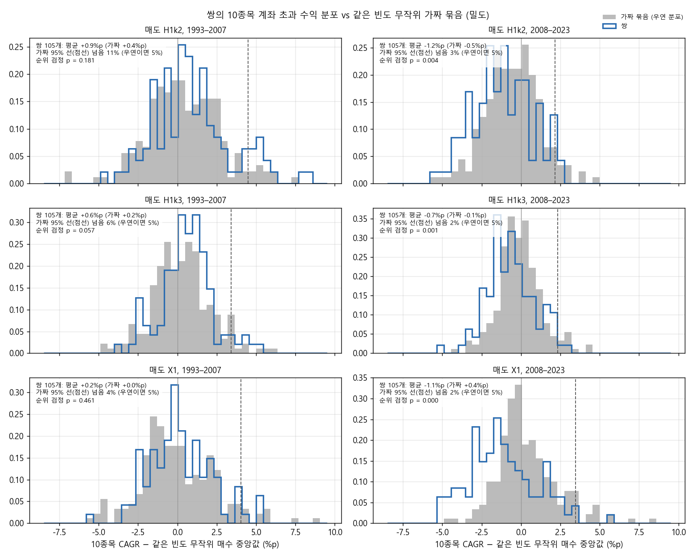
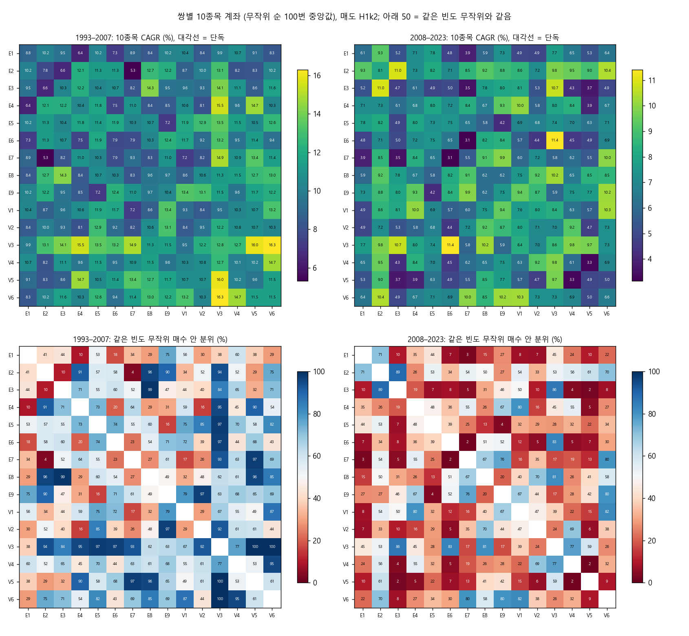
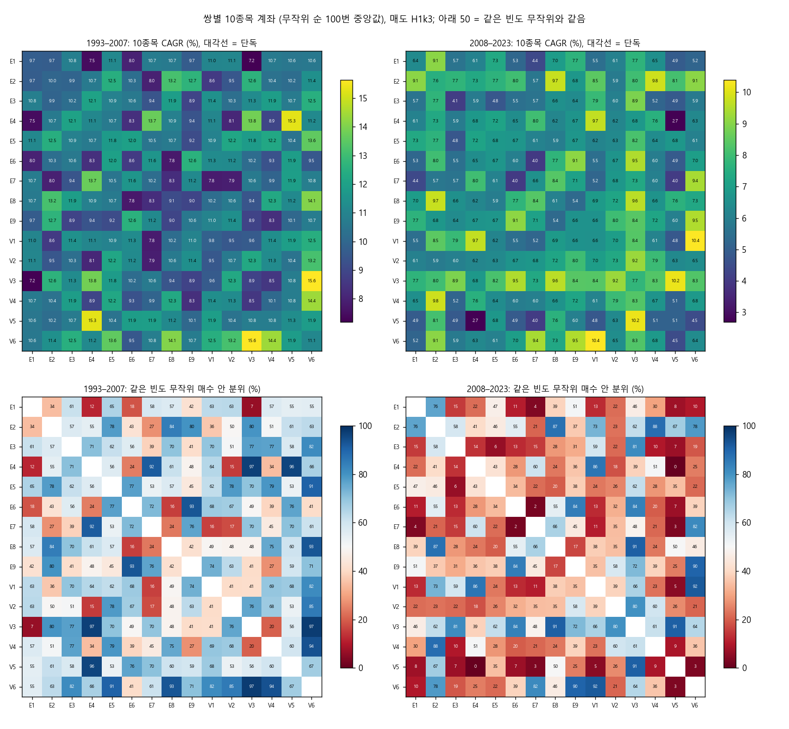
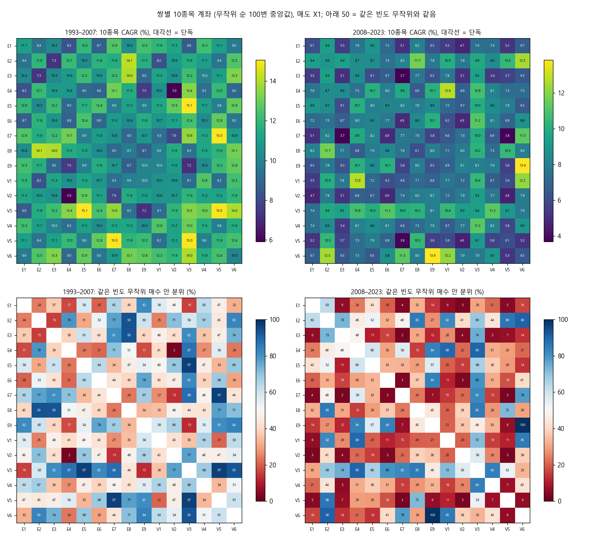
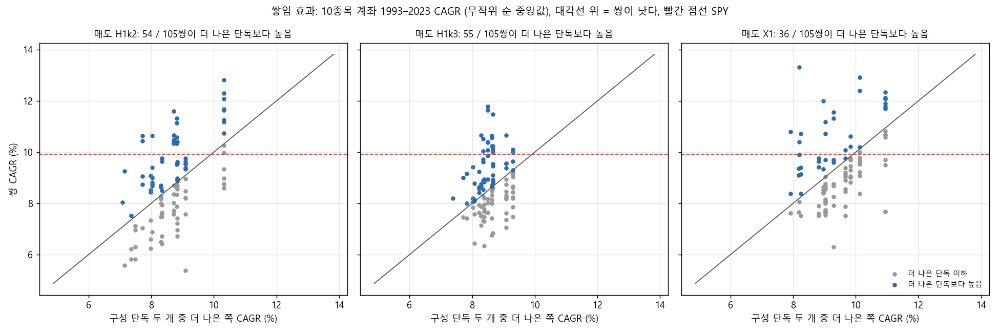

# Stage J 결과: 매수 규칙 2개 묶기 (결정 88)

설계는 `docs/research/lab/2026-10-29_stage_j_design.md`이고, 결과 전에 커밋 301fb15로 올렸습니다. 실행기는 `lab/pair_study.py`입니다. 본 실행 전에 실행기를 설계와 대조해 빠진 것(후보 40bp 재확인, 쌓임 효과 그림)을 넣었고(2c1cc77), 설계는 바꾸지 않았습니다. 본 실행은 2026-10-28 23:54 – 10-29 00:00 KST에 돌렸습니다.

## 왜 했는지

Stage I에서 매수 규칙 15개는 무작위로 산 것보다 거의 낫지 않았습니다. 그 이유로 짐작한 것은 신호가 너무 흔하다는 점이었습니다. 하루 20–60개씩 뜨니 10종목 계좌는 사실상 신호 더미에서 무작위로 고르는 셈입니다. 사용자 제안에 따라 규칙 두 개를 묶어 '둘이 함께 가리키는 종목'만 사게 했습니다. 이렇게 하면 신호가 드물어집니다. 그래도 같은 빈도로 무작위로 산 것보다 나은지 봤습니다.

## 핵심 결과

1. **두 개를 묶어도 우연 이상의 정보는 없었습니다.** 판정은 미리 정한 기준을 따랐습니다(두 반쪽 1993–2007 · 2008–2023 모두, 매도 3종 중 2개 이상). 105쌍 중 통과한 쌍은 다음과 같습니다.
   - (a) 종목 수 제한 없음(신호당 거래 기여): 10쌍
   - (b) 10종목 계좌: 18쌍

   무작위로 만든 가짜 쌍 200개를 같은 판정에 넣으면 22.5% / 20.5%가 통과합니다. 이 비율이면 105쌍 중 23.6 / 21.5쌍이 우연히 통과하리라 기대되고, 95% 분위는 31 / 28쌍입니다. 실제 통과 수는 기대치보다도 적었습니다. 특히 (a)는 우연보다 확연히 적었습니다(10쌍 이하가 나올 확률 0.04%).
2. **SPY를 넘은 후보는 없습니다.** 1993–2023과 2017–2023 모두 SPY보다 CAGR이 높고 낙폭이 얕은 칸은 4개였습니다. 모두 매도 X1이고(E2×E8, E2×V6, E4×V1, V1×V6), 매도 3종 중 2개 조건을 채운 쌍은 없었습니다. 그래서 40bp 재확인과 DSR은 하지 않았습니다.
3. **신호는 드물어졌지만 그것만으로는 나아지지 않았습니다.** 쌍의 하루 신호 수는 0.2–33개(중앙값 5.9개)로, 단독(2–59개)보다 크게 줄었습니다. 그래도 같은 빈도로 솎은 무작위 매수 띠 안에 대부분 있었습니다.
4. **묶어서 더 좋아지는 경우는 반반이었습니다(쌓임 효과).** 1993–2023 10종목 CAGR로 쌍이 구성 단독 둘 중 더 나은 쪽보다 높았던 경우는 다음과 같습니다.
   - H1 k 2: 105쌍 중 54쌍, 차이 중앙값 +0.11%p
   - H1 k 3: 55쌍, +0.03%p
   - X1: 36쌍, −0.37%p

   두 반쪽 모두에서 높았던 쌍은 28 / 25 / 22쌍입니다.
5. **결론**: Stage I의 '신호가 흔해서'라는 설명은 맞지 않았습니다. 지금 있는 가격 · 거래량 매수 규칙은 하나로 쓰든 둘을 묶든 '언제 살지'에 대해 무작위보다 나은 정보를 주지 못했습니다.

## 그림

가로축은 10종목 계좌 CAGR에서 같은 빈도 무작위 매수(E0) 500개 계좌의 중앙값을 뺀 값(%p)입니다. 회색은 가짜 쌍 200개의 분포로, 정보가 없는 묶음이 우연히 보일 수 있는 범위입니다. 파란 선은 실제 105쌍(거래 30회 이상)입니다. 점선은 가짜 분포의 95% 선이고, 정보가 없으면 쌍의 5%만 이 선을 넘습니다. '순위 검정 p'는 쌍과 가짜 쌍의 분포가 같은지 보는 Mann–Whitney 검정입니다.
- 1993–2007: 쌍이 가짜보다 약간 오른쪽입니다(평균 +0.2–0.9%p vs +0.0–0.4%p). 95% 선을 넘은 쌍은 4–11%이고, p = 0.06–0.46으로 우연과 구별되지 않습니다.
- 2008–2023: 세 매도 모두 쌍이 가짜보다 왼쪽입니다(평균 −0.7 – −1.2%p vs −0.6 – +0.4%p, p = 0.000–0.004). 같은 빈도로 무작위로 산 것보다 오히려 못했다는 뜻입니다. 95% 선을 넘은 쌍은 2–3%입니다.
- 쌍 105개는 규칙을 공유해 서로 독립이 아니므로, 이 p값은 실제보다 작게 나왔을 수 있습니다.

사용자 요청(2026-10-29)으로 하루 평균 신호 수를 가로축으로 한 그림 세 장을 이 그림으로 바꿨습니다. 그림은 `lab/pair_study.py`의 `fig_excess`로 이 폴더의 `verdicts.csv`에서 다시 그렸습니다. 숫자는 바뀌지 않았습니다.

15 × 15 쌍 히트맵, 매도 H1 k 2입니다. 위 두 칸은 10종목 CAGR(%)이고 대각선은 단독 규칙입니다. 아래 두 칸은 같은 빈도 무작위 매수 분포 안의 분위(%)로, 50이 무작위와 같습니다. V3 거래량 폭발이 들어간 줄은 1993–2007에 대부분 파랗습니다(무작위보다 높음, 분위 62–100%, E1×V3만 38%). 2008–2023에는 17–86%로 섞여 있습니다.

같은 그림, 매도 H1 k 3입니다.

같은 그림, 매도 X1입니다.

쌓임 효과입니다. 가로축은 구성 단독 둘 중 더 나은 쪽의 CAGR, 세로축은 쌍의 CAGR(1993–2023, 10종목)입니다. 대각선 위가 '묶어서 나아짐'입니다. 점은 대각선 양쪽에 고르게 흩어져 있습니다.

## 무엇을 했나

### 종목 필터링

Stage C · I와 같습니다. 매일 21거래일 평균 시가총액 상위 3,000개 미국 보통주 가운데 위생 필터를 통과한 종목입니다. 위생 필터는 다음 넷입니다.
- 12개월 중 90% 이상 거래
- 주가 5달러 이상
- 21일 거래대금 100만 달러 이상
- Amihud 비유동성 상위 20% 제외

### 매수: 쌍 신호

**쌍 신호**는 같은 종목에서 규칙 A와 B의 '처음 뜬 날' 신호가 10거래일 안에 둘 다 뜬 경우입니다. 두 신호의 간격이 0–10거래일이면 인정하고(11일이면 아님), 순서는 상관없습니다. 나중 신호가 뜬 날 종가로 판단해 다음 날 시가에 삽니다. 15개 규칙에서 2개씩 고르는 모든 조합 105쌍을 봤습니다. 규칙 값은 모두 가운데 값입니다.
- E1 N일 고가 돌파(55일), E2 골든크로스(50일선 > 200일선), E3 52주 신고가 + 거래량(1.5배)
- E4 볼린저 수축 돌파(20%), E5 눌림목(RSI2 < 10), E6 MACD(12, 26, 9)
- E7 +DI 교차(ADX 20), E8 시계열 모멘텀(12개월), E9 갭 상승(4%)
- V1 하루 급등(z 2.5), V2 5일 급등(z 2.5), V3 거래량 폭발(z 4)
- V4 변동폭 급확장(2.5배), V5 52주 신고가 종가 + 거래량(2배), V6 수축 뒤 돌파(20%)

매도일은 종목 · 매수일 · 매도 규칙에만 달려 있습니다. 그래서 나중 신호 규칙의 저장된 신호표 행을 그대로 썼습니다(엔진을 다시 돌리지 않음). 단독 15개도 같은 실행에서 다시 계산했습니다.

### 매도 (3종)

- H1 k 2: 최고 종가 대비 25% 하락 또는 ATR(14) × 2 손절
- H1 k 3: 같은 것에 ATR × 3
- X1: 25% 트레일링만(손절 없음)

### 계좌 규칙

- **10종목 계좌(계좌 A)**: 주식 수 = 자산 × 1% ÷ (매수가 − 손절선), 종목당 10% 상한, 최대 10종목입니다. X1은 손절이 없어 종목당 10% 고정입니다. 그 밖의 규칙은 다음과 같습니다.
  - 청산 뒤 20거래일 재진입 금지
  - 편도 20bp
  - 남는 현금은 단기국채

  신호가 자리보다 많은 날은 무작위 순으로 채웠고, 순서 100번의 중앙값을 봤습니다.
- **종목 수 제한 없음**: 신호마다 같은 비중 규칙으로 따로 매매한다고 보고, 거래 기여(비중 × 수익)의 평균을 봤습니다.
- 기간은 1993-02 – 2023-12의 한 곡선입니다. 두 반쪽(1993–2007, 2008–2023)과 2017–2023은 그 곡선을 잘라 계산했습니다. 보류 구간(2024년 이후)은 쓰지 않았습니다.

### 비교 기준: 같은 빈도 무작위 매수

- **같은 빈도 무작위 매수**: Stage I의 무작위 매수 E0(위생 통과 종목 · 일마다 1% 확률, 씨앗 5개)를 다시 무작위로 솎아 다섯 빈도로 만든 것입니다. 빈도는 종목 · 일 대비 0.02 / 0.05 / 0.1 / 0.2 / 0.4%로, 하루 약 0.4 / 1 / 2 / 4 / 8개입니다. 각 쌍은 신호 빈도가 가장 가까운(로그 기준) 구간의 E0 500개 계좌(씨앗 5 × 순서 100)와 비교했습니다. E0 × X1 신호표는 이번에 새로 만들었습니다. 그 종목 · 일은 Stage I의 E0 × H1과 완전히 같습니다(씨앗 1: 155,100개 중 155,100개).
- **가짜 쌍(위약)**: 같은 방식으로 솎은 무작위 매수를 쌍인 것처럼 같은 판정에 넣은 것입니다. 빈도 구간마다 40개(합계 200개)이고, 무작위 순은 20번씩입니다. 가짜 쌍의 통과율 p0으로 '우연히 몇 쌍이 통과할지'(이항분포 105, p0의 95% 분위)를 정했습니다.
- **쌓임 효과**: 쌍의 10종목 CAGR이 구성 단독 둘 중 더 나은 쪽보다 높은지입니다(같은 매도).

## 결과

### 판정 (105쌍, 거래 30회 미만으로 빠진 쌍 없음)

| 판정 | 매도별 두 반쪽 통과(H1 k 2 / H1 k 3 / X1) | 쌍 통과(매도 2개 이상) | 가짜 쌍 통과율 p0 | 우연 기대 · 95% 분위 | 정보 있음? |
|---|---|---|---|---|---|
| (a) 제한 없음 거래 기여 > 같은 빈도 E0 | 9 / 12 / 20 | 10 | 22.5% | 23.6 · 31 | 아니오 |
| (b) 10종목 중앙값 CAGR > 같은 빈도 E0 중앙값 | 20 / 21 / 17 | 18 | 20.5% | 21.5 · 28 | 아니오 |

가짜 쌍의 통과율은 빈도 구간마다 꽤 다릅니다((a) 7.5–42.5%, (b) 5–37.5%, 구간당 40개). 그래서 정보용으로 쌍이 실제로 놓인 구간의 p0로 다시 셌습니다. 기대치는 (a) 30.2쌍, (b) 23.2쌍으로, 결론은 같습니다.

- (a) 통과 10쌍(E1×E2, E2×E4, E2×E5, E2×E6, E2×E7, E5×E8, E6×E8, E7×E8, E8×V1, E8×V6)은 모두 E2 골든크로스나 E8 시계열 모멘텀을 포함합니다. 이 실행에서 E2 · E8은 단독으로도 (a)를 통과했습니다(E6도 단독 통과). 매도 H1(1% 룰 비중)에서는 두 반쪽 통과가 9 · 12칸으로 가짜 쌍(30% · 26%)보다 크게 적었습니다. 고정 10% 비중인 X1에서는 20칸으로 가짜 쌍(20%)과 같았습니다. 쌍 신호가 변동이 큰 종목(손절폭이 넓어 1% 룰 비중이 작음)에 몰린다면 이렇게 됩니다. 다만 직접 재지는 않은 추정입니다.
- (b) 통과 18쌍 가운데 7쌍이 V3 거래량 폭발을 포함합니다(V3가 든 14쌍 중 7쌍, 나머지 91쌍 중 11쌍). V3는 Stage I에 이어 이번에도 단독으로 (b)를 통과했습니다(H1 k 2, X1). 결과를 본 뒤에 나눈 것이라 증거로 쓰지 않습니다.

### 상위 5쌍 (매도 3종 평균 1993–2023 10종목 CAGR 순)

| 쌍 (하루 신호) | 매도 | CAGR · MDD 1993–2023 | CAGR 1993–2007 / 2008–2023 (같은 빈도 E0 안 분위) | 2017–2023 CAGR · MDD | (b) |
|---|---|---|---|---|---|
| V1 하루 급등 × V6 수축 뒤 돌파 (7.4개) | H1 k 2 | 11.6% · −43% | 13.2% / 10.3% (87 / 82%) | 8.7% · −35% | 예 |
| | H1 k 3 | 11.6% · −37% | 12.5% / 10.4% (82 / 92%) | 9.2% · −35% | |
| | X1 | 12.0% · −39% | 12.3% / 12.2% (63 / 85%) | 16.1% · −27% | |
| V3 거래량 폭발 × V5 52주 신고가 종가 + 거래량 (1.5개) | H1 k 2 | 12.8% · −42% | 16.0% / 9.7% (100 / 59%) | 8.3% · −31% | 예 |
| | H1 k 3 | 10.5% · −35% | 10.8% / 10.2% (56 / 91%) | 9.1% · −27% | |
| | X1 | 11.8% · −42% | 15.0% / 9.1% (97 / 53%) | 8.0% · −36% | |
| E2 골든크로스 × E8 시계열 모멘텀 (2.2개) | H1 k 2 | 10.6% · −42% | 12.8% / 9.2% (96 / 50%) | 12.0% · −28% | 예 |
| | H1 k 3 | 11.5% · −41% | 13.2% / 9.7% (84 / 87%) | 10.9% · −27% | |
| | X1 | 12.9% · −50% | 14.1% / 11.7% (93 / 85%) | 17.5% · −29% | |
| E9 갭 상승 × V6 수축 뒤 돌파 (0.8개) | H1 k 2 | 11.1% · −50% | 12.2% / 10.2% (69 / 80%) | 7.9% · −49% | 예 |
| | H1 k 3 | 9.9% · −38% | 10.7% / 9.5% (71 / 90%) | 8.7% · −32% | |
| | X1 | 13.3% · −48% | 12.8% / 13.9% (84 / 100%) | 17.6% · −39% | |
| V3 거래량 폭발 × V6 수축 뒤 돌파 (1.4개) | H1 k 2 | 11.7% · −47% | 16.3% / 7.3% (100 / 26%) | 4.2% · −47% | 아니오 |
| | H1 k 3 | 11.8% · −40% | 15.6% / 8.3% (97 / 64%) | 3.7% · −40% | |
| | X1 | 10.8% · −42% | 14.0% / 7.9% (93 / 33%) | 3.8% · −42% | |

비교 기준은 다음과 같습니다(1993–2023 / 1993–2007 / 2008–2023 / 2017–2023).
- SPY: 9.9%, −55% / 10.1% / 9.8% / 13.2%, −34%
- SPY 200일선: 8.6%, −21% / 8.2% / 8.9% / 10.4%
- 동일비중 유니버스: 10.2%, −61% / 12.1% / 8.5% / 8.5%
- 같은 빈도 E0 10종목 중앙값(1993–2023, 구간별): H1 k 2 8.5–10.1%, H1 k 3 8.2–9.1%, X1 8.9–10.2%

상위 5쌍의 1993–2023 CAGR(10–13%)은 SPY와 같은 빈도 E0 중앙값보다 높습니다. 하지만 같은 빈도 E0 500개 계좌의 1993–2023 CAGR도 5–95% 범위가 대략 5–14%로 넓습니다. 상위 쌍은 그 범위의 윗부분에 있습니다. 105쌍 중 가장 좋은 몇 개가 이 정도 나오는 것은 우연으로도 설명됩니다(판정 표의 우연 기대치 참고). 2017–2023에 SPY(13.2%)를 넘은 것은 매도 X1뿐이었습니다(10칸, 낙폭 조건까지 맞춘 것은 6칸).

### 단독 15개 재계산 (Stage I와 대조)

신호 수는 15개 규칙 모두 Stage I와 같았습니다. 10종목 중앙값 CAGR은 무작위 순이 달라서 Stage I와 평균 0.22%p, 최대 0.60%p 차이가 났습니다(H1 k 2 · k 3). (b) 판정은 30칸 모두 같았습니다. 이번에 단독으로 판정을 통과한 것은 다음과 같습니다(같은 빈도 E0 기준).
- (a): E2, E6, E8
- (b): V3

## 해석

- '신호가 흔해서 무작위와 같았다'는 설명은 이번 결과로 약해졌습니다. 신호를 하루 1–8개로 줄여도, 같은 빈도의 무작위 매수와 구별되지 않았습니다.
- 통과한 쌍은 단독으로 이미 통과한 규칙(E2 · E8의 (a), V3의 (b))을 품은 것들이 많았습니다. 묶기가 새로 더한 정보라기보다 그 규칙의 성질이 따라온 것으로 보입니다.
- 1993–2007에는 많은 쌍(특히 V3가 든 쌍)이 무작위보다 위에 있었지만, 2008–2023에는 대부분 무작위 중앙값 근처이거나 아래였습니다. Stage H · I에서 본 '앞 반쪽에서만 좋음'과 같은 모양입니다.

## 한계

- 매수 값은 가운데 하나, 창은 10거래일 하나만 봤습니다(결과 전에 정함).
- 105쌍은 규칙을 공유해 서로 겹칩니다. 그래서 통과 쌍이 독립이 아니고, 이항분포로 센 우연 기대치는 근사입니다.
- 가짜 쌍과 기준 E0는 같은 무작위 매수(씨앗 5개)를 솎은 것이라 일부 겹칩니다. 빈도가 높은 구간일수록 많이 겹칩니다(0.4% 구간은 E0의 40%를 남김). 겹치면 가짜 쌍이 기준과 비슷해지므로, p0이 독립인 경우보다 약간 낮게 나올 수 있습니다. 그래도 실제 통과 수가 p0 기대치보다 낮았으니 결론은 바뀌지 않습니다.
- 하루 8개를 넘는 쌍(최대 33개)은 가장 가까운 0.4% 구간(하루 8개)과 비교했습니다. E0 중앙값은 빈도에 따라 크게 달라지지 않았습니다(구간별 차이 2%p 안팎).
- 기간별 값은 1993-02부터 이어진 한 계좌 곡선을 잘라 계산했습니다. 그래서 2017–2023과 두 반쪽은 새로 시작한 계좌가 아닙니다.
- 시험 수는 +315(105쌍 × 매도 3)입니다. 단독 · E0 · 가짜 쌍은 세지 않았습니다. 이 실행기는 연구 기록 파일(`trials.csv`)에 쓰지 않습니다(Stage H · I와 같음).

## 남은 판단

- 설계에는 '통과한 쌍을 씨앗으로 3개 묶기'를 다음 번호로 등록한다고 적었습니다. 하지만 통과 쌍 수가 우연 기대치보다 적었으므로, 그 쌍들을 씨앗으로 쓰면 잡음에서 출발하는 셈입니다. 3개 묶기를 할지, 매수 규칙 연구를 접고 매도 · 비중 · 시장 국면 쪽으로 옮길지는 사용자가 정합니다.
- V3 거래량 폭발이 든 쌍이 (b)를 많이 통과한 것은 결과를 본 뒤의 관찰입니다. 확인하려면 다른 값(V3 z 3 / 5)이나 다른 기간을 미리 등록해 따로 시험해야 합니다.
- 집계표는 `docs/research/lab/2026-10-29_stage_j/`에 있습니다.
  - `verdicts.csv`: 판정 전체(쌍 · 단독 · 가짜 쌍 × 매도)
  - `accounts_quantiles.csv`: 무작위 순 계좌의 5 · 50 · 95% 분위
  - `unlimited.csv`: 신호 단위 거래 기여
  - `chance.json`: 우연 기대치와 구간별 p0
  - `baselines.csv`: 기준선

  전체 결과는 드라이브 `CRSP/lab_crsp/stage_j_pairs`에 있습니다(묶음별 계좌, E0 × X1 신호표, 실행 기록).
