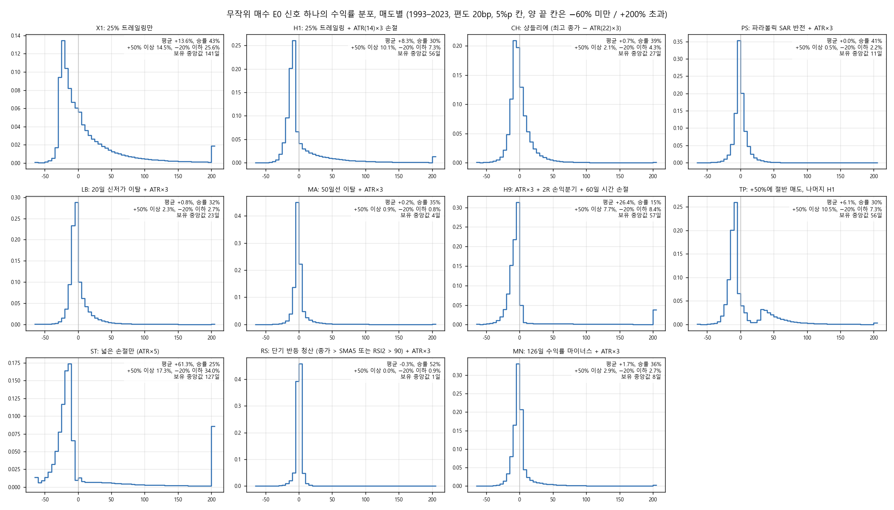
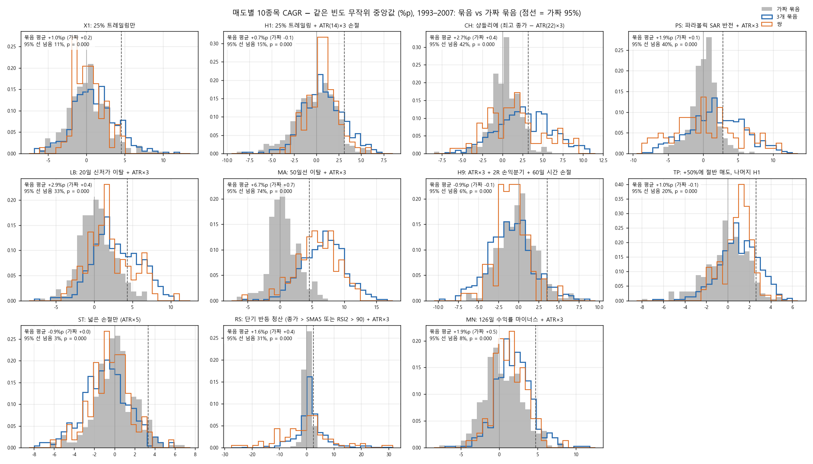
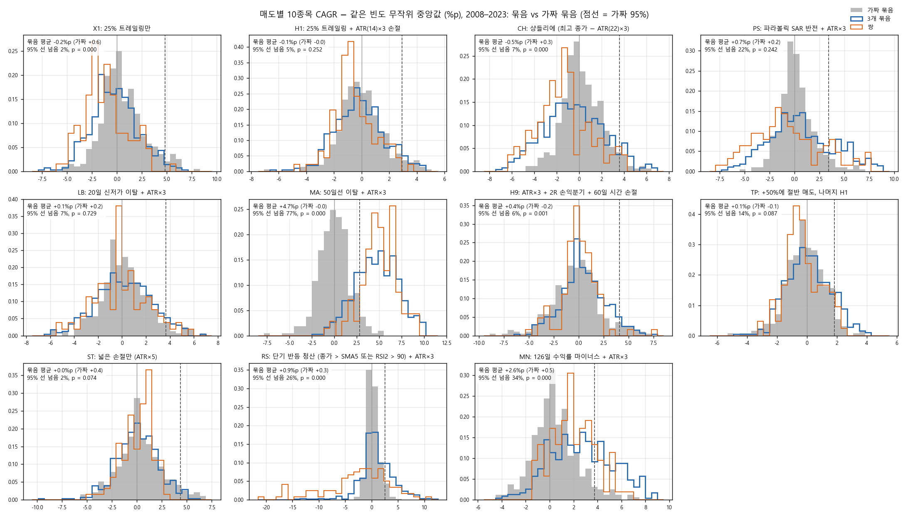
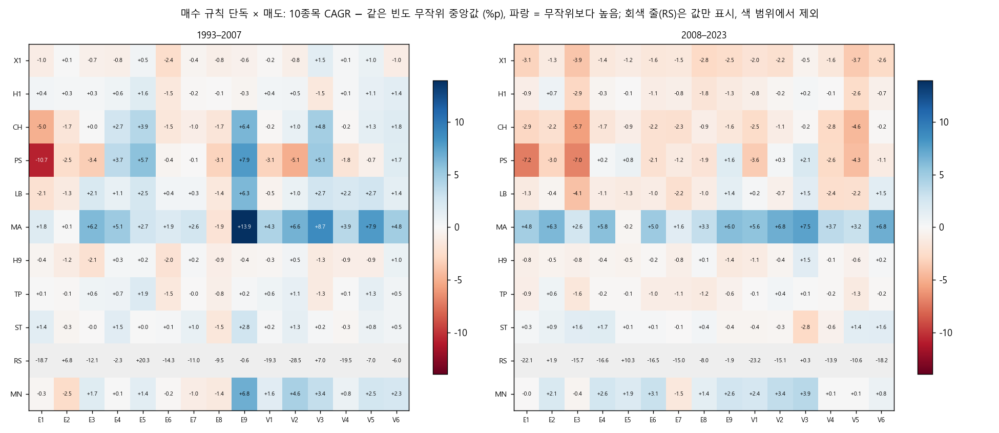
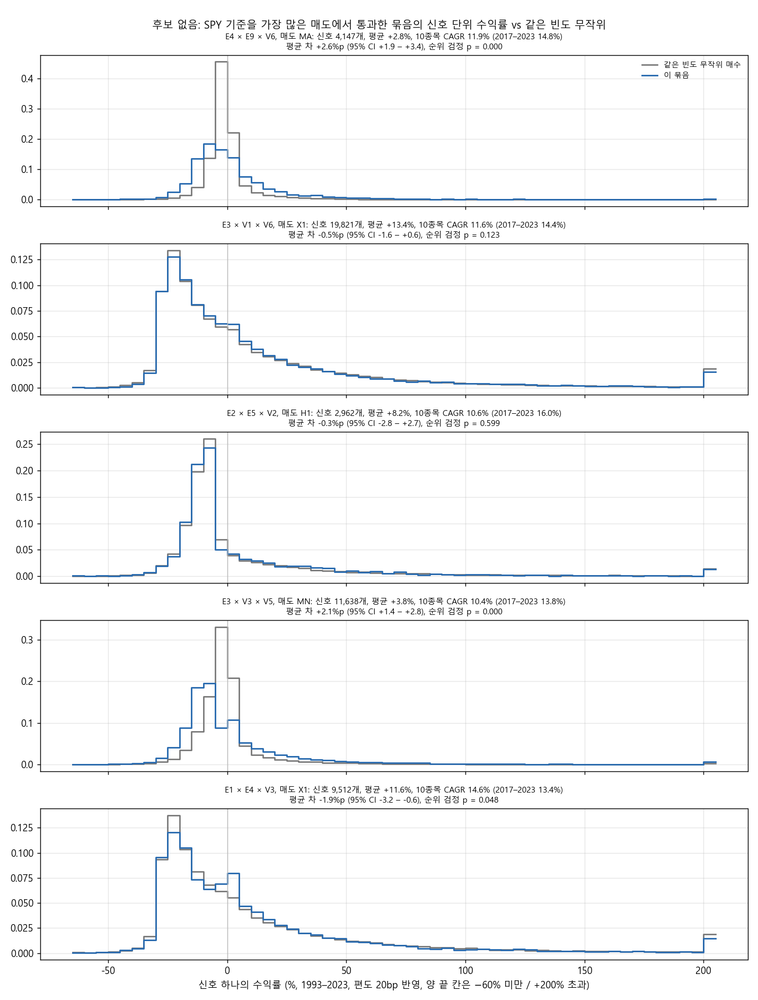

# Stage L 결과: 매도 전략 확장 (결정 90)

설계는 `docs/research/lab/2026-10-29_stage_l_design.md`이고, 결과 전에 커밋 e75406f로 등록했습니다. 실행기는 `lab/exit_study.py`이고, 2026-10-29 13:30–16:29 KST에 돌렸습니다(낮 시간 CPU 제한: 코어 8개, 낮은 우선순위). 1단계(엔진 신호표 97개)에 24분, 2단계(940세트 × 매도 11종)에 2시간 35분이 걸렸습니다.

## 왜 했는지

Stage I–J3은 매도를 2–3종만 썼습니다. 사용자는 매도가 적어서 매매가 제대로 시험되지 않았을 수 있다고 보고, 매도 전략을 크게 늘려 다양하게 시험하기로 했습니다. 그래서 같은 매수 묶음(단독 15, 쌍 105, 3개 묶음 455)을 성격이 다른 매도 11종으로 다시 계산했습니다. 두 가지를 봤습니다. 첫째, 매수 규칙이 같은 빈도 무작위 매수보다 나은지가 매도에 따라 달라지는가. 둘째, 각 매도는 어떤 성격인가.

## 핵심 결과

1. **매도에 따라 결과가 크게 달라졌습니다.** 3개 묶음이 같은 빈도 무작위보다 낫다는 '정보 있음'(가짜 묶음으로 구한 우연 95% 분위를 넘음)이 나온 매도는 다음과 같습니다.
   - (b) 10종목 계좌: 11종 중 7종(CH, PS, LB, MA, MN, RS, TP)
   - (a) 신호당 거래 기여: 5종(CH, PS, LB, MA, MN)

   지금까지 쓰던 X1 · H1 · H9와 넓은 손절 ST에서는 어느 쪽도 정보가 없었습니다.
2. **그러나 정보가 나온 매도는 대부분 '빨리 파는' 매도이고, 그 차이의 큰 부분은 기계적 효과입니다.**
   - MA(50일선 이탈)와 MN(126일 수익률 마이너스)에서 무작위 매수는 사자마자 팔렸습니다. 보유 중앙값이 3.6일 · 8일입니다. 무작위로 산 종목은 이미 50일선 아래이거나 6개월 수익률이 마이너스인 경우가 많기 때문입니다.
   - 추세형 매수 규칙으로 산 종목은 그 반대 상태에서 출발합니다. 그래서 32일 · 49일을 보유했습니다.
   - 즉 '규칙이 매도 조건과 반대 상태의 종목을 고른다'는 것만으로도 무작위를 이깁니다. MA에서는 단독 15개 중 13개가 두 반쪽 모두 무작위를 이겼습니다.
   - 보유 기간이 무작위와 비슷한 CH · PS에서의 차이가 더 순수한 정보에 가깝습니다. 하지만 CH는 1993–2007에서만 났습니다.
3. **절대 성적은 빨리 파는 매도일수록 나빴습니다.** 3개 묶음의 1993–2023 10종목 CAGR 중앙값은 다음과 같습니다.
   - 오래 보유하는 매도: X1 9.7%, H1 9.0%, TP 8.0%
   - 빨리 파는 매도: MN 7.8%, MA 6.8%, LB 5.6%, CH 5.0%, PS 2.0%, RS −4.2%
   - SPY: 9.9%

   무작위를 이기는 매도에서는 모두가 함께 못했습니다. 무작위를 못 이기는 매도(X1)에서 성적이 가장 좋았습니다.
4. **SPY를 넘은 후보는 없습니다.** 후보가 되려면 1993–2023과 2017–2023 모두 SPY보다 CAGR이 높고 낙폭이 얕아야 하고, 그것이 매도 3종 이상에서 성립해야 합니다. 그런 묶음은 없었고, 많아야 매도 2종이었습니다(4개 묶음). 가짜 묶음은 3,520칸 중 19칸이 SPY 기준을 통과했고, 3종 이상인 것은 없었습니다.
5. **결론**: 매도를 바꾸면 '매수 규칙이 무작위보다 나은가'의 답이 바뀝니다. 하지만 그 차이는 주로 매수와 매도 조건이 맞물려서 생깁니다. 그리고 그런 매도에서는 계좌 성적 자체가 낮았습니다. SPY를 꾸준히 넘는 매수 × 매도 조합은 이번에도 없었습니다.

## 그림

**그림 1.** 무작위 매수 E0(위생 통과 종목 · 일의 1%, 씨앗 5개)의 신호 하나 수익률 분포입니다. 매도마다 한 칸이고, 1993–2023, 편도 20bp를 반영했습니다. 칸마다 평균 · 승률 · +50% 이상 · −20% 이하 · 보유 중앙값을 적었습니다.
- X1 · ST · H9는 오른쪽 꼬리가 깁니다(+200% 초과 칸).
- MA · RS · PS · MN은 0 근처에 몰려 있습니다(며칠 만에 팜).
- TP는 +50% 근처에 작은 봉우리가 있습니다(절반 매도).

**그림 2.** 매도마다 10종목 계좌 CAGR에서 같은 빈도 무작위 매수의 중앙값을 뺀 값(%p)입니다(1993–2007). 회색은 가짜 묶음, 파란 선은 3개 묶음, 주황 선은 쌍입니다. 점선은 가짜 분포의 95% 선입니다. 정보가 없으면 묶음의 5%만 이 선을 넘습니다.

**그림 3.** 같은 그림, 2008–2023입니다.
- MA는 분포 전체가 오른쪽으로 크게 밀려 있습니다(77%가 95% 선 너머).
- MN · RS · PS도 오른쪽입니다.
- X1 · CH는 오히려 가짜보다 왼쪽입니다.

**그림 4.** 매수 규칙 단독 15개 × 매도 11종의 10종목 CAGR − 같은 빈도 무작위 중앙값(%p)입니다. 왼쪽이 1993–2007, 오른쪽이 2008–2023입니다. MA 줄은 거의 모두 파랗습니다(기계적 효과). X1 · H1 줄은 2008–2023에 거의 모두 붉습니다. RS 줄(회색)은 값만 적었습니다. 하루 보유로 비용에 잠식되어 값의 폭이 너무 커서, 색 범위에서 뺐습니다.

**그림 5.** 후보가 없어서, SPY 기준을 가장 많은 매도(2종)에서 통과한 묶음들의 신호 단위 수익률을 같은 빈도 무작위와 비교했습니다. 각 묶음에서 가장 좋은 매도를 골랐습니다.

## 무엇을 했나

### 종목 필터링 · 매수 · 계좌 (Stage J3와 같음)

- 종목 필터링: 매일 21거래일 평균 시가총액 상위 3,000개 미국 보통주 + 위생 필터(12개월 중 90% 거래, 5달러 이상, 거래대금 100만 달러 이상, Amihud 비유동성 상위 20% 제외)
- 매수: 15개 규칙(가운데 값)의 단독, 2개 쌍 105개, 3개 묶음 455개입니다. 묶음은 10거래일 안에 모두 뜬 경우이고, 가장 늦은 신호 날 다음 시가에 삽니다.
- 10종목 계좌: 손절이 있는 매도는 1% 룰(주식 수 = 자산 × 1% ÷ 손절폭, 종목당 10% 상한), 손절이 없는 X1은 10% 고정입니다. 최대 10종목, 청산 뒤 20거래일 재진입 금지, 편도 20bp, 남는 현금은 단기국채입니다. 무작위 순 100번의 중앙값을 봅니다.
- 종목 수 제한 없음: 신호당 거래 기여와 신호 단위 수익률을 봅니다.
- 기간: 1993-02 – 2023-12 한 곡선, 두 반쪽, 2017–2023입니다. 보류 구간은 쓰지 않았습니다.

### 매도 11종

| 키 | 매도 | 비중 |
|---|---|---|
| X1 | 최고 종가 대비 25% 하락(트레일링)만 | 10% 고정 |
| H1 | X1 + 진입가 − ATR(14) × 3 손절 | 1% 룰 |
| CH | 샹들리에: 종가 < 최고 종가 − ATR(22) × 3 | 1% 룰(ATR22 × 3) |
| PS | 파라볼릭 SAR 반전(0.02, 최대 0.2) + ATR × 3 | 1% 룰 |
| LB | 20일 신저가 이탈 + ATR × 3 | 1% 룰 |
| MA | 50일선 이탈 + ATR × 3 | 1% 룰 |
| H9 | ATR × 3 + 2R 손익분기 + 60일 시간 손절(진입가 이하일 때만) | 1% 룰 |
| TP | 종가가 진입가 +50% 이상인 첫날 다음 시가에 절반 매도, 나머지 H1 | 1% 룰 |
| ST | 넓은 손절만(ATR × 5) | 1% 룰(ATR × 5) |
| RS | 단기 반등 청산(종가 > SMA5 또는 RSI(2) > 90) + ATR × 3 | 1% 룰 |
| MN | 126일 수익률 마이너스 + ATR × 3 | 1% 룰 |

새 용어는 다음과 같습니다.
- **트레일링**: 산 뒤의 최고 종가에서 일정 비율 떨어지면 파는 것
- **ATR**: 최근 N일 하루 진폭의 평균
- **샹들리에**: 최고 종가에서 ATR의 몇 배 아래로 내려가면 파는 트레일링
- **파라볼릭 SAR**: 추세를 따라 점점 빨리 올라오는 손절선. 가격이 그 아래로 내려가는 날이 반전입니다.
- **RSI(2)**: 최근 2일의 오름폭과 내림폭 비율로 만든 0–100 지표
- **손익분기 이동**: 수익이 손절폭(R)의 2배가 되면 손절선을 진입가로 올리는 것

### 표 만들기

- 1단계(엔진, 97개 작업): 15개 규칙과 E0를 새 매도 PS · LB · MA · RS · MN · ST로, E0는 CH로도 돌려 신호표를 만들었습니다.
- 저장된 표를 그대로 쓴 것: X1, H1(k 3), H9(k 3), 15개 규칙의 CH(Stage C X2 k 3, 같은 규칙)
- TP: H1 표에 엔진의 부분 익절 규칙을 그대로 붙였습니다. 진입부터 매도 신호일 전까지 종가 ≥ +50%인 첫날의 다음 시가에 절반을 팝니다. 수익은 0.5 × 부분 + 0.5 × 전량입니다. E2 실제 행으로 확인했습니다(부분 매도 21%, 그 수익 중앙값 +51%).

### 비교 기준과 판정 (등록대로)

- 같은 빈도 무작위 매수 E0: 8구간(하루 약 0.04–8개), 씨앗 5 × 순서 100을 매도마다 썼습니다.
- 가짜 묶음: 구간당 40개 × 순서 20을 매도마다 썼습니다.
- 판정은 매도마다 따로 했습니다.
  - (a) 신호당 거래 기여, (b) 10종목 중앙값 CAGR이 두 반쪽 모두 같은 빈도 E0보다 높은지
  - 거래 30회 미만인 칸은 뺐습니다(빠진 칸은 없었음).
  - 가짜 묶음 통과율 p0와 이항(455, p0)의 95% 분위를 넘으면 '정보 있음'입니다.
- 후보: SPY 두 기간 + 거래 30 + 매도 3종 이상(20bp) → 40bp에서도 3종 이상

## 결과

### 매도별 성격 (무작위 매수 E0 전체, 1993–2023)

| 매도 | 10종목 CAGR · MDD | 보유 중앙값 | ATR 손절 종료 | 큰 승자(기여 ≥ 자산 5%) | 신호 평균 · 중앙값 | +50% 이상 · −20% 이하 | 단독 15개 CAGR 중앙값 |
|---|---|---|---|---|---|---|---|
| X1 25% 트레일링만 | 9.8% · −56% | 141일 | — | 14.5% | +13.6% · −5.8% | 14.5% · 25.6% | 8.8% |
| H1 + ATR×3 | 8.9% · −45% | 56일 | 57% | 8.4% | +8.3% · −7.7% | 10.1% · 7.3% | 8.4% |
| CH 샹들리에 | 4.5% · −50% | 27일 | — | 0.9% | +0.7% · −2.9% | 2.1% · 4.3% | 3.1% |
| PS SAR 반전 | 0.8% · −57% | 11일 | 7% | 0.1% | +0.0% · −1.2% | 0.5% · 2.2% | −1.3% |
| LB 20일 신저가 | 4.0% · −54% | 23일 | 4% | 1.3% | +0.8% · −3.4% | 2.3% · 2.7% | 4.2% |
| MA 50일선 | −0.1% · −69% | 4일 | 2% | 0.6% | +0.2% · −1.2% | 0.9% · 0.8% | 3.8% |
| H9 손익분기 + 시간 손절 | 7.5% · −58% | 57일 | 50% | 7.1% | +26.4% · −5.8% | 7.7% · 8.4% | 7.2% |
| TP 절반 익절 | 7.5% · −41% | 56일 | 57% | 7.9% | +6.1% · −7.7% | 10.5% · 7.3% | 7.4% |
| ST 넓은 손절만 | 7.4% · −49% | 127일 | 86% | 13.7% | +61.3% · −15.1% | 17.3% · 34.0% | 7.9% |
| **RS 단기 반등** | **−24.4% · −100%** | **1일** | 4% | 0.0% | −0.3% · +0.1% | 0.0% · 0.9% | **−36.7%** |
| MN 126일 모멘텀 소멸 | 5.5% · −57% | 8일 | 19% | 2.4% | +1.7% · −1.4% | 2.9% · 2.7% | 6.8% |

SPY는 9.9%, −55%입니다. 읽는 법은 다음과 같습니다.
- **RS는 추세추종 계좌에서는 비용에 잠식됩니다.** 보유가 하루뿐이라 매일 사고팔며 편도 20bp를 냅니다. 무작위 매수 계좌가 연 −24%로 사실상 0이 되었습니다. 눌림목 단타용 청산을 이 계좌 규칙(10종목, 20bp)에 넣으면 이렇게 된다는 것이 결과입니다.
- **H9 · ST**는 트레일링이 없어 이긴 종목을 데이터 끝까지 들고 갑니다. 그래서 신호 평균이 +26% · +61%로 큽니다. 하지만 닫힌 거래의 대부분은 손실입니다(손실 비율 90% · 86%). 10종목 계좌는 자리가 막혀 7.4–7.5%였습니다.
- **TP**는 H1보다 낙폭이 얕았지만(−41% vs −45%) CAGR도 낮았습니다(7.5% vs 8.9%). 큰 승자의 절반을 일찍 팔기 때문입니다.
- X1이 무작위 매수로도 가장 높았고(9.8%), H1이 그다음이었습니다(8.9%).

### 매도별 판정 (455개 3개 묶음, 가짜 묶음 기준 우연 기대 · 95% 분위)

| 매도 | (b) 10종목 통과 / 기대 / 95% 분위 | (a) 기여 통과 / 기대 / 95% 분위 | 정보 있음 |
|---|---|---|---|
| X1 | 130 / 149 / 166 | 37 / 127 / 142 | 아니오 |
| H1 | 122 / 119 / 135 | 27 / 132 / 148 | 아니오 |
| CH | 169 / 142 / 159 | 233 / 141 / 157 | (a) (b) |
| PS | 205 / 121 / 136 | 174 / 147 / 163 | (a) (b) |
| LB | 199 / 141 / 157 | 296 / 149 / 166 | (a) (b) |
| MA | 435 / 147 / 163 | 432 / 158 / 175 | (a) (b) |
| H9 | 82 / 90 / 104 | 20 / 81 / 95 | 아니오 |
| TP | 158 / 107 / 122 | 38 / 129 / 145 | (b) |
| ST | 80 / 129 / 145 | 30 / 78 / 92 | 아니오 |
| RS | 234 / 168 / 185 | 93 / 148 / 164 | (b) |
| MN | 292 / 152 / 169 | 420 / 141 / 157 | (a) (b) |

쌍은 (a) LB · MA · MN, (b) MA · MN에서 정보가 있었습니다. 단독 15개는 MA · MN에서 (a) · (b) 모두 정보가 있었습니다. 단독이 두 반쪽 모두 무작위를 이긴 수는 매도별로 다음과 같습니다.
- (b) 10종목: MA 13개, MN 9개, ST 6개, PS 4개, LB · RS 3개, H1 · H9 · TP 1개, X1 · CH 0개
- (a) 기여: MA · MN 12개, LB 7개, X1 6개

### 보유 기간: 묶음 vs 같은 빈도 무작위 (3개 묶음의 중앙값)

| 매도 | 묶음 보유 중앙값 | 무작위 | 묶음 ATR 손절 비율 | 무작위 |
|---|---|---|---|---|
| X1 | 127일 | 142일 | — | — |
| H1 | 59일 | 55일 | 55% | 57% |
| CH | 28일 | 27일 | — | — |
| PS | 12일 | 11일 | 3% | 7% |
| LB | 35일 | 23일 | 14% | 4% |
| **MA** | **32일** | **3.6일** | 9% | 2% |
| H9 | 61일 | 57일 | 46% | 50% |
| TP | 59일 | 55일 | 55% | 57% |
| ST | 119일 | 127일 | 83% | 86% |
| RS | 1일 | 1일 | 1% | 4% |
| **MN** | **49일** | **8일** | 38% | 19% |

MA · MN(그리고 LB 일부)에서는 묶음이 무작위보다 훨씬 오래 들고 있었습니다. 추세형 매수 규칙이 '이미 50일선 위 · 6개월 수익 플러스'인 종목을 사기 때문에, 매도 조건이 바로 켜지지 않습니다. 무작위 매수는 다음 날 팔려 비용만 냅니다. 이 차이가 MA · MN에서 '정보 있음'이 크게 나온 주된 이유로 보입니다. 보유 기간이 비슷한 CH · PS · RS의 차이는 이런 기계적 효과가 작은 경우입니다.

### 초과 수익 히스토그램의 숫자 (3개 묶음 vs 가짜, 같은 빈도 무작위 대비 %p)

| 매도 | 1993–2007 묶음 평균 (가짜) · 95% 선 넘음 | 2008–2023 묶음 평균 (가짜) · 95% 선 넘음 |
|---|---|---|
| X1 | +1.0 (+0.2) · 11% | −0.2 (+0.6) · 2% |
| H1 | +0.7 (−0.1) · 15% | −0.2 (−0.0) · 5% |
| CH | +2.7 (+0.4) · 42% | −0.6 (+0.3) · 7% |
| PS | +1.9 (+0.1) · 40% | +0.7 (+0.2) · 22% |
| LB | +2.9 (+0.4) · 33% | +0.1 (+0.2) · 7% |
| MA | +6.7 (+0.7) · 74% | +4.7 (−0.1) · 77% |
| H9 | −0.9 (−0.2) · 6% | +0.4 (−0.2) · 6% |
| TP | +1.0 (−0.1) · 20% | +0.1 (−0.1) · 14% |
| ST | −0.9 (+0.1) · 3% | +0.0 (+0.4) · 2% |
| RS | +1.6 (+0.4) · 31% | +0.9 (+0.3) · 26% |
| MN | +1.9 (+0.5) · 8% | +2.6 (+0.5) · 34% |

정보가 없으면 '95% 선 넘음'은 5% 근처여야 합니다.
- 두 반쪽 모두 뚜렷이 넘은 것: MA · RS · PS
- MN: 2008–2023에 뚜렷(34%), 1993–2007은 8%
- 1993–2007에서만 넘은 것: CH · LB · TP · X1 · H1

### 신호 단위 수익률 검정 (`stats.csv`, 3개 묶음 × 매도, 같은 빈도 E0 대비)

| 매도 | p < 0.05 (가짜) | 평균 차 CI가 0보다 위 | 0보다 아래 | 평균 차 중앙값 |
|---|---|---|---|---|
| X1 | 51% (4.7%) | 8% | 59% | −2.0%p |
| H1 | 70% (3.7%) | 2% | 43% | −0.9%p |
| CH | 59% (3.7%) | 51% | 8% | +0.5%p |
| PS | 64% (6.6%) | 35% | 22% | +0.1%p |
| LB | 64% (5.0%) | 73% | 1% | +0.8%p |
| MA | 90% (10.0%) | 97% | 0% | +1.4%p |
| H9 | 73% (3.7%) | 0% | 55% | −5.8%p |
| TP | 68% (3.7%) | 6% | 29% | −0.4%p |
| ST | 81% (6.6%) | 0% | 68% | −13.5%p |
| RS | 93% (6.2%) | 14% | 34% | −0.1%p |
| MN | 97% (3.7%) | 93% | 0% | +2.0%p |

가짜 묶음의 p < 0.05는 4–10%였습니다(MA만 10%). 그러니 검정은 대체로 맞춰져 있습니다. 묶음의 신호 분포는 모든 매도에서 무작위와 '달랐'습니다.
- 평균이 무작위보다 높아진 것은 MA · MN · LB · CH(빨리 파는 매도)입니다.
- 오래 들고 가는 매도(X1 · H1 · H9 · ST · TP)에서는 Stage J3처럼 평균이 오히려 낮았습니다(큰 승자 꼬리가 얇음).

### SPY 기준 (후보 없음)

SPY 기준(1993–2023과 2017–2023 모두 CAGR > SPY, |MDD| < |SPY MDD|, 거래 30회 이상)을 통과한 칸은 다음과 같습니다.
- 3개 묶음 40칸(5,005칸 중), 쌍 5칸
- 매도별로는 X1 27칸, H9 6칸, MN 5칸, MA 3칸, H1 · LB 2칸, 나머지 0칸

매도 2종에서 통과한 묶음은 4개였고, 3종 이상은 없었습니다.

| 묶음 | 매도: CAGR · MDD 1993–2023 / 2017–2023 CAGR · MDD |
|---|---|
| E4 볼린저 수축 돌파 × E9 갭 상승 × V6 수축 뒤 돌파 | LB: 10.9% · −34% / 14.7% · −34%, MA: 11.9% · −28% / 14.9% · −23% |
| E3 52주 신고가 + 거래량 × V1 하루 급등 × V6 수축 뒤 돌파 | H1: 11.0% · −34% / 13.7% · −24%, X1: 11.6% · −40% / 14.4% · −27% |
| E2 골든크로스 × E5 눌림목 × V2 5일 급등 | H1: 10.6% · −38% / 16.0% · −24%, X1: 10.1% · −42% / 14.8% · −28% |
| E3 52주 신고가 + 거래량 × V3 거래량 폭발 × V5 52주 신고가 종가 | H9: 10.0% · −55% / 15.0% · −33%, MN: 10.4% · −49% / 13.8% · −31% |

SPY는 9.9%, −55% / 13.2%, −34%입니다. 같은 기준을 가짜 묶음에 대 보면 3,520칸 중 19칸(0.5%)이 통과했고, 3종 이상인 가짜 묶음은 없었습니다. 묶음은 0.8%였습니다. E2 × E5 × V2는 Stage J3의 후보였던 묶음입니다. 같은 표를 쓰지만 무작위 순이 달라 숫자가 조금 다릅니다(10.6% vs 10.7%).

### 매도마다 가장 높은 3개 묶음 (1993–2023 10종목 CAGR, 정보)

- X1: V3 × V5 × V6 15.6%(MDD −42%, 2017–2023 11.6%)
- H1: E8 × V4 × V6 12.8%
- MA: E9 × V5 × V6 12.2%(−23%, 12.0%)
- LB: 같은 묶음 11.6%(2017–2023 13.2%)
- CH: 같은 묶음 10.3%(−23%)

E9 갭 상승 × V5 52주 신고가 종가 + 거래량 × V6 수축 뒤 돌파가 빨리 파는 매도 여러 개에서 맨 위였습니다. 하지만 2017–2023에는 SPY(13.2%)를 넘지 못했습니다.

## 한계

- 매도마다 값은 하나입니다. 이웃 값은 보지 않았습니다.
- **기계적 효과**: MA · MN · LB의 '정보 있음'은 매수 규칙이 매도 조건과 반대 상태의 종목을 고르는 데서 크게 나옵니다(보유 기간 차이). 같은 빈도 무작위 매수는 그런 조건을 갖추지 않아 이 비교에서 불리합니다. 미래 수익을 맞히는 정보와 구별하려면 '매도 조건이 바로 켜지지 않는 무작위 매수'(예: 50일선 위 종목만 무작위로 산 기준)가 필요합니다. 이번에는 등록하지 않았습니다.
- 손절이 있는 매도는 1% 룰 비중에도 영향을 줍니다(ST는 ATR × 5라 비중이 작음). 매도 차이와 비중 차이가 섞입니다.
- CH의 1% 룰 비중은 신호일 ATR(22) × 3으로 계산했습니다. 엔진의 샹들리에 선은 ATR(22)를 따라 움직입니다.
- 묶음끼리 규칙을 공유해 겹치고, 같은 시기 신호끼리 닮습니다. 그래서 이항 기대치와 순위 검정 p는 근사입니다. 가짜 묶음의 p < 0.05는 대체로 5% 근처였지만, MA에서는 10%였습니다.
- 기간별 값은 1993-02부터 이어진 한 곡선을 잘랐습니다.
- 시험 수는 +4,600(575세트 × 새 매도 8종), 누적 약 69,818입니다. 이 실행기는 `trials.csv`에 쓰지 않습니다.
- 보류 구간(2024년 이후)은 쓰지 않았습니다.

## 남은 판단

- 빨리 파는 매도(MA · MN · LB)에서 나온 '정보'가 기계적 효과인지 확인하려면, 기준을 '매도 조건이 바로 켜지지 않는 무작위 매수'로 바꾼 시험을 새로 등록해야 합니다. 할지는 사용자가 정합니다.
- 절대 성적이 가장 좋았던 것은 여전히 오래 들고 가는 X1 · H1입니다. 그런데 이 매도에서는 매수 규칙에 정보가 없었습니다. 그래서 다음 연구를 매수 쪽보다 '비중 · 시장 국면 · 계좌 규칙' 쪽으로 옮길지도 판단할 일입니다.
- SPY 후보는 없어 보류 구간 평가는 하지 않습니다.
- 집계표는 `docs/research/lab/2026-10-29_stage_l/`에 있습니다.
  - `verdicts.csv.gz`, `stats.csv.gz`, `hist.csv.gz`, `unlimited.csv.gz`, `accounts_quantiles.csv.gz`, `singles_by_exit.csv.gz`
  - `chance.json`: 매도별 우연 기대치와 '정보 있음 매도'
  - `exit_character.csv`: 매도 성격 표
  - `hold_vs_e0.csv`: 보유 기간 비교
  - `engine_timing.csv`: 1단계 표마다 걸린 시간
  - `baselines.csv`

  전체 결과는 드라이브 `CRSP/lab_crsp/stage_l_exits`에 있습니다.
