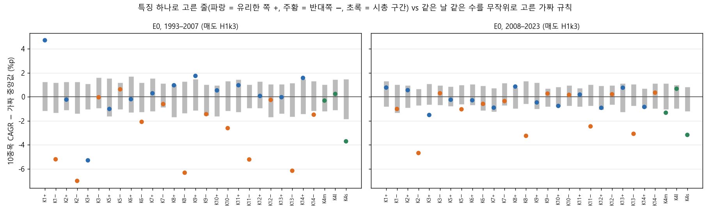
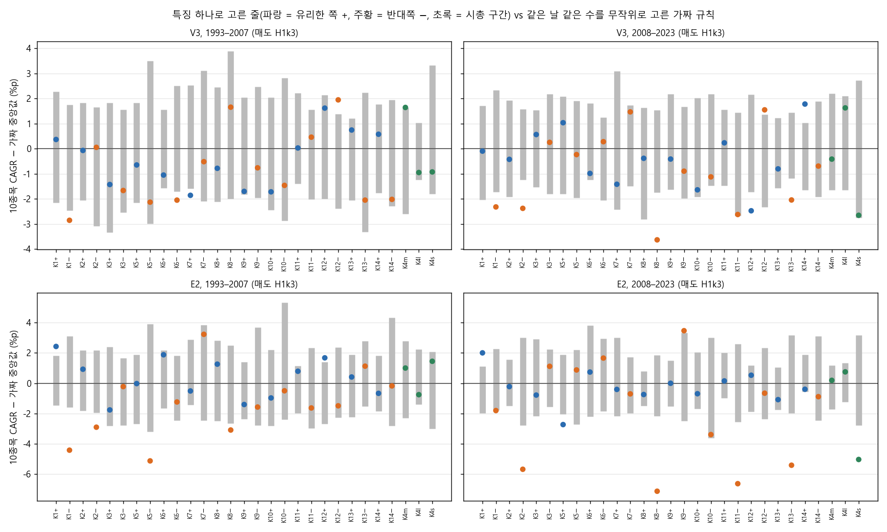
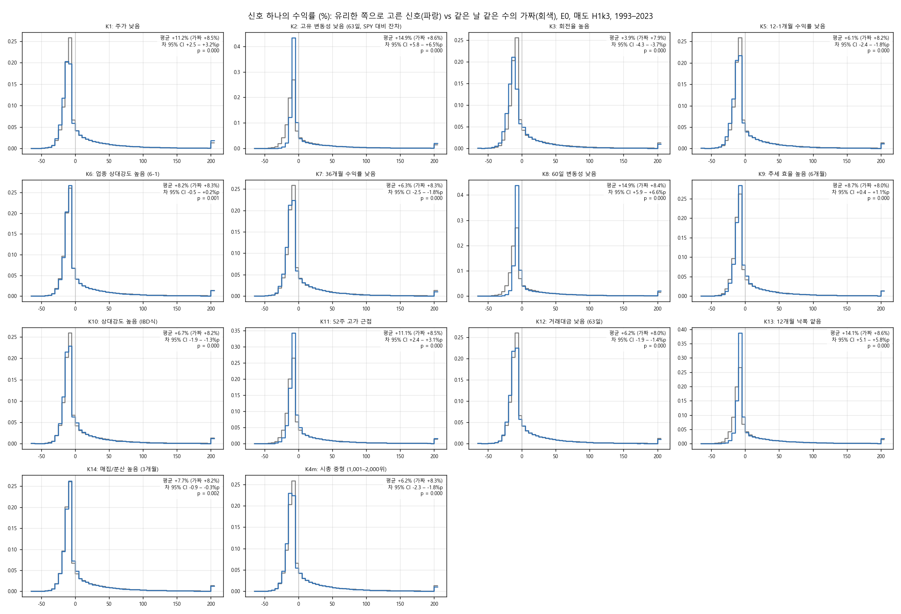
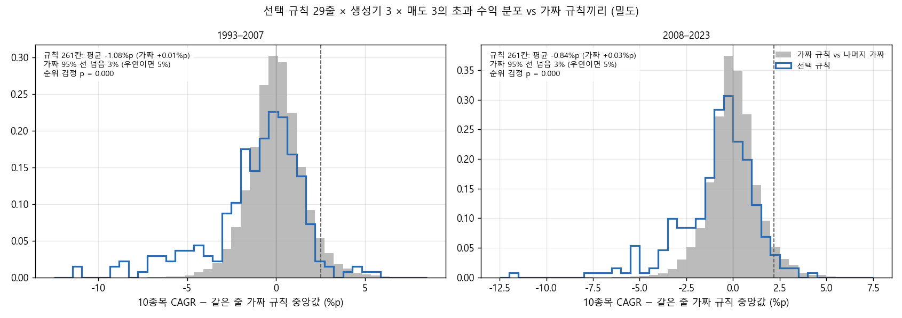
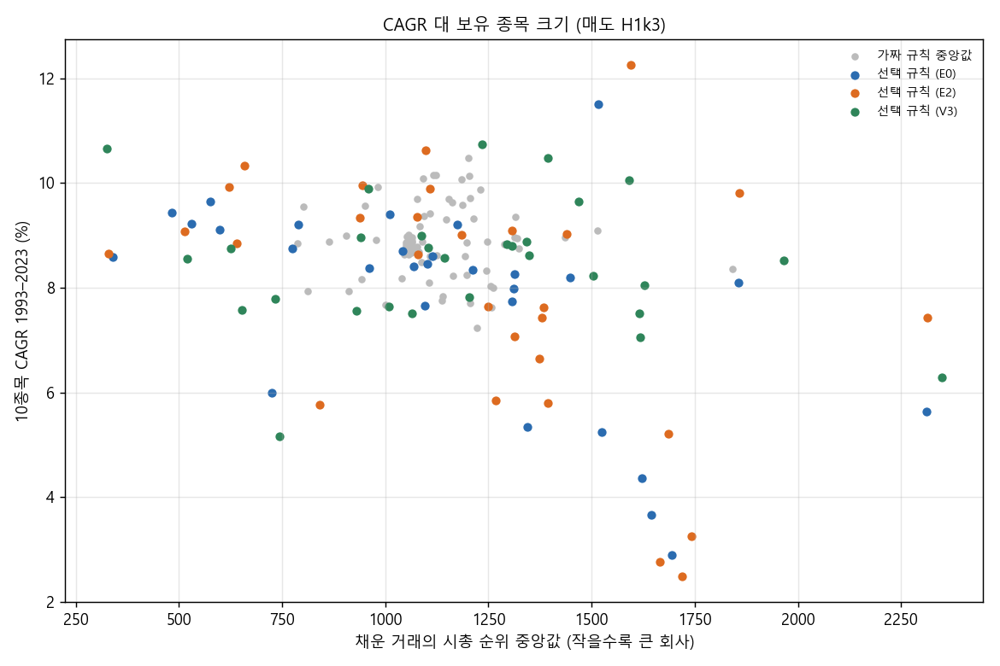

# Stage K 결과: 종목 선택 규칙 하나씩 (결정 91)

설계는 `docs/research/lab/2026-10-31_stage_k_design.md`이고, 결과 전에 커밋 b6a3126으로 등록했습니다. 실행기는 `lab/select_study.py`(커밋 53f310e)입니다. 2026-10-31 21:48–23:18 KST에 밤 전체 CPU로 돌렸습니다. 22시부터는 같은 컴퓨터에서 자산배분 A42 실행이 함께 돌아 시간이 조금 늘었습니다.

## 왜 했는지

Stage I–L에서 '언제 사고파느냐'(매수 · 매도 규칙)의 축에서는 무작위보다 나은 정보를 찾지 못했습니다. 이번에는 '어떤 종목을 사느냐'를 봅니다. 질문은 하나입니다. **매수 신호가 난 종목 가운데 특징 하나로 고르면, 같은 날 같은 수를 무작위로 고른 것보다 나은가.** 근거는 Stage H 모형의 계수(낮은 주가, 낮은 고유 변동성, 높은 회전율, 중형주, 낮은 12개월 수익률)와 Stage E 스크린(약한 업종 제외, 36개월 과열 제외)입니다. 이것들이 사용자 계좌 규칙(1% 룰, 10종목)에서 특징 하나씩으로도 살아남는지 확인합니다.

## 핵심 결과

1. **줄 하나하나로 보면 우연과 구별되지 않습니다.**
   - 29줄(특징 13개 × 유리한 쪽 · 반대쪽 + 시총 3구간) 가운데 무작위를 이긴 줄의 수가 세 생성기 모두 우연 기대치 안이었습니다.
   - 무작위를 이긴다는 것은 두 반쪽 모두, 매도 3종 중 2종 이상에서 같은 날 같은 수의 가짜 규칙보다 나은 것입니다.
   - E0 무작위 매수 생성기: (a) 신호당 기여 8줄(우연 기대 6.3, 95% 분위 10), (b) 10종목 계좌 3줄(기대 5.0, 95% 분위 8)
2. **특징 단위로 보면 '정보 있음'이 나왔습니다. 하지만 대부분 '피해야 할 종목'에서 나온 정보입니다.**
   - E0(판단 생성기)에서 세 특징이 등록 기준을 통과했습니다. 기준은 유리한 쪽이 무작위를 이기고, 반대쪽은 두 반쪽 모두 무작위 아래인 것입니다.
     - K1 주가 낮음
     - K2 고유 변동성 낮음
     - K8 60일 변동성 낮음

     가짜 규칙 쌍으로 구한 우연 기대는 0.43개, 95% 분위는 2개라, 3개는 우연을 넘습니다. E2 골든크로스 생성기에서도 K1, K6 업종 상대강도, K11 52주 고가 근접 3개가 통과했습니다(우연 95% 분위 2개). V3 거래량 폭발 생성기는 1개(K14)로 우연 안이었습니다.
   - 그런데 유리한 쪽이 무작위보다 나은 폭은 작았습니다. E0, 매도 3종 평균, 1993–2023 10종목 CAGR 기준으로 다음과 같습니다.
     - 고유 변동성 낮음: +0.5%p
     - 변동성 낮음: +0.8%p

     반대쪽이 무작위보다 못한 폭은 훨씬 컸습니다.
     - 고유 변동성 높음: −7.3%p
     - 변동성 높음: −6.6%p
     - 낙폭 깊음: −5.0%p
     - 52주 고가에서 먼 종목: −4.3%p
     - 소형주: −3.6%p
   - 모든 줄 × 생성기 × 매도 261칸 가운데, 가짜 규칙끼리의 분포 95% 선을 넘은 칸은 3%(두 반쪽 모두)였습니다(우연이면 5%). 5% 선 아래로 떨어진 칸은 21–22%였습니다. 특징으로 '좋은 종목'을 고르기는 어렵고, '나쁜 종목'을 가려내기는 쉬웠습니다.
3. **예외는 저가주(K1)입니다.**
   - 같은 날 같은 수의 무작위보다 1993–2023 +3.1%p(1993–2007 +5.1%p, 2008–2023 +1.1%p) 나았습니다. 매도 3종 모두에서 두 반쪽 다 이겼고, E2에서도 같았습니다.
   - 다만 2017–2023 CAGR은 4.4–8.9%로 SPY 13.2%에 크게 못 미쳤습니다.
   - 저가주는 시총이 더 작은데도(채운 거래의 시총 순위 중앙값 1,517위, 무작위 1,058위) 나았습니다. 단순한 크기 효과는 아닙니다.
4. **Stage H · E의 가설 중 사용자 계좌 규칙에서 살아남은 것은 7개 중 3개(K1, K2, K8)입니다.**
   - K3 회전율은 부호가 반대였습니다. 높은 회전율 −4.3%p, 낮은 회전율은 (a) 통과입니다.
   - K5 12-1개월 수익률 낮음, K6 업종 상대강도(E0), K7 36개월 수익률 낮음은 통과하지 못했습니다.
   - 크기는 '중형주가 낫다'가 아니라 '대형 쪽으로 갈수록 낫다'였습니다. 대형 +0.4%p, 중형 −0.5%p, 소형 −3.6%p입니다. 채운 거래의 시총 순위를 무작위보다 크게 옮긴 줄일수록 성적이 나빴습니다(순위상관 −0.58).
5. **SPY를 넘은 후보는 없습니다.**
   - 20bp에서 K14 매집/분산 높음 × V3가 매도 2종(H1 k2, X1)에서 SPY 기준을 통과했습니다.
   - 40bp에서 H1 k2가 탈락해 1종만 남았습니다.
   - DSR 0.81 · 0.67, SPY 대비 PSR 0.82 · 0.68, 가짜 대비 PSR 0.71 · 0.52로 SPY · 무작위와 구별되지 않았습니다.
6. **결론**: 종목 선택에는 '언제'의 축보다 분명한 신호가 있었지만, 그 내용은 주로 '변동성이 크고 · 작고 · 고점에서 먼 종목을 사지 말라'였습니다. 특징 하나로 고른 계좌가 SPY를 꾸준히 넘지는 못했습니다.

## 그림

**그림 1.** 생성기 E0(무작위 매수), 매도 H1 k 3입니다. 가로는 줄(K번호 + 유리한 쪽 / − 반대쪽, K4는 시총 구간)이고, 세로는 10종목 CAGR에서 그 줄의 가짜 규칙 40개 중앙값을 뺀 값(%p)입니다. 회색 막대는 가짜 40개의 5–95% 범위입니다. 반대쪽(주황)은 여러 특징에서 막대 아래로 크게 떨어집니다(K2−, K8−, K13−, K11−, K1−). 회전율은 유리하다고 본 쪽(K3+, 파랑)이 떨어졌습니다. 유리한 쪽 중 막대 위로 뚜렷이 올라온 것은 1993–2007의 K1+이고, K9+ · K14+는 막대 끝에 걸칩니다.

**그림 2.** 같은 그림, 생성기 V3(위)와 E2(아래)입니다.

**그림 3.** 신호 하나의 수익률(%) 분포입니다(E0, H1 k 3, 1993–2023). 유리한 쪽으로 고른 신호(파랑)와 같은 날 같은 수의 가짜 규칙 신호(회색)를 비교했습니다. 변동성이 낮은 쪽(K2, K8)과 낙폭이 얕은 쪽(K13)은 −20% 이하 손실이 거의 없습니다(1–2% vs 7%). 평균도 +14.1–14.9%로 가짜(+8.6%)보다 높습니다.

**그림 4.** 261칸(29줄 × 생성기 3 × 매도 3)의 '10종목 CAGR − 가짜 중앙값'(파랑)과 가짜 규칙끼리의 같은 값(회색)입니다. 오른쪽 꼬리(무작위보다 확실히 나음)는 가짜보다 오히려 얇습니다(95% 선 넘음 3%). 왼쪽 꼬리(무작위보다 확실히 나쁨)가 두껍습니다.

**그림 5.** 매도 H1 k 3에서 10종목 CAGR 대 채운 거래의 시총 순위 중앙값입니다(작을수록 큰 회사). 회색은 가짜 규칙 중앙값으로, 1,000위 근처에 모여 있습니다. 작은 회사 쪽(오른쪽)으로 간 줄이 대체로 아래에 있습니다. 예외는 저가주 K1(오른쪽 위, 1,500–1,600위에 11.5–12.3%)입니다.

## 무엇을 했나

### 종목 필터링 (Stage C–L과 같음)

매일 21거래일 평균 시가총액 상위 3,000개 미국 보통주 가운데 위생 필터를 통과한 종목입니다. 위생 필터는 12개월 중 90% 거래, 5달러 이상, 거래대금 100만 달러 이상, Amihud 비유동성 상위 20% 제외입니다. 시총 하한은 없습니다.

### 매수: 신호 생성기 3개 (저장된 신호표, 엔진 재실행 없음)

- **E0 무작위 매수**(판단 생성기): 위생 통과 종목 · 일의 1%(씨앗 5개, 씨앗마다 하루 약 20개). 매수 규칙 자체의 정보를 없애고 '어떤 종목'만 보려는 것입니다.
- **V3 거래량 폭발**(z 4): 하루 약 4개
- **E2 골든크로스**(50일선 > 200일선 첫날): 하루 약 6개

모두 신호일 종가로 판단해 다음 날 시가에 삽니다.

### 선택 규칙 (하나씩)

특징 값은 신호일 종가까지의 자료로 계산합니다. 그날 위생 통과 유니버스 안의 백분위로 바꿔, 30%를 기준으로 남깁니다. 특징마다 유리하다고 본 쪽 30%와 그 반대쪽 30%를 따로 시험했습니다.

| 번호 | 특징 | 유리한 쪽(가설) |
|---|---|---|
| K1 | 주가 | 낮은 30% |
| K2 | 고유 변동성(63일, SPY 대비 잔차의 표준편차) | 낮은 30% |
| K3 | 회전율(63일 거래대금 ÷ 시총) | 높은 30% |
| K4 | 시총 순위 | 중형(1,001–2,000위) vs 대형(1–1,000) · 소형(2,001–3,000) |
| K5 | 12-1개월 수익률 | 낮은 30% |
| K6 | 업종 상대강도(2자리 SIC, 6-1개월) | 높은 30% |
| K7 | 36개월 수익률 | 낮은 30% |
| K8 | 60일 변동성 | 낮은 30% |
| K9 | 추세 효율(6개월) | 높은 30% |
| K10 | 상대강도(IBD식) | 높은 30% |
| K11 | 52주 고가 근접(종가 ÷ 52주 최고 종가) | 높은 30% |
| K12 | 거래대금(63일) | 낮은 30% |
| K13 | 12개월 최대 낙폭 얕음 | 높은 30% |
| K14 | 매집/분산(3개월, 오른 날 거래대금 ÷ 내린 날) | 높은 30% |

K1–K3과 K5–K8은 Stage H · E에서 온 가설 집합이고, 나머지는 탐색 집합입니다. 줄 수는 29개, 설정은 29 × 생성기 3 × 매도 3 = 261개입니다.

- 새로 만든 점수는 둘입니다. `screens.py`의 `s_low_price`(−log 주가)와 `s_low_ivol`(−고유 변동성)입니다. 기존 '고유 변동성 상위' 제외 스크린과 같은 계산을 공유하고, 그 결과는 바뀌지 않습니다(테스트).
- K7은 같은 값인 기존 `s_reversal`(36개월, = −36개월 수익률)을 썼습니다.
- 기존 연구(score_study · screen_study)의 등록 메뉴에는 새 점수를 넣지 않았습니다.

### 매도 · 계좌 (Stage I · J · J3와 같음)

- 매도
  - H1 k 2: 최고 종가 대비 25% 하락 또는 진입가 − ATR(14) × 2
  - H1 k 3: 같은 것에 ATR × 3
  - X1: 25% 트레일링만(손절 없음, 10% 고정)
- **10종목 계좌**: 1% 룰(주식 수 = 자산 × 1% ÷ 손절폭, 10% 상한), 최대 10종목, 청산 뒤 20거래일 재진입 금지, 편도 20bp, 남는 현금은 단기국채입니다. 무작위 순 100번의 중앙값을 봅니다(E0는 씨앗마다 20번).
- **종목 수 제한 없음**: 신호당 거래 기여(비중 × 수익)의 평균입니다.
- 기간은 1993-02 – 2023-12의 한 곡선, 두 반쪽 1993–2007 · 2008–2023, 2017–2023입니다. 보류 구간은 쓰지 않았습니다.

### 비교 기준: 날짜를 맞춘 가짜 규칙

**가짜 규칙**은 그 줄이 남긴 날마다 그날 남긴 수만큼, 같은 생성기의 신호에서 무작위로 남긴 것입니다. 줄마다 40개(각각 무작위 순 20번)를 만들었습니다. 신호 출처 · 날짜 · 하루 수가 같으므로, 차이는 '어떤 종목을 남겼나'뿐입니다.

### 판정 (등록대로)

- **줄**: (a) 신호당 기여 평균, (b) 10종목 무작위 순 중앙값 CAGR이 가짜 40개의 중앙값보다 높은지를 봅니다. 두 반쪽 모두에서 그래야 하고, 매도 3종 중 2종 이상이어야 합니다.
- **특징**: 유리한 쪽이 (b)를 통과하고, 반대쪽은 두 반쪽 모두 가짜 중앙값 아래여야 합니다(매도 2종 이상). E0에서 판단하고, K4는 보이기만 합니다.
- **우연 기대**: 가짜 규칙 하나를 나머지 39개와 같은 판정에 넣어 통과율 p0를 구합니다. 그러면 이항(29, p0)의 95% 분위가 나옵니다. 특징은 가짜 쌍(유리한 쪽 가짜 k와 반대쪽 가짜 k)의 통과율로, 이항(13, p0)을 씁니다.
- **후보**: 1993–2023과 2017–2023 모두 SPY보다 CAGR이 높고 낙폭이 얕아야 합니다. 거래 30회 이상, 매도 3종 중 2종 이상, 편도 40bp에서도 통과해야 합니다.

## 결과

### 우연 기대치와 비교 (줄 29개, 거래 30회 미만으로 빠진 줄 없음)

| 생성기 | (a) 기여 통과 / 기대 / 95% 분위 | (b) 10종목 통과 / 기대 / 95% 분위 | 특징 정보 / 기대 / 95% 분위 |
|---|---|---|---|
| E0 무작위 | 8 / 6.3 / 10 | 3 / 5.0 / 8 | **3 / 0.43 / 2 (K1, K2, K8)** |
| V3 거래량 폭발 | 8 / 6.6 / 10 | 2 / 6.1 / 10 | 1 / 0.65 / 2 (K14) |
| E2 골든크로스 | 10 / 7.1 / 11 | 5 / 5.8 / 9 | **3 / 0.55 / 2 (K1, K6, K11)** |

(b)를 통과한 줄은 생성기별로 다음과 같습니다.
- E0: K1+, K2+, K8+
- V3: K11+, K14+
- E2: K1+, K4 중형, K6+, K11+, K12+

(a)는 K2+ · K3− · K4 대형 · K8+ · K11+ · K12− · K13+가 세 생성기에서 공통으로 통과했습니다. 모두 '덜 흔들리고, 크고, 고점 근처인 종목' 쪽입니다.

### E0의 특징별 결과 (매도 3종 평균, 10종목 CAGR − 같은 줄 가짜 중앙값, %p)

| 특징 | 유리한 쪽 1993–2007 / 2008–2023 | 반대쪽 1993–2007 / 2008–2023 | 판정 |
|---|---|---|---|
| K1 주가 낮음 | **+5.1 / +1.1** | −6.0 / −1.3 | 정보 있음 |
| K2 고유 변동성 낮음 | +0.5 / +0.6 | −9.1 / −5.5 | 정보 있음 |
| K3 회전율 높음 | −6.8 / −2.3 | +0.4 / −0.1 | 반대(높은 회전율이 나쁨) |
| K5 12-1개월 수익률 낮음 | −1.8 / +0.0 | +0.0 / −0.9 | 아님 |
| K6 업종 상대강도 높음 | −0.3 / −0.3 | −2.4 / −0.6 | 아님(E2에서는 정보 있음) |
| K7 36개월 수익률 낮음 | +0.7 / −0.8 | −1.4 / −0.5 | 아님 |
| K8 60일 변동성 낮음 | +0.7 / +1.0 | −8.8 / −4.0 | 정보 있음 |
| K9 추세 효율 높음 | +1.8 / −0.5 | −1.9 / +0.5 | 아님 |
| K10 상대강도 높음 | +0.6 / −1.1 | −2.5 / −0.1 | 아님 |
| K11 52주 고가 근접 | +1.3 / −0.1 | −5.9 / −2.6 | 아님(E2에서는 정보 있음) |
| K12 거래대금 낮음 | −0.1 / −1.3 | −0.3 / +0.4 | 아님 |
| K13 낙폭 얕음 | +0.1 / +0.3 | −6.8 / −3.5 | 아님((a)만 통과) |
| K14 매집/분산 높음 | +1.5 / −0.5 | −0.9 / −0.0 | 아님 |
| K4 시총(보이기만) | 대형 −0.0 / +0.8 · 중형 0.0 / −1.0 · 소형 −3.8 / −3.7 | | |

가짜 규칙 중앙값의 10종목 CAGR은 E0 H1 k 3에서 1993–2023 8.6–9.0%였습니다. SPY는 9.9%, −55%(2017–2023 13.2%, −34%)입니다.

E0에서 정보가 있다고 판정된 세 줄의 절대 성적입니다(매도별 1993–2023 CAGR · MDD / 2017–2023 CAGR).
- **K1 저가주**
  - H1 k2: 12.6% · −51% / 5.1%
  - H1 k3: 11.5% · −44% / 4.4%
  - X1: 13.3% · −55% / 8.9%
- **K2 고유 변동성 낮음**
  - H1 k2: 10.1% · −47% / 7.1%
  - H1 k3: 9.2% · −41% / 6.1%
  - X1: 10.7% · −47% / 10.1%
- **K8 변동성 낮음**
  - H1 k2: 9.8% · −46% / 7.1%
  - H1 k3: 9.7% · −42% / 6.2%
  - X1: 10.4% · −47% / 9.5%

변동성이 낮은 쪽은 거래가 적고(170–380회, 무작위 약 500회) 보유가 깁니다(H1 k3 73일, X1 316일).

### 신호 단위 수익률 (`stats.csv`)

- 선택 규칙 261칸 중 87%가 가짜 규칙 신호와 분포가 달랐습니다(p < 0.05).
  - 평균 차 95% 신뢰구간이 0보다 위인 칸은 28%, 아래인 칸은 48%입니다.
- 같은 검정에서 가짜 규칙끼리는 0.8%만 p < 0.05였습니다. 가짜 하나와 나머지 39개는 같은 날의 같은 신호에서 뽑혀 많이 겹칩니다. 그래서 이 영(null) 비율은 5%보다 낮은 보수적인 값입니다.
- E0, H1 k3에서 신호 평균이 가장 크게 높아진 것은 다음과 같습니다(가짜 대비).
  - K8+ +6.3%p
  - K2+ +6.2%p
  - K13+ +5.4%p
  - K3− +3.9%p
  - K4 대형 +3.3%p
  - K1+ +2.8%p
  - K11+ +2.7%p
- K2+ · K8+는 −20% 이하 손실이 0.8 · 0.9%(가짜 7.1%)뿐입니다. 손절 없는 X1에서도 신호 평균이 +25.8 · +26.1%(가짜 +14.1%)였습니다. 그러니 이 차이가 ATR 손절의 폭에서만 오는 것은 아닙니다.

### 후보 (없음)

| 줄 · 생성기 · 매도 | 1993–2023 CAGR · MDD | 2017–2023 CAGR · MDD | 40bp |
|---|---|---|---|
| K14 매집/분산 높음 × V3, H1 k2 | 12.6% · −44% | 14.0% · −32% | 탈락 |
| K14 매집/분산 높음 × V3, X1 | 11.5% · −47% | 16.2% · −33% | 통과 |

20bp에서 매도 2종이 통과했지만, 40bp에서는 1종만 남아 후보가 되지 못했습니다. 이 두 칸의 DSR(N = 70,079, 261칸 샤프의 분산)은 0.81 · 0.67이고, PSR은 SPY 샤프 대비 0.82 · 0.68, 가짜 중앙값 샤프 대비 0.71 · 0.52입니다. 이 밖에 SPY 기준을 통과한 칸은 셋이고, 모두 매도 1종뿐입니다. 셋은 K4 중형 × E2 X1, K6+ × E2 X1, K9+ × V3 X1입니다.

## 한계

- 기준은 30% 하나입니다. 10% · 50%는 보지 않았습니다.
- 가설 집합의 근거(Stage H · E)가 같은 1993–2023 자료에서 나왔습니다. 그래서 이번 통과는 독립 확인이 아니라 '사용자 계좌 규칙에서도 살아남는가'의 확인입니다.
- 특징끼리 겹칩니다. 고유 변동성 · 변동성 · 낙폭 · 52주 고가 근접은 모두 '덜 흔들리는 종목'이고, 저가 · 소형 · 거래대금도 서로 상관이 있습니다. 통과한 세 특징(K1, K2, K8) 가운데 K2와 K8은 사실상 같은 성질입니다.
- 1% 룰 비중은 손절폭(ATR)에 따라 정해집니다. 그래서 변동성이 낮은 종목은 10% 상한까지 크게 들고, 높은 종목은 작게 듭니다. 변동성 특징의 결과에는 이 비중 규칙과의 상호작용이 섞여 있습니다(X1은 10% 고정이라 덜함).
- 가짜 규칙끼리의 신호 단위 검정은 서로 많이 겹쳐 p < 0.05 비율이 보수적입니다(0.8%).
- 같은 생성기를 쓰는 29줄은 서로 독립이 아니어서, 이항 기대치는 근사입니다.
- 기간별 값은 1993-02부터 이어진 한 곡선을 잘라 계산했습니다.
- 시험 수는 +261(누적 약 70,079)입니다. 이 실행기는 `trials.csv`에 쓰지 않습니다.
- 보류 구간(2024년 이후)은 쓰지 않았습니다.

## 남은 판단

- 가장 분명한 것은 '고유 변동성 · 변동성 상위 종목을 사지 않기'입니다. 반대쪽이 무작위보다 연 4–9%p 못했고, Stage E의 x_ivol · x_volatility 제외와 방향이 같습니다. 이것을 계좌 규칙의 고정 제외로 넣고 다른 매도 · 기간에서 확인할지는 사용자가 정합니다. 결과를 본 뒤의 결정이라 새 번호로 등록해야 합니다.
- 저가주(K1)는 1993–2007에 크고 2017–2023에는 SPY에 크게 못 미쳤습니다. 이 효과가 지금도 유효한지는 보류 구간(사용자가 지정할 때만)으로만 확인할 수 있습니다.
- SPY를 넘은 후보가 없어 보류 구간 평가는 하지 않습니다.
- 집계표는 `docs/research/lab/2026-10-31_stage_k/`에 있습니다.
  - `verdicts.csv.gz`: 줄 × 생성기 × 매도별 판정, 가짜 중앙값 · 5–95%, 시총 순위, 후보, DSR · PSR
  - `lines.csv`: 줄 × 생성기 판정
  - `chance.json`: 우연 기대치, 특징 판정
  - `stats.csv.gz`: 신호 단위 검정
  - `hist.csv.gz`: 신호 수익률 히스토그램 칸
  - `accounts.csv.gz`: 계좌 중앙값
  - `pseudo_vs_pseudo.csv.gz`: 가짜끼리 판정
  - `baselines.csv`

  전체 결과(작업별 계좌, 신호별 특징 표)는 드라이브 `CRSP/lab_crsp/stage_k_select`에 있습니다.
