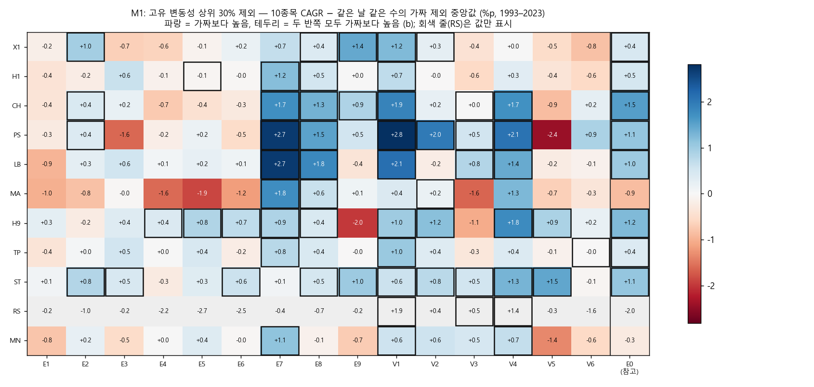
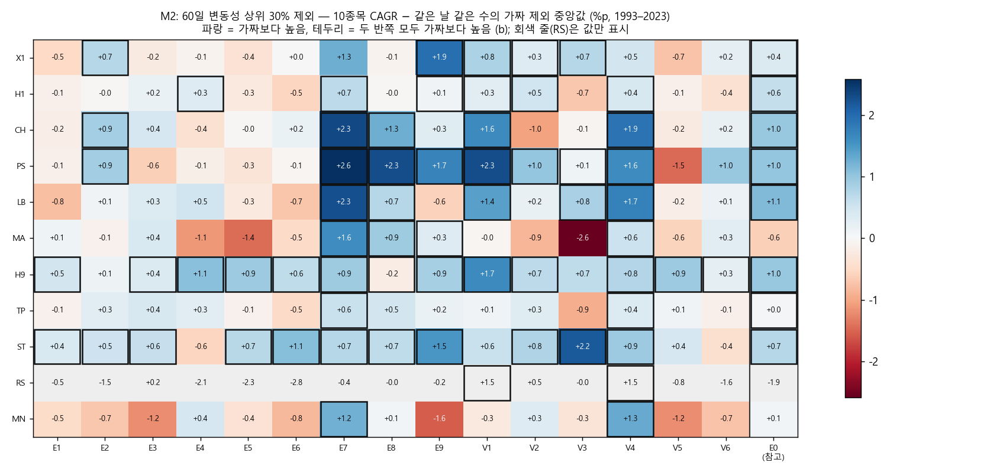
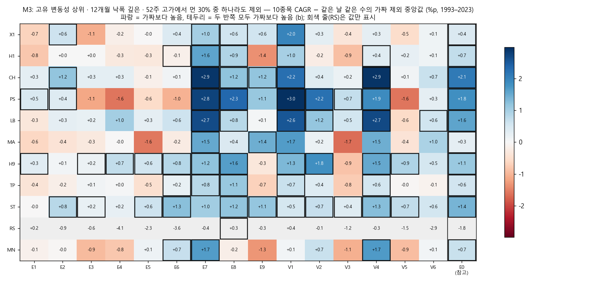
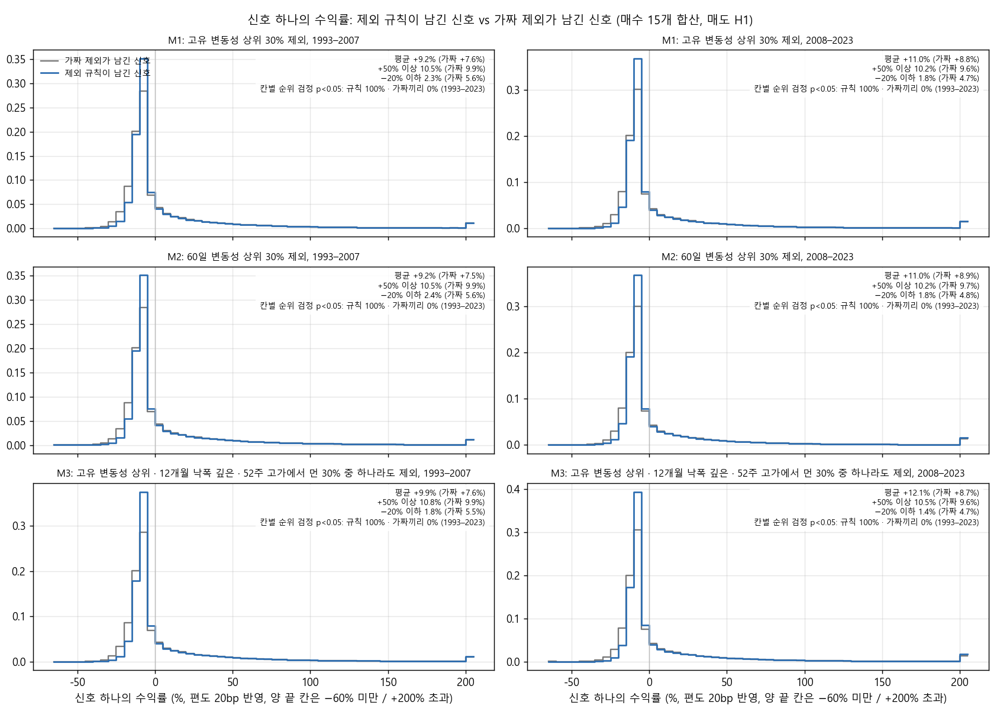
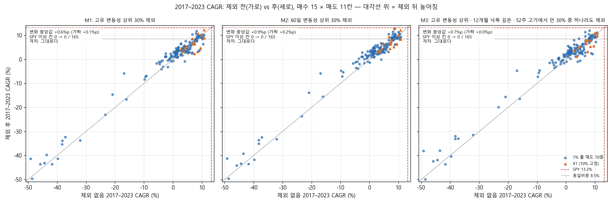
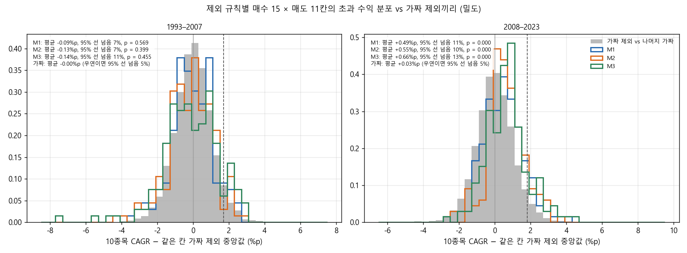
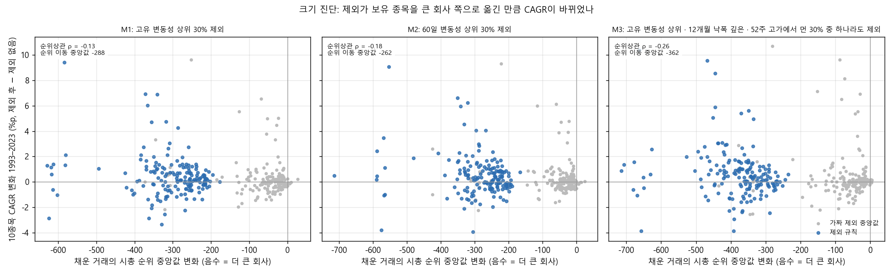

# Stage M 결과: '피할 종목' 제외를 고정하고 매수 × 매도 전체에서 다시 시험 (결정 92)

설계는 `docs/research/lab/2026-11-01_stage_m_design.md`이고, 결과 전에 커밋 efdf87c로 등록했습니다. 실행기는 `lab/exclude_study.py`(커밋 7efff7c)입니다. 2026-11-01 03:12–04:14 KST에 밤 전체 CPU로 돌렸습니다(작업 18개 동시, 1시간 2분).

## 왜 했는지

Stage K(결정 91)에서 특징 하나로 '좋은 종목'을 고르는 효과는 작았습니다. 반면 '나쁜 종목'만 모아 산 계좌는 무작위보다 연 4–9%p 못했습니다(고유 변동성 상위 30%, 60일 변동성 상위 30%, 12개월 낙폭 깊은 30%, 52주 고가에서 먼 30%). 그 결과는 무작위 매수 E0와 매수 규칙 둘(V3 · E2), 매도 3종에서만 본 것입니다. 그래서 질문이 둘 생겼습니다.

1. 그 종목들을 신호일에 미리 빼면, 매수 15개 × 매도 11종 전체에서 같은 날 같은 수를 무작위로 뺀 것보다 계좌가 나아지는가.
2. 그렇게 하면 2017–2023에 SPY(13.2%)에 크게 뒤처지던 격차가 줄고, SPY를 넘는 후보가 나오는가.

제외 규칙은 Stage K 결과를 보고 골랐고 같은 1993–2023 자료로 돌렸습니다. 따라서 이 시험은 사후(post-hoc) 시험입니다. 통과하더라도 '같은 자료의 다른 매수 · 매도에서도 성립한다'까지만 말할 수 있습니다.

## 핵심 결과

1. **제외 규칙 셋 모두 등록 기준으로는 '정보 없음'입니다.**
   - 기준은 10종목 계좌 (b)에서 매도 11종 중 6종 이상이 우연의 95% 분위를 넘는 것입니다.
   - 넘은 매도의 수는 M1 2종(H9 · ST), M2 3종(PS · H9 · ST), M3 3종(PS · H9 · ST)이었습니다.
2. **신호 하나의 수익률과 종목 수 제한 없는 기여는 뚜렷이 좋아졌습니다.**
   - 신호당 기여 (a)는 세 규칙 모두 매도 9–10종에서 우연을 넘었습니다. 가짜 제외보다 약 1.2배(M3 1.3배)입니다.
   - 신호 단위 순위 검정은 165칸 중 96–97%가 p < 0.05였고, 거의 모두 규칙 쪽이 높았습니다. 같은 검정을 가짜끼리 하면 0.3–0.7%입니다.
   - 매도 H1, 매수 15개 합산으로 보면 다음과 같습니다(M1, 규칙 / 가짜).
     - 신호 평균: 1993–2007 +9.2% / +7.6%, 2008–2023 +11.0% / +8.8%
     - −20% 이하 손실 비율: 2.3% / 5.6%, 1.8% / 4.7%
     - +50% 이상 비율: 10.5% / 9.9%, 10.2% / 9.6%

     큰 손실은 절반 넘게 줄었고, 큰 승자는 줄지 않았습니다.
3. **그러나 10종목 계좌에서는 차이가 작았고, 2008–2023에만 있었습니다.**
   - 165칸의 '10종목 CAGR − 가짜 중앙값'의 중앙값은 1993–2023 +0.2 · +0.2 · +0.3%p였습니다(M1 · M2 · M3).
   - 반쪽으로 나누면 1993–2007은 −0.1 · −0.0 · −0.2%p, 2008–2023은 +0.4 · +0.6 · +0.7%p입니다.
   - 2008–2023에서는 분포 전체가 가짜끼리의 분포보다 오른쪽에 있습니다(순위 검정 p < 0.001). 1993–2007에서는 구별되지 않습니다(p 0.40–0.57).
   - 제외 전(Stage L)과 비교하면 165칸 중앙값 기준으로 다음과 같습니다.
     - CAGR: 6.6% → 6.8 · 6.8 · 6.6%(칸별 변화 중앙값 +0.2 · +0.3 · +0.4%p)
     - MDD: −53.3% → −49.3 · −50.1 · −48.7%(2.0–3.4%p 얕아짐)
4. **2017–2023 격차는 '그대로'입니다.**
   - 165칸의 2017–2023 CAGR 변화 중앙값은 +0.6 · +0.9 · +0.7%p로, 등록 기준 +1%p에 못 미쳤습니다. 가짜 제외는 +0.1 · +0.2 · +0.0%p였습니다.
   - SPY(13.2%) 이상인 칸은 제외 전에도 0개, 제외 후에도 0개입니다. 가장 높은 칸은 M2 × E9 × ST 12.9%, M2 × E9 × X1 12.7%, M1 × E2 × X1 12.3%였습니다.
5. **SPY를 넘은 후보는 없습니다.** 495칸 중 1993–2023과 2017–2023 모두 SPY보다 CAGR이 높고 낙폭이 얕은 칸이 하나도 없었습니다(제외 전 Stage L 단독 165칸도 0개).
6. **크기 효과나 1% 룰 비중 때문만은 아닙니다.**
   - 제외 뒤 채운 거래의 시총 순위 중앙값은 260–360위 큰 회사 쪽으로 옮겨 갔습니다. 하지만 그 이동과 CAGR 변화의 순위상관은 −0.13 · −0.18 · −0.26으로 약했습니다(기준 |ρ| ≥ 0.5에 못 미침).
   - 비중이 10% 고정인 X1에서도 방향이 같았습니다. 가짜 대비 중앙값은 +0.0 · +0.2 · +0.3%p이고, 1% 룰 매도 10종은 +0.2 · +0.2 · +0.3%p였습니다.
7. **결론**: '흔들리거나 무너진 종목을 사지 않기'는 신호 하나의 질을 분명히 높였습니다. 큰 손실이 절반으로 줄었고, 종목 수 제한 없는 기여는 약 20% 늘었습니다. 하지만 사용자 계좌 규칙(1% 룰, 10종목)에서는 연 0.2–0.4%p, 낙폭 2–3%p 정도의 작은 개선에 그쳤습니다. 그 개선도 2008–2023에만 있었고, 등록한 우연 기준을 넘지 못했으며, SPY와의 격차를 줄이지 못했습니다.

## 그림

**그림 1.** M1(고유 변동성 상위 30% 제외)의 매수 15 × 매도 11칸입니다. 칸 값은 10종목 CAGR에서 같은 칸 가짜 제외 20개의 중앙값을 뺀 값입니다(%p, 1993–2023). 테두리는 두 반쪽 모두 가짜보다 높은 칸 (b)입니다. 오른쪽 끝 E0(무작위 매수)는 참고로만 보여 줍니다. H9 · ST 줄은 대부분 파랗고 테두리가 있습니다. RS(회색, 값만 표시) · MA · MN 줄은 붉거나 섞여 있습니다. 매수 쪽에서는 E7 · V1 · V4 열이 파랗고, E1 · E4 · E5 열은 옅게 붉습니다.

**그림 2.** M2(60일 변동성 상위 30% 제외)의 같은 그림입니다. M1과 거의 같습니다. 두 변동성 정의는 계좌에서 같은 일을 합니다.

**그림 3.** M3(합집합 제외, 매수 규칙 신호의 약 42%를 뺌)의 같은 그림입니다. CH · LB 줄이 M1 · M2보다 더 파랗고, RS 줄은 더 나쁩니다.

**그림 4.** 신호 하나의 수익률(%) 분포입니다(매도 H1, 매수 15개 합산, 두 반쪽). 제외 규칙이 남긴 신호(파랑)와 가짜 제외가 남긴 신호(회색)를 비교했습니다. 파랑은 −20% 아래 칸들이 얇고, −10 – 0% 칸(ATR 손절 근처)에 더 몰립니다. 오른쪽 꼬리(+50% 이상, +200% 초과 칸)는 두 분포가 거의 같습니다. 칸마다 평균, +50% 이상 · −20% 이하 비율, 칸별 순위 검정에서 p < 0.05인 비율(규칙 vs 가짜끼리)을 적었습니다.

**그림 5.** 2017–2023 CAGR을 제외 전(가로, Stage L 값)과 후(세로)로 놓았습니다. 점 하나가 매수 × 매도 한 칸이고, 주황 삼각형은 X1입니다. 점들은 대각선 바로 위에 붙어 있습니다. 붉은 점선(SPY 13.2%)을 넘는 점은 제외 전에도 후에도 없습니다. −20% 아래의 점 39개는 모두 RS 매도(하루 이틀 만에 파는 매도)의 칸입니다.

**그림 6.** 495칸(규칙별 165칸)의 '10종목 CAGR − 가짜 중앙값'(선)과, 가짜 하나를 나머지 19개와 비교한 같은 값(회색)입니다. 1993–2007(왼쪽)에서는 세 규칙이 회색과 겹칩니다. 2008–2023(오른쪽)에서는 세 규칙 모두 오른쪽으로 0.5%p쯤 옮겨 가 있고, 가짜 95% 선(점선)을 넘는 칸이 10–13%입니다(우연이면 5%).

**그림 7.** 가로는 채운 거래의 시총 순위 중앙값의 변화(제외 후 − 제외 없음, 음수 = 큰 회사 쪽)이고, 세로는 10종목 CAGR의 변화입니다(1993–2023, %p). 파랑은 제외 규칙, 회색은 가짜 제외 중앙값입니다. 규칙은 보유 종목을 200–400위 큰 쪽으로 옮겼습니다. 하지만 옮긴 정도와 CAGR 변화는 거의 관계가 없습니다.

## 무엇을 했나

### 종목 필터링 · 매수 · 매도 · 계좌 (Stage L과 같음)

- 유니버스는 매일 21거래일 평균 시가총액 상위 3,000개 미국 보통주 가운데 위생 필터를 통과한 종목입니다. 위생 필터는 12개월 중 90% 거래, 5달러 이상, 거래대금 100만 달러 이상, Amihud 비유동성 상위 20% 제외입니다. 시총 하한은 없습니다.
- 매수는 단독 15개(E1–E9, V1–V6, 대표 값)와 무작위 매수 E0(위생 통과 종목 · 일의 1%, 씨앗 5개)입니다. Stage L이 매도 11종으로 저장한 신호표를 그대로 다시 썼고, 엔진은 돌리지 않았습니다.
- 매도는 Stage L의 11종(X1, H1, CH, PS, LB, MA, H9, TP, ST, RS, MN)이고, 값은 등록 그대로입니다. 손절이 없는 X1은 종목당 10% 고정, 나머지는 1% 룰입니다.
- **10종목 계좌**는 다음 규칙으로 돌렸습니다.
  - 주식 수 = 자산 × 1% ÷ (매수가 − 손절선), 종목당 10% 상한, 최대 10종목
  - 청산 뒤 20거래일 재진입 금지, 편도 20bp, 남는 현금은 단기국채
  - 신호가 자리보다 많은 날은 무작위 순서로 삽니다. 순서 100번의 중앙값을 봅니다(E0는 씨앗마다 20번).
- **종목 수 제한 없음**은 신호당 거래 기여(비중 × 수익)의 평균입니다.
- 기간은 1993-02 – 2023-12의 한 곡선, 두 반쪽 1993–2007 · 2008–2023, 2017–2023입니다. 보류 구간(2024년 이후)은 쓰지 않았습니다.

### 제외 규칙 3개 (결과 전에 고정)

값은 신호일 종가까지의 자료로 계산하고, 그날 위생 통과 유니버스 안의 백분위로 바꿉니다. 기준은 Stage K와 같은 30%입니다.

| 기호 | 사지 않는 종목 | 특징(Stage K 번호) | 실제로 뺀 신호 (매수 15개 / E0) |
|---|---|---|---|
| M1 | 고유 변동성(63일, SPY 대비 잔차의 표준편차) 상위 30% | K2 | 29.0% / 29.8% |
| M2 | 60일 변동성 상위 30% | K8 | 28.6% / 29.5% |
| M3 | 고유 변동성 상위 30% **또는** 12개월 최대 낙폭 깊은 30% **또는** 52주 고가에서 먼 30% | K2, K13, K11 | 41.9% / 47.1% |

- 제외된 신호는 '없던 신호'로 칩니다. 이미 들고 있는 종목은 매도 규칙대로 팝니다. 제외는 매수만 막습니다.
- 특징 값이 없는 신호(자료 기간이 짧은 종목, 신호의 0–0.9%)는 빼지 않았습니다. '상위 30%에 든다'고 확인된 종목만 뺀 것입니다. 설계 문서에 적혀 있지 않던 세부라 여기에 적습니다.
- 시총 · 주가로는 빼지 않았습니다(사용자 규칙: 소형주를 빼지 않음).
- 신호 수는 매수 15개 합계 283만 개, E0 씨앗마다 약 15.5만 개입니다. M3이 매수 규칙에서 E0보다 덜 뺀 것은, 추세 매수의 신호가 고점 근처 · 얕은 낙폭 종목에 많기 때문으로 보입니다.

### 비교 기준

1. **제외 없음**은 같은 매수 × 매도의 Stage L 값입니다. 같은 신호표와 같은 무작위 순서(Stage L과 같은 이름의 난수)로 다시 돌려, Stage L 결과표와 맞춰 봤습니다(아래 '재현 점검').
2. **날짜를 맞춘 가짜 제외**(주 기준)는 칸마다 20개입니다.
   - 제외 규칙이 어느 날 그 매수의 신호를 n개 뺐다면, 가짜는 같은 날 같은 매수의 신호 중 n개를 무작위로 뺍니다. 날짜와 하루 신호 수가 같으므로, 차이는 '어떤 종목을 뺐나'뿐입니다.
   - 가짜 k번은 매도 11종에서 같은 종목을 뺍니다(규칙과 같음).
   - 가짜마다 무작위 순서 20번(E0는 씨앗마다 4번)으로 계좌를 돌렸습니다.
3. SPY, SPY 200일선, 유니버스 동일비중을 함께 적습니다.

### 판정 (등록대로)

- **칸 판정**(제외 3 × 매수 15 × 매도 11 = 495칸): 두 반쪽 모두에서 다음 값이 가짜 20개의 중앙값보다 높으면 통과입니다. (a)와 (b)는 따로 셉니다.
  - (a) 신호당 기여 평균
  - (b) 10종목 순서 중앙값 CAGR
- **우연 기대**: 가짜 하나를 나머지 19개와 같은 판정에 넣어 통과율 p0를 매도마다 구합니다. 그러면 이항(15, p0)의 95% 분위가 나옵니다. 제외 규칙에 '정보가 있다'고 하려면 **(b)에서 11종 중 6종 이상**이 이 분위를 넘어야 합니다. 15개 매수 모두 거래 30회 이상이라 빠진 매수는 없습니다.
- **2017–2023 격차**: 규칙마다 165칸의 '제외 후 − 제외 없음' CAGR 변화 중앙값을 봅니다. +1%p를 넘으면 '줄었다', −1%p 아래면 '커졌다', 그 사이면 '그대로다'입니다.
- **후보**: 다음을 모두 만족해야 합니다.
  - 같은 제외 × 같은 매수가 매도 3종 이상에서, 1993–2023과 2017–2023 모두 SPY보다 CAGR이 높고 낙폭이 얕음
  - 거래 30회 이상
  - 편도 40bp에서도 3종 이상
- **크기 진단**(보이기만): 채운 거래의 시총 순위 중앙값이 제외 뒤 움직인 정도와 CAGR 변화의 순위상관입니다. |ρ| ≥ 0.5면 '크기 효과와 분리되지 않음'으로 적습니다.
- **신호 단위 수익률**: 규칙이 남긴 신호와 가짜가 남긴 신호의 수익률을 비교합니다. 평균 차 부트스트랩 95% CI(1,000번), Mann–Whitney p와 P(규칙 > 가짜), KS를 쓰고, 가짜끼리의 같은 검정과 나란히 놓습니다.
- 시험 수는 +495(누적 약 70,574)입니다. E0와 가짜는 세지 않았습니다.

## 결과

### 재현 점검: 제외 없음 = Stage L

- 단독 15개와 E0 씨앗 5개 × 매도 11종 = 220칸, 3,740개 값을 Stage L 결과표(`2026-10-29_stage_l/verdicts.csv.gz` · `unlimited.csv.gz`)와 비교했습니다. 값은 CAGR · MDD 5개 기간, 거래 수, 기여 평균, 신호 수입니다.
- 최대 차는 1.1e-16(부동소수점 반올림)이었습니다.
- 처음 dry 실행에서는 거래 수 · 기여는 같고 CAGR · MDD만 1e-7 수준으로 달랐습니다. 남는 현금의 수익률(BIL)을 yfinance에서 새로 받았기 때문입니다(배당 반영으로 과거 값이 아주 조금 바뀜). Stage L 실행 때 받아 둔 캐시(2026-10-29)를 쓰자 정확히 같아졌습니다. 본 실행도 그 캐시를 썼습니다.

### 매도별 판정: 10종목 계좌 (b)와 신호당 기여 (a)

칸 수는 '통과한 매수 수 / 우연 95% 분위'(매수 15개)입니다. p0는 0.22–0.29였습니다. **굵게**는 우연을 넘은 것입니다.

| 매도 | M1 (b) | M2 (b) | M3 (b) | M1 (a) | M2 (a) | M3 (a) |
|---|---|---|---|---|---|---|
| X1 25% 트레일링만 | 5 / 7 | 5 / 6 | 4 / 7 | **15** / 7 | **15** / 7 | **15** / 7 |
| H1 + ATR×3 | 4 / 7 | 6 / 7 | 5 / 7 | **15** / 6 | **15** / 7 | **15** / 6 |
| CH 샹들리에 | 7 / 7 | 5 / 7 | 6 / 7 | **11** / 7 | **11** / 7 | **12** / 7 |
| PS 파라볼릭 SAR | 7 / 7 | **8** / 7 | **8** / 7 | **8** / 7 | **8** / 7 | 7 / 7 |
| LB 20일 신저가 | 5 / 7 | 5 / 7 | 6 / 7 | **11** / 7 | **13** / 7 | **13** / 7 |
| MA 50일선 | 3 / 7 | 4 / 7 | 2 / 7 | 7 / 7 | **8** / 7 | **8** / 6 |
| H9 손익분기 + 시간 손절 | **9** / 6 | **13** / 7 | **11** / 6 | **14** / 7 | **14** / 7 | **14** / 6 |
| TP 부분 익절 | 3 / 7 | 2 / 7 | 5 / 7 | **15** / 7 | **15** / 7 | **15** / 6 |
| ST 넓은 손절만 | **10** / 7 | **11** / 6 | **11** / 7 | **15** / 7 | **15** / 6 | **15** / 7 |
| RS 단기 반등 | 3 / 7 | 2 / 6 | 1 / 7 | 0 / 7 | 1 / 7 | 0 / 7 |
| MN 모멘텀 소멸 | 3 / 7 | 2 / 7 | 3 / 6 | **14** / 7 | **13** / 7 | **14** / 7 |
| **우연을 넘은 매도 수** | **2** | **3** | **3** | 9 | 10 | 9 |

- (b)는 세 규칙 모두 6종에 못 미쳐 '정보 없음'입니다.
- (a)는 RS(하루 이틀 만에 파는 매도)를 빼면 거의 모든 매도에서 통과했습니다. 가짜 대비 기여의 비율(칸별 중앙값)은 다음과 같습니다.
  - M1: 1993–2007 1.18, 2008–2023 1.22
  - M2: 1.19, 1.21
  - M3: 1.24, 1.34
- 가짜끼리의 통과율은 (a) · (b) 모두 25% 안팎이었습니다. 규칙은 (b) 36–38%, (a) 76–78%였습니다.

### 10종목 CAGR − 가짜 중앙값 (%p, 매수 15개 평균)

| 매도 | M1 | M2 | M3 |
|---|---|---|---|
| X1 | +0.1 | +0.3 | +0.2 |
| H1 | +0.1 | +0.0 | +0.0 |
| CH | +0.4 | +0.5 | +0.9 |
| PS | +0.6 | +0.7 | +0.6 |
| LB | +0.6 | +0.4 | +0.8 |
| MA | −0.3 | −0.2 | +0.2 |
| H9 | +0.4 | +0.7 | +0.7 |
| TP | +0.2 | +0.1 | +0.1 |
| ST | +0.6 | +0.7 | +0.7 |
| RS | −0.5 | −0.6 | −1.2 |
| MN | −0.0 | −0.3 | −0.0 |

매수별로 보면(매도 11종 평균) E7(+1.2 · +1.3 · +1.5), V1(+1.3 · +0.9 · +1.4), V4(+1.1 · +1.1 · +1.3), E8(+0.6 · +0.6 · +1.0)에서 컸습니다. E1 · E4 · E5 · V5는 −0.2 – −0.5%p였습니다.

### 제외 전(Stage L) vs 후, 165칸 중앙값

| | 제외 없음 | M1 | M2 | M3 | 가짜(M1 · M2 · M3) |
|---|---|---|---|---|---|
| CAGR 1993–2023 | 6.6% | 6.8% | 6.8% | 6.6% | 6.6 · 6.7 · 6.5% |
| CAGR 1993–2007 | 7.7% | 8.1% | 7.9% | 8.1% | 7.7 · 7.7 · 7.8% |
| CAGR 2008–2023 | 4.5% | 4.9% | 5.2% | 5.1% | 4.5 · 4.6 · 4.1% |
| CAGR 2017–2023 | 3.6% | 3.7% | 3.9% | 3.7% | 3.2 · 3.7 · 3.3% |
| MDD 1993–2023 | −53.3% | −49.3% | −50.1% | −48.7% | |
| 거래 수 | 1,514 | 1,395 | 1,414 | 1,298 | |

- 칸별 변화의 중앙값(제외 후 − 제외 없음, 1993–2023)은 +0.24 · +0.31 · +0.42%p입니다.
- 1993–2023 CAGR이 오른 칸은 62 · 59 · 65%입니다. 반쪽별로는 1993–2007 52–53%, 2008–2023 67–75%입니다.
- 같은 기준선: SPY 9.9% · −55%(2017–2023 13.2% · −34%), 유니버스 동일비중 10.2% · −61%(2017–2023 8.5%)입니다.

### 2017–2023 격차 (판정: 세 규칙 모두 '그대로다')

| | M1 | M2 | M3 |
|---|---|---|---|
| 165칸 CAGR 변화 중앙값 | +0.6%p | +0.9%p | +0.7%p |
| 가짜 제외의 변화 중앙값 | +0.1%p | +0.2%p | +0.0%p |
| 오른 칸 비율 | 68% | 69% | 67% |
| SPY(13.2%) 이상 칸, 전 → 후 | 0 → 0 | 0 → 0 | 0 → 0 |
| 동일비중(8.5%) 이상 칸, 전 → 후 | 29 → 30 | 29 → 33 | 29 → 31 |

2017–2023에서 가장 높은 칸은 다음과 같습니다(1993–2023 CAGR · MDD / 2017–2023 CAGR · MDD).
- M2 × E9 × ST: 8.5% · −71% / 12.9% · −34%
- M2 × E9 × X1: 10.1% · −50% / 12.7% · −33%
- M1 × E2 × X1: 11.3% · −50% / 12.3% · −28%

1993–2023에서 가장 높은 칸은 M3 × E2 × X1 11.7% · −47%(제외 없음 9.9%)였습니다. 2017–2023은 11.3%였습니다.

### 신호 단위 수익률 (`stats.csv`)

| | M1 | M2 | M3 |
|---|---|---|---|
| 순위 검정 p < 0.05인 칸 (165칸) | 96% | 97% | 97% |
| 그중 규칙이 높은 쪽 | 95% | 95% | 94% |
| 가짜끼리 p < 0.05 | 0.3% | 0.4% | 0.7% |
| 평균 차 95% CI가 0보다 위 / 아래 | 62% / 3% | 62% / 2% | 65% / 5% |
| P(규칙 > 가짜) 중앙값 | 0.524 | 0.524 | 0.532 |

- 차이는 통계적으로 뚜렷하지만 크지 않습니다. P(규칙 > 가짜)가 0.52–0.53이라는 것은, 두 분포에서 하나씩 뽑았을 때 규칙 쪽이 높을 확률이 반보다 2–3%p 높다는 뜻입니다.
- 차이는 주로 왼쪽 꼬리에서 나옵니다. −20% 이하 손실이 절반 이하로 줄었고, +50% 이상 비율은 거의 같습니다(그림 4).
- 가짜끼리의 비율(0.3–0.7%)은 5%보다 낮습니다. 가짜 하나와 나머지 19개가 같은 날의 같은 신호에서 뽑혀 많이 겹치기 때문입니다. 그래도 규칙의 96–97%는 이 비율과 5%를 모두 크게 넘습니다.

### 크기 진단

| | M1 | M2 | M3 |
|---|---|---|---|
| 채운 거래의 시총 순위 이동 중앙값 (제외 없음 대비) | −288위 | −262위 | −362위 |
| 같은 값, 가짜 대비 | −239위 | −223위 | −299위 |
| 순위 이동과 CAGR 변화의 순위상관 | −0.13 | −0.18 | −0.26 |
| 판정 | 분리됨 | 분리됨 | 분리됨 |

음수 순위 이동은 큰 회사 쪽입니다. 크기가 옮겨 간 만큼 CAGR이 바뀌었다는 증거는 약합니다. Stage K(특징 하나로 고른 줄)에서는 같은 종류의 상관이 −0.58이었습니다.

### X1(비중 10% 고정)

- X1에서 (b)를 통과한 매수는 5 · 5 · 4개입니다. 우연 95% 분위는 6–7입니다.
- 가짜 대비 중앙값은 +0.0 · +0.2 · +0.3%p이고, 1% 룰 매도 10종은 +0.2 · +0.2 · +0.3%p입니다. 방향이 같습니다.
- 그러니 1% 룰 비중(변동성 낮은 종목을 크게 듦)과의 상호작용만으로 생긴 효과는 아닙니다. 다만 X1에서도 효과는 작습니다.

### 무작위 매수 E0 (참고, 판정에 넣지 않음)

- 무작위 매수에서는 제외 효과가 매수 규칙들보다 컸습니다.
  - 가짜 대비 10종목 CAGR(%p, M1 · M2 · M3): CH +1.5 · +1.0 · +2.1, PS +1.1 · +1.0 · +1.8, LB +1.0 · +1.1 · +1.6, H9 +1.3 · +1.0 · +1.1, ST +1.1 · +0.7 · +1.4, X1 +0.5 · +0.4 · +0.4, H1 +0.5 · +0.6 · +0.7, RS −2.0 · −1.9 · −1.8
  - (b) 통과는 매도 11종 중 8 · 8 · 10종입니다.
- E0 H1의 절대 성적은 다음과 같습니다.
  - 1993–2023: 8.9% · −45% → 9.3 · 9.5 · 9.4%, −43 · −44 · −42%
  - 2017–2023: 6.0% → 6.6 · 6.8 · 6.1%
- Stage K에서 '나쁜 쪽 30%만 산' 계좌가 −9.1 / −5.5%p였던 것과 비교하면, 그 30%를 빼서 얻는 개선은 훨씬 작습니다. 나쁜 30%를 빼도 남은 70%는 무작위 순서로 10자리를 채우기 때문입니다.

### 후보 (없음)

20bp에서 SPY 기준(1993–2023과 2017–2023 모두 CAGR이 더 높고 낙폭이 더 얕음, 거래 30회 이상)을 통과한 칸은 495칸 중 0개였습니다. 그래서 40bp 재확인, DSR · PSR, 후보 그림(설계 그림 6)은 만들지 않았습니다.

## 한계

- **사후 설계입니다.** 제외 규칙은 Stage K 결과를 보고 골랐고 같은 자료로 돌렸습니다. 독립 확인은 보류 구간(2024년 이후)뿐입니다.
- 기준은 30% 하나입니다. M3은 신호의 42–47%를 빼서 10종목 계좌가 덜 차는 날이 늘었습니다(거래 1,514 → 1,298).
- 같은 신호표를 쓰는 495칸은 서로 독립이 아닙니다. 이항 기대치는 근사입니다.
- 가짜끼리의 신호 단위 검정은 서로 많이 겹쳐 p < 0.05 비율이 보수적입니다(0.3–0.7%).
- 1% 룰 비중은 손절폭(ATR)에 달려 있어, 변동성 제외의 효과에 비중 규칙과의 상호작용이 섞입니다. X1에서 방향이 같았지만 완전히 분리한 것은 아닙니다.
- 신호 단위의 큰 개선이 계좌에서 작아지는 이유는 확인하지 않았습니다. 다음은 가설입니다.
  - 1% 룰은 흔들리는 종목을 이미 작게 들기 때문에, 그 종목을 빼도 계좌 비중이 크게 바뀌지 않습니다.
  - 10자리가 대부분 차 있어, 빠진 자리는 무작위 순서로 다른 신호가 채웁니다.
- 기간별 값은 한 곡선을 잘라 계산했습니다.
- 시험 수는 +495(누적 약 70,574)입니다. 이 실행기는 `trials.csv`에 쓰지 않습니다.
- 보류 구간은 쓰지 않았습니다.

## 남은 판단

- '흔들리는 종목 제외'는 신호의 질(큰 손실 절반)과 낙폭(2–3%p)을 개선했습니다. 하지만 등록 기준의 '정보 있음'은 아니었고, 계좌 수익 개선은 2008–2023에만 연 0.4–0.7%p 있었습니다.
  - 이것을 계좌 규칙의 위험 관리 장치로 쓸지는 사용자가 정합니다. 수익 근거가 아니라 낙폭 · 손실 분포를 근거로 쓰는 것이고, 결과를 본 뒤의 선택이라는 점을 함께 적어야 합니다.
- SPY와의 2017–2023 격차는 제외로 줄지 않았습니다. 이 격차는 '어떤 종목을 빼느냐'보다 계좌 구조(10종목, 1% 룰, 추세 매수의 종목 구성) 쪽에 있는 것으로 보입니다. 이것은 해석입니다.
- 후보가 없어 보류 구간 평가는 하지 않습니다.
- 집계표는 `docs/research/lab/2026-11-01_stage_m/`에 있습니다.
  - `verdicts.csv.gz`: 규칙 × 매수 × 매도 칸 판정. 가짜 중앙값 · 5–95%, 제외 없음 값, 시총 순위, 기여, 후보 열이 들어 있습니다.
  - `chance.json`: 매도별 우연 기대, 격차, 크기 진단, X1, 신호 통계 요약
  - `pseudo_vs_pseudo.csv.gz`: 가짜끼리 판정
  - `stats.csv.gz`: 신호 단위 검정
  - `hist.csv.gz`: 신호 수익률 히스토그램 칸
  - `accounts.csv.gz`: 계좌 중앙값
  - `unlimited.csv.gz`: 신호 · 기여 요약
  - `repro.csv.gz`: Stage L 재현 점검
  - `baselines.csv`

  전체 결과(작업별 계좌, 신호별 특징 표 `base.parquet`)는 드라이브 `CRSP/lab_crsp/stage_m_exclude`에 있습니다.
