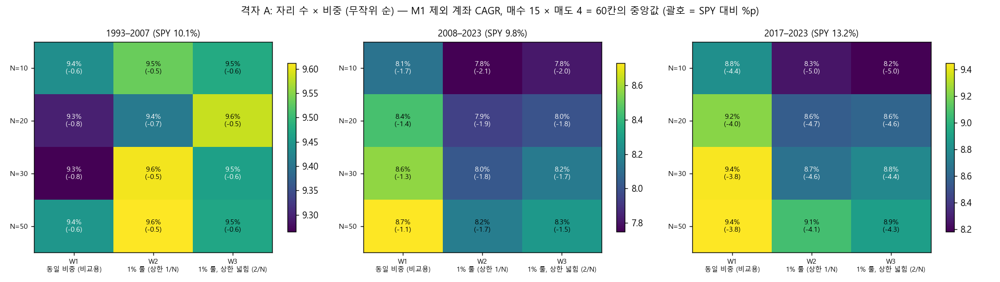
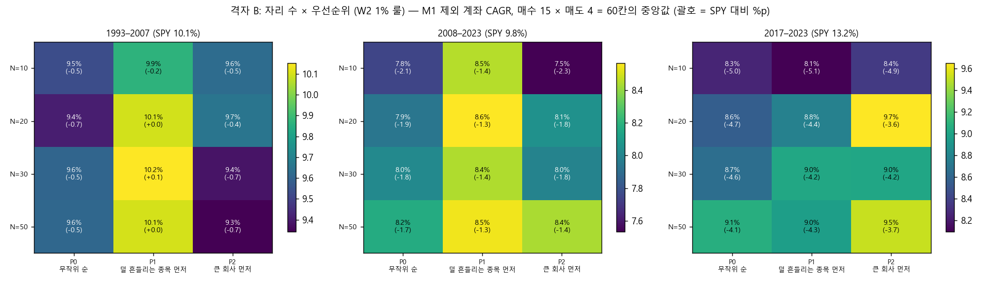
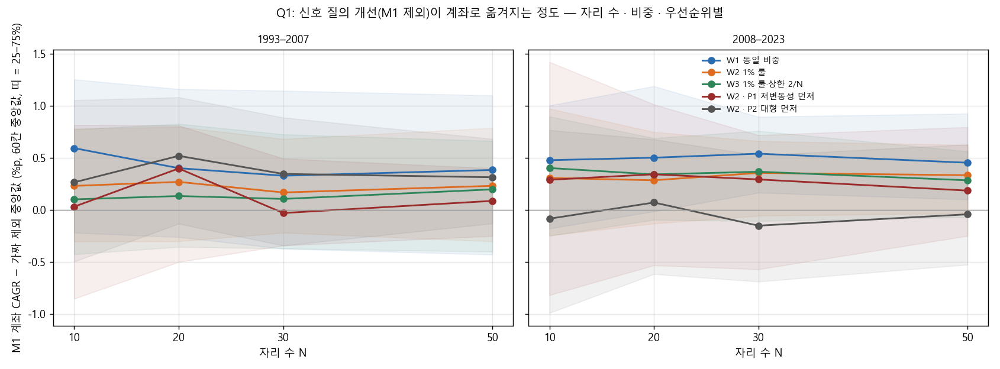
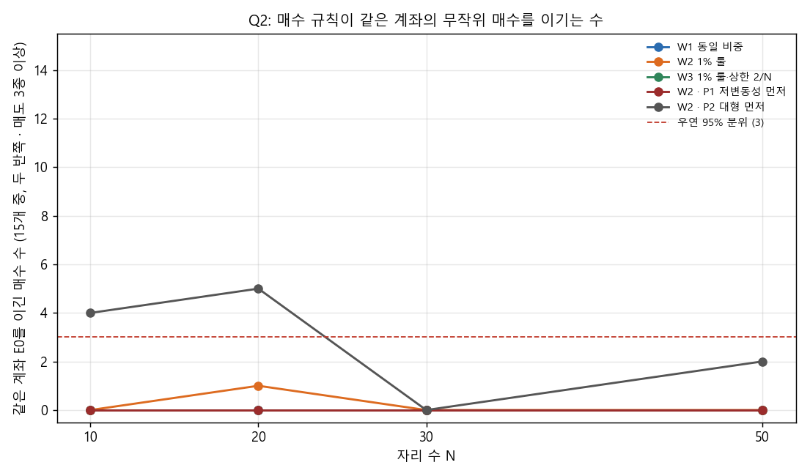
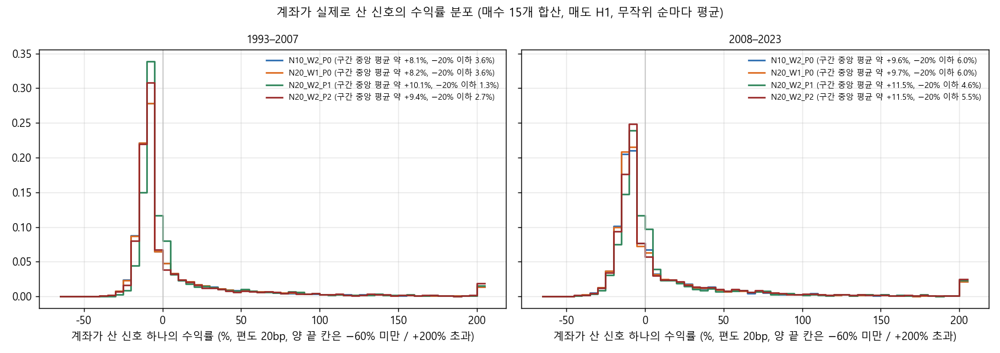
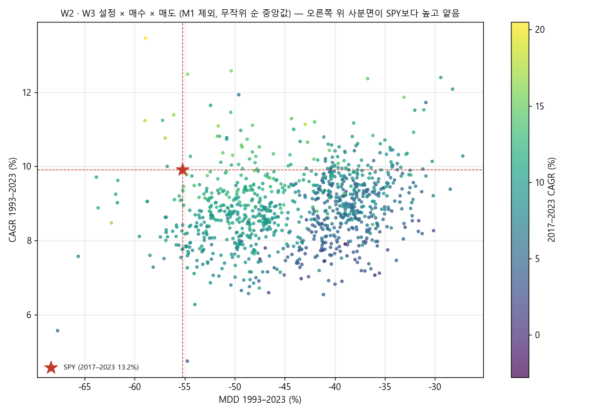

# Stage N 결과: 계좌 · 비중 규칙 (결정 93)

설계는 `docs/research/lab/2026-11-01_stage_n_design.md`(#114, 결과 전에 등록)입니다. 실행기는 `lab/account_study.py`입니다. 2026-11-02 01:28–02:47 KST에 밤 전체 CPU로 돌렸습니다(작업 18개 동시, 1시간 19분). 집계는 02:48에 한 번 더 돌렸습니다. 신호 단위 통계의 영 분포 줄 이름을 "null"로 썼더니 CSV를 다시 읽을 때 결측값이 되어서, 이름을 바꾼 것입니다. 계좌 재생은 다시 하지 않았고 숫자는 같습니다.

## 왜 했는지

Stage M(결정 92)에서 고유 변동성 상위 30%를 빼자(M1) 신호 하나의 질은 분명히 좋아졌습니다. −20% 이하 손실이 절반 넘게 줄었습니다. 그런데 사용자 계좌(1% 룰, 10종목)의 연 수익은 거의 늘지 않았습니다. 그 이유로 짐작한 계좌 구조는 셋이었습니다.

- 자리가 10개뿐이라 무작위 순서가 무엇을 살지 정한다.
- 1% 룰이 10% 상한에 묶여 사실상 동일 비중이다.
- 자리가 찼을 때 누구를 사는지가 무작위다.

그래서 매수 신호와 매도 규칙은 그대로 두고 계좌를 굴리는 방식만 바꿔 세 가지를 물었습니다.

- **Q1**: 신호 질의 개선이 계좌로 더 옮겨지는가.
- **Q2**: 매수 규칙이 같은 계좌의 무작위 매수(E0)를 더 자주 이기는가.
- **Q3**: SPY를 1993–2023과 2017–2023 모두 이기는 설정이 나오는가.

## 핵심 결과

1. **Q1: 자리 수 · 비중 · 우선순위를 바꿔도 옮겨짐은 커지지 않았습니다.**
   - 기준(N=10 · W2 · P0)에서 'M1 계좌 − 가짜 제외 중앙값'(60칸 중앙값)은 +0.33%p(1993–2007 +0.23, 2008–2023 +0.31)였습니다.
   - 자리 수 20 · 30 · 50의 어느 설정도 두 반쪽 모두 +0.5%p 이상 늘지 않았습니다. 가장 많이 는 것은 비교용 동일 비중(W1)이고, +0.10 – +0.17 / +0.15 – +0.23%p였습니다.
   - 1% 룰(W2)에서는 자리 수를 50까지 늘려도 변화가 −0.06 – +0.05%p였습니다.
   - 다만 무작위 순 설정에서는 기준 설정을 포함해 대부분 '가짜 95% 분위를 넘는 칸'이 우연보다 많았습니다(15–30칸, 우연 95% 분위 11–12). M1 제외에 정보가 있다는 것 자체는 매도 4종(X1 · H1 · H9 · ST)에서 다시 보였습니다. 커지지 않았을 뿐입니다.
2. **Q2: 자리가 늘어도 매수 규칙이 무작위 매수를 이기는 일은 늘지 않았습니다.**
   - 무작위 순 설정 12개에서 같은 계좌의 E0를 이긴 매수 수는 0–1개였습니다. 기준은 15개 중 두 반쪽 · 매도 3종 이상이고, 우연 95% 분위는 3입니다.
   - 우연을 넘은 것은 '큰 회사 먼저(P2)'의 N=10(4개: E4 E5 E9 V2)과 N=20(5개: E2 E5 V1 V2 V4)뿐이었습니다. 이것은 주로 같은 순서를 쓴 E0가 나빠진 탓입니다. N=10에서 무작위 순 대비 E0는 9.0% → 7.9%로 떨어졌고, 매수 규칙은 8.3% → 8.7%로 올랐습니다.
3. **Q3: SPY 후보는 없습니다.**
   - SPY 기준(1993–2023과 2017–2023 모두 CAGR이 더 높고 낙폭이 더 얕음)을 통과한 칸은 1,200칸 중 11칸이었습니다. 모두 우선순위를 정한 설정(P1 · P2)에서 나왔고, 무작위 순 설정에서는 0칸이었습니다.
   - 매도 2종 이상을 넘고 40bp에서도 남은 것은 N=10 · P1 × E5(H1 · H9) 하나였습니다. 이웃 자리 수(N=20 · P1)에서는 E5가 한 매도도 통과하지 못해 등록 기준(이웃 조건)에서 탈락했습니다.
4. **덜 흔들리는 종목을 먼저 사면(P1) 계좌가 나아졌지만, SPY에는 못 미쳤습니다.**
   - 60칸 중앙값 CAGR은 N=10에서 8.3% → 8.9%, N=20에서 8.6% → 9.3%였습니다(무작위 순 → P1). MDD는 −45% → −40%로 얕아졌습니다.
   - 계좌가 산 신호의 수익률이 기준 설정과 다른 칸이 52–62%였습니다(영 분포 5%). −20% 이하 손실은 4.6–6.1%로, 기준의 11.7%보다 적었습니다.
   - 그래도 1993–2023은 SPY(9.9%)와 비슷하거나 아래였고, 2017–2023은 8.1–9.0%로 SPY 13.2%에 크게 못 미쳤습니다.
   - P1 아래에서는 같은 순서의 E0도 9.2–9.7%였습니다. P1이 이미 M1이 하던 일(흔들리는 종목을 뒤로 미룸)을 하기 때문에, P1 설정에서는 M1을 걸어도 제외 없음과 거의 같았습니다(60칸 중앙값 차 −0.1 – +0.04%p).
5. **자리 수와 비중은 절대 성적을 조금 바꿨습니다.**
   - 1% 룰(W2), 무작위 순에서 N=10 → 50으로 가면 60칸 중앙값 CAGR이 8.3% → 8.8%, 2017–2023이 8.3% → 9.1%, MDD가 −44.8% → −43.7%였습니다.
   - 상한을 2/N으로 넓힌 W3은 W2와 거의 같았습니다(차이 ±0.2%p).
   - 계좌가 산 신호의 수익률 분포는 자리 수 · 비중을 바꿔도 기준 설정과 구별되지 않았습니다(p < 0.05 0–3%칸, 영 분포 5%). 같은 신호 풀에서 무작위로 더 많이 사는 것뿐이기 때문입니다.
6. **'1% 룰이 거의 작동하지 않는다'는 짐작은 절반만 맞았습니다.**
   - W2에서 상한(1/N)에 묶인 거래는 51%였고, 49%는 손절폭으로 비중이 정해졌습니다. 자리 수와 관계없이 같았습니다.
   - 상한을 2/N으로 넓히면(W3) 묶인 거래는 7%로 줄었지만, 계좌 성적은 거의 같았습니다.
7. **결론**: 계좌 구조(자리 수 · 비중)를 바꿔도 M1 제외의 신호 질이 계좌로 더 옮겨지지 않았고, 매수 규칙이 무작위 매수를 더 자주 이기지도 않았습니다. 순서를 '덜 흔들리는 종목 먼저'로 정하는 것이 가장 큰 차이(연 +0.6–0.7%p, 낙폭 4–5%p)를 냈습니다. 하지만 같은 순서의 무작위 매수도 똑같이 좋아졌고, 2017–2023 SPY와의 격차는 그대로였습니다.

## 그림

**그림 1.** 격자 A(자리 수 × 비중, 무작위 순)입니다. M1 제외 계좌의 CAGR을 매수 15 × 매도 4 = 60칸의 중앙값으로 적고, 괄호에 SPY 대비 차이를 적었습니다. 세 기간 모두 SPY 아래입니다.
- 2008–2023 · 2017–2023에서는 자리 수가 많을수록 조금 높습니다.
- 1993–2007에서는 설정 사이 차이가 0.3%p 안입니다.
- 색 범위가 칸마다 달라 작은 차이도 진하게 보입니다. 숫자를 보십시오.

**그림 2.** 격자 B(자리 수 × 우선순위, W2)의 같은 그림입니다.
- P1(덜 흔들리는 종목 먼저)이 1993–2007 · 2008–2023에서 가장 높습니다. 1993–2007 N=20 · 30 · 50에서는 SPY와 같습니다.
- 2017–2023에서는 P2(큰 회사 먼저)가 조금 높지만, 모든 칸이 SPY보다 3.6–5.1%p 낮습니다.

**그림 3.** Q1입니다. 가로는 자리 수이고, 세로는 'M1 계좌 CAGR − 같은 칸 가짜 제외 10개의 중앙값'의 60칸 중앙값(띠 = 25–75%)입니다. 왼쪽은 1993–2007, 오른쪽은 2008–2023입니다.
- 모든 선이 0.0 – +0.6%p 사이에서 거의 평평합니다. 자리 수가 늘어도 올라가지 않습니다.
- P2(큰 회사 먼저)는 2008–2023에 0 근처까지 내려갑니다.

**그림 4.** Q2입니다. 같은 계좌의 E0(M1 제외, 같은 순서 규칙)를 두 반쪽 모두 · 매도 3종 이상에서 이긴 매수 수(15개 중)입니다. 붉은 점선은 우연 95% 분위(3)입니다. 무작위 순 설정은 모두 0–1개입니다. P2만 N=10 · 20에서 선을 넘습니다.

**그림 5.** 계좌가 실제로 산 신호 하나의 수익률 분포입니다(매수 15개 합산, 매도 H1, 무작위 순마다 평균, 두 반쪽). 기준(N=10 · W2 · P0), 옮겨짐 중앙값이 가장 큰 N≥20 설정(N=20 · W1 · P0), 같은 자리 수의 P1 · P2를 겹쳤습니다.
- P1(초록)은 −20 – −10% 칸이 얇고 −5 – +5% 칸이 두껍습니다.
- 다른 설정은 기준과 거의 겹칩니다.
- 칸 안의 평균은 히스토그램 구간 중앙값으로 계산한 대략값입니다.

**그림 6.** W2 · W3 설정 16개 × 매수 15 × 매도 4 = 960칸의 1993–2023 CAGR(세로)과 MDD(가로)입니다. 색은 2017–2023 CAGR이고, 별은 SPY입니다. 별의 오른쪽 위(SPY보다 높고 얕음)에 있는 점들 대부분은 2017–2023 색이 SPY(13.2%)보다 어둡습니다. 즉 2017–2023에서 SPY에 못 미칩니다.

후보가 없어서 설계의 그림 7(후보의 자산 곡선)은 만들지 않았습니다.

## 무엇을 했나

### 종목 필터링 · 매수 · 매도 (고정)

- 유니버스는 매일 21거래일 평균 시가총액 상위 3,000개 미국 보통주 가운데 위생 필터를 통과한 종목입니다. 위생 필터는 12개월 중 90% 거래, 5달러 이상, 거래대금 100만 달러 이상, Amihud 비유동성 상위 20% 제외입니다.
- 여기에 **M1 제외**(신호일 고유 변동성이 그날 유니버스 상위 30%인 종목은 사지 않음)를 고정으로 걸었습니다. 매수 15개 신호의 29%가 빠집니다. 시총 하한은 없습니다.
- 매수는 단독 15개(E1–E9, V1–V6, 대표 값)와 무작위 매수 E0(씨앗 5개)입니다. Stage L이 저장한 신호표를 그대로 다시 썼고, 엔진은 돌리지 않았습니다.
- 매도는 Stage L에서 오래 보유하던 4종입니다.
  - X1: 25% 트레일링만
  - H1: X1 + ATR(14)×3 손절
  - H9: ATR×3 + 2R 손익분기 + 60일 시간 손절
  - ST: ATR×5 손절만

  비중을 정하는 손절폭은 ATR(14)×3입니다(ST는 ×5). X1에서는 이 손절폭을 비중 계산에만 썼습니다.

### 계좌 설정 20개 (결과 전에 고정)

종목당 위험은 r = 10% ÷ N입니다. 모든 자리가 손절에 걸려도 총위험이 약 10%로 같습니다.

| 축 | 값 |
|---|---|
| 자리 수 N | 10, 20, 30, 50 |
| 비중 W | W1 동일 1/N(비교용) · W2 min(r ÷ 손절폭, 1/N)(현재 방식) · W3 min(r ÷ 손절폭, 2/N) |
| 우선순위 P | P0 무작위 순(100번) · P1 신호일 고유 변동성 낮은 순 · P2 시총 큰 순(P1 · P2는 한 번) |

- 격자 A는 N × W(P0) 12개, 격자 B는 N × P(W2) 12개입니다. 겹치는 4개를 빼면 20개입니다.
- 나머지 규칙은 Stage I–M과 같습니다: 청산 뒤 20거래일 재진입 금지, 편도 20bp, 남는 현금은 단기국채, 1993-02 – 2023-12(두 반쪽, 2017–2023). 보류 구간은 쓰지 않았습니다.

### 무작위 순서와 재현

- 무작위 순서는 Stage M의 난수를 그대로 다시 뽑아 썼습니다.
  - M1 계좌와 가짜 제외 0–9번: Stage M의 M1 실행에서 뽑힌 순서와 같은 난수
  - 제외 없음 계좌: Stage L의 난수
- 그래서 N=10 · W2 · P0(X1은 W1)은 Stage M의 칸과 같아야 합니다. 그리고 설정끼리는 같은 난수로 비교됩니다(공통 난수).
- E0의 제외 없음은 씨앗마다 20번만 썼습니다(Stage L은 100번).

### 비교 기준과 판정 (등록대로)

- **Q1**: 설정마다 60칸의 'M1 계좌 CAGR − 가짜 제외 10개 중앙값'의 중앙값을 냅니다.
  - '옮겨짐이 커졌다'는 N ≥ 20의 어떤 설정에서 이 값이 기준보다 두 반쪽 모두 0.5%p 이상 크고, 가짜 95% 분위를 넘는 칸의 수가 이항(60, p0)의 95% 분위를 넘을 때만 합니다.
  - p0는 가짜 하나를 나머지 9개와 비교한 통과율입니다.
- **Q2**: 설정마다 매수 15개 중 '같은 설정 E0(M1 제외)의 중앙값 CAGR보다 두 반쪽 모두 높고, 매도 4종 중 3종 이상'인 수를 셉니다. 우연 95% 분위는 E0 씨앗 하나를 나머지 4개와 비교한 통과율로 구한 이항(15, p0)입니다.
- **Q3**: 다음을 모두 만족하면 후보입니다.
  - W2 · W3에서 1993–2023과 2017–2023 모두 CAGR > SPY, |MDD| < |SPY MDD|, 거래 30회 이상
  - 매도 2종 이상, 40bp에서도 2종 이상
  - 같은 비중 · 우선순위에서 바로 옆 자리 수에서도 같은 매수가 통과
- 시험 수는 +1,200(누적 약 71,774)입니다. E0 · 가짜 · 제외 없음은 세지 않았습니다.
- **설계에 적혀 있지 않아 실행 전에 정한 세부**(실행기 docstring, 커밋 64c37ea · 2c7ec59):
  - Q1의 칸 수는 1993–2023 CAGR이 가짜 10개 중앙값들의 95% 분위를 넘는지로 셉니다.
  - Q2의 p0는 20개 설정의 씨앗 하나 빼기 검정 100개를 모두 모아 구합니다(p0 = 0.09). 설정마다 구하면 씨앗이 5개뿐이라 너무 거칩니다.
  - 신호 단위 통계는 각 설정의 첫 무작위 순(P1 · P2는 단 한 번)에서 산 신호를 N=10 · W2 · P0 첫 순서에서 산 신호와 비교합니다. 영 분포는 N=10 · W2 · P0의 순서 1 vs 순서 0입니다.

## 결과

### 재현 점검: N=10 · W2 · P0 = Stage M

- 매수 15개 + E0 × 매도 4종 = 64칸, 1,964개 값을 Stage M 결과표(`2026-11-01_stage_m/`)와 비교했습니다.
- 값은 M1 계좌의 CAGR · MDD 5개 기간, 거래 수, 기여 평균, 가짜 0–9번의 1993–2023 CAGR, 제외 없음 CAGR(매수 15개)입니다.
- 최대 차는 9.7e-17이었습니다.

### 설정별 요약 (60칸 중앙값; Q1은 %p, Q2는 15개 중)

| 설정 | CAGR 93–23 | 93–07 | 08–23 | 17–23 | MDD 93–23 | Q1 옮겨짐 93–07 / 08–23 | 가짜 95% 넘은 칸 / 우연 | Q2 E0 이긴 매수 |
|---|---|---|---|---|---|---|---|---|
| N10 · W1 · P0 | 8.4% | 9.4 | 8.1 | 8.8 | −52.0% | +0.59 / +0.48 | 21 / 12 | 0 |
| **N10 · W2 · P0 (기준)** | 8.3% | 9.5 | 7.8 | 8.3 | −44.8% | +0.23 / +0.31 | 15 / 12 | 0 |
| N10 · W3 · P0 | 8.5% | 9.5 | 7.8 | 8.2 | −44.5% | +0.10 / +0.40 | 10 / 12 | 0 |
| N20 · W1 · P0 | 8.7% | 9.3 | 8.4 | 9.2 | −50.0% | +0.40 / +0.50 | 25 / 12 | 0 |
| N20 · W2 · P0 | 8.6% | 9.4 | 7.9 | 8.6 | −44.2% | +0.27 / +0.29 | 19 / 12 | 1 |
| N20 · W3 · P0 | 8.7% | 9.6 | 8.0 | 8.6 | −43.9% | +0.13 / +0.34 | 18 / 12 | 0 |
| N30 · W1 · P0 | 8.7% | 9.3 | 8.6 | 9.4 | −49.3% | +0.33 / +0.54 | 28 / 12 | 0 |
| N30 · W2 · P0 | 8.6% | 9.6 | 8.0 | 8.7 | −43.4% | +0.17 / +0.36 | 19 / 12 | 0 |
| N30 · W3 · P0 | 8.8% | 9.5 | 8.2 | 8.8 | −43.7% | +0.11 / +0.37 | 18 / 12 | 0 |
| N50 · W1 · P0 | 8.8% | 9.4 | 8.7 | 9.4 | −49.3% | +0.38 / +0.45 | 30 / 11 | 0 |
| N50 · W2 · P0 | 8.8% | 9.6 | 8.2 | 9.1 | −43.7% | +0.23 / +0.33 | 29 / 12 | 0 |
| N50 · W3 · P0 | 8.9% | 9.5 | 8.3 | 8.9 | −43.4% | +0.20 / +0.29 | 22 / 12 | 0 |
| N10 · W2 · P1 | 8.9% | 9.9 | 8.5 | 8.1 | −40.7% | +0.03 / +0.29 | 8 / 12 | 0 |
| N20 · W2 · P1 | 9.3% | 10.1 | 8.6 | 8.8 | −39.7% | +0.40 / +0.34 | 7 / 12 | 0 |
| N30 · W2 · P1 | 9.2% | 10.2 | 8.4 | 9.0 | −39.7% | −0.03 / +0.29 | 8 / 12 | 0 |
| N50 · W2 · P1 | 9.3% | 10.1 | 8.5 | 9.0 | −41.7% | +0.09 / +0.19 | 12 / 12 | 0 |
| N10 · W2 · P2 | 8.7% | 9.6 | 7.5 | 8.4 | −46.6% | +0.27 / −0.08 | 4 / 13 | **4** |
| N20 · W2 · P2 | 9.0% | 9.7 | 8.1 | 9.7 | −42.6% | +0.52 / +0.07 | 6 / 13 | **5** |
| N30 · W2 · P2 | 8.9% | 9.4 | 8.0 | 9.0 | −42.2% | +0.35 / −0.15 | 7 / 12 | 0 |
| N50 · W2 · P2 | 9.0% | 9.3 | 8.4 | 9.5 | −43.4% | +0.32 / −0.04 | 13 / 12 | 2 |
| SPY | 9.9% | 10.1 | 9.8 | 13.2 | −55.2% | | | |
| 유니버스 동일비중 | 10.2% | 12.2 | 8.5 | 8.5 | −60.9% | | | |

- Q2의 우연 95% 분위는 모든 설정에서 3입니다(p0 = 0.09).
- 같은 설정의 E0(M1 제외) 60칸 중앙값 CAGR은 다음과 같습니다. 매수 규칙의 중앙값은 대부분의 설정에서 E0보다 낮습니다.
  - 무작위 순: 9.0–9.7%
  - P1: 9.2–9.7%
  - P2: 7.9–9.0%
- 옮겨짐 비율(계좌 초과 %p ÷ 종목 수 제한 없는 신호당 기여 초과 %p)은 W2에서 N=10 0.79 → N=50 3.36으로 커졌습니다. 하지만 이것은 신호당 기여가 비중(1/N)에 비례해 작아지기 때문에 생기는 기계적인 증가라, 옮겨짐이 좋아졌다는 뜻이 아닙니다.

### 매도별 옮겨짐 (M1 − 가짜, 1993–2023 %p, 15칸 중앙값)

| 매도 | 무작위 순 설정 12개 범위 | P1 · P2 |
|---|---|---|
| X1 | −0.13 – +0.14 | −0.22 – +0.44 |
| H1 | −0.10 – +0.27 | −0.41 – +0.19 |
| H9 | +0.35 – +0.72 | +0.07 – +1.01 |
| ST | +0.36 – +0.84 | +0.09 – +0.53 |

Stage M과 같은 모습입니다. 효과는 H9 · ST에서 나고, X1 · H1에서는 거의 없습니다.

### 계좌 통계 (매수 15개의 중앙값, 첫 무작위 순)

| 설정 | 평균 보유 종목 | 현금 비중 | 체결률 | 평균 비중 | 상한에 묶인 거래 | 1% 룰이 정한 거래 | 연 매수 회전 | 100만 달러 계좌 주문 ÷ 20일 거래대금 (중앙값 / 5% 넘는 비율) |
|---|---|---|---|---|---|---|---|---|
| N10 · W2 · P0 | 9.9 | 6.3% | 0.2% | 7.5% | 51% | 49% | 57% | 2.1% / 27% |
| N10 · W3 · P0 | 9.8 | 3.8% | 0.2% | 7.7% | 7% | 93% | 57% | 2.0% / 27% |
| N20 · W2 · P0 | 19.8 | 4.7% | 0.4% | 3.8% | 51.5% | 48.5% | 58% | 1.0% / 11% |
| N50 · W2 · P0 | 49.0 | 4.8% | 1.0% | 1.5% | 51% | 49% | 56% | 0.4% / 3% |
| N10 · W2 · P1 | 9.9 | 3.8% | 0.1% | 7.9% | 72% | 28% | 51% | 2.2% / 30% |
| N10 · W2 · P2 | 9.9 | 4.3% | 0.2% | 7.7% | 59% | 41% | 48% | 0.5% / 10% |

- 체결률은 M1이 남긴 신호 가운데 실제로 산 비율입니다. 자리는 늘 차 있고(평균 보유 ≈ N), 신호는 자리보다 수백 배 많습니다.
- 10만 달러 계좌는 모든 설정에서 주문이 20일 거래대금의 0.2% 이하였습니다(5% 넘는 비율 1% 미만).
- 100만 달러 · 10종목에서는 주문의 약 27%가 20일 거래대금의 5%를 넘었습니다. 자리 수를 늘리거나 큰 회사를 먼저 사면 이 비율이 줄었습니다.

### 계좌가 산 신호의 수익률 (`stats.csv.gz`, 첫 순서 vs N=10 · W2 · P0 첫 순서, 매수 15 × 매도 4 = 60칸)

| 설정 | 순위 검정 p < 0.05 | 평균 차 중앙값 | −20% 이하 (기준 11.7%) | +50% 이상 (기준 13.5%) |
|---|---|---|---|---|
| 영 분포 (N=10 · W2 · P0 순서 1 vs 0) | 5% | −1.5%p | 12.2% | 12.4% |
| 무작위 순 11개 설정 | 0–3% | −0.8 – +0.2%p | 11.4–13.8% | 13.2–13.8% |
| P1 (N 10 · 20 · 30 · 50) | 52 · 62 · 58 · 57% | +5.2 · +7.8 · +5.3 · +5.3%p | 4.6–6.1% | 14.4–15.1% |
| P2 (N 10 · 20 · 30 · 50) | 10 · 8 · 7 · 8% | +3.9 – +6.4%p | 7.8–10.9% | 14.1–14.5% |

- 자리 수 · 비중을 바꾸면 계좌가 사는 신호의 분포는 그대로입니다. 같은 신호 풀에서 무작위로 사는 수만 늘기 때문입니다.
- P1은 분명히 다른 신호를 삽니다. 큰 손실이 절반 이하이고, 평균이 높고, 큰 승자도 조금 많습니다. 매도별로는 H1 · H9 · ST에서 60–63%, X1에서 42%가 p < 0.05였습니다.
- P2는 영 분포(5%)를 조금 넘는 정도입니다.

### SPY 기준을 통과한 칸 (후보 없음)

| 설정 × 매수 × 매도 | 1993–2023 CAGR · MDD | 2017–2023 CAGR · MDD | 거래 | 40bp 재확인 |
|---|---|---|---|---|
| N10 · P1 × E5 × H1 | 11.9% · −33% | 15.5% · −24% | 332 | 통과 |
| N10 · P1 × E5 × H9 | 10.1% · −40% | 13.8% · −33% | 165 | 통과 |
| N10 · P1 × V4 × H9 | 11.1% · −52% | 16.3% · −33% | 149 | — |
| N20 · P1 × E4 × H9 | 12.4% · −37% | 14.6% · −30% | 343 | — |
| N20 · P1 × V4 × H9 | 10.8% · −36% | 13.4% · −32% | 336 | — |
| N30 · P1 × E4 × H9 | 11.2% · −42% | 13.9% · −30% | 590 | — |
| N50 · P1 × V4 × H9 | 10.6% · −43% | 13.6% · −31% | 1,013 | — |
| N10 · P2 × E4 × H9 | 10.2% · −42% | 14.5% · −30% | 105 | — |
| N10 · P2 × E5 × X1 | 10.3% · −33% | 14.0% · −24% | 161 | — |
| N20 · P2 × E4 × ST | 10.4% · −41% | 14.8% · −27% | 150 | — |
| N30 · P2 × E5 × ST | 11.1% · −48% | 14.5% · −27% | 155 | — |

- 매도 2종 이상(20bp · 40bp)을 만족한 것은 N10 · P1 × E5(H1 · H9)뿐입니다. 이웃 N20 · P1 × E5는 한 매도도 통과하지 못해 등록 기준에서 탈락했습니다.
- 40bp 재확인은 등록대로 매도 2종 이상을 통과한 설정 × 매수(N10 · P1 × E5)만 했습니다. 나머지는 매도 1종이라 재확인 대상이 아닙니다(표의 '—').
- E4 · E5 · V4가 P1 · P2에서 여러 번 보이지만, 설정마다 다른 매도에서 한 번씩입니다.
- P1 · P2는 순서가 하나라, 무작위 순서의 분포 없이 '한 번의 결과'입니다.

## 한계

- M1 제외는 Stage M 결과를 보고 넣은 사후 선택입니다. 계좌 설정의 효과도 같은 1993–2023 자료에서 봤습니다.
- 위험 예산은 총 10% 하나만 봤습니다. 피라미딩은 넣지 않았습니다.
- P1 · P2는 순서가 하나라 무작위 순서의 분포가 없습니다. 견고성은 두 반쪽과 이웃 자리 수로만 봤습니다.
- P1의 정렬 값(신호일 고유 변동성 백분위)은 M1 제외와 같은 특징입니다. 그래서 P1 설정에서는 'M1 제외'와 '덜 흔들리는 순서'가 겹치고, Q1(옮겨짐)은 작게 나올 수밖에 없습니다.
- 같은 신호표를 쓰는 칸들은 서로 독립이 아닙니다. 우연 기대치는 근사입니다.
- 신호 단위 통계는 첫 무작위 순 하나에서 산 신호로 비교했습니다. 다른 순서였다면 숫자가 조금 다를 수 있습니다(영 분포 5%가 그 크기를 보여 줌).
- 주문 크기 대비 거래대금은 신호일의 20일 평균 거래대금을 기준으로 했습니다. 체결 충격은 모형에 없습니다.
- 기간별 값은 한 곡선을 잘라 계산했습니다.
- 시험 수는 +1,200(누적 약 71,774)입니다. 이 실행기는 `trials.csv`에 쓰지 않습니다.
- 보류 구간(2024년 이후)은 쓰지 않았습니다.

## 남은 판단

- 계좌 구조 축(자리 수 · 비중)에서는 등록 기준의 개선이 없었습니다. '덜 흔들리는 종목 먼저(P1)'만 연 +0.6–0.7%p, 낙폭 4–5%p의 차이를 냈습니다.
  - 이 순서를 계좌 규칙으로 쓸지는 사용자가 정합니다.
  - 근거는 낙폭 · 손실 분포입니다. 같은 순서의 무작위 매수도 함께 좋아졌으므로, 매수 규칙의 정보가 아니라 '어떤 종목을 먼저 사느냐'의 효과입니다. 결과를 본 뒤의 선택이라는 점도 함께 적어야 합니다.
- N10 · P1 × E5(H1 · H9)는 SPY 기준을 20bp · 40bp에서 매도 2종으로 통과했지만, 이웃 자리 수에서 통과하지 못해 후보가 아닙니다. 기준을 낮추지 않습니다.
- 2017–2023 SPY 격차(약 4–5%p)는 어떤 계좌 설정에서도 줄지 않았습니다. Stage M(제외)과 Stage N(계좌 구조) 모두 이 격차를 줄이지 못했습니다.
- 후보가 없어 보류 구간 평가는 하지 않습니다.
- 집계표는 `docs/research/lab/2026-11-01_stage_n/`에 있습니다.
  - `settings.csv`: 설정별 Q1 · Q2
  - `verdicts.csv.gz`: 설정 × 매수 × 매도 칸. M1 · 가짜 · 제외 없음 · E0 값과 SPY 기준
  - `candidates.csv`: 설정 × 매수의 20bp · 40bp · 이웃 판정
  - `stats.csv.gz`: 산 신호의 검정. 영 분포는 `N10_W2_P0_o1`
  - `shown.csv.gz`: 계좌 통계
  - `hist.csv.gz`: 산 신호의 수익률 칸
  - `accounts.csv.gz`: 계좌 중앙값
  - `pseudo_vs_pseudo.csv.gz`
  - `repro.csv.gz`: Stage M 재현
  - `chance.json`
  - `baselines.csv`

  전체 결과(작업별 계좌, 산 신호, 신호 기준표)는 드라이브 `CRSP/lab_crsp/stage_n_account`에 있습니다.
