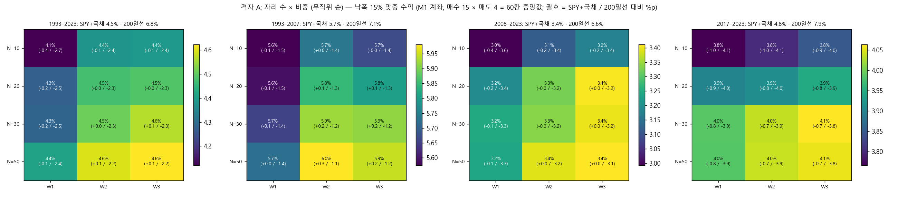
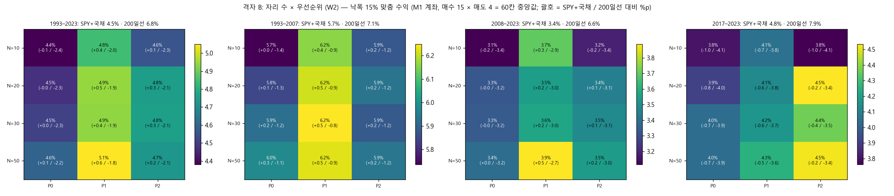
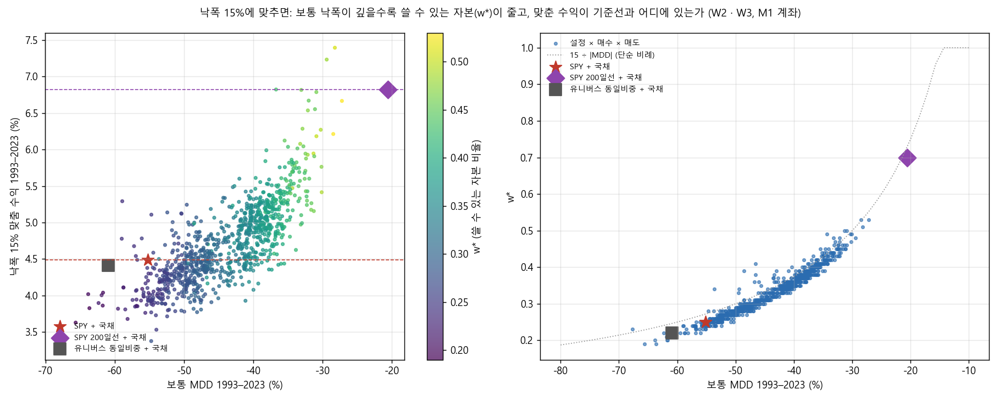
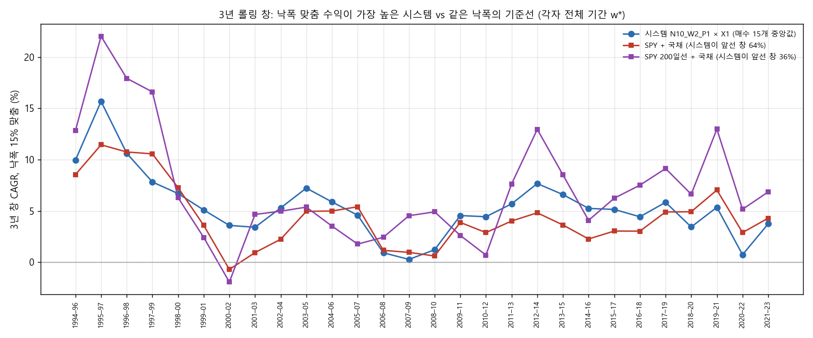
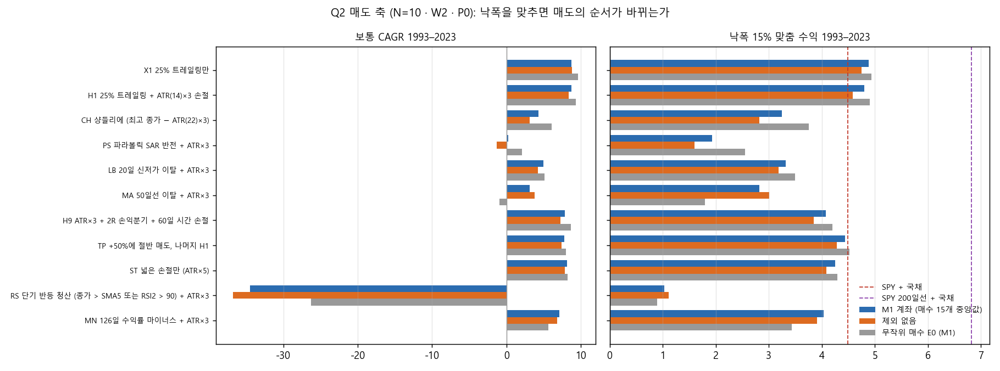

# Stage O 결과: 판정 기준을 낙폭 맞춤 수익으로 (결정 94)

설계는 `docs/research/lab/2026-11-02_stage_o_design.md`(결정 94, 결과 전에 등록)입니다. 실행기는 `lab/goal_study.py`(커밋 df558e2)입니다. 2026-11-02 22:34–23:22 KST에 밤 전체 CPU로 돌렸습니다(작업 18개 동시, 48분).

## 왜 했는지

Stage I–N은 "1993–2023과 2017–2023 모두 SPY보다 많이 벌고 덜 떨어지는가"로 매겼습니다. 사용자는 2017–2023에 SPY에 지는 것을 넓은 유니버스 추세추종의 구조로 받아들였습니다(2026-11-02 21:47 KST). 그러면 남는 질문은 원래 목표 그대로입니다.

**레버리지 없이 최악의 낙폭을 15%로 맞췄을 때, 종목 추세추종 계좌가 같은 낙폭의 SPY+국채나 SPY 200일선+국채보다 1년에 더 버는가.**

새로 사고팔지 않고, Stage N의 계좌 곡선을 똑같이 다시 만들어 이 기준(결정 64·65, `lab/target.py`)으로 다시 매겼습니다.

## 핵심 결과

1. **낙폭 15%에 맞추면 종목 추세추종은 SPY+국채와 비슷하고, SPY 200일선+국채에는 모든 설정에서 졌습니다.**
   - 기준선 셋을 각자 낙폭 15%에 맞추면 다음과 같습니다.

     | 기준선 | 쓸 수 있는 자본 w* | 맞춘 수익 1993–2023 | 1993–2007 | 2008–2023 | 2017–2023 |
     |---|---|---|---|---|---|
     | SPY + 국채 | 25% | 4.5% | 5.7% | 3.4% | 4.8% |
     | SPY 200일선 + 국채 | 70% | 6.8% | 7.1% | 6.6% | 7.9% |
     | 유니버스 동일비중 + 국채 | 22% | 4.4% | 6.0% | 3.0% | 3.6% |

   - 종목 계좌는 설정 × 매도 80개 시스템(매수 15개의 중앙값)의 맞춘 수익이 4.0–5.4%였습니다. 가장 높은 것은 N=10 · 1% 룰 · 덜 흔들리는 종목 먼저(P1) × 25% 트레일링(X1)으로, 5.4%(w* 43%)입니다.
   - 80개 중 29개가 세 기간 모두 SPY+국채를 이겼습니다. SPY 200일선+국채를 한 기간이라도 이긴 시스템은 없었습니다. 그래서 등록 기준의 '목표 통과 시스템'은 0개입니다.
   - 3년 창 28개에서 시스템이 SPY 200일선+국채를 앞선 비율은 21–36%였습니다. SPY+국채에는 39–71%였습니다.
2. **후보도 0개입니다.**
   - 1,200칸(설정 20 × 매수 15 × 매도 4, M1 계좌) 중 431칸이 세 기간 모두 SPY+국채를 이겼습니다. 세 기간 모두 SPY 200일선+국채를 이긴 칸은 0이었습니다.
   - 전체 기간만 보면 3칸이 200일선(6.8%)을 넘었습니다. 셋 다 2008–2023이 5.8–6.4%로 200일선(6.6%)보다 낮았습니다.
     - 수축 뒤 돌파(V6) × P1 × H1, N=20: 7.4%
     - 같은 매수 · 매도, N=30: 7.2%
     - 볼린저 수축 돌파(E4) × P1 × H9, N=20: 6.8%
   - 무작위 매수 E0의 씨앗 400개(설정 20 × 매도 4 × 씨앗 5)도 하나도 칸 판정을 통과하지 못했습니다.
3. **이유는 낙폭의 깊이입니다.**
   - 종목 계좌의 보통 MDD는 설정별 60칸 중앙값으로 −40 – −52%였습니다. 그래서 15% 예산에서 쓸 수 있는 자본이 시스템별 25–44%뿐입니다. 1% 룰 기준 60칸 중앙값은 31–37%입니다.
   - SPY 200일선은 MDD가 −21%라 70%를 쓸 수 있습니다. 보통 수익은 종목 계좌가 더 높지만(8.3–9.3% vs 8.6%), 쓸 수 있는 자본이 절반이라 맞춘 수익은 뒤집힙니다.
   - 종합 정리의 추정(−40% 전략 약 37%, 200일선 약 71%)이 실제 곡선과 맞았습니다.
   - 낙폭은 주로 2008년에 생깁니다. 반쪽마다 w*를 다시 맞추면 2008–2023의 w*는 전체 기간과 거의 같았고(중앙값 차 +0.01), 1993–2007의 w*는 0.17 컸습니다.
4. **빠른 매도는 낙폭을 맞춰도 순위가 그대로였습니다(Q2).**
   - N=10 · W2 · P0에서 매수 15개 중앙값의 맞춘 수익 순서는 다음과 같습니다.
     - X1 4.9%, H1 4.8%, TP 4.4%, ST 4.3%, H9 4.1%, MN 4.0%
     - LB 3.3%, CH 3.3%, MA 2.8%, PS 1.9%, RS 1.0%
   - 보통 CAGR 순서와 비교하면 X1 · H1이 서로 바뀌고 TP가 5위 → 3위로 올라 ST · H9가 한 칸씩 내려간 정도입니다.
   - 빠른 매도의 보통 낙폭이 얕지도 않았습니다(MA −50%, PS −56%, CH −48% vs X1 −41%). 낙폭을 맞춰도 이득이 없습니다.
5. **M1 제외와 덜 흔들리는 종목 먼저(P1)는 이 기준에서도 작게 도움이 됐습니다.**
   - 같은 설정에서 M1 계좌는 제외 없음보다 맞춘 수익이 0.1%p 안팎 높았습니다.
   - P1 설정은 같은 자리 수의 무작위 순(W2)보다 0.4–0.5%p 높았습니다(60칸 중앙값 4.9–5.1% vs 4.4–4.6%). 보통 낙폭이 얕아 w*가 커지기 때문입니다(0.35–0.37 vs 0.31–0.33).
   - 매수 규칙은 여기서도 무작위 매수와 비슷했습니다. 같은 설정 E0의 맞춘 수익은 4.2–4.9%입니다.
6. **결론**: 사용자의 목표(레버리지 없이 낙폭 15%)로 재면, 지금까지 만든 종목 추세추종 계좌는 'SPY를 사서 국채와 섞는 것'과 비슷한 수준입니다. 지수에 200일선 추세 필터를 거는 가장 단순한 방법보다는 연 1.4–2.8%p 낮습니다.
   - 추세추종이라는 생각 자체가 틀린 것은 아닙니다. 지수 단위의 추세추종(200일선)이 이 목표에서 가장 좋았습니다.
   - 종목 단위로 내려가면 낙폭이 깊어져 그 이점을 잃습니다.

## 그림

**그림 1.** 격자 A(자리 수 × 비중, 무작위 순)입니다. 칸 값은 M1 계좌의 낙폭 15% 맞춤 수익을 60칸(매수 15 × 매도 4)의 중앙값으로 낸 것이고, 괄호는 SPY+국채 대비 / SPY 200일선 대비 차이(%p)입니다.
- SPY+국채 대비는 1993–2023과 두 반쪽에서 −0.4 – +0.3%p로 0 근처이고, 2017–2023은 −0.7 – −1.0%p입니다.
- 200일선 대비는 모든 칸이 −1.1 – −4.1%p입니다.

**그림 2.** 격자 B(자리 수 × 우선순위, W2)의 같은 그림입니다. 덜 흔들리는 종목 먼저(P1) 열이 가장 높습니다(1993–2023 4.8–5.1%). 그래도 200일선보다 1.8–2.0%p 낮습니다. 2017–2023에는 큰 회사 먼저(P2)가 조금 높습니다.

**그림 3.** 왼쪽은 W2 · W3 설정 16개 × 매수 15 × 매도 4 = 960칸입니다. 가로는 보통 MDD, 세로는 낙폭 15% 맞춤 수익, 색은 w*입니다. 붉은 별은 SPY+국채, 보라 마름모는 SPY 200일선+국채, 회색 네모는 동일비중+국채입니다.
- 낙폭이 얕을수록 맞춘 수익이 높아지는 뚜렷한 띠가 보입니다.
- 보라 점선(200일선 6.8%) 위로 올라간 점은 몇 개뿐입니다.

오른쪽은 보통 MDD와 w*의 관계입니다. 점들이 '15 ÷ |MDD|' 곡선을 따라갑니다. 종목 계좌가 쓸 수 있는 자본은 대부분 25–45%이고, 200일선은 70%입니다.

**그림 4.** 3년 창 28개(1994–96 – 2021–23)에서, 맞춘 수익이 가장 높은 시스템(N10 · W2 · P1 × X1, 매수 15개 중앙값)과 두 기준선을 비교했습니다. 모두 각자 전체 기간 w*입니다.
- 시스템은 SPY+국채를 64%의 창에서 앞섰고, 200일선은 36%에서만 앞섰습니다.
- 200일선은 1994–99년 강세장과 2011–21년에 크게 앞섭니다.
- 시스템이 앞선 것은 1999–2006년 무렵(닷컴 붕괴와 그 뒤 중소형 강세)입니다.
- 2007–10년에는 다시 200일선이 앞섭니다.

**그림 5.** N=10 · W2 · P0에서 Stage L의 매도 11종입니다. 왼쪽은 보통 CAGR, 오른쪽은 낙폭 15% 맞춤 수익입니다. 파랑은 M1 계좌, 주황은 제외 없음(둘 다 매수 15개 중앙값), 회색은 무작위 매수 E0입니다. 오른쪽에서도 오래 보유하는 매도(X1 · H1)가 위이고, 빠른 매도(PS · MA · RS)는 아래입니다. 모든 매도가 SPY 200일선(보라 점선)에 크게 못 미칩니다.

## 무엇을 했나

### 종목 필터링 · 매수 · 매도 · 계좌 (Stage N과 같음)

- 유니버스는 매일 21거래일 평균 시가총액 상위 3,000개 미국 보통주 가운데 위생 필터를 통과한 종목입니다. 위생 필터는 12개월 중 90% 거래, 5달러 이상, 거래대금 100만 달러 이상, Amihud 비유동성 상위 20% 제외입니다.
- 계좌는 두 가지를 매겼습니다.
  - M1 제외(신호일 고유 변동성 상위 30%는 사지 않음)를 건 계좌
  - 제외 없는 계좌
- 날짜를 맞춘 가짜 제외는 돌리지 않았습니다(Stage N에서 이미 봤음).
- 매수는 단독 15개(E1–E9, V1–V6)와 무작위 매수 E0(씨앗 5개)입니다. Stage L이 저장한 신호표를 그대로 다시 썼습니다.
- 매도는 X1 · H1 · H9 · ST의 4종입니다. 매도 축(Q2)만 N=10 · W2 · P0에서 Stage L의 11종 전부를 썼고, 비중은 Stage L과 같고 TP는 부분 매도를 포함합니다.
- 계좌 설정은 Stage N의 20개입니다.
  - 자리 수 N {10, 20, 30, 50}
  - 비중 W1 동일 · W2 1% 룰(상한 1/N) · W3 1% 룰(상한 2/N), 위험 r = 10%/N
  - 우선순위 P0 무작위 · P1 덜 흔들리는 종목 먼저 · P2 큰 회사 먼저
- 무작위 순은 Stage N과 같은 100번(같은 난수)이고, P1 · P2는 한 번입니다.
- 나머지는 Stage N과 같습니다: 청산 뒤 20거래일 재진입 금지, 편도 20bp, 남는 현금은 단기국채, 1993-02 – 2023-12. 보류 구간은 쓰지 않았습니다.

### 판정 지표 (결정 64 · 65)

- **w\***: 계좌 일간 수익률 r과 단기국채 c를 매일 w·r + (1−w)·c로 섞을 때, 1993–2023 최대 낙폭이 −15% 안인 가장 큰 w입니다(0.01 간격, w ≤ 1, 레버리지 없음).
- **맞춘 수익**: w\*로 섞은 곡선의 CAGR입니다. 두 반쪽과 2017–2023은 전체 기간의 w\*로 잘랐습니다. 반쪽마다 다시 맞춘 w\*는 따로 적었습니다.
- **3년 창**: 달력 3년 창마다 전략과 기준(각자 w\*)의 CAGR을 비교해 앞선 비율과 가장 나쁜 차이를 냅니다.
  - 연구 구간이 1993-02-01에 시작해 1993년이 온전한 해가 아니므로 창은 1994–96부터 2021–23까지 28개입니다. 설계 메모의 "29개"는 1993년을 넣은 셈이었습니다. 창을 만드는 규칙(`target.windows`, 결정 65)은 그대로 썼습니다.
- 칸의 값은 무작위 순 100번의 중앙값입니다.

### 판정 (등록대로)

- **재현**: 다시 만든 곡선의 보통 CAGR · MDD · 거래 수가 Stage N 결과표와 같아야 합니다.
- **목표 통과 시스템**: 설정 × 매도마다 매수 15개의 중앙값이 1993–2023과 두 반쪽 모두 SPY+국채와 SPY 200일선 둘 다보다 높아야 합니다.
- **후보**: W2 · W3에서 다음을 모두 만족하는 설정 × 매수 × 매도입니다.
  - 맞춘 수익이 세 기간 모두 두 기준보다 높음
  - 3년 창 앞선 비율이 두 기준 모두에 0.5 이상
  - 거래 30회 이상
  - 매도 2종 이상, 40bp에서도 2종 이상
  - 이웃 자리 수에서도 같은 매수가 통과
- 2017–2023은 적되 조건으로 쓰지 않았습니다.
- 시험 수 +0(같은 전략을 다른 지표로 다시 잼, 누적 71,774). 기준을 결과 뒤에 바꿨다는 점은 기록합니다.

## 결과

### 재현 점검

- 2,560칸(설정 20 × 매수 16 × 매도 4 × 계좌 2, 28,160개 값)의 보통 CAGR · MDD(5개 기간) · 거래 수를 비교했습니다.
- Stage N 결과표(`2026-11-01_stage_n/accounts.csv.gz`)와 최대 차 9.7e-17로 같았습니다.

### 시스템 (매수 15개 중앙값, M1 계좌, 맞춘 수익 상위 6개)

| 설정 × 매도 | w* | 1993–2023 | 1993–2007 | 2008–2023 | 2017–2023 | 3년 창 앞섬: SPY+국채 / 200일선 | 같은 설정 E0 | 보통 CAGR · MDD |
|---|---|---|---|---|---|---|---|---|
| N10 · W2 · P1 × X1 | 0.43 | 5.4% | 6.7% | 4.0% | 4.0% | 64% / 36% | 5.0% | 9.1% · −34% |
| N50 · W2 · P1 × H1 | 0.44 | 5.4% | 6.8% | 4.0% | 3.7% | 71% / 32% | 5.3% | 9.3% · −34% |
| N50 · W2 · P1 × X1 | 0.40 | 5.4% | 6.8% | 3.9% | 3.8% | 64% / 32% | 5.2% | 9.5% · −36% |
| N20 · W2 · P1 × X1 | 0.39 | 5.3% | 6.9% | 3.8% | 3.8% | 68% / 36% | 5.5% | 9.4% · −37% |
| N30 · W2 · P1 × X1 | 0.40 | 5.3% | 6.9% | 3.8% | 3.7% | 68% / 32% | 5.6% | 9.3% · −36% |
| N30 · W2 · P1 × H1 | 0.42 | 5.2% | 6.7% | 3.8% | 3.8% | 64% / 32% | 5.2% | 9.0% · −35% |
| SPY 200일선 + 국채 | 0.70 | 6.8% | 7.1% | 6.6% | 7.9% | | | 8.6% · −21% |
| SPY + 국채 | 0.25 | 4.5% | 5.7% | 3.4% | 4.8% | | | 9.9% · −55% |

- 상위는 모두 P1(덜 흔들리는 종목 먼저)과 오래 보유하는 매도였습니다.
- 2008–2023의 맞춘 수익(3.8–4.0%)이 200일선(6.6%)의 60% 수준입니다.

### 설정별 (60칸 중앙값, M1 계좌)

| 설정 | w* | 1993–2023 | 1993–2007 | 2008–2023 | 2017–2023 | 3년 창 앞섬: SPY+국채 / 200일선 |
|---|---|---|---|---|---|---|
| N10 · W2 · P0 (현재 계좌) | 0.31 | 4.4% | 5.7% | 3.1% | 3.8% | 54% / 29% |
| N50 · W2 · P0 | 0.33 | 4.6% | 6.0% | 3.4% | 4.0% | 61% / 29% |
| N50 · W3 · P0 | 0.33 | 4.6% | 6.0% | 3.4% | 4.1% | 61% / 29% |
| N10 · W1 · P0 (동일 비중) | 0.26 | 4.1% | 5.6% | 3.0% | 3.8% | 45% / 25% |
| N20 · W2 · P1 | 0.37 | 4.9% | 6.2% | 3.6% | 4.1% | 64% / 32% |
| N50 · W2 · P1 | 0.36 | 5.1% | 6.2% | 3.9% | 4.3% | 64% / 29% |
| N20 · W2 · P2 | 0.34 | 4.8% | 5.9% | 3.5% | 4.5% | 61% / 25% |

- 제외 없는 계좌는 같은 설정에서 0.0–0.1%p 낮았습니다(예: N20 · W2 · P0 4.4% vs M1 4.5%).

### 칸 단위 (1,200칸, M1 계좌, 20bp)

- 세 기간 모두 SPY+국채를 이긴 칸: 431개(36%)
- 세 기간 모두 SPY 200일선+국채를 이긴 칸: 0개
- 전체 기간만 200일선을 이긴 칸: 3개

| 설정 × 매수 × 매도 | w* | 1993–2023 | 1993–2007 | 2008–2023 | 2017–2023 | 200일선 대비 3년 창 앞섬 | 보통 CAGR · MDD |
|---|---|---|---|---|---|---|---|
| N20 · P1 × V6 수축 뒤 돌파 × H1 | 0.51 | 7.4% | 9.0% | 5.9% | 5.6% | 50% | 12.1% · −28% |
| N30 · P1 × V6 × H1 | 0.48 | 7.2% | 8.8% | 5.8% | 5.9% | 46% | 12.4% · −29% |
| N20 · P1 × E4 볼린저 수축 돌파 × H9 | 0.43 | 6.8% | 7.3% | 6.4% | 7.5% | 43% | 12.4% · −37% |

- V6 × P1 × H1은 N=10 · 50에서 6.8% · 6.6%로 200일선 근처였습니다. 다른 매도(H9 · ST)에서는 4.4–5.4%였습니다. 매도 2종 이상 조건에도 못 미쳤습니다.
- 3년 창에서 200일선을 0.5 이상 앞선 칸은 1,200칸 중 2개뿐이었습니다.

### 매도 축 (Q2, N=10 · W2 · P0, 매수 15개 중앙값)

| 매도 | 보통 CAGR · MDD | w* | 맞춘 수익 M1 | 제외 없음 | E0 | 보통 순위 → 맞춘 순위 |
|---|---|---|---|---|---|---|
| X1 25% 트레일링 | 8.7% · −41% | 0.35 | 4.9% | 4.8% | 4.9% | 2 → 1 |
| H1 + ATR×3 | 8.8% · −42% | 0.35 | 4.8% | 4.6% | 4.9% | 1 → 2 |
| TP 부분 익절 | 7.8% · −39% | 0.37 | 4.4% | 4.3% | 4.5% | 5 → 3 |
| ST 넓은 손절 | 8.2% · −49% | 0.29 | 4.3% | 4.1% | 4.3% | 3 → 4 |
| H9 손익분기 + 시간 손절 | 7.9% · −53% | 0.26 | 4.1% | 3.8% | 4.2% | 4 → 5 |
| MN 모멘텀 소멸 | 7.1% · −49% | 0.28 | 4.0% | 3.9% | 3.4% | 6 → 6 |
| LB 20일 신저가 | 4.9% · −49% | 0.31 | 3.3% | 3.2% | 3.5% | 7 → 7 |
| CH 샹들리에 | 4.3% · −48% | 0.31 | 3.3% | 2.8% | 3.8% | 8 → 8 |
| MA 50일선 | 3.1% · −50% | 0.30 | 2.8% | 3.0% | 1.8% | 9 → 9 |
| PS 파라볼릭 SAR | 0.2% · −56% | 0.29 | 1.9% | 1.6% | 2.6% | 10 → 10 |
| RS 단기 반등 | −34% · −100% | 0.03 | 1.0% | 1.1% | 0.9% | 11 → 11 |

### 쓸 수 있는 자본 (Q3)

- 종목 계좌의 w\*는 설정 × 매도 시스템에서 0.25–0.44, 60칸 중앙값에서 0.26–0.37이었습니다.
  - 동일 비중(W1)이 가장 작습니다(0.26–0.28). 보통 MDD가 −49 – −52%로 가장 깊기 때문입니다.
  - P1이 가장 큽니다(0.35–0.37).
- 기준선은 SPY 0.25, SPY 200일선 0.70, 동일비중 0.22입니다.
- 반쪽마다 다시 맞추면 1993–2007의 w\*가 전체 기간보다 중앙값 0.17 큽니다. 2008–2023은 거의 같습니다(+0.01). 전체 기간의 w\*는 2008년 낙폭이 정합니다. 실제로는 이런 w\*를 미리 알 수 없으므로 모든 값이 낙관적입니다(기준선도 같은 방식).

## 한계

- w\*는 표본 안 전체 기간의 최대 낙폭으로 맞췄습니다. 기준선도 같은 방식이라 비교는 공정하지만, 절대 수준은 낙관적입니다.
- 매일 리밸런싱하는 혼합은 근사입니다. 혼합의 거래 비용은 넣지 않았습니다(전략 쪽에만 비용).
- 판정 기준을 Stage N 결과를 본 뒤에 바꿨습니다(기준 자체는 2026-10-21 결정 64 · 65로 등록돼 있었음).
- M1 제외와 P1은 사후 선택입니다. 같은 1993–2023 자료를 다시 썼습니다.
- SPY 200일선 기준선은 그 자체로 하나의 추세추종 전략입니다. 이 기준선도 결과를 보고 고른 것이 아니라 Stage I부터 늘 함께 적어 온 기준선입니다. 그래도 200일선이라는 길이가 1993–2023에 특별히 잘 맞았을 가능성은 있습니다.
- 비용은 편도 20bp, 세금은 없습니다.
- 칸들은 서로 독립이 아닙니다.
- 보류 구간(2024년 이후)은 쓰지 않았습니다.

## 남은 판단

- 사용자 목표 기준으로는 '지수 + 200일선 + 국채'가 지금까지 본 어떤 종목 추세추종 계좌보다 나았습니다(연 1.4–2.8%p, 3년 창의 64–79%). 이 결과를 받아들여 종목 추세추종 연구를 닫을지는 사용자가 정합니다.
- 종목 계좌를 더 연구한다면, 남은 방향은 낙폭을 얕게 만드는 것입니다. 2008년 같은 하락에서 종목 계좌의 낙폭을 줄이는 시장 국면 필터가 가장 직접적입니다. 예를 들어 SPY가 200일선 아래면 새 매수를 멈추거나 노출을 줄입니다. 낙폭이 −20%대로 줄면 w\*가 70%에 가까워질 수 있습니다. 이것은 추론이고, 새 결정으로 등록해 시험해야 합니다.
- 반대로 지수 쪽 추세추종(200일선의 길이, 여러 지수, 국채 대신 채권 ETF 등)은 자산배분 연구실(A번호)의 영역과 겹칩니다.
- 후보가 없어 보류 구간 평가는 하지 않습니다.
- 집계표는 `docs/research/lab/2026-11-02_stage_o/`에 있습니다.
  - `benchmarks.csv`: 기준선 셋의 w\* · 맞춘 수익
  - `systems.csv`: 설정 × 매도 × 계좌
  - `cells.csv.gz`: 설정 × 매수 × 매도, M1, 칸 판정
  - `goal.csv.gz`: 모든 칸의 중앙값
  - `candidates.csv`
  - `chance.csv`: E0 씨앗 우연
  - `exits.csv`: 매도 축
  - `windows.csv.gz`: 3년 창 중앙값
  - `repro.csv.gz`: Stage N 재현
  - `chance.json`

  곡선은 저장하지 않았습니다. 작업별 원자료는 드라이브 `CRSP/lab_crsp/stage_o_goal`에 있습니다.
