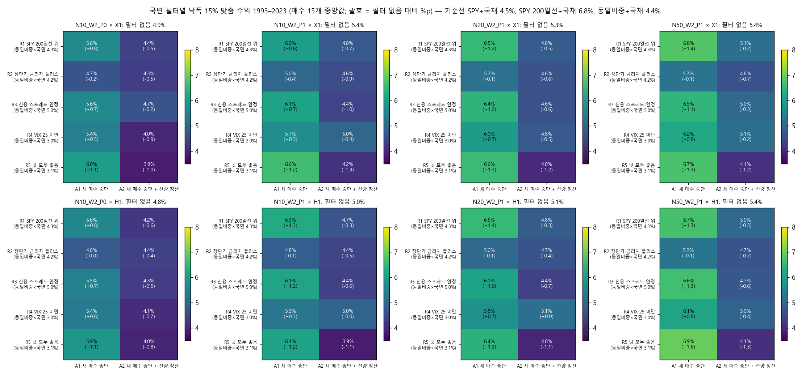
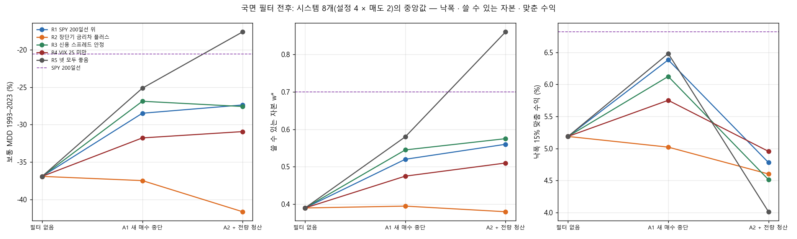
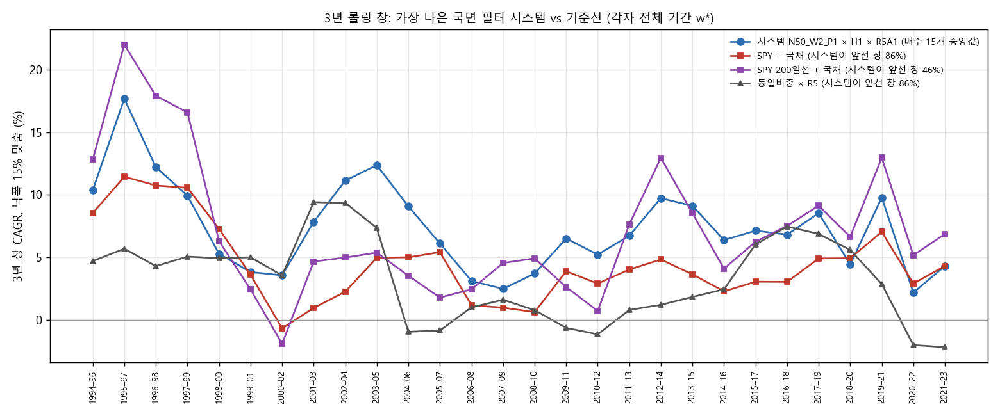
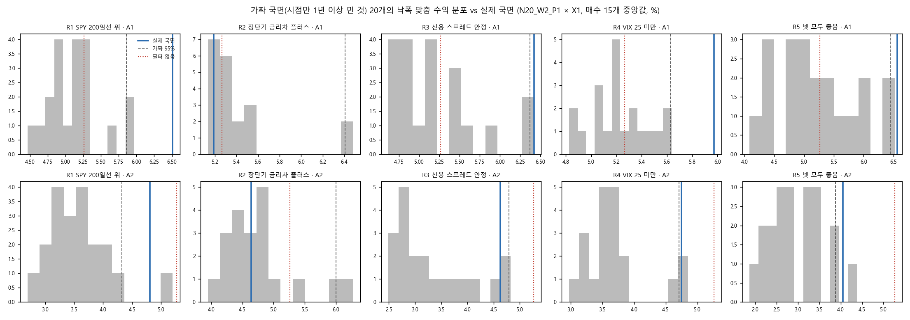
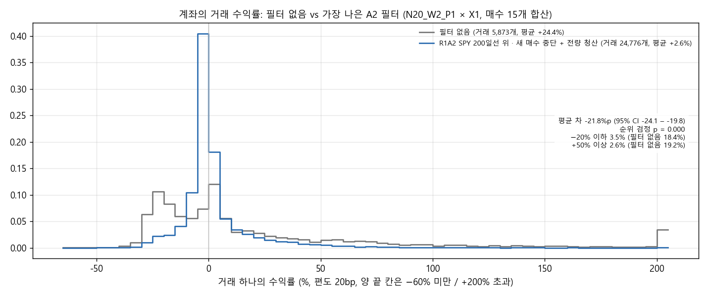
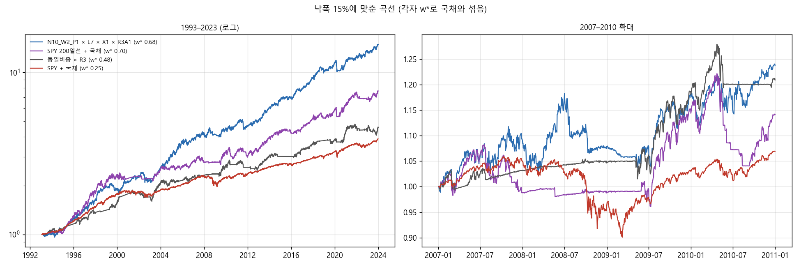

# Stage P 결과: 시장 국면 필터로 낙폭 줄이기 (결정 95)

설계는 `docs/research/lab/2026-11-02_stage_p_design.md`(결정 95, 결과 전에 등록)입니다. 실행기는 `lab/regime_study.py`(커밋 969ed5f)입니다. 2026-11-02 23:52 – 11-03 00:13 KST에 밤 전체 CPU로 돌렸습니다(작업 18개 동시, 21분).

## 왜 했는지

Stage O에서 사용자 목표(레버리지 없이 최악 낙폭 15%)로 재면, 종목 계좌는 'SPY 200일선 + 국채'(연 6.8%)에 모든 설정에서 졌습니다. 보통 수익은 종목 계좌가 더 높았지만, 낙폭이 깊어(−37 – −52%) 자본을 25–44%만 쓸 수 있었기 때문입니다. 그 낙폭은 주로 2008년과 2000–2002년에서 왔습니다.

그래서 시장 전체가 나쁜 국면에 새 매수를 멈추거나(A1) 보유까지 비우면(A2), 낙폭이 얕아져 쓸 수 있는 자본이 커지는지 봤습니다. 그 결과 '지수 + 200일선 + 국채'를 넘는지도 봤습니다.

## 핵심 결과

1. **'새 매수 중단'(A1)은 분명히 도움이 됐습니다.**
   - 시스템 8개(설정 4 × 매도 2, 매수 15개 중앙값)의 중앙값은 다음과 같습니다.

     | 필터 | 낙폭 15% 맞춤 수익 | 쓸 수 있는 자본 | 보통 MDD |
     |---|---|---|---|
     | 필터 없음 | 5.2% | 39% | −37% |
     | R1 SPY 200일선 위 | 6.4% | 52% | −28% |
     | R3 신용 스프레드 안정 | 6.1% | 55% | −27% |
     | R4 VIX 25 미만 | 5.8% | 48% | −32% |
     | R5 넷 모두 좋음 | 6.5% | 58% | −25% |

   - 2007–2009 낙폭은 −36%에서 −14 – −29%로 줄었습니다(R2 제외).
   - 시점만 1년 이상 민 가짜 국면 20개와 비교했습니다. 네 국면(R1 · R3 · R4 · R5)의 A1이 시스템 8개 중 4–7개에서 '도움' 판정을 받았습니다. 우연이면 95% 분위가 2개입니다.
   - R2(장단기 금리차)는 꺼진 날이 10%뿐이라 효과가 없었습니다(0개).
2. **'전량 청산'(A2)은 오히려 해가 됐습니다.**
   - 맞춘 수익이 4.0–5.0%로 필터 없음(5.2%)보다 낮았고, '도움' 판정은 열 칸 모두 0개입니다.
   - 낙폭은 더 얕아졌지만(R5 −18%) 수익도 함께 꺾였습니다.
     - 시장에 있던 날이 36–89%로 줄었습니다.
     - 연 매수 회전(산 비중의 합)이 필터 없음의 0.5–1.1에서 1.1–4.6으로 늘었습니다.
     - 무엇보다 계좌 거래의 평균 수익이 +24%에서 +1 – +10%로 떨어졌습니다. 이긴 거래(+50% 이상 19% → 1–9%)를 중간에 잘라 버리기 때문입니다.
   - 추세추종의 '드문 대박'이 국면 전환 때마다 끊긴 셈입니다.
3. **그래도 '목표 통과 시스템'은 없습니다.**
   - 가장 높은 시스템은 N50 · 1% 룰 · 덜 흔들리는 종목 먼저 × H1 × R5 A1이었습니다. 1993–2023 6.95%(자본 66%)로 SPY 200일선 + 국채(6.8%)를 넘었습니다.
   - 하지만 2008–2023은 5.6%로 200일선(6.6%)보다 낮았습니다.
   - 2008–2023에서 가장 높은 시스템도 5.6%였습니다.
   - 1993–2007에서는 A1 시스템의 중앙값이 7.1–7.9%로 200일선(7.1%)과 같거나 높았습니다(상위 시스템은 7.8–8.4%).
   - 1993–2023 전체는 거의 같은 수준까지 따라왔지만, 2008년 이후 반쪽에서 여전히 집니다.
   - 3년 창에서 SPY 200일선을 앞선 비율은 A1 시스템이 최대 50%였습니다(필터 없음 최대 36%).
4. **칸 하나로는 21개가 통과했지만, 후보는 없습니다.**
   - 1,200칸(필터 10 × 설정 4 × 매수 15 × 매도 2) 중 21칸이 칸 판정을 통과했습니다. 판정은 세 기간 모두 두 기준선보다 높고, 3년 창 0.5 이상, 거래 30회 이상입니다.
   - 필터별로는 R3 A1 8칸, R1 A1 5칸, R5 A1 5칸, R4 A1 2칸, R2 A2 1칸입니다.
   - 가장 높은 칸은 N10 · P1 × E7(+DI 교차) × X1 × R3 A1이었습니다.
     - 맞춘 수익 9.1%(자본 68%, 두 반쪽 10.1 / 8.2%, 2017–2023 9.5%)
     - 보통 12.2% · −22%
     - 3년 창의 79%에서 200일선을 앞섬, 40bp에서도 통과
   - 매도 2종 모두 · 40bp에서도 통과한 것은 N10 · P1 × E7 × R3 A1과 N20 · P1 × V1(하루 급등) × R3 A1 둘입니다. 둘 다 이웃 자리 수에서 같은 조건을 만족하지 못해 등록 기준(이웃 조건)에서 탈락했습니다.
5. **매수 규칙 고유의 효과는 여전히 작습니다.** 같은 필터를 건 무작위 매수 E0의 시스템 값도 필터 없음 4.9 – 5.5%에서 A1 5.4 – 7.2%로 함께 올랐습니다. 국면 필터의 이득은 매수 규칙과 상관없이 계좌 전체에 생깁니다.
6. **결론**: 시장이 나쁠 때 새 매수만 멈추면(A1), 종목 추세추종 계좌의 낙폭이 −37%에서 −25 – −28%로 줄었습니다. 사용자 목표 기준 수익은 연 1.0 – 1.3%p 올라 1993–2023 전체로는 'SPY 200일선 + 국채'와 비슷해졌습니다. 이 이득은 가짜 국면보다 확실히 컸습니다.
   - 그러나 2008–2023 반쪽에서는 여전히 연 1%p 이상 뒤졌고, 등록 기준의 시스템 · 후보는 없습니다.
   - 보유를 비우는 것(A2)은 대박을 잘라 해가 됩니다.

## 그림

**그림 1.** 설정 4 × 매도 2 = 8개 시스템마다 국면 5 × 행동 2의 낙폭 15% 맞춤 수익(1993–2023, 매수 15개 중앙값)입니다. 괄호는 필터 없음 대비 %p이고, 행 이름 옆에는 같은 국면을 건 동일비중 유니버스의 값을 적었습니다.
- 왼쪽 열(A1)은 R2를 빼고 모두 필터 없음보다 높습니다(+0.3 – +1.6%p).
- 오른쪽 열(A2)은 대부분 낮습니다.

**그림 2.** 시스템 8개의 중앙값이 필터 없음 → A1 → A2로 어떻게 움직이는지 보여 줍니다. 왼쪽부터 보통 MDD, 쓸 수 있는 자본 w*, 맞춘 수익이고, 보라 점선은 SPY 200일선입니다.
- A2는 낙폭과 w*를 더 개선하지만(R5는 −18%, w* 0.86), 맞춘 수익은 A1에서 정점을 찍고 A2에서 꺾입니다.
- R2(주황)는 거의 움직이지 않습니다.

**그림 3.** 3년 창 28개에서, 맞춘 수익이 가장 높은 필터 시스템(N50 · W2 · P1 × H1 × R5 A1)과 세 기준선을 비교했습니다. 각자 전체 기간 w*입니다.
- 시스템은 SPY + 국채를 86%, 동일비중 × R5를 86%의 창에서 앞섰습니다. SPY 200일선 + 국채는 46%에서만 앞섰습니다.
- 200일선은 1994–99년 창과 2011–21년의 여러 창(대형주 강세)에서 앞섭니다.
- 시스템은 2001–03부터 2006–08까지의 창에서 크게 앞섭니다.

**그림 4.** N20 · W2 · P1 × X1에서 국면마다 가짜 20개(같은 꺼진 날 비율, 시점만 252–5,000거래일 밀기)의 맞춘 수익 분포(회색)와 실제 국면(파랑)입니다. 검은 점선은 가짜 95%, 붉은 점선은 필터 없음입니다.
- A1(위 줄)에서 R1 · R4 · R5의 실제 값은 가짜 분포 오른쪽 끝 너머에 있습니다. R3은 가짜 최댓값과 비슷합니다.
- A2(아래 줄)는 실제 국면과 가짜 대부분이 필터 없음보다 왼쪽입니다.

**그림 5.** N20 · W2 · P1 × X1에서 계좌가 한 거래의 수익률입니다(매수 15개 합산). 필터 없음과, A2 가운데 맞춘 수익이 가장 높았던 R1 A2를 비교했습니다.
- A2는 거래가 4배로 늘고(5,873 → 24,776), 평균은 +24.4%에서 +2.6%로 떨어집니다.
- +200% 초과 칸(큰 승자)이 거의 사라집니다.

**그림 6.** 낙폭 15%에 맞춘 곡선입니다. 가장 높은 칸 하나(N10 · P1 × E7 × X1 × R3 A1, 자본 68%)를 SPY 200일선 + 국채(70%), 동일비중 × R3(48%), SPY + 국채(25%)와 함께 그렸습니다. 오른쪽은 2007–2010 확대입니다. 칸 하나는 1,200칸 중 가장 높은 것을 고른 것이라 낙관적입니다.

## 무엇을 했나

### 종목 필터링 · 매수 · 매도 · 계좌 (Stage O와 같음)

- 유니버스 · 위생 필터 · M1 제외(신호일 고유 변동성 상위 30%는 사지 않음)는 Stage N · O와 같습니다.
- 매수는 단독 15개(E1–E9, V1–V6)와 무작위 매수 E0(씨앗 5개)입니다. Stage L 신호표를 그대로 다시 썼습니다.
- 매도는 X1(25% 트레일링)과 H1(X1 + ATR(14)×3 손절)입니다.
- 설정은 4개입니다: N10 · W2 · P0(현재 계좌, 무작위 순 100번), 그리고 N10 · N20 · N50 × W2 × P1(덜 흔들리는 종목 먼저).
- 나머지는 Stage O와 같습니다: 위험 r = 10%/N, 청산 뒤 20거래일 재진입 금지, 편도 20bp, 남는 현금 단기국채, 1993-02 – 2023-12. 보류 구간은 쓰지 않았습니다.

### 국면 필터 (등록된 블록의 기본값 그대로)

| 기호 | '좋음'인 조건 | 연구 구간에서 꺼진 날 | 꺼진 구간 수 · 평균 길이 |
|---|---|---|---|
| R1 | SPY 종가 > 200일 이동평균 | 31% | 94번 · 26일 |
| R2 | 전일 10년 − 3개월 금리차 > 0 | 10% | 26번 · 31일 |
| R3 | 전일 Baa − 10년 스프레드 ≤ 그 200관측일 평균 | 44% | 105번 · 33일 |
| R4 | 전일 VIX < 25 | 19% | 149번 · 10일 |
| R5 | R1–R4 모두 좋음 | 64% | 118번 · 42일 |

- 국면은 날 t의 종가(매크로는 t−1 값)로 정하고 t+1 시가의 매매에 적용합니다.
- R1은 SPY의 200일 평균이 생기기 전(1993년 11월 무렵까지)에는 '나쁨'입니다. 기준선 SPY 200일선도 같은 규칙입니다.
- 행동은 두 가지입니다.
  - **A1 새 매수 중단**: 신호일에 국면이 나쁘면 그 신호는 사지 않습니다.
  - **A2 + 전량 청산**: 국면이 좋음 → 나쁨으로 바뀐 다음 거래일 시가에 보유를 모두 팝니다(`pick_study.replay_risk`의 `force_exit`). 시가가 없는 종목은 다음 시가에 팝니다.
- 재진입 금지(20거래일)는 강제 청산 뒤에도 적용했습니다.
- **가짜 국면**은 국면마다 연구 구간 안의 좋음/나쁨 날짜열을 252–5,000거래일 원형으로 민 것 20개입니다(씨앗 고정). 설정 N10 · W2 · P0(무작위 순 20번)과 N20 · W2 · P1, 매도 X1, 매수 15개에서 돌렸습니다.

### 판정 (등록대로)

- **재현**: 필터 없음 칸이 Stage O 결과표와 같아야 하고, '항상 좋음' 국면이 필터 없음과 비트 단위로 같아야 합니다.
- **Q1 도움**: 설정 × 매도 × 필터마다 매수 15개 중앙값이 다음을 모두 만족해야 합니다.
  - 필터 없음보다 1993–2023과 두 반쪽 모두 높음
  - 1993–2023 값이 같은 국면 × 행동의 가짜 20개의 95% 분위보다 높음

  가짜가 없는 설정 · 매도(P1의 N10 · N50, 그리고 매도 H1)는 N20 · W2 · P1 × X1의 가짜 분포를 씁니다. 설계에는 '다른 설정은 N20 · W2 · P1'이라고만 적혀 있어, 매도 H1에도 같은 분포를 쓴다는 세부는 실행 전에 정했습니다.
  우연 기대는 가짜 하나를 같은 판정(나머지 19개의 95% 분위)에 넣은 통과율로 구한 이항(8, p0)의 95% 분위입니다.
- **Q2 목표 통과 시스템**: Stage O와 같습니다. 같은 국면의 동일비중 × 국면(A2) 기준선을 넘는지는 따로 표시합니다.
- **Q3 후보**: P1 설정 × 매수 × 매도 × 필터가 다음을 모두 만족해야 합니다.
  - 칸 판정(세 기간 두 기준선, 3년 창 0.5 이상, 거래 30회)
  - 매도 2종 모두, 40bp에서도 2종 모두
  - 이웃 자리 수(10 ↔ 20 ↔ 50)에서 같은 매수 × 필터가 통과
- 시험 수는 +1,200(누적 약 72,974)입니다.

## 결과

### 재현 점검

- 필터 없음 128칸(설정 4 × 매수 16 × 매도 2, 3,200개 값: 보통 CAGR · MDD 5개 기간, 거래 수, w*, 맞춘 수익, 3년 창)을 비교했습니다. Stage O 결과표와 최대 차 9.7e-17로 같았습니다.
- `--dry`에서 '항상 좋음' 국면(A1 · A2)이 필터 없음과 624개 곡선 모두 차이 0이었습니다(`always_on_dry.csv`).
- 기준표를 매도 2종으로만 만들어 신호가 1개 적었습니다(E8의 H9 · ST 표에만 있는 신호). 단일 규칙은 무작위 순이 가짜 제외보다 먼저 뽑혀 결과에 영향이 없고, 재현 점검도 전 칸이 같았습니다.

### 기준선 (각자 낙폭 15%에 맞춤)

| 기준선 | w* | 1993–2023 | 1993–2007 | 2008–2023 | 2017–2023 |
|---|---|---|---|---|---|
| SPY 200일선 + 국채 | 0.70 | 6.8% | 7.1% | 6.6% | 7.9% |
| SPY + 국채 | 0.25 | 4.5% | 5.7% | 3.4% | 4.8% |
| 유니버스 동일비중 + 국채 | 0.22 | 4.4% | 6.0% | 3.0% | 3.6% |
| 동일비중 × R1 (A2) | 0.42 | 4.3% | 6.2% | 2.6% | 3.0% |
| 동일비중 × R3 | 0.48 | 5.0% | 5.8% | 4.3% | 4.6% |
| 동일비중 × R5 | 0.50 | 3.1% | 4.4% | 1.9% | 2.7% |

같은 국면을 건 동일비중은 3.0–5.0%였습니다. 세 기간 모두 이것을 넘은 시스템은 A1 40개 중 38개, A2 40개 중 13개였습니다. A1에서 못 넘은 둘은 N10 · W2 · P0 × R3입니다.

### 필터별 시스템 (8개의 중앙값)

| 필터 | 맞춘 수익 93–23 | 93–07 | 08–23 | w* | 보통 CAGR · MDD | 2000–02 낙폭 | 2007–09 낙폭 | 시장에 있던 날 | '도움' / 우연 95% |
|---|---|---|---|---|---|---|---|---|---|
| 필터 없음 | 5.2% | 6.8% | 3.7% | 0.39 | 9.2% · −37% | −23% | −36% | 100% | |
| R1 A1 | 6.4% | 7.7% | 5.0% | 0.52 | 9.4% · −28% | −12% | −24% | 96% | **7 / 2** |
| R2 A1 | 5.0% | 6.6% | 3.4% | 0.40 | 8.9% · −37% | −24% | −36% | 100% | 0 / 2 |
| R3 A1 | 6.1% | 7.7% | 4.9% | 0.55 | 9.2% · −27% | −21% | −17% | 98% | **4 / 2** |
| R4 A1 | 5.8% | 7.1% | 4.3% | 0.48 | 9.1% · −32% | −21% | −29% | 98% | **6 / 2** |
| R5 A1 | 6.5% | 7.9% | 5.2% | 0.58 | 9.1% · −25% | −11% | −14% | 94% | **5 / 2** |
| R1 A2 | 4.8% | 5.7% | 3.6% | 0.56 | 6.4% · −27% | −11% | −19% | 69% | 0 / 0 |
| R2 A2 | 4.6% | 5.7% | 3.3% | 0.38 | 7.9% · −42% | −24% | −38% | 89% | 0 / 2 |
| R3 A2 | 4.5% | 5.5% | 3.5% | 0.58 | 6.0% · −28% | −10% | −6% | 55% | 0 / 0 |
| R4 A2 | 5.0% | 6.4% | 3.2% | 0.51 | 6.9% · −31% | −15% | −25% | 81% | 0 / 0 |
| R5 A2 | 4.0% | 4.0% | 3.9% | 0.86 | 4.2% · −18% | −10% | −2% | 36% | 0 / 0 |

- A1은 보통 CAGR을 거의 줄이지 않고(9.1–9.4% vs 9.2%) 낙폭만 줄였습니다. 그래서 w*가 커져 맞춘 수익이 올랐습니다.
- A2는 낙폭을 더 줄였지만 보통 CAGR이 4–8%로 떨어졌습니다.

가장 높은 시스템 다섯 개(1993–2023 맞춘 수익)는 모두 A1입니다.
- N50 · P1 × H1 × R5 A1: 6.95% (93–07 8.4%, 08–23 5.6%, w* 0.66)
- N50 · P1 × X1 × R1 A1: 6.78% (8.3%, 5.5%)
- N50 · P1 × X1 × R5 A1: 6.72% (8.2%, 5.2%)
- N50 · P1 × H1 × R1 A1: 6.69% (8.4%, 5.3%)
- N50 · P1 × H1 × R3 A1: 6.63% (7.8%, 5.6%)

### 칸 단위 (1,200칸)

- 세 기간 모두 SPY + 국채를 이긴 칸: 680개
- SPY 200일선 + 국채를 이긴 칸: 21개(전체 기간만 이긴 칸은 92개)
- 칸 판정을 통과한 21칸은 위와 같습니다.

| 칸 | w* | 맞춘 수익 93–23 | 93–07 | 08–23 | 2017–23 | 200일선 대비 3년 창 | 보통 CAGR · MDD | 거래 | 40bp |
|---|---|---|---|---|---|---|---|---|---|
| N10 · P1 × E7 +DI 교차 × X1 × R3 A1 | 0.68 | 9.1% | 10.1% | 8.2% | 9.5% | 79% | 12.2% · −22% | 124 | 통과 |
| N20 · P1 × E7 × X1 × R3 A1 | 0.68 | 8.9% | 10.0% | 7.9% | 8.1% | 71% | 11.9% · −22% | 267 | 탈락 |
| N10 · P1 × V1 하루 급등 × H1 × R1 A1 | 0.56 | 8.8% | 10.3% | 7.4% | 8.1% | 71% | 13.8% · −26% | 181 | 탈락 |
| N10 · P1 × E7 × H1 × R3 A1 | 0.63 | 8.2% | 9.5% | 7.1% | 8.1% | 79% | 11.6% · −23% | 222 | 통과 |
| N20 · P1 × V2 5일 급등 × X1 × R5 A1 | 0.64 | 8.2% | 9.3% | 7.1% | 7.8% | 64% | 11.4% · −23% | 241 | 탈락 |

- 매도 2종 · 40bp까지 통과한 것은 'N10 · P1 × E7 × R3 A1'과 'N20 · P1 × V1 × R3 A1'입니다.
  - 앞의 것은 이웃 N20에서 매도 1종(X1)만 통과했고, 그것도 40bp에서 탈락했습니다.
  - 뒤의 것은 이웃 N10에서 매도 1종만, N50에서는 0종이 통과했습니다.
  - 그래서 후보는 0개입니다.
- 무작위 매수 E0의 씨앗별로 같은 칸 판정을 하면 통과율 p0가 설정 × 매도 × 필터마다 0–0.4였습니다. 씨앗이 5개뿐이라 이 우연 기준은 매우 거칩니다.

### 신호 · 거래 단위 (`trades_stats.csv`, N20 · W2 · P1 × X1, 매수 15개 합산)

| 필터 | 거래 수 | 평균 수익 (필터 없음 +24.4%) | 평균 차 95% CI | −20% 이하 (18.4%) | +50% 이상 (19.2%) |
|---|---|---|---|---|---|
| R1 A1 | 4,719 | +29.2% | +1.7 – +8.1%p | 17.2% | 20.9% |
| R3 A1 | 4,508 | +29.2% | +1.3 – +8.2%p | 16.6% | 21.1% |
| R4 A1 | 5,206 | +25.5% | −1.8 – +4.1%p | 17.3% | 19.9% |
| R5 A1 | 3,605 | +33.5% | +5.7 – +12.4%p | 13.9% | 24.2% |
| R2 A1 | 5,671 | +24.1% | −3.1 – +2.4%p | 19.6% | 19.5% |
| A2 (다섯 국면) | 11,920 – 35,467 | +0.9 – +10.2% | −14 – −24%p | 1.3 – 12.6% | 0.7 – 9.2% |

- A1은 거래 평균을 높이고 큰 손실 비율을 조금 줄였습니다. A2는 큰 승자를 잘랐습니다.
- **다만 이 검정은 국면의 정보를 가려내지 못합니다.** 가짜 국면에서도 같은 검정의 p < 0.05 비율이 높았습니다.
  - A1 가짜: R4 5%, R2 15%, R1 35%, R3 50%, R5 70%
  - A2 가짜: 85–100%

  거래를 빼거나 끊는 것만으로도 분포가 기계적으로 바뀌기 때문입니다. 국면의 정보는 계좌 단위의 가짜 비교(Q1)로만 판단했습니다.
- **A1이 막은 신호와 산 신호**(신호표의 신호 수익률, X1)를 비교하면, 막힌 신호가 늘 나쁜 것은 아니었습니다.
  - R1(SPY 200일선 아래)과 R4(VIX 25 이상)에서 막힌 신호의 평균은 +21.1% · +24.3%로, 산 신호(+17.2% · +17.0%)보다 오히려 높았습니다.
  - 대신 −20% 이하 손실 비율도 높았습니다(R1 24.6% vs 21.5%).
  - R2(금리차 역전)에서 막힌 신호는 평균 +0.5%(산 신호 +20.5%), R3 · R5는 16.1 · 17.0%(19.4 · 19.5%)였습니다.
  - 계좌의 이득은 '더 좋은 신호를 고른 것'보다 '손실이 한꺼번에 몰리는 시기를 피한 것'에서 온 것으로 보입니다. 이것은 해석입니다.

## 한계

- 국면 필터의 이득은 2000–2002년과 2008년의 몇 번의 사건에서 주로 나옵니다. 가짜 국면 비교와 두 반쪽 조건이 검정을 대신하지만, 독립 사건이 두셋뿐입니다.
- R1(SPY 200일선)은 기준선 SPY 200일선의 규칙 그 자체입니다. R1 A1 시스템이 200일선과 비슷해졌다는 것은 '같은 신호등 위에서 종목 계좌가 지수 보유와 비슷해졌다'는 뜻입니다.
- 국면 기준값은 등록된 기본값이고 바꾸지 않았습니다. 다른 값이면 결과가 달라질 수 있습니다.
- 설정 4개와 매도 2종은 Stage O를 보고 고른 사후 선택입니다. M1 제외도 사후입니다. w*는 표본 안 전체 기간에서 맞췄습니다(기준선도 같은 방식).
- 가짜 국면은 두 설정 × X1에서만 돌렸고, 나머지 설정과 매도 H1은 N20 · W2 · P1 × X1의 분포로 근사했습니다.
- 동일비중 × 국면 기준선은 종가 → 다음 날 수익으로 근사했고, 전환일에 편도 20bp를 뺐습니다.
- 거래 · 신호 단위 검정은 가짜에서도 p가 작아 보정되지 않습니다. 보고만 합니다.
- 칸들은 서로 독립이 아닙니다.
- 보류 구간(2024년 이후)은 쓰지 않았습니다.

## 남은 판단

- 시장 국면에 '새 매수만 멈추는' 규칙(A1)은 등록 기준으로 가짜보다 확실히 도움이 됐습니다. 네 국면 모두 그랬고, 특히 R1 · R5가 컸습니다. 이것을 종목 계좌의 규칙으로 쓸지는 사용자가 정합니다. 결과를 본 뒤의 선택이고 국면 기준값은 등록값 그대로입니다.
- 이 규칙을 넣어도 2008–2023 반쪽에서 'SPY 200일선 + 국채'에 연 1%p 이상 뒤집니다. 그래서 등록 기준의 목표 통과 시스템 · 후보는 없습니다. 기준(15%, 두 반쪽, 두 기준선)은 낮추지 않습니다.
- 칸 하나(N10 · P1 × E7 × X1 × R3 A1, 맞춘 수익 9.1%, 2017–2023 9.5%)는 두 반쪽 · 3년 창 · 40bp를 모두 넘었습니다. 하지만 이웃 조건에서 탈락했고, 1,200칸 가운데 가장 좋은 하나입니다. 보류 구간으로 확인하려면 사용자가 지정해야 합니다(새 결정으로 등록).
- 전량 청산(A2)은 쓰지 않는 것이 맞습니다. 대박을 끊습니다.
- 집계표는 `docs/research/lab/2026-11-02_stage_p/`에 있습니다.
  - `systems.csv`: 설정 × 매도 × 필터
  - `helps.csv`: Q1 판정
  - `cells.csv.gz`: 칸 판정
  - `candidates.csv`
  - `chance.csv`
  - `placebo.csv.gz`: 가짜 국면 시스템 값
  - `benchmarks.csv`: 동일비중 × 국면 포함
  - `regimes.csv`: 꺼진 날 비율
  - `crises.csv`
  - `trades_stats.csv`
  - `goal.csv.gz`: 모든 칸
  - `windows.csv.gz`
  - `repro.csv.gz`
  - `always_on_dry.csv`
  - `chance.json`

  작업별 원자료(산 거래, 신호)는 드라이브 `CRSP/lab_crsp/stage_p_regime`에 있습니다.
